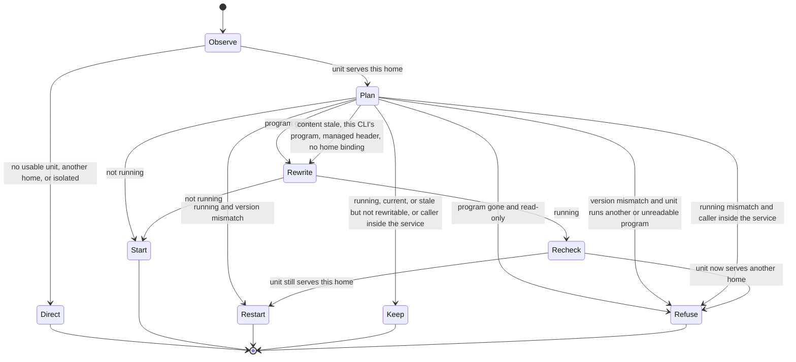

## Behavior

`hack daemon start` and `hack daemon restart` now bring an installed hackd login service up to the running CLI, so most upgrades no longer need a manual `hack daemon install`.

- **systemd (Linux), version mismatch:** when the unit runs this CLI's executable (the same path, or a path that resolves to the same file by realpath or device/inode) and a running hackd reports another version, start restarts the service with `systemctl --user restart`. It first makes the loaded-file, program and stop-hook checks that `stop` makes.
- **systemd, stale content:** start rewrites a stale unit only when all three hold:
  - it runs this CLI's executable;
  - its main file starts with Hack's managed header (`# Managed by hack: written by \`hack daemon install\`...`), the owner policy;
  - its main file does not bind the service to a Hack home that the renderer would drop (`HACK_HOME` or `HOME` in `Environment=`, or any `EnvironmentFile=`).

  The rewrite keeps the program path as written, so a symlink stays a symlink, and keeps the unit enabled or disabled as it was. It uses `install`'s program, `PATH` and unit-directory checks. When hackd is running, the unit's effective home is read again after the `daemon-reload` and before the restart.
- **Hand-written units:** a unit without the header keeps the HACK-2052 behaviour. Start reports the drift with `hack daemon install` as the next step and does not rewrite it.
- **Never from inside the service:** before any rewrite or restart of a running service, start checks whether it runs inside that service.
  - Linux compares `/proc/self/cgroup` with the unit's `ControlGroup`, read through the fakeable runner.
  - macOS checks whether the launchd job's pid is one of its ancestors.
  - From inside, a compatible daemon is kept (exit 0, action `none`, `blocked: "inside-service"`) and a mismatched daemon is refused (exit 1). Nothing is stopped. If the check cannot be made, the caller counts as inside.
- **Refusals kept:** a unit for another existing `hack`, an unreadable `ExecStart`, another Hack home, an isolated `HACK_HOME` without the opt-in, `HACK_SYSTEMD_DISABLE`, and `HACK_DAEMON_SERVICE_READ_ONLY` (which never writes or reloads).
- **launchd (macOS):**
  - The program is read as launchd does: `Program` wins over `ProgramArguments[0]`. A plist whose program cannot be read (not a property list, a repeated key, a non-string value, an XML escape, a relative path) is `"unknown-program"` and never replaced automatically.
  - Only an established absence is retargeted: no program at all, a path that does not exist, or a compiled-binary virtual path (`/$bunfs`).
  - A refresh that fails (unload, write or load) is an error (exit 1, `E_DAEMON_SERVICE`), never "already running".
  - A stopped service whose plist runs another existing or unreadable program is not kickstarted, and `hack daemon restart` refuses before stopping anything. Earlier Hack retargeted such a plist instead; the next step is `hack daemon install`.
  - A plist that runs another existing `hack` is left alone (`"other-program"`), and a mismatched daemon under it is refused with `hack daemon install`.
  - A plist that runs this CLI's executable (same file) is refreshed, gaining the new managed marker comment, when it is Hack's. That means it carries the marker or its `Label` is Hack's (`dance.hack.hackd`), so plists written by earlier Hack versions (no marker) are refreshed on upgrade. It is only ever read at Hack's own LaunchAgents path. The older unbounded-output repair is kept. A plist with neither the marker nor Hack's label is reported as `"unmanaged"`. launchd has no drop-ins, so the systemd header rule does not apply.
- **`hack update`:** after a successful install, the update checks that a login service is installed and that this home's hackd answers on its socket. A live pid alone does not count. It then runs the **new** executable's `hack daemon start --json` with `HACK_DAEMON_RECONCILE_ONLY=1`. In that mode, start returns action `none` when no hackd of this home runs, so a daemon that stopped in the meantime is never started. The step is best effort: observation, run and parsing all report failures in the update result as `daemon` (with `next_step: "hack daemon install"`) and never fail the update.
- **Shared logic:** the pure decision is `planDaemonReconcile` in `src/daemon/reconcile.ts`. Its inputs are `unit`, `programIsOurs`, `readOnly`, `running`, `restartPending`, `contentBlock`, `invokerInsideService` and `cliVersion`; it returns `rewrite`, `service`, `reasons` and `blocked`.



## JSON contract (`--json` on `daemon start|stop|restart|install`)

Only the envelope goes to stdout; human lines go to stderr. Exit codes are unchanged, and `start --foreground --json` is `E_USAGE`.

These commands follow the shared envelope rule from #835 (`docs/reference/machine-readable-output.md`): exactly `ok` and `data` at the top level, with the versioned schema inside `data`. They are `schema-envelope` in the JSON command inventory (`src/cli/json-contracts.ts`), and their schemas `hack.daemon-start.v1`, `hack.daemon-stop.v1`, `hack.daemon-restart.v1` and `hack.daemon-install.v1` are registered in `MACHINE_SCHEMAS`.

```json
{ "ok": true, "data": {
  "schema": "hack.daemon-start.v1",
  "manager": "systemd",
  "action": "reinstalled",
  "stale": true,
  "stale_reasons": ["content"],
  "blocked": null,
  "cli_version": "4.3.0",
  "daemon": { "running": true, "pid": 1234, "version": "4.3.0", "compatible": true }
} }
```

- `manager`: `systemd | launchd | none`
- `action`: `none | started | restarted | reinstalled | stopped | installed`
- `stale_reasons`: `content | program-missing | version-mismatch`
- `blocked`: `null | read-only | other-program | unknown-program | unmanaged | home-binding | inside-service | unproven-owner | rewrite-refused | service-pending | untrusted-unit`
- `fallback`: `null | direct` (a replaced daemon was started directly because the service could not start it)
- Failure: `{ "ok": false, "error": { "code": "E_DAEMON_SERVICE", "message": <last warning/error printed>, "detail": <same data> } }`. Access refusals keep `E_PERMISSION`.
- `E_DAEMON_SERVICE` is a new registry code, and the generated `hack-diagnose` reference is regenerated.

## Review round 31 fixes (commit 13a480926)

1. Explicit PATH.
   - Automatic starts (kickstart, reload, bootstrap) now require the checked plist to set its own `PATH`. launchd's default or inherited PATH is never assumed, and the default-PATH fallback is gone.
   - `loadedJobMatchesPlist` requires that same explicit `PATH` in the loaded job's own environment, so a job without its own PATH never matches.
   - Hack has always rendered `PATH` and the exact command: the first launchd renderer already did. A Hack plist without them is refreshed by the normal checked repair, which writes both. Any other such plist is refused with `rewrite-refused` and the `hack daemon install` step.
2. Exact command, checked before any unload or bootstrap.
   - `checkLaunchdJobBeforeStart` now validates the plist's complete `ProgramArguments` as exactly `<program> daemon start --foreground`, with `Program` taking precedence as launchd does.
   - It runs before any unload, bootstrap or kickstart, so a reload under `RunAtLoad` or `KeepAlive` cannot run custom arguments. The new `parseLaunchdPlistCommand` reads the full argument vector.
3. Availability (owner decision).
   - Reload eligibility is read fresh, right before the bootout, through an `isRunning` callback. A job that started running meanwhile is not booted out, and an unreadable status counts as running.
   - After a successful reload of the fully checked plist, an unparseable re-read is accepted and the kickstart proceeds. A positive mismatch still refuses.
   - Before any reload, an unreadable loaded job on a running service still refuses.
   - `docs/architecture.md` documents real `launchctl print` parsing as an unverified compatibility point, with this as the fallback.
- Tests:
  - no own PATH, extra arguments, or a `Program` that differs from the first argument: each refused before anything changes, with start unloading, reloading and kickstarting nothing;
  - autostart with a custom-argument plist on a stopped job with a stale loaded configuration gives no reload and no kickstart;
  - a Hack plist without PATH is refreshed and gains one;
  - an unknown re-read after our reload kickstarts; a mismatched re-read after a reload refuses; a job that became running between the check and the reload is not booted out.
  The argument, PATH and fresh-running checks each fail their tests when disabled.

## Review round 30 fixes (commit 6792a6169)

1. A kickstart runs the configuration launchd has loaded, not the plist on disk. A loaded job could keep an unsafe PATH or program after the plist was checked.
   - The new `src/daemon/launchd-print.ts` (`parseLaunchdPrintJob`) reads the loaded job strictly from `launchctl print gui/<uid>/dance.hack.hackd`: `program`, the `arguments` list and the job's own `environment` PATH (not the inherited or default environment). Anything malformed, repeated or unbalanced is `unknown`.
   - `verifyLaunchdJobBeforeKickstart` (`src/daemon/launchd.ts`) runs before every automatic kickstart: start, restart, the post-update reconcile, a stopped-service start and autostart. It checks the plist on disk, then requires the loaded job to run exactly that plist: the same program, Hack's arguments and the same PATH.
   - When the loaded job differs, or can't be read: a stopped job is reloaded (bootout plus bootstrap) from the checked plist and read again; a running job is refused with `rewrite-refused`, because a reload would stop hackd. An unverified loaded configuration is never kickstarted.
   - The check before a running daemon is stopped refuses a loaded job it can't read.
2. An implicit install (autostart with no plist yet) bootstrapped before the program was checked.
   - `installLaunchdService` now runs `checkServiceExecutableTrusted` on the program it writes before any unload, write or bootstrap (`unsafeProgram`). Every caller shares it: explicit install, the implicit autostart install, refresh and retarget.
   - Durability is not required at install, so a normal first install from any trusted location still works. A retarget still requires durability through `checkLaunchdRetargetTarget`.
- Tests:
  - parser (`tests/launchd-print.test.ts`): real-looking `launchctl print` output with inherited, default and job environments and nested event triggers; the strict refusals;
  - a safe plist with an unsafe loaded PATH: a running job is neither reloaded nor kickstarted; a stopped job is reloaded and, if launchd still reports the unsafe configuration, not kickstarted; an unreadable loaded job likewise; a reload that fixes it starts; the pre-stop check refuses an unreadable loaded job;
  - an explicit install and autostart's implicit install of a `hack` in a group-writable directory: no bootstrap.
  Each fails with its fix disabled.
- The stub `launchctl print` now emits a service block. The autostart positive control has a matching loaded job, and expects the extra `print` that reads it.

## Merge of next at 34b50534e (merge commit 240dd08d1)

- Brings in #802 (Rust lifecycle supervisor), #860 (read-only update check) and #818 (desktop Env tab).
- `src/lib/machine-output.ts` and `src/cli/json-contracts.ts` conflicted: both sides added schemas and variants. Kept #860's `updateCheck` / `update --check --observe` and this PR's four daemon command schemas.
- `src/commands/update.ts` conflicted. Kept both #860's `observeUpdate` / `handleObserve` and this PR's post-update reconcile.
- The update check stays read-only: `--observe` returns at the top of the handler, and plain `--check` returns before the install. `reconcileDaemonAfterUpdate` runs only after a real install. #860's `tests/update-observe.test.ts` runs the real CLI with `--check --json --observe` and asserts that nothing is spawned, which would fail if the reconcile ran.
- Generated files were regenerated and matched the merge: the CLI reference, the machine-output table (now with both the daemon and `update --check --observe` rows) and the error-code reference (`E_DAEMON_SERVICE` kept). `docs/reference/v5-model-coverage.md` is hand-written, this PR does not touch it, and it is identical to next's.

## Codex security finding: check the program and PATH before every automatic start (commit 8610528e9)

- With a current plist, an incompatible daemon's replacement skipped the program and PATH checks. So the post-update reconcile stopped the old daemon and kickstarted launchd, and hackd ran bare `docker` through a PATH directory another account could write.
- `checkLaunchdJobBeforeStart` (`src/daemon/launchd.ts`) checks the plist launchd will start:
  - its program, with `checkServiceExecutableTrusted`;
  - every directory of the PATH it gives hackd (its own `PATH`, or launchd's default when it sets none), with `checkServicePathDirectories`;
  - an unreadable program or PATH is refused.
- It runs as the last step before every automatic kickstart:
  - `start`, `restart`, the post-update reconcile and a stopped-service start, through `startViaLaunchdIfLoaded`;
  - autostart (`ensureLaunchdDaemonReady`), which then falls back to `hack daemon start` and gets the same refusal.
  A refusal kickstarts nothing, with `blocked: "rewrite-refused"` and the `hack daemon install` step.
- The check before a running daemon is stopped makes the same check for a current plist (`start-refused`, reported as `rewrite-refused`), so nothing is stopped for a start that would be refused.
- systemd:
  - a stopped-service start already ran `checkSystemdLoadedUnitPaths` (loaded programs and effective PATH) right before `systemctl start`;
  - an automatic restart's last check (`refuseUntrustedProgramLast`) now covers the effective PATH too.
- Tests:
  - a current plist with an unsafe PATH, in-process: an incompatible running daemon is refused before any stop; restart's check before its stop refuses; a stopped service is not kickstarted; with the PATH made safe again, the stopped service starts;
  - autostart with an unsafe plist PATH: no kickstart, and it falls back to `hack daemon start`;
  - systemd: a service PATH directory that becomes writable during the final proof gives no restart.
  Each fails with its check disabled.
- The autostart positive control and two in-process tests now use a real plist whose program and PATH are the test's own. The full focused set passed with the host's system directories simulated as unsafe, so no test depends on the host.

## Codex security finding: check the launchd PATH (commit 7b3fe8a5f)

- A launchd refresh rewrote and reloaded the job after checking only the `hack` executable. hackd runs helpers such as `docker` by bare name through the plist's PATH, so a PATH directory another account can write gave code execution as this user.
- `installLaunchdService` (`src/daemon/launchd.ts`) now checks every directory of the PATH the rendered plist gives hackd before it unloads or writes anything. Those directories are `/usr/local/bin`, `/opt/homebrew/bin`, `/usr/bin`, `/bin`, `~/.bun/bin` and `~/.hack/bin`. The check is `checkLaunchdServicePath`, which uses systemd's `checkServicePathDirectories` with no administrator-directory exception. A failure is reported as `unsafePath`.
- Explicit install: before this change, `hack daemon install` on macOS had no PATH check. It now refuses an unsafe PATH the same way, so explicit install and the automatic rewrite agree.
- Automatic refresh and retarget: an unsafe PATH maps to `refresh-refused` or `retarget-refused` (`blocked: "rewrite-refused"`, `hack daemon install` step). Nothing is written, unloaded or loaded.
- The check before a running daemon is stopped (`rewriteTargetIsFit`) makes the program and PATH checks for a refresh or retarget the start would run.
- The rendered PATH is built from one list (`renderedLaunchdPathDirectories`). The system directories have a test-only in-process seam, as systemd's do (HACK-2142). The test driver points it at a fixture directory, so CI runner images with writable system directories don't decide these tests.
- Tests (through the macOS driver):
  - a refresh whose PATH has a group-writable directory gives `refresh-refused`, no bootout or bootstrap, and an unchanged plist;
  - a retarget whose `~/.hack/bin` is world-writable gives `retarget-refused`, with nothing changed;
  - a refresh with a safe PATH still refreshes;
  - an explicit install with an unsafe PATH gives `unsafePath` and no bootstrap.
  The three refusal tests fail with the check disabled.
- I ran the 27-file focused set with the check failing whenever the seam is not set, simulating an unsafe host. Only one in-process test depended on the host's directories, and it now uses the seam.

## Review round 27 fix (commit 080a7853b)

- The last check before an automatic systemd restart validated only the main file's program. A retained drop-in can run another pathname for the same file (a hard link, for example), which passes the identity and earlier trust checks. If that path became replaceable during the final ownership proof, the restart still went through it.
- `refuseUntrustedProgramLast` (`src/commands/daemon-systemd.ts`) now reads the single loaded `ExecStart` (`readSystemdLoadedProgram`). It runs `checkServiceExecutableTrusted` on that exact pathname, symlinks and every directory above it included, as well as on the main file's program.
- It fails closed. A loaded program that cannot be read, or is not exactly one entry, gives `blocked: "unproven-owner"`. An untrusted one gives `rewrite-refused`. Either way nothing is restarted.
- Tests:
  - a drop-in alias (another path, same inode as the CLI) whose directory becomes group-writable during the final proof is not restarted; with the directory safe, the same restart goes on;
  - two loaded `ExecStart` entries at the last check are not restarted (`unproven-owner`).
  Both fail with the fix disabled.

## Codex security finding: check the kept program before every automatic rewrite (commit 26d9fbdc8)

- On macOS, a content refresh of a stale plist kept the plist's program after same-file checks only. The full target checks ran only for a missing-program retarget, and `isSameExecutableFile` accepted equal path strings. Someone able to replace that pathname would have launchd boot out the safe daemon and bootstrap their program as this user.
- `repairLaunchdProgramIfInvalid` (`src/daemon/launchd.ts`) now runs `checkLaunchdRetargetTarget` on the program the rewritten plist will run, for a refresh and a retarget alike, as its last step before the write, bootout and bootstrap. That check rejects a source file or bun script, requires a durable location, and runs `checkServiceExecutableTrusted` along the whole path.
- A refused refresh returns the new result `refresh-refused`, reported as `blocked: "rewrite-refused"` with the `hack daemon install` step. Nothing is written, unloaded or loaded.
- The check before a running daemon is stopped (`refreshBlocksReplacement`) refuses a refresh the start would run for an unfit program, so nothing is stopped.
- `isSameExecutableFile` always resolves both paths and compares device and inode. Equal strings never short-circuit.
- systemd: the content rewrite already checks the kept program (`checkServiceExecutableTrusted` plus the service PATH) inside `rewriteUnitForPlan`, right before `installSystemdUnit`. An automatic restart now checks the unit's program once more as its very last step, after the ownership proof and loaded-program read (`refuseUntrustedProgramLast`, `blocked: "rewrite-refused"`).
- Tests:
  - a refresh whose kept program's directory is group-writable gives `refresh-refused`, no bootout or bootstrap, and an unchanged plist;
  - equal path strings with a different device or inode are not the same file, and a missing path is not the same file as itself;
  - a restart whose program directory becomes group-writable during the final ownership proof gives no restart and `rewrite-refused`.
  Each fails with its fix disabled. The launchd fixture's temp-dir `hack` now counts as durable by default through the existing driver seam; the temporary-location test opts out.

## Merge of next at 345dc0d11, with the #835 envelope rule (merge commit af7957de4)

- Conflict: only the generated `plugins/hack/skills/hack-diagnose/references/error-codes.md` (content revision line). It was regenerated with `bun run generate:agent-plugins`: next's rows plus `E_DAEMON_SERVICE`.
- Envelope decision: this PR's output already had #835's shape. Both have exactly `ok` and `data`, the schema inside `data`, and `{ok:false,error:{code,message,detail}}` on failure. The four commands are recorded as `schema-envelope`, and their schemas are added to `MACHINE_SCHEMAS` and `SCHEMA_JSON_VARIANTS`.
- The one visible change: the schema id moves from `hack.daemon-<command>/v1` to the registry's dotted form `hack.daemon-<command>.v1`. `buildDaemonCommandData` takes it from the registry (`DAEMON_COMMAND_SCHEMAS`), and the post-update parser checks the same constant. Fields, enums, error code and exit codes are unchanged.
- Regenerated `docs/reference/machine-readable-output.md`, which now has four daemon rows. The CLI reference had no diff. `docs/architecture.md` links the shared rule, and the command contracts use the new ids.

## Review round 24 fix (commit effa1dc54)

- `startViaSystemdIfInstalled` refused an untrusted main unit (another account's, writable by others, or a link) before reaching the trust gate, and did not record why, so `daemon start --json` reported `blocked: null`. Both refusals now record `manager: "systemd"`, `action: "none"` and `blocked: "untrusted-unit"` through one helper (`recordUntrustedUnit`). The early message ends with the `hack daemon install` step.
- The early check is still only the unit-file check, ahead of the home check, so another home's unit is handled as before.
- New test: a stopped start with an untrusted main unit (another uid, then a symlinked unit) gives JSON data with `manager: systemd`, `action: none`, `blocked: untrusted-unit`, no systemctl mutations, and the file unchanged. It fails without the fix. The round-11 test that pinned an empty trace for this refusal now expects the recorded reason, and still checks that systemd was not asked to start.

## Codex security finding: unit trust before any change (commit 01b83fd83)

- On the running path, a unit naming a missing program reached the retarget before the trust check. The retarget keeps every other directive and rewrites the file as this user, so the check after it passed for text another account planted (for example a `Wants=` of its own unit), and the restart then ran it.
- New `checkSystemdUnitTrustedBeforeChange` (`src/daemon/systemd.ts`) runs the checks install and enable use: `checkSystemdUnitTrusted` (unit file owner, mode and no link, the directories above it, drop-in directories), every user-unit load directory, and the loaded fragment and drop-ins that a rewrite keeps. It does not judge the loaded program, because a retarget replaces a missing one and the check just before the restart judges what is loaded then.
- It runs before the unit is read to keep its directives, rewritten, retargeted or reloaded, and before the restart:
  - on the running path, before the restart marker, rewrite, pending reload and restart;
  - on the stopped start, before a rewrite or a pending reload;
  - in `refuseSystemdStartBeforeReplacing`, so a running daemon is never stopped for an untrusted unit.
- A failure writes, reloads, stops and restarts nothing. It refuses with the new closed blocked reason `untrusted-unit` and `hack daemon install` as the next step. The reason is added to the enum, `docs/architecture.md` and the command contracts. The preflight's existing unit-file trust refusal now reports `untrusted-unit` instead of `unproven-owner`.
- Managed-header rule unchanged.
- Tests (`tests/daemon-systemd.test.ts`), each with a missing program and a planted `Wants=`:
  - running daemon, unit file owned by another uid (modelled with the `trustUid` seam): no write, no systemctl mutation, no marker, `untrusted-unit`; the trusted control retargets and reloads;
  - running daemon, group-writable user-unit load directory: the same;
  - stopped start, group-writable load directory: no write, no reload, `untrusted-unit`;
  - pre-stop preflight, foreign uid and group-writable load directory: `untrusted-unit` with the install step, no mutations.
  The CLI test for a world-writable unit under `daemon restart` now expects `untrusted-unit`; it still checks that the running daemon is not stopped.
- Mutation check: with the running-path gate disabled, both running tests fail. With the stopped-start and preflight gates disabled, those two tests fail.

## CI fix: spawn env isolation (commit 62ae3e4f4)

- The compiled-binary systemd CLI test ran `bun build` without an env, so it inherited the runner's environment and HOME. It now spawns with `privateCliEnv({ root })`, so `tests/cli-spawn-env-isolation.test.ts` passes without an allowlist entry.

## Review round 19 fix (commit 356ac414e)

- **Retarget eligibility is checked before stopping an incompatible launchd daemon.** `launchdJobBlocksReplacement` (`src/commands/daemon-launchd.ts`) is the pre-stop check shared by start's `checkRunningLaunchdDaemon` and restart's `refuseLaunchdBeforeReplacing`. When the plist's program is missing or virtual, it now applies the retarget that would follow the stop, using the same helpers as the repair:
  - the target must pass `checkLaunchdRetargetTarget`, or it refuses as `rewrite-refused`;
  - the executing CLI must be a compiled binary that is that target (`refuseRunningRewrite`, now exported from `src/daemon/launchd.ts`): `unproven-owner` from source, `other-program` for another binary.
  - It refuses before any stop, with `hack daemon install` as the next step.
- **Tests:** for an incompatible running daemon whose plist names a missing program, a source run, another compiled binary and an unfit target are each refused, with nothing repaired or kickstarted. The compiled CLI that is the target proceeds. Restart's pre-stop check refuses the source run the same way.

## Review round 17 fixes (commit 9b4b830ff)

Settled policy: a source invocation may repair a missing program on a stopped service, but nothing may unload or restart a running daemon unless the executing CLI is eligible.

1. **launchd rewrites of a running daemon are gated.** `repairLaunchdProgramIfInvalid` (`src/daemon/launchd.ts`) runs `refuseRunningRewrite` whenever hackd runs. A running daemon is one that `startViaLaunchdIfLoaded` found running and compatible (`daemonRunning`), or a job launchd reports running.
   - The rewrite needs a compiled executing CLI that is the same file as the program the plist will run.
   - Otherwise nothing is booted out, bootstrapped or kickstarted, and the daemon is kept: `unproven-owner` from source, `other-program` for another binary, with `hack daemon install` as the next step.
   - A stopped job is still repaired from any CLI.
   - Tests through the macOS test driver: from source, with a running daemon and a plist naming a missing program, nothing is booted out, bootstrapped or kickstarted and the plist is unchanged. When the executing CLI is the retarget target, the plist is repaired (bootout and bootstrap). An in-process test checks that a compatible running daemon is kickstarted only after an actual repair.
2. **The launchd retarget target is validated.** `checkLaunchdRetargetTarget` applies the systemd retarget checks.
   - It rejects a source file (`.ts`, `.js`...) and a `#!` script run by bun.
   - The target must be durable (`assessExecutableDurability`) and trusted (`checkServiceExecutableTrusted`).
   - A failure returns `retarget-refused`, and start reports `blocked: "rewrite-refused"`. The retarget now writes the validated target explicitly.
   - Tests: unit cases for a source file, a bun script, a non-durable path, and an accepted installed binary. Through the driver, a retarget to a hack in a temporary location is refused with no launchctl calls.

## Codex finding: "this CLI" is the executing binary (commit d28eddb47)

- **Ownership is judged by the executing CLI, not the `hack` on PATH.** `resolveExecutingCliPath` (`src/daemon/executing-cli.ts`) returns `process.execPath` for a compiled hack. A source invocation (`bun index.ts`) gives null, which is never eligible for an automatic restart or refresh.
- **Where it is used:**
  - systemd (`src/commands/daemon-systemd.ts`): `unitRunsExpected`, `loadedProgramIsExpected` (the early gate and the final check before restart) and `describeSystemdIncompatibleOwner`, through `resolveExecutingProgram` and a new `executingProgram` hook.
  - launchd (`src/daemon/launchd.ts`): `readLaunchdProgramState`, which drives refresh eligibility, the restart and stopped-start refusals and the running-mismatch refusal.
  - The PATH-selected `hack` remains only the install and retarget target.
- **Effect:** a newer CLI run by path, as the post-update hook runs it, no longer treats an older `hack` first on PATH as itself. A service running another program with a mismatched daemon is refused as `other-program` with a `hack daemon install` next step, without a restart.
- **Tests:**
  - The executing binary differs from the PATH-selected `hack` and the unit runs the PATH one: a mismatched daemon is refused as `other-program`, and a compatible one with a pending marker is kept as `other-program`. A source invocation (null) never restarts.
  - Unit tests: compiled vs source detection, and restart's launchd home-binding check in process.
  - The end-to-end Linux rewrite-and-restart CLI test now runs a compiled hack, because a source shim is never eligible.
  - The macOS driver pins the executing CLI for its repair cases.
  - The darwin CLI restart test runs from source, so it may be refused as `other-program` before `home-binding`; either way nothing is stopped.

## Review round 15 fix (commit 3b59c5647)

- **A pending reload is retried before the loaded program is judged.** In `reconcileRunningSystemdDaemon` (`src/commands/daemon-systemd.ts`), systemd's loaded copy is stale while `NeedDaemonReload=yes` is reported for a unit file that runs this CLI (a repair wrote it, but its `daemon-reload` failed).
  - Outside read-only mode, the early loaded-program gate no longer judges that copy.
  - The restart path retries the reload (`completeReloadBeforeRestart`, with the post-reload home recheck).
  - Then `refuseUnexpectedLoadedProgram` judges the newly loaded `ExecStart` just before the restart.
  - A later start therefore finishes a retarget whose reload failed instead of keeping the stale program forever.
- **Test, two runs:** a running daemon of this version and a unit naming a deleted program.
  - Run 1 retargets the unit; its reload fails, so there is no restart and the marker is kept.
  - Run 2 reloads first. The loaded `ExecStart` is now this CLI, so it restarts and clears the marker.

## Review round 14 fix (commit fe38f272d)

- **The loaded-executable check gates every automatic restart.** Changes are in `src/commands/daemon-systemd.ts`.
  - `gateRestartOnLoadedProgram` applies after planning, whatever asked for the restart: a pending-restart marker, a stale-content plan or a version mismatch.
    - A loaded `ExecStart` that is another hack keeps a compatible daemon (`blocked: "other-program"`), or refuses a mismatched one.
    - An unreadable one does the same with `blocked: "unproven-owner"`.
    - The restart-pending marker stays.
  - A program retarget is the one exception before the rewrite, because the loaded copy still names the missing program. `refuseUnexpectedLoadedProgram` re-reads the loaded `ExecStart` after any rewrite or reload and just before every automatic restart. A retained drop-in that still selects another program stops the restart there, with the marker kept.
- **Tests:** a compatible daemon with a pending marker and a drop-in for another executable gets no restart (`other-program`, marker kept); the same with an unreadable `ExecStart` gets `unproven-owner`. A missing main program with a retained `ExecStart` drop-in override is retargeted and reloaded, but not restarted (`other-program`, marker kept).

## Codex findings: restart ordering and loaded ExecStart (commit fa4b583cd)

- **A: restart is checked before its stop.** `restartDaemon` (`src/commands/daemon.ts`) runs `refuseRestartBeforeStop` before stopping a running hackd. On macOS that is `refuseLaunchdBeforeReplacing` (`src/commands/daemon-launchd.ts`): the loaded job must not bind another home and must be this home's. On Linux it is `refuseSystemdStartBeforeReplacing`. A refusal exits 1 with `E_DAEMON_SERVICE` and the matching `blocked` reason, and nothing is stopped. The start after the stop now passes `alreadyReplaced`, so it goes through `startReplacementDaemon` with the same idle-gated direct fallback. Tests:
  - macOS (darwin-preloaded CLI): a live process in the pid file with its socket, and a plist binding another `HACK_HOME`. `restart --json` is refused as `home-binding`; the process lives, its pid file is kept, only `launchctl print` ran, and the plist is unchanged.
  - Linux (fake `systemctl` CLI): an installed, running service whose unit file others can write. `restart --json` is refused as `unproven-owner`; the daemon lives and no stop was issued.
- **B: automatic restart follows the loaded ExecStart.** `reconcileRunningSystemdDaemon` (`src/commands/daemon-systemd.ts`) now also requires the program systemd has loaded to be this CLI's executable by file identity. That is the single loaded `ExecStart`, drop-ins included, read by `readSystemdLoadedProgram` (`src/daemon/systemd.ts`) from `systemctl --user show`. A drop-in running another `hack` keeps the daemon (`blocked: "other-program"`); an unreadable or ambiguous `ExecStart` keeps it too (`blocked: "unproven-owner"`). Tests: a drop-in `ExecStart` for another executable with stale main content and a compatible daemon gives no restart, no reload, an unchanged unit and the daemon kept; two loaded `ExecStart` entries give `unproven-owner` and no restart.

## Review round 12 fix (commit cb3aafad1)

- **The launchd idle gate is simplified (owner decision).** `readLaunchdManagerState` (`src/daemon/launchd.ts`) now always queries `launchctl print` for Hack's label, whether or not the plist file exists, since moving or deleting the file does not unload the job.
  - It is `idle` only on the confirmed not-found answer: exit 113 with "Could not find service".
  - Every loaded job, whatever its plist file says, is `unknown`, and so is every other result. That covers loaded config differing from the file, `StartInterval`, `StartCalendarInterval` and `WatchPaths`.
  - The missing-plist shortcut and the on-disk `KeepAlive`/`RunAtLoad` reading are gone; `parseLaunchdPlistRetry` and the parser's boolean value kind are removed.
  - A process that may not use launchd (isolated `HACK_HOME`, `HACK_LAUNCHD_DISABLE`) cannot query it and never started a launchd job, so it still counts as idle. This is documented in the code.
- **Tests** through the macOS test driver (new `manager-state` mode): a missing plist file while the job is still loaded is `unknown`; a loaded, stopped job whose plist on disk has no `KeepAlive` is `unknown`; launchd's confirmed not-found answer is `idle` with or without the plist file. Unit tests cover the classifier cases.

## Review round 11 fixes (commit f204a4820)

Changes to `startReplacementDaemon` (`src/commands/daemon-replace.ts`):

1. **Fall back only when the manager is positively idle.** A new `managerState` gate (`readServiceManagerState` in `src/commands/daemon.ts`) decides.
   - systemd: `readSystemdManagerState`/`classifySystemdManagerState` (`src/daemon/systemd.ts`) run `systemctl --user show --all -p LoadState,ActiveState,SubState,Job` through the runner. The manager is idle only when `ActiveState` is `inactive`/`failed`, `SubState` is not `auto-restart` and `Job` is empty, or when the unit is not loaded.
   - launchd: `readLaunchdManagerState` (`src/daemon/launchd.ts`). Superseded by round 12: idle only on launchd's confirmed not-found answer.
   - Pending or unknown returns the service error with `blocked: "service-pending"` and a message that the service may still start hackd.
2. **A rejected service start is caught** and treated like a failed one behind the same gate. If the fallback is not used or fails, the original error is rethrown.
3. **An explicit start outcome decides, not the trace.** `startStoppedDaemon` returns `{ kind: "service-refused" | "service-attempted" | "direct-attempted", exitCode, manager }`. The new `onStartRequested` hooks fire just before `systemctl start` and before the launchd reload/kickstart. An early systemd refusal with an empty trace therefore still falls back, subject to the gate.

Tests:
- A service still activating, with no pid or socket, gets no direct start: `pending` and `unknown` both give `service-pending`.
- A rejected service start falls back when idle, and rethrows when pending or when the direct start fails.
- An early refusal with an empty trace falls back.
- An untrusted unit refuses without the start hook firing and leaves the trace at `none`.
- The systemd state classifier and runner, and the launchd state for absent, failed, running, retrying, conditional and unreadable cases, are covered.
- Not verified on a real systemd: that `--all` prints an empty `Job=` when no job is queued. If it doesn't, the gate reads `unknown` and refuses (safe direction).
- On macOS a loaded Hack plist (conditional `KeepAlive`) is never idle, so the fallback does not run there while the job stays loaded.

## Review round 10 fixes (commit 9892b28ae)

Owner decision: make the guarantee structural.

1. **Retained drop-ins are checked before the stop.** When a rewrite is planned, `refuseSystemdStartBeforeReplacing` (`src/commands/daemon-systemd.ts`) also runs the effective-configuration checks the start applies after the write, on the configuration that survives it. These are `checkSystemdLoadedUnitPaths` and the new `checkSystemdEffectiveService`/`checkSystemdEffectivePath` (`src/daemon/systemd.ts`); `checkBeforeEnable` now uses the same function. A program retarget checks only the effective `PATH`, because the loaded copy still names the missing program. Test: a stale managed unit with a trusted drop-in that puts a world-writable directory on `PATH` is refused before the stop as `rewrite-refused`, with no `systemctl` mutation and the unit unchanged.
2. **A replacement never leaves hackd stopped.** `startReplacementDaemon` (`src/commands/daemon-replace.ts`, used by `startDaemon` in `src/commands/daemon.ts` on Linux and macOS):
   - After stopping a running daemon, it starts the replacement through the service. If that is refused or fails for any reason, it starts this home's hackd directly (`startDaemonDetached`).
   - It reports action `restarted`, `fallback: "direct"` and the service's `blocked` reason, and warns to run `hack daemon install`.
   - It skips the fallback when the service path was not used, or when a hackd of this home already answers (the service may still be starting one). If the direct start also fails, the service's error stands.
   - It applies in the post-update reconcile-only mode too, since that daemon was running.
   - `--json` data gains the closed `fallback` field.
   - Tests: a forced post-stop service refusal leads to a direct start and `fallback: "direct"` in the data. There is no fallback when the service start worked, is still starting, or was already direct, and a failing direct start keeps the error.
   - Limit: the fallback is tested through `startReplacementDaemon` with injected starts, not through a CLI run with a real incompatible daemon.

## Review round 9 fix (commit be501d45a)

- **The pre-stop check and the start share one non-mutating prepare step.** In `src/commands/daemon-systemd.ts`, `planStoppedStart` (the plan) and `computeUnitRewrite` (the new unit text, or why it cannot be written) are now used both by `refuseSystemdStartBeforeReplacing`, before a direct daemon is stopped, and by the start itself (`prepareSystemdUnitForStart` and `rewriteUnitForPlan`), so the two cannot drift.
  - Covered: replacement executable resolution and durability, renderability, and install's program and `PATH` checks. The missing-program retarget now runs those program and `PATH` checks too.
  - A refused rewrite is refused before the stop with the new closed reason `blocked: "rewrite-refused"`.
  - The durability warning of a content rewrite moved from the compute step to the apply step, so the check stays silent.
  - Runtime failures and changes between the check and the start remain outside the guarantee; this is documented in a code comment and in `docs/architecture.md`.
- **Tests:** a missing program with a non-durable replacement makes the check refuse as `rewrite-refused`, with no `systemctl` mutation and a byte-identical unit. The start then refuses for the same reason, and a durable replacement passes. A stale managed unit whose rendered service `PATH` includes a directory others can write is refused before the stop.

## Codex finding: decide before stopping a direct daemon (commit 0cc5af557)

- **macOS:** `checkRunningLaunchdDaemon` (`src/commands/daemon-launchd.ts`) now also checks the loaded launchd job before the caller stops this home's incompatible direct daemon (`launchdJobBlocksReplacement`). If the job's plist binds another home it refuses as `home-binding`; if the job is not proven this home's it refuses as `unproven-owner`. Exit 1, `E_DAEMON_SERVICE`, and the running daemon is left alone.
- **Linux had the same stop-then-refuse ordering.** `refuseSystemdStartBeforeReplacing` (`src/commands/daemon-systemd.ts`) runs in `handleRunningDaemonAtStart` (`src/commands/daemon.ts`) before the stop. It refuses up front when `startViaSystemdIfInstalled` would refuse afterwards: an untrusted unit, a unit whose Hack home cannot be read, a missing program in read-only mode, or loaded files or a program Hack cannot vouch for. A unit serving another home is fine: start then starts this home's hackd directly.
- **Tests:**
  - launchd: an incompatible direct daemon with a loaded job bound to another `HACK_HOME`, and one whose job is unproven, are refused without any repair or kickstart; this home's job lets the replacement go on.
  - systemd: an unreadable unit home and a read-only missing program are refused with no `systemctl` start, stop, restart, reload, enable or reset-failed calls; another home's unit and this home's usable unit let the replacement go on.
  - Limit: the stop itself is skipped because these checks return before `stopProvenDaemon` in `handleRunningDaemonAtStart`. An end-to-end run with a real incompatible daemon was not reproduced, because faking a daemon of another version that passes the identity proof isn't practical here.

## Codex finding: continued unit lines (commit d5c7d885e)

- **A home binding on a continued line no longer slips through.** systemd joins a line ending in a backslash with the next, so `Environment=FOO=1 \` followed by `HACK_HOME=...` escaped the per-line check. I chose the simpler, safe option over re-implementing systemd's line joining: `findDroppedHomeBinding` (`src/daemon/systemd.ts`) now treats any continued line in the main unit file as a home binding. The unit Hack renders has none. The automatic rewrite is refused with `blocked: "home-binding"`, and `hack daemon install` replaces the unit. Tests: a managed, stale unit carrying `HACK_HOME` on a continued line is not rewritten when stopped, and is kept when running and compatible; the unit file is byte-identical, with no reload or restart. Unit tests cover continuations of unrelated settings and trailing spaces.

## Review round 6 fix (commit e6d735501)

- **A failed launchd status query no longer counts as "not loaded".**
  - `getLaunchdServiceStatus` (`src/daemon/launchd.ts`) now records how `launchctl print` answered, as `observation: "reported" | "not-found" | "failed"`. Only exit 113 with launchd's "Could not find service" message is `not-found` (`isLaunchdServiceNotFound`); every other failure is `failed`.
  - `loaded: false` keeps its meaning for status and doctor display.
  - `proveLaunchdJobOwnership` accepts an unloaded job only when `observation` is `not-found`. A failed or missing observation is unproven: repair returns `unproven-owner` with no `bootout`, rewrite or `bootstrap`.
  - Tests through the macOS test driver: `print` fails with an unrecognized error while `bootout` would succeed, and only `print` is called, with the plist unchanged; launchd's own exit-113 answer still allows the refresh. Unit tests cover the classifier and the ownership proof.

## Codex bot findings, second batch (commit 3f5ebed22)

- **P2: reconcile-only no longer leaks into a replacement daemon.** `detachedDaemonEnvironment` (`src/daemon/spawn.ts`) drops `HACK_DAEMON_RECONCILE_ONLY` next to `HACK_DAEMON_SERVICE_READ_ONLY` for every detached hackd: the reconcile's replacement and the client autostart. A `--foreground` start also ignores the flag (`src/commands/daemon.ts`). The guard still applies to the post-update `daemon start --json` itself. Tests: the spawn environment drops both flags. A CLI test runs `daemon start --foreground` with the flag set, as a leaked replacement would; the daemon runs, and a reconcile-only `start --json` then reports `none` with the daemon running.
- **P1: launchd job ownership before an automatic refresh or retarget.** `repairLaunchdProgramIfInvalid` (`src/daemon/launchd.ts`) now refuses in two cases:
  - `home-binding`: the plist's `EnvironmentVariables` sets `HACK_HOME`, or a `HOME` other than the one Hack writes (`plistKeepsThisHome`, read with the new `parseLaunchdPlistEnvironment`);
  - `unproven-owner`: the loaded job is running and its pid is not proven this home's hackd (`proveLaunchdJobOwnership`, the `proveOwnedDaemonProcess` proof that `stop` uses). A running job without a pid also counts as unproven.
  `startViaLaunchdIfLoaded` reports these and does not kickstart such a job. Tests through the macOS test driver: a plist with another `HACK_HOME`, a plist with another `HOME`, and a running job whose pid is not this home's hackd. Each is refused with no `bootout`/`bootstrap` and an unchanged plist. Unit tests cover the home check and the job proof. The launchctl stub's job state is now configurable, so refresh tests model a loaded job that runs nothing.

## Review round 4 fixes (commit 720f51edc)

1. **The final restart proof fails closed.** `proveOwnershipBeforeRestart` (`src/commands/daemon-systemd.ts`) does a fresh state read just before the restart. It requires an available user manager and no state error. Otherwise it refuses with `blocked: "unproven-owner"` (`refuseUnobservedRestart`) and never reuses the earlier snapshot. Test: the final `systemctl show` fails while the home queries succeed; no restart.
2. **Read-only pending restarts no longer repeat.** In `planDaemonReconcile` (`src/daemon/reconcile.ts`), a pending restart no longer restarts a daemon that already runs this version under `HACK_DAEMON_SERVICE_READ_ONLY`. It stays pending and is reported (`blocked: "read-only"`, with a warning to run `hack daemon install`). A version mismatch still restarts. Test: two consecutive read-only starts with a pending reload; the first restarts the mismatched daemon, the second does not, and the marker stays.
3. **Escaped and spaced plist keys.** In `src/daemon/launchd-plist.ts`, root keys are compared exactly as written, without trimming. A root key containing an XML entity or character reference (`Progr&#97;m`) is `unknown`. Program values are not trimmed either. Tests: an escaped `Program` key pointing at another existing executable is never replaced (macOS test driver, `unknown-program`, no launchctl calls); a ` Program ` key with spaces is not treated as `Program`; an escaped `ProgramArguments` key; a value with a leading space.

## Review round 3 fixes (commit 76681cbb6)

1. **Only root-dict keys count.** `parseLaunchdPlistProgram` moved to `src/daemon/launchd-plist.ts` and is now a small structured reader. It drops comments, tracks dict and array nesting, and reads `Program`/`ProgramArguments` only from the root `<dict>`. CDATA, unterminated comments, malformed or unbalanced tags, unknown value types and repeated root keys are `unknown`. Tests: a nested `Program` in `EnvironmentVariables`, a commented-out `Program`, and both combined with a foreign top-level program. The driver tests check that these stay `other-program` with no launchctl call and an unchanged plist, plus unit cases for each unknown structure.
2. **Stat errors fail closed.** `classifyLaunchdProgramPath` (`src/daemon/launchd.ts`) reports `missing` only for `ENOENT`/`ENOTDIR`; every other error is `unknown`, which `readLaunchdProgramState` turns into `unknown-program`. `pathExists` is unchanged. Tests: injected `EACCES`, `EIO`, `ENOENT`, `ENOTDIR` and a code-less error, plus a real `EACCES` in the darwin driver (a program inside a mode-000 directory stays `unknown-program`; skipped when running as root).

## Codex bot findings (commit 8f8ad8957)

- **P1: prove ownership before an automatic restart.** `refuseUnprovenRestart` (`src/commands/daemon-systemd.ts`) runs the stop path's `checkMainProcessServesHome` + `decideUnitStop` before any change and again just before the restart. Cgroup membership of this home's pid is no longer enough. Without the proof, start exits 1 with `blocked: "unproven-owner"` and changes nothing. Tests: this home's hackd started by a job inside another home's service, and a reload that pointed `HACK_HOME` at this home while the main process serves another. In both cases there is no restart, no reload and no unit change.
- **P2: finish a pending reload before the retried restart.** When the restart plan has no rewrite but `NeedDaemonReload=yes`, `completeReloadBeforeRestart` runs `daemon-reload` and rechecks the unit's home before restarting. A failed reload returns 1 without restarting and keeps the restart-pending marker. Under read-only the marker is kept after the restart. Test: a reload failure on the repair, a rerun while it still fails (no restart, marker kept), then a rerun that reloads before it restarts and clears the marker.

## Review round 2 fixes (commit f1b08f7cc)

1. **Failed launchd refreshes no longer report success.** `startViaLaunchdIfLoaded` (`src/commands/daemon-launchd.ts`) handles `"failed"` before the `onlyIfStale` shortcut: it logs an error and returns 1. Tests cover an unload failure and a load failure after a successful unload (driver with a failing launchctl stub), and the in-process start path (no kickstart, exit 1).
2. **launchd program semantics.** `parseLaunchdPlistProgram` (`src/daemon/launchd.ts`) gives `Program` precedence, and the new `unknown` state is refused (`unknown-program`). `readLaunchdProgramState` treats only an established absence as missing. Tests cover `Program` alone pointing at another existing hack (left alone), `Program` conflicting with `ProgramArguments` (`Program` wins), an unreadable program (never replaced), and parser cases.
3. **macOS restart refuses another program.** `refuseForeignLaunchdProgram` runs in `restartDaemon` (`src/commands/daemon.ts`) before the stop. The stopped-service start path also refuses instead of kickstarting another or unreadable program. A darwin CLI test runs `daemon restart --json` against another existing executable: exit 1, `E_DAEMON_SERVICE`, `detail.blocked: "other-program"`, only `launchctl print` called, plist unchanged.
4. **Identity checks fail closed.** `readInvokerInSystemdUnit` (`src/daemon/systemd.ts`) returns unknown for a missing, empty or non-path `ControlGroup` and for an empty or malformed `/proc/self/cgroup`. `runsInsideJob` (`daemon-launchd.ts`) treats a loaded job with no usable pid as inside. Tests cover each case. The fakes now report a `ControlGroup` for a running unit, as systemd does.

## Follow-up: earlier Hack plists count as managed (commit fb1890227)

Owner decision: `isHackManagedPlist` (`src/daemon/launchd.ts`) is true for the marker **or** Hack's `Label`. An unmarked legacy plist that runs this CLI's executable is refreshed and gains the marker. An unmarked plist with another label is still `unmanaged`, and another existing program is still `other-program`. The systemd header rule is unchanged.

## Review round 1 fixes (commit 91f8e18af)

1. **The service never restarts its own caller.** Planner guard: `src/daemon/reconcile.ts` (`planDaemonReconcile`). Linux check: `readInvokerInSystemdUnit` in `src/daemon/systemd.ts`, used by `reconcileRunningSystemdDaemon` in `src/commands/daemon-systemd.ts`. macOS check: `checkRunningLaunchdDaemon` in `src/commands/daemon-launchd.ts`, built on `hasAncestorProcess` in `src/daemon/process-ancestry.ts`.
2. **The service's Hack home is kept.** `findDroppedHomeBinding` in `src/daemon/systemd.ts` and `readContentBlock` in `daemon-systemd.ts` block the rewrite. `restartReconciledUnit` reads the unit's home again after the rewrite and before the restart.
3. **launchd keeps another existing program.** `readLaunchdProgramState`, `isSameExecutableFile` and the rewritten `repairLaunchdProgramIfInvalid` in `src/daemon/launchd.ts`. The mismatch refusal is in `checkRunningLaunchdDaemon`.
4. **The update hook needs proof that hackd is running.** `observePostUpdateDaemon` in `src/commands/daemon-upgrade.ts` requires an API answer on this home's socket. The child runs with `HACK_DAEMON_RECONCILE_ONLY=1`, handled in `startDaemon` in `src/commands/daemon.ts`.
5. **Observation is best effort.** It now sits inside the try in `reconcileDaemonAfterUpdate`.
6. **Owner policy on hand-written units.** `SYSTEMD_MANAGED_HEADER` and `isHackManagedUnit` (`src/daemon/systemd.ts`), `LAUNCHD_MANAGED_MARKER` and `isHackManagedPlist` (`src/daemon/launchd.ts`). Docs and the diagram are updated.

## Docs

- `docs/architecture.md`, section "After an upgrade: a stale service is repaired by `start`": the rules, the managed-header policy, the inside-service and home-binding refusals, launchd, the update hook, the diagram and the JSON table (with `blocked`).
- v5 start-here `docs/versions/v5/upgrade.md`, `guides/upgrade-from-v4.md`, `reference/command-contracts.md` and `docs/cli.md` are updated.
- `docs/reference/cli.md` is regenerated.

## Validation

All runs used Bun 1.4.4 and `umask 022`, with tests hermetic: temp HOME, fake `systemctl`/`loginctl`/`launchctl`, darwin-preload driver.

Latest, head 13a480926 (review round 31):

- Focused tests (28 files): 510 pass, 35 skipped (macOS-only), 0 fail. `machine-output-contract` + `machine-output-success-shapes` + `sync-spawn-bound` + `bounded-spawn-sync` + `update-observe`: 121 pass, 0 fail.
- Both typechecks, `bun run check` (exit 0; no warnings in changed files), `bun run privacy:check`, `bun run docs:prepare` plus `bun run docs:check`, and `bun run build` pass. Generators: no diff.
- `bun run build:config-compiler` (throwaway zig `cc` wrapper, deleted afterwards), `bun run check:native-plan-cli` (config-compiler CLI, env plan, host 139, routing 141, endpoint 153, process 145, acquisition 198, config-import 49 checks) and `scripts/check-config-compiler-cli.ts` on its own pass.

At 6792a6169 (review round 30):

- Focused tests (28 files: the previous 27 plus `tests/launchd-print.test.ts`): 507 pass, 35 skipped (macOS-only), 0 fail.
- `machine-output-contract` + `machine-output-success-shapes` + `sync-spawn-bound` + `bounded-spawn-sync` + `update-observe`: 121 pass, 0 fail.
- Both typechecks, `bun run check` (exit 0; no warnings in changed files), `bun run privacy:check`, `bun run docs:prepare` plus `bun run docs:check`, and `bun run build` pass. Generators: no diff.
- `bun run build:config-compiler` (throwaway zig `cc` wrapper, deleted afterwards), `bun run check:native-plan-cli` (config-compiler CLI, env plan, host 139, routing 141, endpoint 153, process 145, acquisition 198, config-import 49 checks) and `scripts/check-config-compiler-cli.ts` on its own pass.

At 240dd08d1 (merge of next at 34b50534e, on top of fix 8610528e9):

- Focused tests (27 files, including `tests/cli-spawn-env-isolation.test.ts`): 501 pass, 35 skipped (macOS-only), 0 fail.
- `machine-output-contract` + `machine-output-success-shapes` + `sync-spawn-bound` + `bounded-spawn-sync` + `update-observe`: 121 pass, 0 fail.
- Both typechecks, `bun run check` (exit 0; no warnings in changed files), `bun run privacy:check`, `bun run docs:prepare` plus `bun run docs:check`, and `bun run build` pass. Generators: no diff after the merge commit.
- `bun run build:config-compiler` (throwaway zig `cc` wrapper, deleted afterwards), `bun run check:native-plan-cli` (config-compiler CLI, env plan, host 139, routing 141, endpoint 153, process 145, acquisition 198, config-import 49 checks) and `scripts/check-config-compiler-cli.ts` on its own pass.
- At 8610528e9, before the merge, the same focused set (501 pass), contract and guard tests (107 pass), typechecks, check, docs, generators and build passed. The acceptance scripts ran once, on the merged tree above.

At 7b3fe8a5f (launchd PATH check):

- Focused tests (27 files, including `tests/cli-spawn-env-isolation.test.ts`): 498 pass, 35 skipped (macOS-only), 0 fail. `machine-output-contract` + `machine-output-success-shapes` + `sync-spawn-bound` + `bounded-spawn-sync`: 107 pass, 0 fail.
- Both typechecks, `bun run check` (exit 0; no warnings in changed files), `bun run privacy:check`, `bun run docs:prepare` plus `bun run docs:check`, and `bun run build` pass. Generators: no diff.
- `bun run build:config-compiler` (throwaway zig `cc` wrapper, deleted afterwards), `bun run check:native-plan-cli` (config-compiler CLI, env plan, host 139, routing 141, endpoint 153, process 145, acquisition 198, config-import 49 checks) and `scripts/check-config-compiler-cli.ts` on its own pass.

At 080a7853b (review round 27):

- Focused tests (27 files, including `tests/cli-spawn-env-isolation.test.ts`): 494 pass, 35 skipped (macOS-only), 0 fail. `machine-output-contract` + `machine-output-success-shapes` + `sync-spawn-bound` + `bounded-spawn-sync`: 107 pass, 0 fail.
- Both typechecks, `bun run check` (exit 0; no warnings in changed files), `bun run privacy:check`, `bun run docs:prepare` plus `bun run docs:check`, and `bun run build` pass. Generators: no diff.
- The only non-test source change is in `src/commands/daemon-systemd.ts`, so the native acceptance scripts were not rerun. They last passed at 26d9fbdc8, below.

At 26d9fbdc8 (kept-program checks):

- Focused tests (27 files, including `tests/cli-spawn-env-isolation.test.ts`): 492 pass, 35 skipped (macOS-only), 0 fail. `machine-output-contract` + `machine-output-success-shapes` + `sync-spawn-bound` + `bounded-spawn-sync`: 107 pass, 0 fail.
- Both typechecks, `bun run check` (exit 0; no warnings in changed files), `bun run privacy:check`, `bun run docs:prepare` plus `bun run docs:check` pass. Generators (`generate-machine-output-reference.ts`, `generate:agent-plugins`, `docs:cli-reference`): no diff.
- `bun run build`, `bun run build:config-compiler` (throwaway zig `cc` wrapper, deleted afterwards), `bun run check:native-plan-cli` (config-compiler CLI, env plan, host 139, routing 141, endpoint 153, process 145, acquisition 198, config-import 49 checks) and `scripts/check-config-compiler-cli.ts` on its own pass.

At af7957de4 (merge of next at 345dc0d11 with the #835 envelope rule):

- `tests/machine-output-contract.test.ts` + `tests/machine-output-success-shapes.test.ts` + `tests/sync-spawn-bound.test.ts` + `tests/cli-spawn-env-isolation.test.ts`: 110 pass, 0 fail. This includes the usage-error probe for each daemon command and the generated inventory table.
- Focused tests (27 files): 489 pass, 35 skipped (macOS-only), 0 fail.
- Both typechecks, `bun run check` (exit 0; no warnings in changed files), `bun run privacy:check`, `bun run docs:prepare` plus `bun run docs:check` pass.
- Generators (`scripts/generate-machine-output-reference.ts`, `bun run generate:agent-plugins`, `bun run docs:cli-reference`) rerun after the commit: no diff.
- `bun run build`, `bun run build:config-compiler` (throwaway zig `cc` wrapper, deleted afterwards), `bun run check:native-plan-cli` (config-compiler CLI, env plan, host 139, routing 141, endpoint 153, process 145, acquisition 198, config-import 49 checks) and `scripts/check-config-compiler-cli.ts` on its own pass.

At effa1dc54 (review round 24 on top of the security fix):

- Focused tests (27 files, including `tests/cli-spawn-env-isolation.test.ts`): 489 pass, 35 skipped (macOS-only), 0 fail. `tests/sync-spawn-bound.test.ts` + `tests/bounded-spawn-sync.test.ts`: 6 pass.
- Both typechecks, `bun run check` (exit 0, no warnings in changed files), `bun run privacy:check`, `bun run docs:prepare` plus `bun run docs:check` pass. `bun run docs:cli-reference`: no diff.
- The only source change is in `src/commands/daemon-systemd.ts`, so the native acceptance scripts were not rerun. They last passed at 01b83fd83, below.

At 01b83fd83 (security fix on top of the bf74aaf08 merge):

- `tests/sync-spawn-bound.test.ts` + `tests/bounded-spawn-sync.test.ts`: 6 pass, 0 fail.
- Focused tests (27 files, including `tests/cli-spawn-env-isolation.test.ts`): 488 pass, 35 skipped (macOS-only), 0 fail.
- Both typechecks, `bun run check` (exit 0; its warnings are all in files this PR does not change; `bunx ultracite check` on the changed files is clean), `bun run privacy:check`, `bun run docs:prepare` plus `bun run docs:check` pass. `bun run docs:cli-reference` and `bun run generate:agent-plugins`: no diff.
- `bun run build`, `bun run build:config-compiler` (zig `cc` wrapper, deleted afterwards), `bun run check:native-plan-cli` (config-compiler CLI, env plan, host 139, routing 141, endpoint 153, process 145, acquisition 198, config-import 49 checks) and `scripts/check-config-compiler-cli.ts` on its own pass.

Latest, after merging `next` at bf74aaf08 (merge commit 172559e2a; head c15779cd3):

- Merge: no conflicts. The generated `plugins/hack/skills/hack-diagnose/references/error-codes.md` merged cleanly, and `bun run generate:agent-plugins` reproduces it unchanged, with `E_DAEMON_SERVICE`. (The earlier merge of e47681ea0 in 1dd298b5e conflicted only on that file's content revision line and was resolved by regenerating it.)
- Bounded spawns (#857): `compileHack` in `tests/daemon-systemd-cli.test.ts` now uses `spawnSyncBounded` with a 60 s bound, below the test's 90 s timeout. This PR adds no other synchronous spawn. Its two long-lived async children (a foreground daemon and a `sleep` holder) stay on `Bun.spawn`; their tests kill them and they do not block the event loop.
- `tests/sync-spawn-bound.test.ts` + `tests/bounded-spawn-sync.test.ts`: 6 pass, 0 fail. `tests/cli-spawn-env-isolation.test.ts` passes (it is in the focused set).
- Focused tests: 484 pass, 35 skipped (macOS-only), 0 fail across 27 files.
- Both typechecks, `bun run check` (exit 0; its warnings are all in files this PR does not change, and `bunx ultracite check` on every changed TS file is clean), `bun run privacy:check`, and `bun run docs:prepare` plus `bun run docs:check` pass. `bun run docs:cli-reference`: no diff.
- `bun run build` and `bun run build:config-compiler` pass. `bun run check:native-plan-cli` passes all 8 scripts it runs: config-compiler CLI, env plan, host 139, routing 141, endpoint 153, process 145, acquisition 198, config-import 49 checks. `scripts/check-config-compiler-cli.ts` run on its own also passes. This Linux host has no system `cc`, so the compiler was linked with a throwaway `zig cc` wrapper (`CC` and `CARGO_TARGET_X86_64_UNKNOWN_LINUX_GNU_LINKER`), deleted afterwards.

Earlier rounds:

- `bun run --cwd packages/cli typecheck`, `bun run typecheck`, `bun run check` (pre-existing warnings only), `bunx ultracite check` on changed tests and new modules, `bun run privacy:check`, and `bun run docs:prepare && bun run docs:check` all pass.
- Focused tests: 482 pass, 35 skipped (macOS-only), 0 fail across 27 files, including the spawn env isolation guard (after the CI env-isolation fix). Round 1 regression coverage:
  - `tests/daemon-reconcile.test.ts`: inside-service and content-block planning, header and home-binding detection, cgroup containment, process ancestry, launchd inside-job keep and refuse, plist marker, executable identity (symlink, hard link, different file), a stale pid file is not a running daemon, a rejected observer, and a daemon that stopped before the child ran.
  - `tests/daemon-systemd.test.ts`:
    - a mismatched daemon under this unit is refused from inside the cgroup, with no restart and no reload;
    - a stale but compatible service is kept from inside;
    - the restart goes ahead from another cgroup;
    - a hand-written stale unit is reported, not rewritten;
    - a custom-home unit is not rewritten, and a mismatch restarts it unchanged;
    - the home is re-checked after the rewrite, with no restart when it changed.
  - `tests/launchd-isolation.test.ts` (darwin driver): another existing program is never retargeted, an unmarked legacy plist with Hack's label and this CLI's program is refreshed and gains the marker, an unmarked plist with another label is not refreshed, and a marked plist with an older environment is refreshed.
  - `tests/daemon-systemd-cli.test.ts`: reconcile-only `start --json` with nothing running reports `none` and writes no pid file. The earlier end-to-end managed-unit rewrite and restart still passes.
- `bun run build` + `./dist/hack` smoke under a temp HOME (`HACK_SYSTEMD_DISABLE=1 HACK_LAUNCHD_DISABLE=1 HACK_DAEMON_AUTOSTART_DISABLE=1`):

| Run | Result |
| --- | --- |
| reconcile-only `start --json`, nothing running | `none`, no pid file |
| `start --json` | `started` |
| reconcile-only `start --json`, running | `none` |
| `stop --json` | `stopped` |

  The temp daemon was confirmed gone afterwards.

## Not verified

- A real systemd user manager or real launchd.
- A real cgroup layout under a running hackd.service: the cgroup comparison is unit-tested with fixed strings.
- macOS ancestry through real `ps`, and a darwin compatible-running refresh end to end. The repair decisions run through the darwin driver.
- A real `hack update` across two releases.
- Known limit, documented: an explicit `hack daemon restart` run from inside the service still stops the service. Only the automatic reconcile is guarded.
- After a load that fails following a successful unload, the plist on disk is already current but not loaded; later `start` runs take the direct-start path, as before this PR.
- **Behaviour change:** a plist pointing at an older versioned install path that still exists (for example an old Homebrew Cellar path) is no longer normalized automatically. It is now refused with `hack daemon install`, as item 3 requires.

Tracks HACK-2216.

🤖 Generated with [Claude Code](https://claude.com/claude-code)


