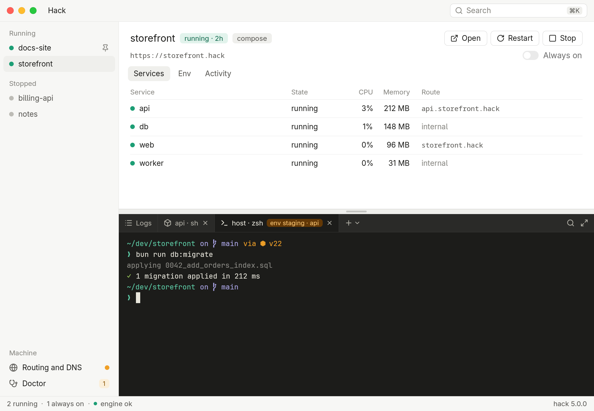
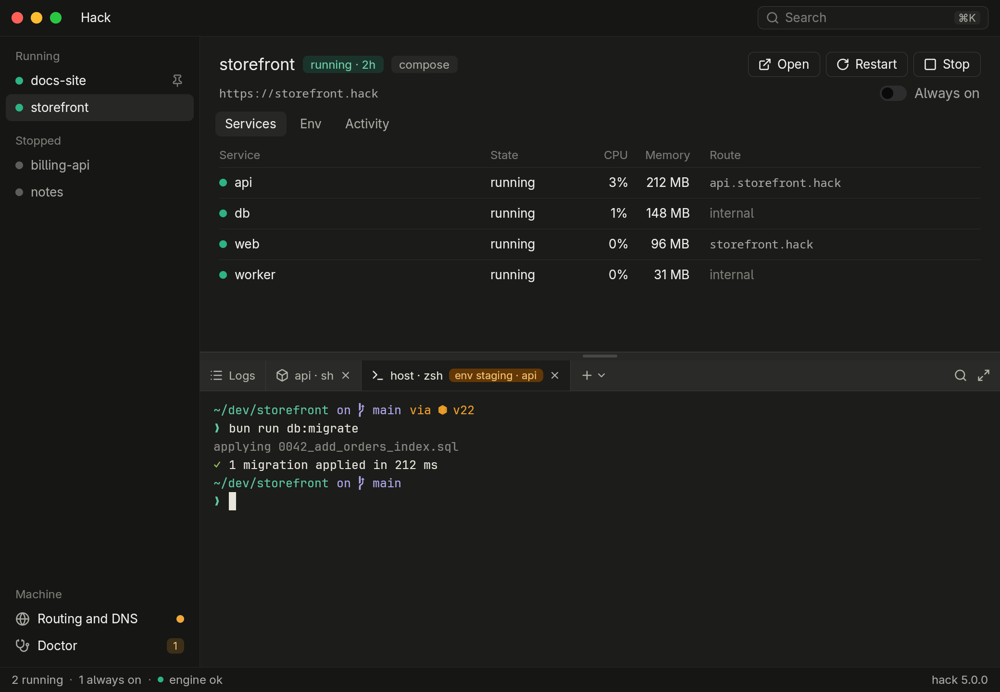
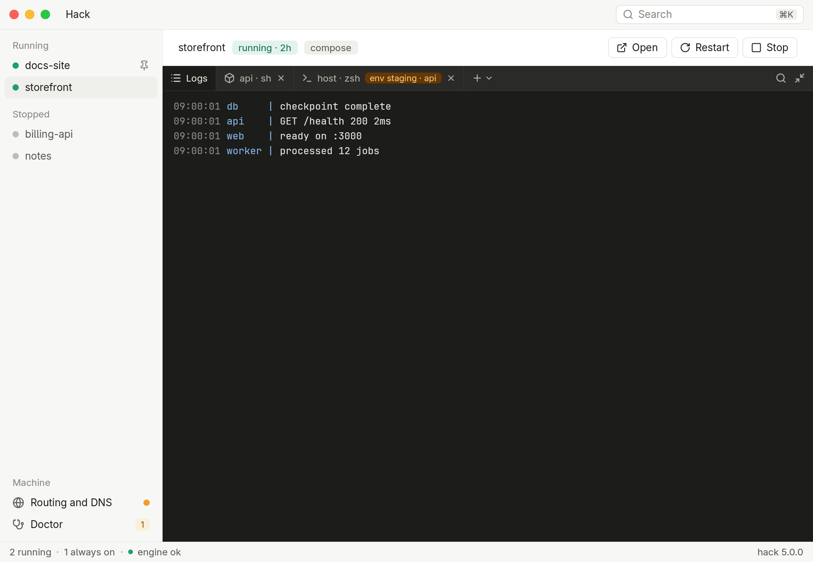
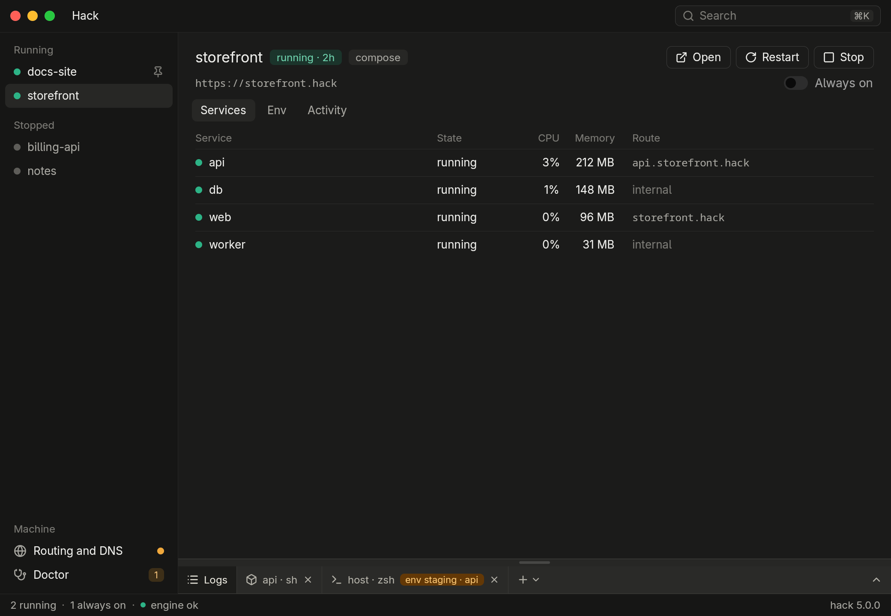

# Hack desktop app: design v1 (visual spec)

Status: direction accepted by the owner on Nov 15 2026 (HACK-2252), with
the logs moved into a terminal panel (approved panel mockup). The real window
(`app/src/view.rs`) now uses these tokens and components; the terminal panel
is wired behind the app's `terminal` feature (it needs the libghostty inputs),
and without it the logs stay a Logs tab (DESIGN-V1 renders in
`screenshots/v1/`, the real window's in `screenshots/window/`).

Reference: the approved mockups (main window: title bar with search, sidebar
with Running / Stopped / Machine, detail header, pill tabs, services table,
status bar; and the edge-to-edge terminal panel with tabs and env badges). Quality bar: a native, crisp, dense but calm
window with clear hierarchy and nothing that looks like a default widget.

`DESIGN.md` still owns behaviour (states, actions, data flow). This file owns
the look. Every number below is a named token in `ui/src/tokens.rs`; change
both together.

## Renders

| | |
|---|---|
|  |  |
|  |  |

Terminal panel in its three states, light and dark, for `running` and
`failed-start`, plus the new-tab menu: `screenshots/v1/panel-*.png`.
All 15 main-window fixtures with the panel half open on Logs, row by row
(loading, empty, daemon-down / daemon-mismatch, engine-down, error /
cli-missing, many-projects, stopped / starting, running, degraded / stopping,
failed-start, needs-attention):
[light](screenshots/v1/fixtures-light.png), [dark](screenshots/v1/fixtures-dark.png).

```sh
cd apps/desktop
cargo run -p hack-desktop-ui --bin hack-desktop-gallery -- --fixture running --theme dark --panel max
cargo run -p hack-desktop-ui --features screenshots --bin hack-desktop-gallery -- --screenshots /tmp/v1
```

The offscreen renders draw stand-in traffic lights so the title bar can be
judged; the real window uses the native controls. CPU and memory in the
gallery are labelled sample values: the core does not read per-service usage
yet (`hack usage --json`, #852, is the source to wire next). Shell tabs in
the gallery show sample output (a starship-style prompt drawn with an
installed Nerd Font when there is one); the gallery never reads the user's
own configuration.

## Type

UI text uses the platform UI font (SF Pro on macOS; the installed fallback
on Linux). URLs, routes, commands and logs use the platform monospace font
(Menlo on macOS by gpui-kit default). No uppercase captions, no letter-spacing.

| Token | Size / line | Weight | Used for |
|---|---|---|---|
| `TITLE` | 17 / 22 | 600 | Project name in the header |
| `HEADLINE` | 15 / 20 | 600 | Empty and error pane headline |
| `BODY` | 13 / 18 | 400 | Rows, tabs, buttons, table cells |
| `BODY_STRONG` | 13 / 18 | 500 | Selected row, selected tab, window title, primary button |
| `SMALL` | 12 / 16 | 400 | Table header, status bar |
| `SMALL_STRONG` | 12 / 16 | 500 | Sidebar captions, pills |
| `MONO` | 12 / 18 | 400 | URL, routes, commands |
| `MICRO` | 11 / 14 | 500 | Count pill, ⌘K hint |

Hierarchy comes from three text colours (primary, secondary, muted) and one
weight step, not from size jumps.

## Spacing, sizes, radii, borders

Spacing is a 4-point scale: 2, 4, 6, 8, 10, 12, 16, 20, 24 (`S1`–`S9`).

| Size | Value |
|---|---|
| Title bar | 38 |
| Status bar | 26 |
| Sidebar width | 208 |
| Sidebar row | 28 |
| Table row | 32 |
| Control (button, tab) | 26 |
| State dot | 8 (6 in the status bar) |
| Icon | 14 (15 on machine rows, 20 in empty panes) |
| Search field | 240 × 24 |
| Traffic-light inset | 76 |

Radii: pill 5, control 6, menu and icon tile 8, terminal panel 0 (edge to edge), window 12. Borders are
hairlines, 0.5 pt (one device pixel at 2x), in `border`; controls use
`border_strong`. The services table has row separators only, no outer box.
Detail content is inset 20 left and right; the sidebar list 6.

## Colour

The dark desktop palette uses Merino Dark from the HACK-2595 frames.

| Token | Light | Dark | Used for |
|---|---|---|---|
| `surface` | `#FFFFFF` | `#0D1117` | Detail pane |
| `chrome` | `#F7F7F5` | `#090C10` | Title bar, sidebar, status bar |
| `surface_1` | `#EFEFEC` | `#1A1E24` | Hover, panel handle, neutral pill |
| `surface_2` | `#E6E6E2` | `#24272B` | Pressed, selected file row in light mode |
| `selection` | `#EFEFEC` | `#24272B` | Selected navigation, selected file row in dark mode |
| `preview_surface` | `#EFEFEC` | `#1E2329` | Read-only file preview body |
| `border` | black 9% | `#1E2329` | Hairlines |
| `border_strong` | black 18% | `#2B3036` | Button and field outlines |
| `text_primary` | `#1C1C1A` | `#E6EDF3` | |
| `text_secondary` | `#5C5B57` | `#BFC5CB` | URL, stopped names, inactive tabs |
| `text_muted` | `#8B8A85` | `#8B9197` | Captions, table header, timestamps |
| `accent` | `#2F6FDB` | `#E6EDF3` | Switch on, focus ring |

State colours (dot / pill background / pill text):

| State | Light | Dark | Shown as |
|---|---|---|---|
| Running | `#1D9E75` / `#E2F3EC` / `#146B50` | `#3FB950` / `#152C20` / `#56D364` | solid dot |
| Busy (starting, stopping) | `#378ADD` / `#E5EEFA` / `#235E9E` | `#58A6FF` / dot at 19% / `#79C0FF` | solid dot |
| Degraded | `#EF9F27` / `#FBEFDA` / `#8A5608` | `#D29922` / dot at 18% / `#E3B341` | solid dot |
| Failed (failed start, needs attention) | `#E24B4A` / `#FBE6E5` / `#A82E2D` | `#FF7B72` / `#2F2024` / `#FFA198` | solid dot |
| Stopped | `#BDBCB6` / `surface_1` / secondary | `#686D73` / `surface_1` / secondary | solid grey dot, name in secondary |
| Unknown | `#9C9B95` / `surface_1` / secondary | `#8B9197` / `surface_1` / secondary | **ring**, never a solid dot |

Unknown is a ring so an unobserved project never reads as stopped.

## Setup wizard

Setup uses Builtin Light and Merino Dark in `Palette::setup`. The sidebar
is 232 pt wide with 32 pt rows. The main card keeps a stage up to 560 pt
wide and uses a 22 pt step title or 26 pt welcome and completion title.
Command, details and footer controls maintain the same left alignment.

## Icons

Lucide, from the icon catalog shipped inside the pinned `gpui-kit-assets`
crate (ISC). Only the icons below are embedded (`ui/src/icons.rs`,
`icon_assets!`), composed with gpui-kit's default bundle for its own widgets.
Stroke icons at 14 pt, coloured with the text colour of their context.

| Icon | Where |
|---|---|
| `search` | Title bar search field |
| `pin` | Sidebar row of an always-on project (muted) |
| `globe` | Machine: Routing and DNS |
| `stethoscope` | Machine: Doctor |
| `power` | Machine: hackd |
| `circle-arrow-up` | Machine: Upgrade |
| `external-link` | Header: Open |
| `rotate-cw` | Header: Restart; banner: Restart hackd |
| `square` | Header: Stop |
| `play` | Header: Start |
| `power` | Banner: Start hackd |
| `triangle-alert` | Banners |
| `folder-plus`, `circle-alert`, `loader-circle` | Empty, error and loading panes |
| `list` | Panel tab: Logs |
| `box` | Panel tab and menu item: shell in a service |
| `terminal` | Panel tab and menu item: host shell |
| `plus`, `chevron-down` | Panel: new-tab menu |
| `x` | Panel: close tab |
| `maximize-2` / `minimize-2` / `chevron-up` | Panel: maximize / restore / expand from collapsed |
| `square-terminal` | Reserved: "Open shell" on a service row |

## Anatomy

### Title bar (38)
`chrome` background, hairline below. Left: traffic-light inset (76), then
"Hack" in `BODY_STRONG`. Right: the search field (240 × 24, `surface`,
`border_strong` hairline, radius 6): search icon, "Search" in muted, `⌘K`
hint chip (`surface_1`, `MICRO`). On macOS the window uses a transparent,
full-size-content title bar so this row is the title bar; on Linux it sits
under the system decorations.

### Sidebar (208)
`chrome` background, hairline on the right. Scrolling project list, fixed
Machine section at the bottom.

- Captions: "Running", "Stopped" (or "Not observed" when every remaining row
  is Unknown), "Machine". `SMALL_STRONG`, muted, sentence case, 12 above / 4
  below.
- Project row (28, radius 6): state dot, name (`BODY`; `BODY_STRONG` when
  selected; secondary when stopped or unknown), muted pin icon if always on.
  Selected and hover: `surface_1`.
- Machine rows: icon (15, secondary), label, trailing state. Upgrade has a
  dot from its last check (green ready, red not ready, a ring before one ran).
  hackd has a
  dot from its card's tone; before the pane has read hackd's status, from the
  project reads (a matching hackd answered: green; off: red; mismatched:
  amber; otherwise a ring). Routing and DNS
  has a dot (a ring while routing status is not read). Doctor has an amber
  count pill when it reports findings, a green dot when clean, a ring when
  unknown. Routing and DNS shows a solid state dot whenever its state is
  known (from Doctor's checks in its `routing_dns` and `certificates`
  areas, as classified in `src/lib/doctor-metadata.ts`, optional tool probes
  excluded; a test keeps the list in sync; worst wins:
  green ok, amber warn, red error) and a ring only when nothing has reported.
  The live app needs the core to expose this; the gallery derives it from the
  fixture's Doctor checks.

### Banners
Directly under the title bar, across the detail pane: one line, tinted
(`degraded.bg` for daemon problems, `failed.bg` for engine down), alert icon,
message, optional action button on the right (Start hackd / Restart hackd).
The stale banner is folded into the daemon banner when one is shown (it has
the same cause); otherwise it is shown ("Showing last known state. The latest
read failed: …"), because it is then the only sign that the current read
failed. The reason line is suppressed when a daemon
banner explains an Unknown project.

### Detail header
Inset 20, top 16.

1. Name (`TITLE`), state pill, backend pill (neutral), spacer, actions.
   - State pill labels are short and lowercase: `running · 2h`, `starting…`,
     `stopping…`, `degraded · worker down`, `failed · api, worker` (three or
     more: `failed · api +2`), `needs attention`, `stopped`, `unknown`.
   - Actions: Open (`external-link`), Restart (`rotate-cw`), Stop (`square`)
     as quiet outlined buttons (26 high, `border_strong` hairline, hover
     `surface_1`). Start (`play`) is the one filled button, shown when the
     project is stopped or failed. While an action is in flight all buttons
     are disabled (muted text, no hover).
2. URL in `MONO`, secondary; spacer; Always on switch.
3. Reason line when needed: failed/needs-attention reason in `failed.fg`,
   others in secondary. Native-project note in `SMALL`, muted.

### Tabs
Pill tabs: Services, Env, Activity (Logs moved into the terminal panel). 26 high, radius 6, padding 10.
Selected: `surface_1` background, `BODY_STRONG`, primary. Others: `BODY`,
secondary, primary on hover. No underline, no bar background.

### Services table
Columns: Service (flex, dot + name), State (92), CPU (64, right-aligned),
Memory (64, right-aligned), Route (flex, `MONO` secondary; "internal" muted
when the service has no route). Header row 26, `SMALL` muted, sentence case.
Rows 32, hairline separators. State cell is short and agrees with the dot:
`running`, `unhealthy` (degraded), `restarting` / `dead` / `exited 1`
(failed), `exited 0` and `not created` (stopped), `paused` and any
unrecognised container state (unknown ring, never stopped), `unknown` when
not observed; failures in `failed.fg`. Unknown
numbers are an em dash in muted.

### Terminal panel

Approved mockup: an edge-to-edge panel docked at the bottom of the content
area, right of the sidebar, full width. No card, no rounded corners, no inner
padding box. Its height is remembered per project.

Anatomy, top to bottom:

1. **Drag handle** (9): `surface_1`, `border_strong` hairline on top, a
   36 × 3 grip (radius 2), row-resize cursor. Drag to resize; drag to the top
   or double-click to maximize; drag down past the strip to collapse.
2. **Tab strip** (32): terminal `strip` colour, hairline below. Tabs are
   12 pt with a 14 pt icon, separated by hairlines; the selected tab takes the
   terminal background and primary text. After the tabs: `+` and a caret for
   the new-tab menu. Right: find (search icon) and maximize / restore
   (`chevron-up` when collapsed).
3. **Terminal surface**: fills the rest; 14 / 10 inset; terminal font and
   theme (below). The emulator draws everything inside it.

States:

| State | Panel | Project header | Top tabs and Services |
|---|---|---|---|
| Collapsed | Handle and tab strip only, at the bottom | Full | Visible, fill the area |
| Open (default half; any remembered height) | Handle, strip, terminal | Full | Visible above, scroll |
| Maximized | Strip and terminal fill the content area | One compact row: name (13/500), state pill, backend pill, actions | Hidden |

Tab kinds and labels (names only, never values):

| Kind | Started with | Label | Badge |
|---|---|---|---|
| Logs (always first, not closable) | Core log stream reader (from #808), read-only | `Logs` | — |
| Shell in a service | `hack exec <service> -- bash` (falls back to `sh`) | `api · sh` | — |
| Host shell | User's login shell, login + interactive, in the project root | `host · zsh` | — |
| Host shell with env | `hack host shell --env <overlay> --scope <service>` | `host · zsh` | `env staging · api` |

The env badge is 11 pt, radius 5: amber (`badge_warn`) when the overlay is
not the project's default, so a production-like environment is obvious;
neutral when it is the default. It stays visible when the panel is
maximized. The Logs tab has a service filter, follow, and find; its output
is shown exactly as printed (ANSI kept, never stripped or re-coloured).

New-tab menu (`+`): "Shell in <service>" for each running service, a
separator, "Host shell", "Host shell with env…" (then pick overlay and scope
from names read with `hack env list --json`). 220 wide, `surface`,
`border_strong` hairline, shadow, 28 pt rows, at most 300 tall (longer
service lists scroll). It opens from the `+` button toward the larger space:
above the strip when the panel is docked, below it when maximized.

Closing a tab, or the window, ends that tab's whole process session.

Terminal look: the user's Ghostty config when it exists (font family and
size, theme or palette, cursor style, padding), mapped onto the component.
Without one, the fallback terminal theme (`TermPalette::fallback`), dark in
both app modes as in the approved mockup, 12.5 / 19 in the app's mono font:

| Token | Value | | Token | Value |
|---|---|---|---|---|
| `bg` | `#1C1C1A` | | `green` | `#5DCAA5` |
| `fg`, `cursor` | `#E8E6DC` | | `bright_green` | `#97C459` |
| `dim` | `#8B8A85` | | `blue` | `#85B7EB` |
| `strip` | `#2A2A28` | | `magenta` | `#AFA9EC` |
| `strip_border` | `#3A3A37` | | `yellow` | `#EF9F27` |
| `tab_fg` | `#B4B2A9` | | `red` | `#F07B7A` |
| `badge_warn_bg` / `_fg` | `#633806` / `#FAC775` | | `cyan` | `#6CCFD9` |
| `badge_bg` / `_fg` | `#3A3A37` / `#D3D1C7` | | | |

Prompt themes (zsh, oh-my-zsh, starship) come from the real shell in a
real PTY (`TERM`, `COLORTERM=truecolor`); tmux is not involved.

Keyboard (shortcuts that would reach the shell are never taken; on Linux the
app uses Ctrl-Shift chords, as terminals do):

| Action | macOS | Linux |
|---|---|---|
| Toggle panel | ⌘J | Ctrl-Shift-J |
| New tab (opens the menu) | ⌘T | Ctrl-Shift-T |
| Close tab | ⌘W | Ctrl-Shift-W |
| Next / previous tab | ⌘⇧] / ⌘⇧[ | Ctrl-Shift-PageDown / Ctrl-Shift-PageUp |
| Maximize / restore | ⌘⇧↩ | Ctrl-Shift-Enter |
| Find in tab | ⌘F | Ctrl-Shift-F |
| Copy / paste | ⌘C / ⌘V | Ctrl-Shift-C / Ctrl-Shift-V |

### Status bar (26)
`chrome`, hairline above, `SMALL` secondary. Left, separated by `·`:
`N running` (or `N not observed`), `N always on`, engine state with a 6 pt
dot (`engine ok` / `engine down` / `engine unknown`), and `hackd off` /
`hackd mismatch` only when relevant. Right: `hack <version>`. Without a
snapshot: `not connected`.

### Empty, error and loading panes
Centred: 40 pt rounded icon tile (`surface_1`), headline, one-line body
(secondary, max 360 wide), optional command chip in `MONO`. Loading shows
three skeleton rows in the sidebar.

## gpui-kit components and overrides

| Element | Built with | Override |
|---|---|---|
| Window root | `gpui_kit::open_window` (gpui-kit `Root`) | Background, text colour and font family set from tokens, not the theme |
| Always on switch | gpui-kit `Switch`, `.small()` | `.color(accent)`; label from tokens; disabled until HACK-2213 |
| Icons | gpui-kit `Icon` with `.path()` | Selected Lucide set via `icon_assets!`, explicit size and colour |
| Buttons, tabs, pills, rows, table, search field, banners, terminal panel chrome | `div` compositions in `ui/src/components.rs` and `ui/src/panel.rs` | All colours, sizes and radii from tokens |

gpui-kit's `Button`, `TabBar::pill` and `Tag` draw from the theme's
colours, heights (32) and radii, which are the "default-looking" parts. When
the real window is restyled, interactive pieces keep gpui-kit behaviour
(focus, keyboard, tooltips) by either (a) the custom button variant fed from
tokens, or (b) the small components here gaining `track_focus` and key
handlers. Recommended default: (a) for buttons, (b) for tabs and rows.
Hairlines use a small `StyledExt` helper because GPUI's border helpers start
at 1 pt.

## Terminal sessions

The `term` crate (decision in `term/DECISION.md`, PR #862) owns the PTYs and
the emulator; this spec owns the panel. Session rules:

- The app owns each PTY and runs the CLI in it. It never builds an
  environment and never sees a value: env injection happens inside
  `hack host shell` / `hack exec`, and the app passes overlay, scope,
  service and shell names only.
- Each session starts in its own session and process group; closing the
  tab or the window ends the whole group.
- The app never types secrets, never logs terminal contents, and passes no
  values in argv. What a service prints is shown as printed, without any
  redaction claim.
- Preferred over attaching to tmux: one mechanism, it works without tmux,
  and the CLI stays the only thing that touches env values.

## Not in v1

Menu bar popover (mockup "later"), Doctor and Routing detail views,
Activity content and per-service usage in the live app. Accessibility labels
are kept from the current view when the window is restyled.
