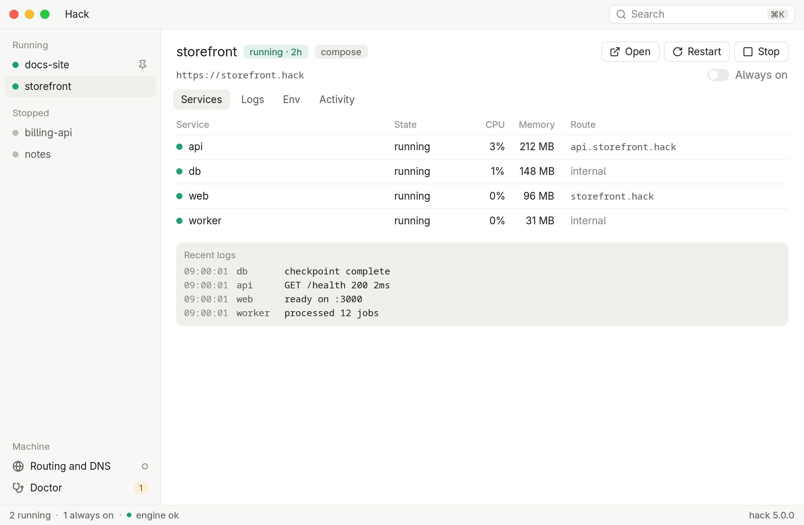
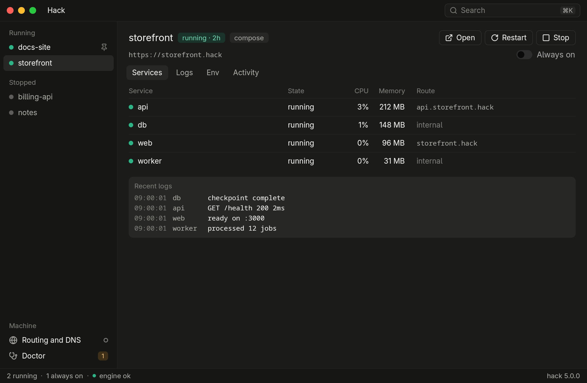

# Hack desktop app: design v1 (visual spec)

Status: proposal for owner acceptance (HACK-2252). The current window
(`app/src/view.rs`) is unchanged. This spec, the tokens and components in
`ui/` and the gallery renders in `screenshots/v1/` are what the window will be
restyled to once the main-window renders are accepted.

Reference: the approved mockup (main window: title bar with search, sidebar
with Running / Stopped / Machine, detail header, pill tabs, services table,
compact log tail, status bar). Quality bar: a native, crisp, dense but calm
window with clear hierarchy and nothing that looks like a default widget.

`DESIGN.md` still owns behaviour (states, actions, data flow). This file owns
the look. Every number below is a named token in `ui/src/tokens.rs`; change
both together.

## Renders

| | |
|---|---|
|  |  |

All 15 fixtures, row by row (loading, empty, daemon-down / daemon-mismatch,
engine-down, error / cli-missing, many-projects, stopped / starting, running,
degraded / stopping, failed-start, needs-attention):
[light](screenshots/v1/fixtures-light.png), [dark](screenshots/v1/fixtures-dark.png).

```sh
cd apps/desktop
cargo run -p hack-desktop-ui --bin hack-desktop-gallery -- --fixture running --theme dark
cargo run -p hack-desktop-ui --features screenshots --bin hack-desktop-gallery -- --screenshots /tmp/v1
```

The offscreen renders draw stand-in traffic lights so the title bar can be
judged; the real window uses the native controls. CPU and memory in the
gallery are labelled sample values: the core does not read per-service usage
yet (`hack usage --json`, #852, is the source to wire next).

## Type

UI text uses the platform UI font (SF Pro on macOS; the installed fallback
on Linux). URLs, routes, commands and logs use the platform monospace font
(Menlo on macOS by gpui-kit default). No uppercase captions, no letter-spacing.

| Token | Size / line | Weight | Used for |
|---|---|---|---|
| `TITLE` | 17 / 22 | 600 | Project name in the header |
| `HEADLINE` | 15 / 20 | 600 | Empty and error pane headline |
| `BODY` | 13 / 18 | 400 | Rows, tabs, buttons, table cells |
| `BODY_STRONG` | 13 / 18 | 500 | Selected row, selected tab, window title, primary button |
| `SMALL` | 12 / 16 | 400 | Table header, status bar |
| `SMALL_STRONG` | 12 / 16 | 500 | Sidebar captions, pills |
| `MONO` | 12 / 18 | 400 | URL, routes, commands, log lines |
| `MICRO` | 11 / 14 | 500 | Count pill, ⌘K hint |

Hierarchy comes from three text colours (primary, secondary, muted) and one
weight step, not from size jumps.

## Spacing, sizes, radii, borders

Spacing is a 4-point scale: 2, 4, 6, 8, 10, 12, 16, 20, 24 (`S1`–`S9`).

| Size | Value |
|---|---|
| Title bar | 38 |
| Status bar | 26 |
| Sidebar width | 208 |
| Sidebar row | 28 |
| Table row | 32 |
| Control (button, tab) | 26 |
| State dot | 8 (6 in the status bar) |
| Icon | 14 (15 on machine rows, 20 in empty panes) |
| Search field | 240 × 24 |
| Traffic-light inset | 76 |

Radii: pill 5, control 6, panel (log block) 8, window 12. Borders are
hairlines, 0.5 pt (one device pixel at 2x), in `border`; controls use
`border_strong`. The services table has row separators only, no outer box.
Detail content is inset 20 left and right; the sidebar list 6.

## Colour

| Token | Light | Dark | Used for |
|---|---|---|---|
| `surface` | `#FFFFFF` | `#1B1B1A` | Detail pane |
| `chrome` | `#F7F7F5` | `#161615` | Title bar, sidebar, status bar |
| `surface_1` | `#EFEFEC` | `#272725` | Hover, selected row, selected tab, log block, neutral pill |
| `surface_2` | `#E6E6E2` | `#31312E` | Pressed |
| `border` | black 9% | white 8% | Hairlines |
| `border_strong` | black 18% | white 15% | Button and field outlines |
| `text_primary` | `#1C1C1A` | `#EDEDEA` | |
| `text_secondary` | `#5C5B57` | `#A9A8A2` | URL, stopped names, inactive tabs |
| `text_muted` | `#8B8A85` | `#7B7A75` | Captions, table header, timestamps |
| `accent` | `#2F6FDB` | `#6EA2F5` | Switch on, focus ring |

State colours (dot / pill background / pill text):

| State | Light | Dark | Shown as |
|---|---|---|---|
| Running | `#1D9E75` / `#E2F3EC` / `#146B50` | `#2DB386` / 19% / `#6FD3AE` | solid dot |
| Busy (starting, stopping) | `#378ADD` / `#E5EEFA` / `#235E9E` | `#4C98E6` / 19% / `#8DBDF0` | solid dot |
| Degraded | `#EF9F27` / `#FBEFDA` / `#8A5608` | `#F0A83C` / 18% / `#F3C27A` | solid dot |
| Failed (failed start, needs attention) | `#E24B4A` / `#FBE6E5` / `#A82E2D` | `#EC5D5C` / 19% / `#F29A99` | solid dot |
| Stopped | `#BDBCB6` / `surface_1` / secondary | `#5E5D59` / `surface_1` / secondary | solid grey dot, name in secondary |
| Unknown | `#9C9B95` / `surface_1` / secondary | `#7B7A75` / `surface_1` / secondary | **ring**, never a solid dot |

Unknown is a ring so an unobserved project never reads as stopped.

## Icons

Lucide, from the icon catalog shipped inside the pinned `gpui-kit-assets`
crate (ISC). Only the icons below are embedded (`ui/src/icons.rs`,
`icon_assets!`), composed with gpui-kit's default bundle for its own widgets.
Stroke icons at 14 pt, coloured with the text colour of their context.

| Icon | Where |
|---|---|
| `search` | Title bar search field |
| `pin` | Sidebar row of an always-on project (muted) |
| `globe` | Machine: Routing and DNS |
| `stethoscope` | Machine: Doctor |
| `external-link` | Header: Open |
| `rotate-cw` | Header: Restart; banner: Restart hackd |
| `square` | Header: Stop |
| `play` | Header: Start |
| `power` | Banner: Start hackd |
| `triangle-alert` | Banners |
| `folder-plus`, `circle-alert`, `loader-circle` | Empty, error and loading panes |
| `square-terminal` | Exec action (terminal surface, later) |

## Anatomy

### Title bar (38)
`chrome` background, hairline below. Left: traffic-light inset (76), then
"Hack" in `BODY_STRONG`. Right: the search field (240 × 24, `surface`,
`border_strong` hairline, radius 6): search icon, "Search" in muted, `⌘K`
hint chip (`surface_1`, `MICRO`). On macOS the window uses a transparent,
full-size-content title bar so this row is the title bar; on Linux it sits
under the system decorations.

### Sidebar (208)
`chrome` background, hairline on the right. Scrolling project list, fixed
Machine section at the bottom.

- Captions: "Running", "Stopped" (or "Not observed" when every remaining row
  is Unknown), "Machine". `SMALL_STRONG`, muted, sentence case, 12 above / 4
  below.
- Project row (28, radius 6): state dot, name (`BODY`; `BODY_STRONG` when
  selected; secondary when stopped or unknown), muted pin icon if always on.
  Selected and hover: `surface_1`.
- Machine rows: icon (15, secondary), label, trailing state. Routing and DNS
  has a dot (a ring while routing status is not read). Doctor has an amber
  count pill when it reports findings, a green dot when clean, a ring when
  unknown.

### Banners
Directly under the title bar, across the detail pane: one line, tinted
(`degraded.bg` for daemon problems, `failed.bg` for engine down), alert icon,
message, optional action button on the right (Start hackd / Restart hackd).
The stale banner is not shown separately: the daemon banner and the "Not
observed" caption already say it. The reason line is suppressed when a daemon
banner explains an Unknown project.

### Detail header
Inset 20, top 16.

1. Name (`TITLE`), state pill, backend pill (neutral), spacer, actions.
   - State pill labels are short and lowercase: `running · 2h`, `starting…`,
     `stopping…`, `degraded · worker down`, `failed · api, worker` (three or
     more: `failed · api +2`), `needs attention`, `stopped`, `unknown`.
   - Actions: Open (`external-link`), Restart (`rotate-cw`), Stop (`square`)
     as quiet outlined buttons (26 high, `border_strong` hairline, hover
     `surface_1`). Start (`play`) is the one filled button, shown when the
     project is stopped or failed. While an action is in flight all buttons
     are disabled (muted text, no hover).
2. URL in `MONO`, secondary; spacer; Always on switch.
3. Reason line when needed: failed/needs-attention reason in `failed.fg`,
   others in secondary. Native-project note in `SMALL`, muted.

### Tabs
Pill tabs: Services, Logs, Env, Activity. 26 high, radius 6, padding 10.
Selected: `surface_1` background, `BODY_STRONG`, primary. Others: `BODY`,
secondary, primary on hover. No underline, no bar background.

### Services table
Columns: Service (flex, dot + name), State (92), CPU (64, right-aligned),
Memory (64, right-aligned), Route (flex, `MONO` secondary; "internal" muted
when the service has no route). Header row 26, `SMALL` muted, sentence case.
Rows 32, hairline separators. State cell is short: `running`, `exited 1`,
`not created`, `stopped`, `unknown`; failures in `failed.fg`. Unknown
numbers are an em dash in muted.

### Log tail (compact)
12 below the table. `surface_1` block, radius 8, padding 8 / 10, sized to its
lines (no fixed minimum height): caption "Recent logs" (`SMALL`, muted), then
up to the last few lines in `MONO`: time (muted), service (secondary, 52),
message. Warnings in `degraded.fg`, errors in `failed.fg`. With no lines it
shows one muted line ("No recent log lines", or the read error). The full log
view is the Logs tab (terminal surface, below).

### Status bar (26)
`chrome`, hairline above, `SMALL` secondary. Left, separated by `·`:
`N running` (or `N not observed`), `N always on`, engine state with a 6 pt
dot (`engine ok` / `engine down` / `engine unknown`), and `hackd off` /
`hackd mismatch` only when relevant. Right: `hack <version>`. Without a
snapshot: `not connected`.

### Empty, error and loading panes
Centred: 40 pt rounded icon tile (`surface_1`), headline, one-line body
(secondary, max 360 wide), optional command chip in `MONO`. Loading shows
three skeleton rows in the sidebar.

## gpui-kit components and overrides

| Element | Built with | Override |
|---|---|---|
| Window root | `gpui_kit::open_window` (gpui-kit `Root`) | Background, text colour and font family set from tokens, not the theme |
| Always on switch | gpui-kit `Switch`, `.small()` | `.color(accent)`; label from tokens; disabled until HACK-2213 |
| Icons | gpui-kit `Icon` with `.path()` | Selected Lucide set via `icon_assets!`, explicit size and colour |
| Buttons, tabs, pills, rows, table, log block, search field, banners | `div` compositions in `ui/src/components.rs` | All colours, sizes and radii from tokens |

gpui-kit's `Button`, `TabBar::pill` and `Tag` draw from the theme's
colours, heights (32) and radii, which are the "default-looking" parts. When
the real window is restyled, interactive pieces keep gpui-kit behaviour
(focus, keyboard, tooltips) by either (a) the custom button variant fed from
tokens, or (b) the small components here gaining `track_focus` and key
handlers. Recommended default: (a) for buttons, (b) for tabs and rows.
Hairlines use a small `StyledExt` helper because GPUI's border helpers start
at 1 pt.

## Terminal surface (planned)

The Logs tab and an Exec action move onto one terminal component (crate
`term`, decision in `term/DECISION.md`):

- **Logs tab**: the component in read-only mode, fed by the core's existing
  log stream reader and ndjson parser (they stay). It replaces the text
  panel; the compact tail above stays on Services. Bounded scrollback, follow
  on/off, search bar drawn above the terminal, selection and copy.
- **Exec**: a `square-terminal` action on a running service row and in the
  header overflow. It runs `hack exec <service> -- <shell>` on a PTY the app
  owns: the child starts in its own session and process group, and closing
  the tab or window ends the whole group.
- **Security rules**: the app never types secrets into a terminal, never
  logs terminal contents, never passes values in argv (it passes service and
  shell names only); what a service prints is shown as printed, without
  redaction claims.

## Not in v1

Menu bar popover (mockup "later"), Doctor and Routing detail views,
Env and Activity content, per-service usage in the live app, the Exec
action wiring. Accessibility labels are kept from the current view when the
window is restyled.
