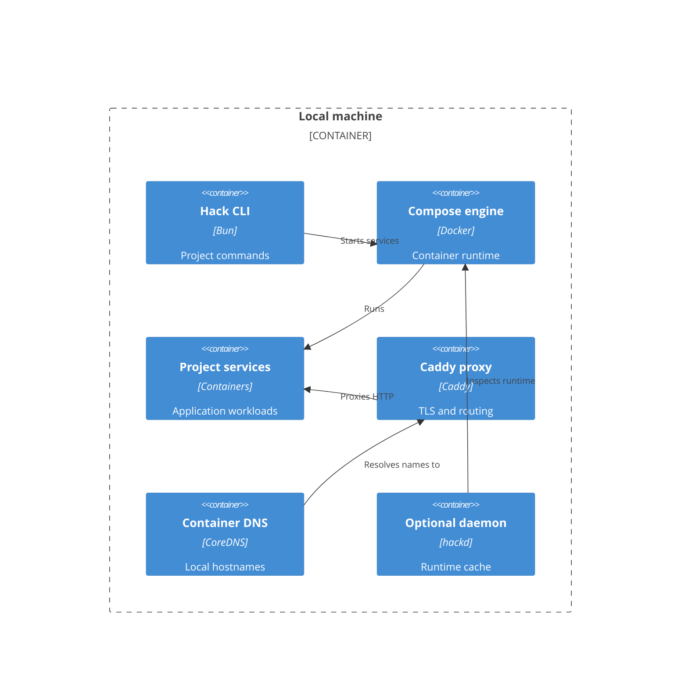
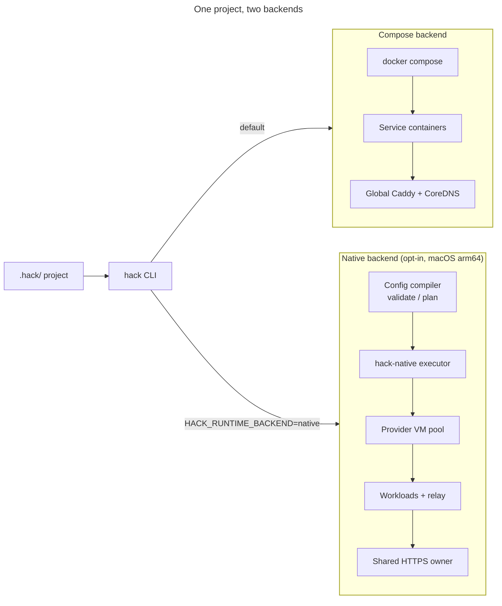
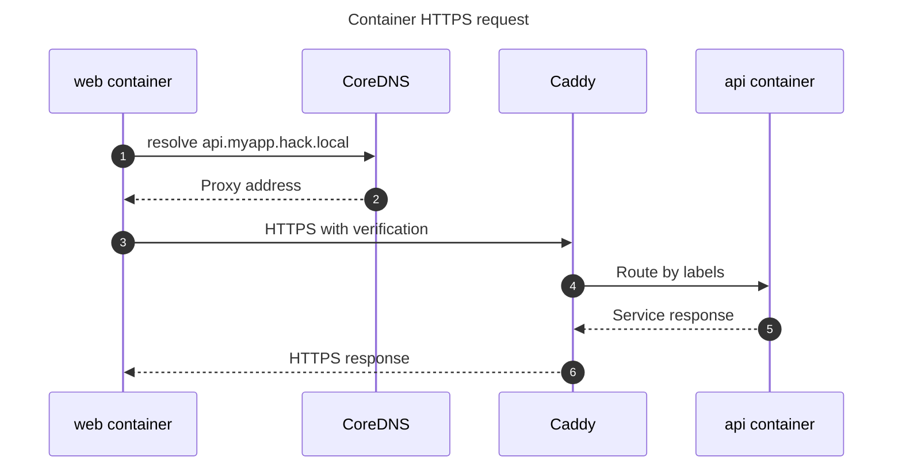
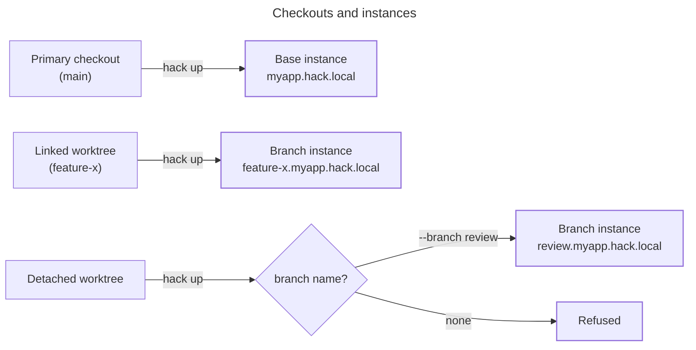
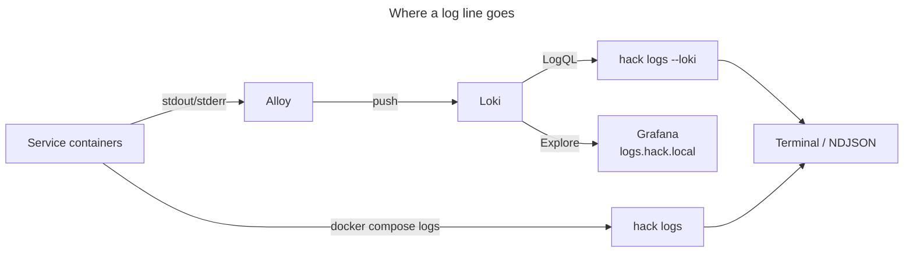
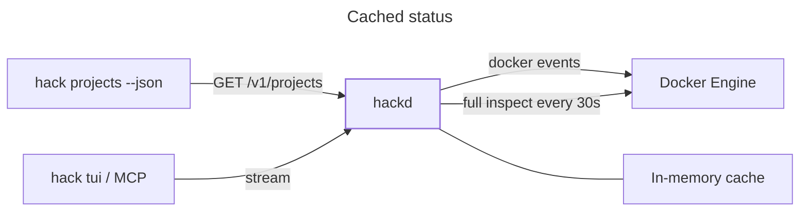
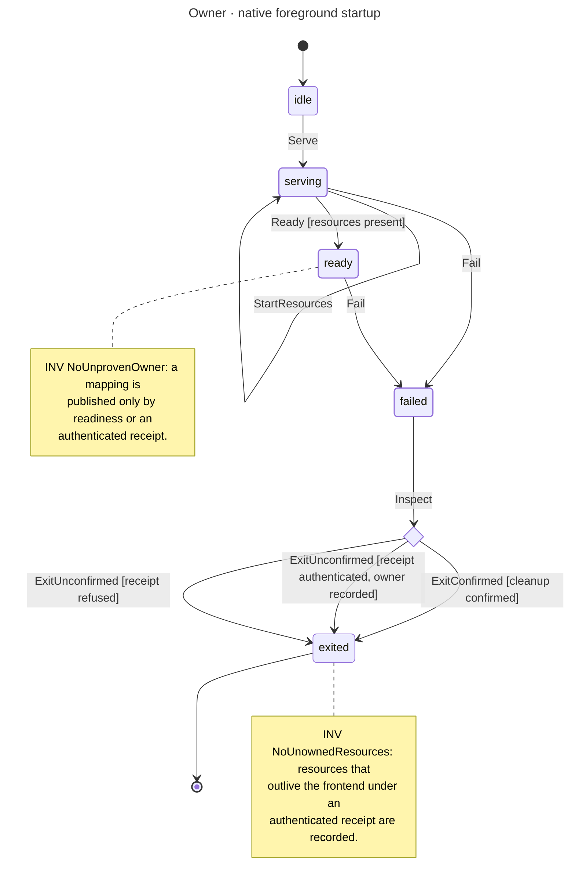
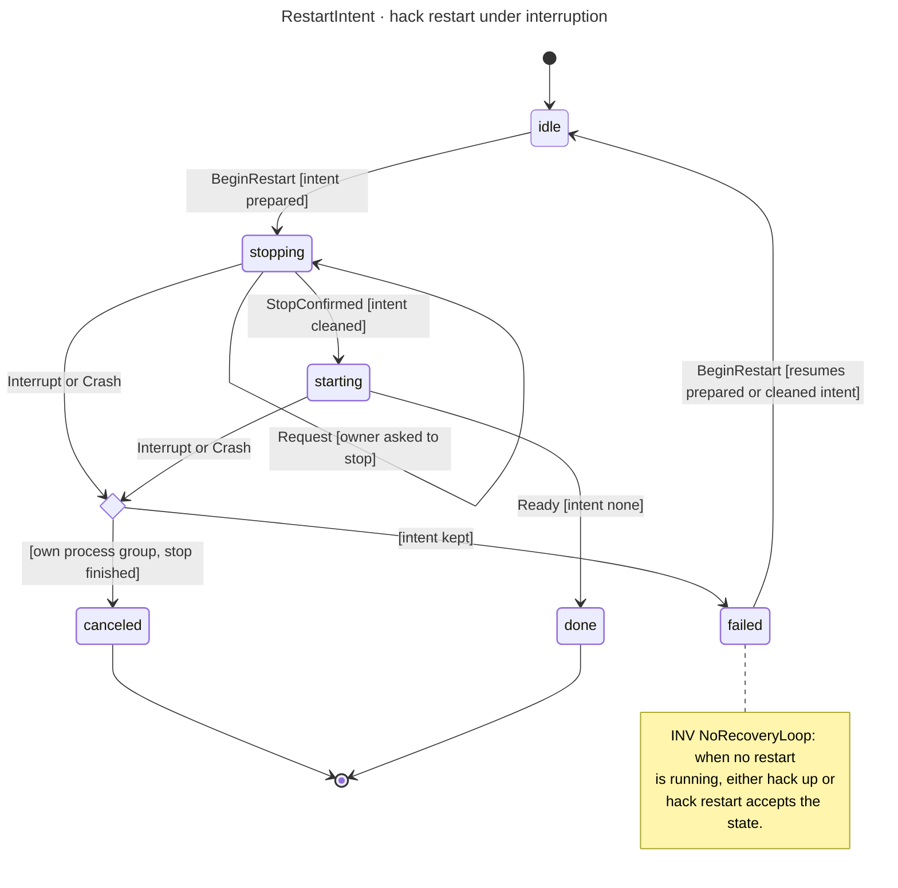
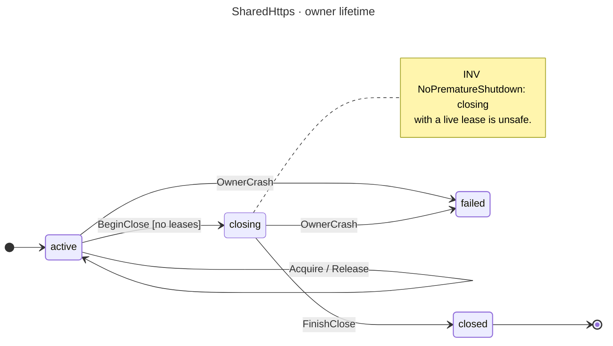

# Architecture

Hack is a local CLI that turns a small committed `.hack/` folder into a running
project: services, environment, secrets, trusted HTTPS, logs and host-side helpers.
Everything runs on the developer's machine. There is no hosted component.

Two kinds of state exist. **Global state** under `~/.hack/` (overridable with
`HACK_HOME`) holds the shared infrastructure every project uses: the proxy, DNS,
the logging stack, the project registry and the optional daemon. **Project state**
under `<repo>/.hack/` holds that project's definition and is committed, apart from
machine-local generated files that Hack keeps ignored.

## System overview

The Compose view separates executable responsibilities: the CLI controls the engine,
while DNS resolves proxy addresses, Caddy proxies requests and the optional daemon
reads runtime state for cached queries.



C4 containers here mean executable units, not only Docker containers. The CLI and
optional daemon run on the host; Caddy and CoreDNS belong to global setup. The
native backend has its own explicitly prepared routing path, described below.

- **Caddy** terminates TLS with a locally trusted CA and routes
  `https://<service>.<project>.hack.local` to containers by their Docker labels.
  Existing `.hack` names, `.hack.gy` OAuth aliases and custom domains route the
  same way.
- **CoreDNS** gives containers the same `*.hack.local` names as the host, so a
  service can call another service by its public local URL.
- **Alloy, Loki and Grafana** collect container logs and keep searchable history.
- **hackd** is an optional daemon that caches Docker state for fast `--json`
  status. The CLI works without it.
- **Schemas** for the project config files are served by Caddy at
  `https://schemas.hack.local` for editor validation.

## Backends

The CLI reads the same `.hack/` project on either backend. **Docker Compose** is the
default and runs everywhere Hack runs. The **native backend** is opt-in and
experimental: on Apple Silicon macOS it runs an explicitly prepared project inside
a provider-managed Linux VM pool without Docker, with its own routing and a bounded
command subset.



The native backend selects a verified executor binary and a private native home,
plans the project through the config compiler, and runs workloads under a
foreground owner process that holds the run until it is stopped. Its supported
commands are whole-project `up` and `restart`, owner-mediated `down`, saved-run
`ps`, finite `logs`, and noninteractive `exec` and `run`. See
[the native backend guide](guides/native-candidate.md) and
[native authored commands](reference/native-authored-commands.md). A Compose flag
in these docs does not imply native support.

## Global vs project scope

- Global scope (`~/.hack`)
  - Caddy proxy on 80/443, routing by Docker labels
  - CoreDNS for container DNS (`*.hack.local` and legacy `*.hack` → Caddy)
  - macOS DNS helper: dnsmasq plus `/etc/resolver` entries selecting the local resolver
  - Logging stack (Alloy → Loki → Grafana)
  - Global config `hack.config.json` and the project registry `projects.json`
  - Networks `hack-dev` (ingress) and `hack-logging`
- Project scope (`.hack`)
  - `docker-compose.yml` defines services and Caddy labels
  - `hack.config.json` stores the project name, dev host, log preferences, OAuth
    alias and browser launch preference
  - `hack.env.default.yaml` and optional overlays hold committed env, with
    per-value encryption for secrets
  - `hack.branches.json` is an optional committed branch registry
  - `.internal/` and `.branch/` hold generated, machine-local files. Hack
    rewrites them on every run; keep them out of Git. `hack doctor` reports tracked
    copies and `hack doctor --fix` untracks them.

## Project lifecycle

`hack up` and `hack down` run more than Compose. Hooks and managed host processes
declared in `.hack/hack.config.json` run around the services, inside a dedicated
tmux or zellij session that Hack owns and can tear down. The exact ordering is in
[Lifecycle](lifecycle.md).

The [lifecycle outcome and phase diagrams](lifecycle.md#runtime-behavior) distinguish
failed startup, owned helper cleanup and an unconfirmed stop. They describe
whole-project Compose operations; native limits and service-scoped commands differ.

Lifecycle state is checkout-local at `.hack/.internal/lifecycle/state.json`, one
entry per instance. A random token mirrored in the mux session and in that state
proves ownership. Teardown never trusts a session name or a reused process group
on its own: `hack down` stops the saved process groups only while a matching
session still proves ownership, and `hack doctor --fix` removes a stale session
only when its instance is absent and a second check agrees. Fixed-port helpers
such as database or SSM tunnels can declare a `singleton` listener set so Hack
reuses an equivalent helper instead of starting a competing one; see
[shared host helper lifecycle](reference/shared-host-lifecycle.md).

## Environment and secrets

Env lives in committed YAML. Secrets are encrypted per value with a key that stays
out of Git. At runtime Hack merges the layers below and injects the result into
Compose, host commands and lifecycle processes. Nothing decrypted rests on disk:
the generated Compose override holds only `${HACK_ENV_...}` references and the
values travel through the `docker compose` process environment.

The [environment resolution diagram](env.md#merge-rules) applies scopes inside each
ordered file layer. A later file wins even when it supplies a global value over a
service value from an earlier file; host scope is not delivered to containers.

Later layers win. The primary-checkout layers apply only in a linked git worktree,
which also inherits the primary checkout's secret key through the shared git
directory. `HACK_ENV_SECRET_KEY` covers CI and other detached environments.
[Environment and secrets](env.md) covers the file format, delivery matrix,
rotation and the external secret-store backends.

## Internal DNS and TLS

When `internal.dns` and `internal.tls` are enabled, `hack up` writes a Compose
override that points each service at CoreDNS, mounts Caddy's local CA and the
combined trust bundle, sets the usual `SSL_CERT_FILE`-style variables, and adds
`extra_hosts` entries for runtimes that ignore custom DNS. Containers then use the
same `https://*.hack.local` names as the host. If Caddy's IP changes,
`hack status` and `hack doctor` warn and `hack restart` refreshes the mapping.

Caddy and CoreDNS hold reserved addresses on `hack-dev` (`172.30.0.2` and
`172.30.0.53`). Docker can report a proxy container as running while it is
attached to no network, to another network, or at another address; a plain
`docker compose up -d` leaves such a container as it is, and a project container
can then take the reserved address. `hack doctor` (`proxy network`) and
`hack global status` (`proxy_network` in `--json`) report it, and `hack global up`
takes the proxy stack down, moves any project container off the reserved
addresses, and starts the stack again.

A container resolves its peer through CoreDNS and receives the HTTPS response
through Caddy, which forwards the request to the peer's service port.



## Workflow: init, up, logs

For detached Compose startup, the CLI owns sequencing while proxy discovery and the optional daemon
observe the engine independently rather than coordinating the start.

```mermaid
---
title: Compose startup responsibilities
---
swimlane-beta TB
  subgraph CLI
    Env[Resolve env]
    Before[Before hooks]
    Processes[Host processes]
    Up[Start detached]
    After[After hooks]
    Verify[Check states]
    Env --> Before --> Processes --> Up --> After --> Verify
  end
  subgraph Engine
    Services[Containers]
  end
  subgraph Proxy
    Labels[Read labels]
    Routes[Routes]
    Labels --> Routes
  end
  subgraph Daemon
    Events[Events]
    Cache[Cache]
    Events --> Cache
  end
  Up --> Services
  Services -->|labels| Labels
  Services -->|events| Events
```

The daemon lane is optional. Observer arrows indicate metadata and event inputs,
not a readiness acknowledgement: successful startup does not prove that a browser
can reach a route. After hooks run before service-state verification; an after-hook
failure ends startup there (see [Lifecycle](lifecycle.md#hack-up)).

## Branch instances

`--branch <name>` generates a per-branch Compose override that prefixes hostnames
(`api.myapp.hack.local` → `api.<branch>.myapp.hack.local`) and the Compose project
name, so parallel checkouts never collide on ports or names. In a linked git
worktree, `hack up` selects a branch instance named after the branch automatically.
A detached worktree has no branch to derive a name from, so Hack refuses to target
the base instance silently; pass `--branch`, or set `worktree.auto_branch=false`.



`hack doctor` checks linked checkouts for divergent secret keys and `dev_host`
collisions. See [Worktrees and watchers](guides/development-runtime-safety.md).

## Logging pipeline

`hack logs` has two backends. **compose** streams `docker compose logs` directly
and is the default for following output. **loki** adds searchable history and
LogQL filters and is the default for snapshots (`--no-follow`), falling back to
Compose with a one-line notice when Loki has nothing for the selection.
`hack logs --json` emits NDJSON `start`, `log`, `error` and `end` events for
agents and the TUI.



Alloy discovers containers by polling Docker every five seconds and includes exited
containers, so a one-shot service such as a migration is shipped after it stops as
long as Docker keeps the container. A container removed between two polls never
reaches Loki; use `hack logs --compose` or the command's own output for those.
Alloy keeps its read positions in a named volume across `hack global down` and
`up`; `hack global logs-reset` clears positions and Loki data together. Loki
retention defaults to one week in the global template; per-project
`logs.retention_period` applies when `hack down` prunes logs.

## Daemon (hackd)

`hackd` is an optional local daemon that watches Docker events and keeps a cached
view of running containers behind a Unix socket at `~/.hack/daemon/hackd.sock`.
It powers `hack projects --json` and streaming consumers such as the TUI and MCP.
`hack ps` queries Compose directly so failed startups are visible immediately. If
the daemon is missing or version-mismatched, the CLI falls back to direct Docker
calls.



The daemon treats the container runtime as ephemeral: it fingerprints the engine,
detects resets, performs one bounded refresh, and marks cached state stale with
`runtime_*` metadata when the runtime is unavailable. Scripted and noninteractive
commands never autostart it. v5 prerelease launchers (`hack-next`, `hack-v5`)
never autostart it either, because autostart would run the stable daemon on PATH;
`hack doctor --fix` under those launchers skips its hackd repair and names the
command to run yourself. On macOS the launchd service belongs to the default
`~/.hack` root only; an isolated `HACK_HOME` runs hackd directly.

### Keeping hackd running

`hack daemon start` runs hackd in its own session and process group, with its
output going only to `~/.hack/daemon/hackd.log`. hackd's local API has no
authentication, so before it binds its sockets hackd makes `~/.hack/daemon`
owner-only (`0700`), and it sets each socket to `0600`. It changes the mode only
after checking that `daemon` is a real directory you own (not a link) under
directories others cannot replace, and it refuses to start when the directory
cannot be made private. The same goes one level down (`gateway/`). Once the directory
is private, hackd refuses to start if it holds anything it did not create
(another account's entry, a symlink, a hard-linked file), and it removes
group and other write from its own logs and pid file. The gateway token store
is written owner-only (`0600`). A store that others could write, such as one
written before this under umask `0002`, is not used: the gateway accepts no
token from it until you remove it and issue tokens again
(`rm ~/.hack/daemon/gateway/tokens.json && hack x gateway token-create`). Closing the terminal, or an agent
harness killing the process group that ran the command, does not stop it. It does
not survive logout or reboot. For that, install it as a login service with
`hack daemon install`:

- **macOS**: a launchd agent (`~/Library/LaunchAgents/dance.hack.hackd.plist`).
- **Linux**: a systemd user unit, `hackd.service`, written to
  `${XDG_CONFIG_HOME:-~/.config}/systemd/user/`, enabled for `default.target` and
  started with `systemctl --user`. `hack daemon uninstall` stops, disables and
  removes it.

On Linux, once the unit is installed, `hack daemon start` and `hack daemon stop`
go through `systemctl --user`, so a single manager owns the socket and pid file.
`stop` goes through systemd even when the pid file is missing or stale, which also
cancels a restart systemd has scheduled after a crash. When systemd runs or is
about to restart `hackd.service` but the managed unit file is gone (or the unit
is loaded from another directory), `stop` refuses and prints the
`systemctl --user` commands to review and stop it, instead of reporting hackd as
stopped, unless the unit is shown to be another home's (below). `uninstall` does the same in that case instead of reporting
that nothing was installed. If systemd cannot report the unit's state at all (the query
fails, times out, loses the user bus, or `systemctl` cannot be run), both refuse
in the same way. Only a unit systemd reports as inactive or not found, or a
failed query whose only message names `hackd.service` itself as absent
("Unit hackd.service could not be found."), counts as nothing to do. `start` and `stop` act on the unit only when its effective environment
serves the shell's Hack home. A unit that serves another Hack home is left alone:
`start` starts this home's hackd directly (its socket, pid file and lock live in
this home's `daemon/` directory), and `stop` stops only this home's own hackd. When the unit has a live main
process, `stop` proves from that process which Hack home it serves (a hackd
holding a socket in this home's `daemon/` directory), not from the loaded
configuration: a reload without a restart changes the configuration, not the
running daemon. A hackd main process that does not hold this home's socket is
left alone only with positive evidence that it is another home's daemon: the
configuration names another home, and the process is proven (identity stable)
to hold a socket in that home's `daemon/` directory, or it exited while being
checked. Then the unit is left alone and this home's own hackd is still
stopped, whether or not the managed unit file is present. Without that
evidence `stop` refuses: the daemon may still be starting (it has not bound
its socket yet), its sockets may be unreadable, or a reload changed the
configuration to this home under a running daemon; the message says to run
`stop` again or how to stop it by hand. A main process that cannot be
identified (its process details cannot be read, or it is not a hackd) is
refused, with the `systemctl --user status` and `stop` commands. With no live
process (a pending restart), the configuration decides, and `stop` still
cancels the restart. A failed query of the unit's state or main process is
not "no process": it is refused with the manual commands, installed unit or
not. Just before `systemctl --user stop`, `stop` reads the unit's state again
and refuses if the main pid changed or the read fails. That narrows the gap
without closing it: `systemctl stop` acts on whatever runs when it lands, so a
change after that read, or a pid reused in between, is not detected.
When the Hack home cannot be read with certainty (for example an
`EnvironmentFile=`, an `ExecSearchPath=`, a `PassEnvironment=` naming
`HACK_HOME`, `HOME` or `PATH`, a relative `HOME`, or an escaped quote or
backslash in `Environment=`), both exit 1 and print the `systemctl --user`
command to use by hand. The effective environment is built the way systemd
builds it: the user manager's environment, then the unit's `Environment=`
(drop-ins included), then `UnsetEnvironment=` last; with no `HOME` left, the
account's home from the password database is used, as hackd does. `start`, `stop` and `clear` remove stale pid and socket
files only while they are still stale: the socket is removed only if, right
before removal, the pid file is still the stale one, the socket is the same file
that was checked, and nothing answers on it. So they never delete the files of a
daemon that another start or a systemd restart just wrote. `install` stops a
hackd that was started directly and lets systemd start it.

Every signal Hack sends to a hackd goes through one proof, whether it comes from
`stop`, `restart`, `install`, replacing an incompatible hackd, or the sweep for
untracked ("orphan") daemons in `start` and `clear`. The proof needs all of:

- the exact argument list and the resolved executable (Linux `/proc`, macOS
  `KERN_PROCARGS2` and `proc_pidpath`), never `ps` text. The executable must be
  a Hack binary (named `hack` or `hack-*` once symlinks are resolved) or `bun`
  running this checkout's entry file, and the arguments must be a
  `daemon start --foreground` in any option order. A script named `hack` that
  runs another interpreter does not count;
- an open socket in this `HACK_HOME`'s daemon directory;
- a start time that does not change while it is checked (clock ticks on Linux).

The whole proof runs again immediately before each signal, SIGKILL included, and
must give the same executable, arguments and start time, so a reused pid or a
process that `exec`ed another program is never signalled. A process that fails
the proof is reported with its pid and left running. When a proven hackd cannot
be confirmed stopped, `stop` exits 1 and says it is still running, and `restart`,
`start` and the `install` handover stop there. A pid file that survived an unclean
shutdown and now names another program does not count as a running hackd. If
systemd runs an incompatible hackd from a unit that points at another `hack`,
`hack daemon status`, `hack doctor` and `hack daemon restart` all point to
`hack daemon install`, because a restart would start the same version again.
`install` reports success only when systemd runs the hackd that answers. The unit:

- runs `<hack> daemon start --foreground`, where `<hack>` is the absolute path of
  the `hack` found on `PATH` at install time. Symlinks are kept as they are, so a
  stable link such as `~/.local/bin/hack` keeps working when an upgrade moves the
  real binary;
- restarts hackd after a crash (`Restart=on-failure`), at most five times a
  minute, but not after `hack daemon stop`. After a crash loop,
  `hack daemon start` clears the failed state before starting it again;
- keeps systemd's default `KillMode=control-group`: stopping or restarting the
  service also stops the processes hackd started;
- sends stderr to the journal (`journalctl --user -u hackd.service`); hackd's own
  log stays in `~/.hack/daemon/hackd.log`.

`hack daemon install` writes the whole unit file. Before writing it, it makes
sure `$XDG_CONFIG_HOME`, `systemd/` and `systemd/user/` are directories you own
that your group and other users cannot write: it creates them `0755` whatever
the umask and removes group or other write from ones you own, and it refuses
(with the `chmod` to run) when that is not possible, because whoever can replace
the enabled unit runs code as you at the next login. For the same reason,
`install` and `start` check `hackd.service.d/` and `service.d/`: every drop-in
there must be a file you own that others cannot write, or they refuse to use the
unit until you review it. `start` (and autostart) also runs the unit only when
`hackd.service` is a regular file you own that others cannot write, in
directories that pass the same check; a symlinked unit is refused. A unit or
drop-in file that others could write is refused, not repaired, since its contents
may already be someone else's; `install` replaces such a unit file with a fresh
one. The
directories above `$XDG_CONFIG_HOME`, up to `/` and through any symlinks, must not
be writable by your group or others either (Hack refuses and prints the
`chmod go-w` to run; it does not change your home directory). Right before
it starts or restarts the unit, Hack asks systemd which files it loads
(`FragmentPath` and `DropInPaths`, which cover every user-unit load directory,
`$XDG_DATA_HOME` included): the fragment must be the unit Hack manages, and
every drop-in and its directory must belong to you or root and not be writable
by others. Every directory systemd loads user units from (its `UnitPath`) gets
the same check, even when it is empty or does not exist yet (then its nearest
existing parent is checked), because another account that can write one could
add a drop-in for the next login. The program the unit runs gets the same check when you install the
unit and before each start: the `hack` binary, the file it resolves to, and every
directory above them must belong to you or root and not be writable by your
group or others (sticky directories such as `/tmp` excepted). Hack does not
repair these, even inside `HACK_HOME`: a program or directory others could
write may already have been changed, so it refuses and prints the
`chmod go-w` to run. Another regular user's program is never trusted; a file
owned by a system account (below `UID_MIN`) is accepted only in a root-owned
directory nobody else can write, as package managers install setuid tools.

What systemd runs for the unit is an allowlist: exactly one `ExecStart` running
`<hack> daemon start --foreground`, and no other `Exec*` setting. The program
must be a hack executable: named `hack` or `hack-*`, resolving to a binary named
the same way or to a `#!` launcher whose interpreter is an absolute path that
passes the same ownership check (with no argument, or `env <program>`, which
is looked up through the checked `PATH`). Any other program, such as an interpreter
that would run a script named `daemon`, is unknown, and the unit is left as it is. A drop-in that
adds `ExecStartPre=`, `ExecStop=`, an interpreter wrapper or a second
`ExecStart` makes `install` and `start` refuse. `hack daemon stop` and
`hack daemon uninstall` first make the same unit-file, load-directory and drop-in checks
as `start` (a stop also starts units a drop-in names, such as `OnSuccess=`),
and refuse while an `ExecStop`/`ExecStopPost` hook is loaded, because stopping
runs it (systemd runs stop hooks even after `systemctl kill`); remove it and run `systemctl --user daemon-reload` first. A
unit whose `hack` was removed can still be stopped and uninstalled. `install`
also refuses to enable a unit that a drop-in points at another `HACK_HOME`. Before it
writes anything, `install` also refuses to replace a unit systemd is running
(wherever it was loaded from) that serves
another Hack home, or whose Hack home it cannot read, since its restart would
stop that daemon. hackd runs helpers such as `docker` and `git` through its
`PATH`, so every directory on the service's `PATH` (the one Hack writes at install,
and the effective one the service gets before each start, including a `PATH`
inherited from the user manager) must not let other users
add or create programs there either. Variables that load code before the checked program
(`LD_PRELOAD`, `LD_LIBRARY_PATH`, `BASH_ENV`, `SHELLOPTS`, `NODE_OPTIONS`,
`BUN_OPTIONS` and similar) are removed by an `UnsetEnvironment=` line in the unit
Hack writes, so values from the user manager's environment never reach hackd,
at login either. If a drop-in brings one back, `install` and `start` refuse. A unit
that runs in another file namespace (`RootDirectory=`, `RootImage=`, bind mounts,
images) is refused as well, because the paths Hack checked on the host need not
be what systemd runs there. Put local settings, such as
`DOCKER_HOST` for rootless Docker, in a drop-in (`systemctl --user edit hackd`).
`install` writes the `hack` it was run from, and warns when that path is in a
temporary directory, a package cache or a source checkout.

`hack daemon start` reads `ExecStart` only when it is a single plain absolute
path. A prefix (`-`, `@`, `:`, `+`, `!`), a specifier such as `%h`, an escape or
several `ExecStart=` lines make the program unknown: `start` leaves that unit as
it is and says so, and `hack daemon status` and `hack doctor` report it. An unknown
program is never treated as a missing one.

`hack daemon start` and autostart never rewrite a unit whose program still exists,
even when the `hack` on the current `PATH` is a different one: they say so, and
`hack daemon install` switches the service. If systemd runs an incompatible
hackd from such a unit, `start` reports it instead of replacing it, because
systemd would only start the same version again. Only when the unit's program no
longer exists may `start` repair it, and only to a durable location: the path
and the file it resolves to must both be outside temporary directories, package
caches and source checkouts. The unit keeps the path as written. It then replaces just the
program in `ExecStart` and keeps every other line, including your edits;
otherwise it reports the problem and asks you to run `hack daemon install`. If an
earlier `daemon-reload` failed (`NeedDaemonReload=yes`), `start` and `install`
reload before they start. Other edits to the file show up as drift in
`hack daemon status` and `hack doctor`, and `hack daemon install` replaces them.

A systemd user manager runs only while you have a login session, unless linger is
on. `hack daemon install` and `hack daemon status` report linger. When it is off,
they print the command, `loginctl enable-linger`, which keeps your user services
running without a session and starts them at boot. Hack never turns linger on for
you.

Where `systemctl --user` cannot be used (no systemd, a container, WSL without
systemd, or an SSH session with no user bus), `hack daemon install` explains why,
writes nothing, starts hackd directly instead and exits 1.

`hack daemon status` reports who manages hackd: `managed_by` (`launchd`,
`systemd` or `null`) and a `service` object in `--json`, and a `systemd:` line in
the text output on Linux. The text and JSON give the same next step. On Linux,
`hack doctor` adds a `daemon service` check. It warns when the unit is missing,
has drifted or is disabled (fix: `hack daemon install`); when the unit has failed,
or the running hackd was started directly rather than by systemd (fix:
`hack daemon restart`); or when linger is off. `hack doctor --fix` offers
`hack daemon install` only interactively, because it writes outside the project
and enables a login service. It skips the install without a TTY, and also skips it
under the same conditions that skip the hackd repair. Without a TTY, or when you
decline the install, its hackd repair may still start hackd, but it never writes
or reloads the unit (`hack daemon` runs with `HACK_DAEMON_SERVICE_READ_ONLY=1`).
`hack daemon uninstall` exits 1 and says what it already did when the final
`daemon-reload` fails. The unit belongs to the
default `~/.hack` root: an isolated `HACK_HOME` or `HACK_SYSTEMD_DISABLE=1` turns
systemd management off (`HACK_SYSTEMD_ALLOW_ISOLATED_HOME=1` opts in).

## Native backend internals

The native backend is built around explicit ownership: every run has one owner,
every resource it creates is recorded before it can outlive the frontend, and
cleanup is confirmed rather than assumed. These rules are checked against finite
TLA+ models under `tests/models/tla/`; the charts below are drawn from those
specifications, and [the model coverage map](reference/v5-model-coverage.md)
records what each model does and does not prove.

### Foreground startup owner

A foreground `hack up` on the native backend serves the run until it is ready or
fails. Readiness publishes the run mapping. A failure after resources were created
must leave them owned: either cleanup is confirmed, or the frontend's final
read-only inspection authenticates the owner receipt and records it.



Source: [`Owner.tla`](https://github.com/hack-dance/hack/blob/next/tests/models/tla/native-startup-owner/Owner.tla). A refused
inspection is a known coverage gap: nothing can be authenticated, so only the
runtime journal retains the graph.

### Interrupted restart

`hack restart` saves a `prepared` intent bound to the exact old run, asks the old
run's owner to stop, and marks the intent `cleaned` only after that stop is
confirmed. `hack up` refuses while an intent is pending, so an interrupted restart
must always leave a state that `hack restart` itself accepts.



Source: [`RestartIntent.tla`](https://github.com/hack-dance/hack/blob/next/tests/models/tla/native-restart-intent/RestartIntent.tla).
The restart's stop request runs in its own process group so a terminal Ctrl-C
reaches only the restart frontend and lets the stop finish.

### Shared HTTPS owner

Native runs on one machine share a single HTTPS owner. Clients lease it, prove
cleanup, and release; the owner may begin closing only once no lease remains.



Source: [`SharedHttps.tla`](https://github.com/hack-dance/hack/blob/next/tests/models/tla/shared-https-lifetime/SharedHttps.tla).

Other models cover registry writers and lock recovery, publication journals,
persistent data enrollment, dependency rebinding, engine restart policies and MCP
startup. A finite model checks a property over a bounded domain; it does not
qualify the installed binary, real filesystems or an application.

## Files and directories

- `~/.hack/` (default; override the whole root with an absolute `HACK_HOME`)
  - `hack.config.json` (global config and extension settings)
  - `projects.json` (project registry; `hack projects prune` removes stale entries)
  - `daemon/hackd.sock`, `daemon/hackd.pid`, `daemon/hackd.log` (capped at 5 MiB)
  - `caddy/docker-compose.yml`, `caddy/Corefile`
  - `logging/docker-compose.yml`, `logging/alloy.alloy`, `logging/loki.yaml`, `logging/grafana/`
  - `schemas/hack.config.schema.json`, `schemas/hack.branches.schema.json`
  - `certs/` (mkcert output for non-Caddy services)
- `<repo>/.hack/`
  - `docker-compose.yml`, `hack.config.json`, optional `hack.branches.json`
  - `.gitignore` (committed; created by `init` and repaired by `doctor --fix`)
  - `hack.env.default.yaml` and optional `hack.env.<overlay>.yaml` (committed env)
  - `hack.env.local.yaml` and `hack.env.<overlay>.local.yaml` (worktree-local)
  - `.env` (only when explicitly materialized) and `.env.state.json`
  - `.internal/compose.override.yml`, `compose.env.override.yml`, `compose.runtime.override.yml`
  - `.internal/extra-hosts.json`, `.internal/branch-usage.json`
  - `.internal/lifecycle/state.json` and `.internal/lifecycle/*.log`
  - `.branch/compose.<branch>.override.yml` and `.branch/compose.<branch>.runtime.override.yml`
  - `hack.project.json` and `native/adaptation.json` (native backend only)

## Key design choices

- Docker Compose is the default execution substrate for predictability and portability.
- Caddy routes by container label, so no project carries reverse-proxy config.
- CoreDNS gives containers the same `*.hack.local` namespace as the host.
- Logs default to `docker compose logs` for speed; Loki holds history and filtering.
- The daemon keeps JSON queries fast without becoming a dependency.
- Config lives beside each repo in `.hack/` so projects stay isolated and portable.
- The native backend records ownership before effects and confirms cleanup, and
  those rules are model-checked.

## Unsupported retained surfaces

Remote, gateway, node and dispatch code, the extension dispatcher and the macOS
app remain in the repository for explicit maintenance. They are outside the
supported local CLI and are hidden from default help. See
[unsupported retained surfaces](extensions.md).
