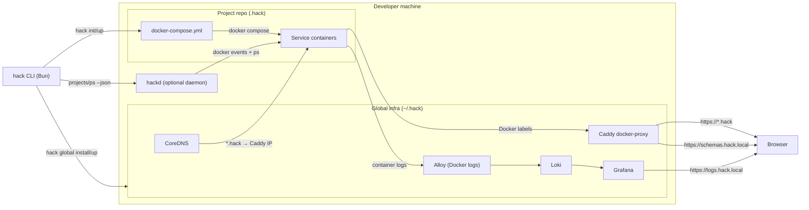
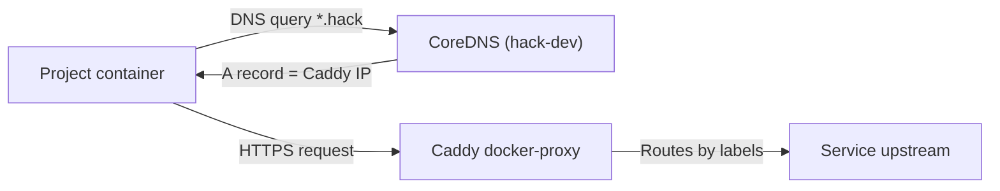
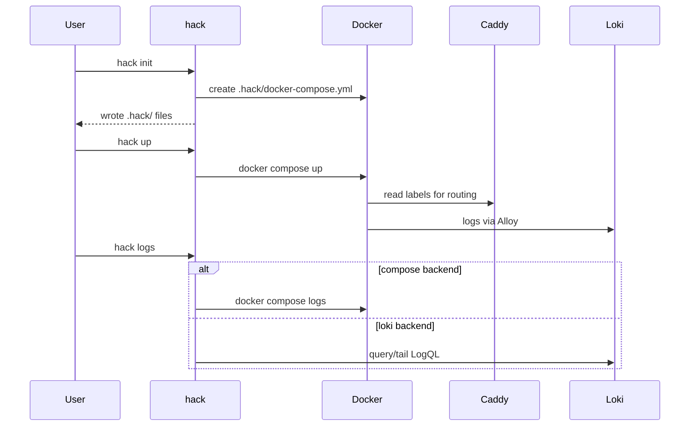
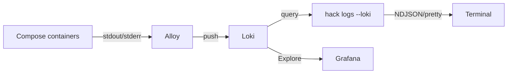
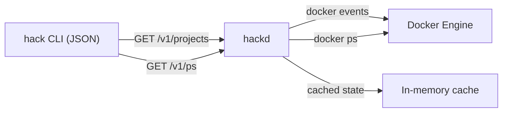

## System overview
 
`hack` is a Bun CLI that writes per-project Compose files under `.hack/` and manages a machine-wide
proxy, DNS helpers, and logging stack under `~/.hack/` (overridable via the `HACK_HOME` env var,
which redirects all global state — registry, daemon, secrets — to another root).

- **Caddy** (docker-proxy) routes `*.hack` based on container labels.
- **CoreDNS** resolves `*.hack` inside containers to the Caddy IP, with `extra_hosts` mappings for resolver compatibility.
- **Alloy + Loki + Grafana** capture logs and provide history.
- **Schemas** are served by Caddy at `https://schemas.hack.local`.
- **hackd (optional daemon)** caches Docker state for fast `hack projects --json` / `hack ps --json`.

## Global vs project scope

- Global scope (`~/.hack`)
  - Caddy proxy on 80/443 (routes via Docker labels)
  - CoreDNS for container DNS (`*.hack` → Caddy)
  - macOS DNS helper: dnsmasq + `/etc/resolver` for `*.hack` → Caddy container IP
  - Logging stack (Alloy → Loki → Grafana)
  - Global config: `hack.config.json` (control plane defaults + extension settings)
    - Gateway bind/port/allowWrites
  - Schemas hosted under `https://schemas.hack.local`
  - Networks: `hack-dev` (ingress) and `hack-logging`

- Project scope (`.hack`)
  - `docker-compose.yml` defines services + Caddy labels
  - `hack.config.json` stores project name, dev host, log preferences, OAuth alias, and browser
    launch preference (`open.prefer`)
  - `controlPlane.gateway.enabled` marks the project as gateway-capable
  - Optional overrides:
    - `.internal/compose.override.yml` (generated internal DNS/TLS injection)
    - `.internal/extra-hosts.json` — CLI-managed, not hand-edited (use
      `hack internal extra-hosts set/unset/list`)
    - `.branch/compose.<branch>.override.yml` (branch builds)
  - Everything under `.hack/.internal` is a hack-managed, machine-local artifact; do not hand-edit
    or commit generated files there. Newer Hack versions rewrite them (for example
    `compose.override.yml`), so a tracked copy leaves the working tree dirty; `hack doctor`
    reports tracked files and `hack doctor --fix` untracks them.

## Internal DNS + TLS (containers)

When `internal.dns` / `internal.tls` are enabled, `hack up` writes a Compose override that:

- sets each service’s DNS to the CoreDNS container
- mounts Caddy’s local CA cert into each service, and — once `hack global trust` has generated it —
  the combined public+local trust bundle alongside it
- points replace-semantics SSL env vars (`SSL_CERT_FILE`, `CURL_CA_BUNDLE`, `REQUESTS_CA_BUNDLE`,
  `GIT_SSL_CAINFO`) at the combined bundle, so OpenSSL-based tools (.NET/NuGet, git,
  python-requests) trust both public roots and `*.hack`; `NODE_EXTRA_CA_CERTS` appends the local CA
  for Node. Without the bundle, only the append-semantics vars are set — public TLS is never broken
  as a side effect of internal trust
- injects `extra_hosts` mappings for `*.hack` → current Caddy IP (for runtimes that ignore custom DNS)
- merges any repo-local `.hack/.internal/extra-hosts.json` entries (for host tunnels / dynamic domains)

This lets containers use the same `https://*.hack` hostnames as the host machine. If Caddy’s IP changes,
`hack status`, `hack doctor`, and the TUI will warn; `hack restart` refreshes the mapping.

 
## Project env + secrets

Projects can declare shareable env overlays and safely inject secrets into compose:

- Canonical env: `.hack/hack.env.default.yaml` plus optional `.hack/hack.env.<overlay>.yaml`
- Compatibility output: `.hack/.env` only when explicitly materialized
- Secret key: checkout-local `.hack.secret.key`, or — in a linked git worktree — inherited
  automatically from the primary checkout through the shared git common dir; `HACK_ENV_SECRET_KEY`
  covers CI/detached environments. `hack doctor` flags divergent keys across checkouts.

At runtime, hack resolves the selected overlay and injects the effective env directly into compose and
host-side command flows. For service-scoped values, hack still generates
`.hack/.internal/compose.env.override.yml` so compose services get the right per-service environment
without requiring `.hack/.env` to exist. That file holds only `${HACK_ENV_...}` references; the values
reach `docker compose` through its process environment, so no decrypted value rests on disk.

See `docs/env.md` for the current env model and migration notes.

## Project lifecycle hooks + host processes

Projects can run host-side hooks around `hack up/down` and start managed host processes (auth steps,
local proxies/tunnels). Processes are started inside a mux session (tmux or zellij) so they have a
stable home and can be torn down on `hack down`.

Lifecycle state is checkout-local at `.hack/.internal/lifecycle/state.json`. For tmux processes, the
saved process group belongs to the wrapped user command rather than its mux pane shell. Each compose
instance has its own entry, so starting a branch instance does not replace the base instance's entry
in the same checkout. A random token mirrored in mux metadata and lifecycle state proves current
session ownership; deterministic session names never authorize teardown. A versioned SHA-256 digest
of the effective overlay and sorted lifecycle environment participates in session freshness without
persisting environment names, keys, or values. Cleanup reconciles the saved process group with the live process table; if the group
leader exited while members remain, `hack doctor` reports the orphan. `hack down` terminates the
persisted leaderless group and descendant process groups only while a matching lifecycle mux session
still proves ownership; without that session, cleanup stays non-destructive because the numeric PGID
may have been reused. A live group leader without its saved pane PID is likewise not trusted as
lifecycle ownership.

Doctor also compares ownership-proven lifecycle sessions with live Compose instances. `doctor --fix`
can remove a proven session only when its corresponding instance is absent and a second liveness and
ownership check still agrees. Foreign or ambiguous same-name sessions remain non-destructive findings.

For fixed-port helpers such as SSM/database/search tunnels, lifecycle config can also declare a
`singleton` listener set. This lets Hack reuse an already-running equivalent helper or fail fast on
partial conflicts instead of launching a competing duplicate supervisor. The intent is to reduce local
port churn and keep external/manual tunnels from being mistaken for stale Hack-owned processes.

See `docs/lifecycle.md` for config and behavior.

## Workflow (init → up → logs)

## Logging pipeline

`hack logs` supports two backends:

- **compose**: fast, direct `docker compose logs`
- **loki**: searchable history + LogQL filters

NDJSON streaming (`hack logs --json`) emits `start`, `log`, `error`, and `end` events for MCP/TUI
consumers.

Snapshots (`hack logs --no-follow`) use Loki by default (`logs.snapshotBackend`). Without
`--since`, a Loki snapshot looks back 24 hours and returns the newest `--tail` entries. If Loki
returns no entries and Loki was not requested explicitly, `hack logs` writes a one-line notice
to stderr and answers from `docker compose logs` instead. Nothing from Loki is written first,
so `--json` output still has one `start`/`end` pair. When Loki was requested explicitly
(`--loki`, `--services`, `--query`, `--since`, `--until`), the empty result stands and the
notice suggests `hack logs --compose --no-follow` with every selector you gave that the
compose backend accepts: `--path`, `--project`, `--branch`, `--tail`, `--profile`, `--pretty`,
`--json` and a single service. `--query`, `--since`, `--until` and more than one service have
no compose equivalent, so the notice names them instead of dropping them. Follow mode
(`hack logs` without `--no-follow`) does not fall back. When Loki is the follow backend
(`logs.followBackend: loki`, or `--loki`) and no entry arrives within 8 seconds, `hack logs`
writes the same kind of one-line stderr notice, suggesting `hack logs --compose`, and keeps
following.

Short-lived containers: Alloy finds containers by polling Docker every 5 seconds. It includes
exited containers, so a one-shot Compose service (a migration or seed job) is shipped after it
stops, as long as Docker keeps the container. A container that starts, exits and is removed
between two polls (for example `docker compose run --rm`) never reaches Loki; use
`hack logs --compose` or the command's own output for those. Existing installs pick up this
discovery config after `hack global install` rewrites `~/.hack/logging/alloy.alloy` and the
Alloy container restarts (`hack global down` then `hack global up`).

Alloy keeps its read positions (`positions.yml`) under `--storage.path`, which the logging
compose maps to the named volume `alloy-data`. `hack global down` then `hack global up`
recreates the Alloy container but keeps the volume, so Alloy resumes each container's log
after the last line it shipped instead of reading all retained logs again. A position is a
whole second and Docker's `since` filter includes that second, so lines from the last second
Alloy read can be sent again. `hack global logs-reset` removes the volume together with Loki's
data (`docker compose down -v`); the next start reads the retained logs from the beginning,
which matches the emptied Loki. Installs made before this volume existed pick it up after
`hack global install` rewrites `~/.hack/logging/docker-compose.yml` and the stack restarts.
Loki rejects entries older than its sample age limit (one week by default).

Kept containers have a polling cost. In Alloy v1.12.0
(`internal/component/loki/source/docker/runner.go`), `loki.source.docker` calls container
inspect on every discovered container every 5 seconds, running or exited, for as long as
Docker keeps it. After that call it reopens the container's log (one more inspect call and one
logs call) when the container is running and its log is not already open, or when
`finished.Unix() >= target.Last()`. `finished` is the container's `State.FinishedAt` in whole
seconds (0 if it cannot be parsed). `Last()` is the wall-clock second at which Alloy last
processed a line from that container: `dockertarget/target.go` sets it to the current time
after each line, it starts at 0 when the target is created, and it is not stored in the
positions file. A reopen asks Docker for the lines since the container's position, which is a
whole second, and Docker includes that second. So a reopen of a container that logged
anything reads at least its last line again, and `Last()` moves past the container's finish
time. For an exited container this means:

- A container that never logged a line keeps `Last()` at 0, so it is reopened every
  5 seconds for as long as Docker keeps it.
- A container whose last line Alloy read in or before the second the container finished (it
  logged and then exited while Alloy followed it), or one whose lines the positions file
  already covers (for example after Alloy restarts), is reopened once. That reopen sends the
  lines from its last logged second again, and then the container is not reopened. If the
  reopen happens within the second the container finished, there is one more reopen.
- A container whose last line Alloy read in a later second than the one the container
  finished in, for example a one-shot service that exited before Alloy discovered it, is not
  reopened.

Docker discovery does not expose a container's state or exit time, so the config cannot skip
old exited containers. Remove them (`hack down` or `docker compose down`) to stop the inspect
calls. Each reopen also makes Alloy log a "finished transferring logs" info line. Alloy runs
as a Compose service, so it would ship those lines into Loki: one per reopen, and one every
5 seconds for each kept container that never logged a line. The Alloy config sets
`logging { level = "warn" }`, so only Alloy's warnings and errors are written and shipped.

Retention:
- Loki retention is set in the global Loki config (`~/.hack/logging/loki.yaml`), default `168h` in the template.
- Per-project overrides live in `hack.config.json` under `logs.retention_period` and apply when `hack down` prunes logs.

Note: the daemon does not proxy logs yet; `hack logs` still talks directly to Docker Compose or Loki.

## Daemon (hackd)

`hackd` is an optional local daemon that watches Docker events and maintains a cached view of running
containers. It serves a small local API over a Unix socket at `~/.hack/daemon/hackd.sock` and powers:

- `hack projects --json`
- `hack ps --json`
- streaming consumers (TUI/MCP)

The event watcher ignores container actions such as health-check `exec_*` events that cannot change
the cached runtime view. Relevant event bursts are debounced and rate-bounded. Event refreshes reuse
inspect data for unchanged container IDs, while startup, watcher recovery, and the 30-second interval
perform full inspection so missed events and mutable network data remain eventually consistent.

If the daemon is not running (or version-mismatched), the CLI falls back to direct Docker calls.

Daemon startup and `hack daemon clear` only terminate untracked daemon processes
when `lsof` confirms they hold a socket in the target daemon state directory.
Matching a process name is insufficient: a different `HOME` or `HACK_HOME` may
own another daemon. If socket ownership cannot be established, automatic orphan
termination is skipped. Scripted/noninteractive commands do not autostart the
daemon; after an explicit stop, use `hack daemon start` to restore cached queries.
`HACK_DAEMON_AUTOSTART_DISABLE=1` turns autostart off for interactive commands
too. Candidate runs never autostart: `hack-next` and the bundled `hack-v5`
entrypoint set `HACK_CANDIDATE_ENTRYPOINT`, and `hack-v5` also sets the opt-out.
Autostart would start whatever hackd the host resolves (the launchd plist or the
first `hack` on PATH), which is the stable daemon, not the candidate. Under
either variable, `hack global up` also skips its `daemon.autoStart` step (the
`hack daemon start` it runs through the first `hack` on PATH), and macOS
`hack global install` skips its offer to run `hack daemon install`; both log the
skip. `hack doctor --fix` also skips its hackd repair (restart an incompatible
hackd, clear stale pid/socket files, start hackd), in interactive and
non-interactive mode alike, because each step runs the first `hack` on PATH. It
asks nothing, notes the skip with the reason, and names the command to run
yourself, for example `hack daemon clear && hack daemon start`.

launchd and isolated state roots: on macOS the hackd launchd service is one
per-user service (`gui/<uid>/dance.hack.hackd`, plist in
`$HOME/Library/LaunchAgents`). It belongs to the default `$HOME/.hack` root.
When `HACK_HOME` points anywhere else, the CLI does not read the plist, write
it, or run `launchctl` for hackd. `hack daemon start` and autostart then start
hackd directly under `HACK_HOME`, as on Linux. `hack daemon status` reports the
launchd service as not installed. `hack daemon install` and
`hack daemon uninstall` refuse with `E_PERMISSION` before they change anything.
Set `HACK_LAUNCHD_ALLOW_ISOLATED_HOME=1` to manage the service from an isolated
root anyway. `HACK_LAUNCHD_DISABLE=1` turns all launchd management off, opt-in
included; the end-to-end harness sets it for every CLI call.

Runtime health:
- The daemon treats the container runtime as ephemeral; it fingerprints the engine (socket + engine id)
  and detects resets.
- On reset detection, hackd performs one bounded cache refresh to stabilize its view before asking the
  user to repair anything manually.
- When the runtime is unavailable, cached state is retained but marked stale; API responses include
  `runtime_*` metadata, including what changed, what hackd repaired, and the next step when manual
  recovery is still required. Project `status` becomes `unknown`.

Why optional:
- The CLI must keep working with zero background processes.
- Not all users need cached JSON (especially if they only use interactive commands).
- It stays off in minimal or constrained environments, but is available when you want faster status.

## Unsupported retained surfaces

Remote, gateway, node and dispatch code remains in the repository for explicit
maintenance. It is outside the supported local CLI contract and default onboarding.

## Branch builds

`--branch <name>` generates a per-branch Compose override that:

- prefixes hostnames (e.g. `api.myapp.hack.local` → `api.<branch>.myapp.hack.local` for the
  new-project `.hack.local` default; existing `.hack` names and `.hack.gy` OAuth aliases keep
  working and are prefixed the same way)
- prefixes the Compose project name

This enables parallel worktrees without port or hostname collisions.

In a linked git worktree, `hack up` defaults to a branch instance named after the worktree's git
branch instead of requiring an explicit `--branch` — opt out with config `worktree.auto_branch=false`
or pass an explicit `--branch`. The secret key for a linked worktree is inherited automatically from
the primary checkout through the shared git common dir (see "Project env + secrets" above), and
`hack doctor` checks for divergent secret keys and `dev_host` collisions across checkouts sharing the
same repo.

If the linked worktree is detached, Hack refuses to silently target the base compose project because
there is no branch name from which to derive an isolated instance. Pass `--branch <name>` to select
one, or set `worktree.auto_branch=false` to opt into the base instance explicitly.

## Files and directories

- `~/.hack/` (default; override the whole root with `HACK_HOME`)
  - `hack.config.json` (global config: control-plane defaults, gateway bind/port/allowWrites,
    extension settings)
  - `daemon/hackd.sock`
  - `daemon/hackd.pid`
  - `daemon/hackd.log`
  - `caddy/docker-compose.yml`
  - `caddy/Corefile` (CoreDNS config)
  - `logging/docker-compose.yml`
  - `logging/alloy.alloy`
  - `logging/loki.yaml`
  - `logging/grafana/...`
  - `schemas/hack.config.schema.json`
  - `schemas/hack.branches.schema.json`
  - `certs/` (mkcert output for non-Caddy services)
  - `projects.json` (best-effort registry; `hack projects prune` removes stale entries and stops
    orphaned containers)

- `<repo>/.hack/`
  - `docker-compose.yml`
  - `hack.config.json`
  - `hack.branches.json` (optional)
  - `.gitignore` (committed; created by `init`, and by `doctor --fix` when an existing project
    lacks it or its managed block; runtime commands put the same
    rules in the repository's local `info/exclude` instead of writing it; covers machine-local generated files —
    `.internal/`, `.branch/`, `.env`, `.env.state.json`, and `hack.env*.local.yaml`. The retired
    `tickets/` path stays ignored only to contain legacy machine-local caches during upgrades. If
    generated files leaked into git, `hack doctor --fix` untracks them without deleting them from
    disk.)
  - `hack.env.default.yaml` plus optional `hack.env.<overlay>.yaml` (committed env)
  - `hack.env.local.yaml` / `hack.env.<overlay>.local.yaml` (worktree-local overrides)
  - `.env.state.json`
  - `.env` (optional, only when explicitly materialized)
  - `.internal/compose.override.yml`
  - `.internal/compose.env.override.yml`
  - `.internal/compose.runtime.override.yml`
  - `.internal/extra-hosts.json`
  - `.internal/lifecycle/state.json` and `.internal/lifecycle/*.log`
  - `.branch/compose.<branch>.override.yml`
  - `.branch/compose.<branch>.runtime.override.yml`

## Key design choices

- Docker Compose is the execution substrate for predictability and portability.
- Caddy routes by container label so there is no per-repo reverse proxy config.
- CoreDNS gives containers the same `*.hack` namespace as the host.
- Logs default to `docker compose logs` for speed; Loki is used for history and filtering.
- The optional daemon keeps CLI JSON queries fast without making it a hard dependency.
- Config lives alongside each repo in `.hack/` to keep repos isolated and portable.
- Schemas are generated from templates and served locally for editor validation.

### Global service hostname compatibility

New global templates prefer `logs.hack.local`, `loki.hack.local`, and
`schemas.hack.local`. The same services retain `logs.hack`, `loki.hack`, and
`schemas.hack` routes, so existing schema references and explicit legacy URLs
continue to work. Existing custom project hosts and OAuth `.hack.gy` aliases are
unchanged.

A CLI upgrade does not rewrite or restart running global services. Use
`hack global install` to review template changes and DNS setup, preserving any
custom routes when reviewing an existing Compose file. Installation can start
global services; do not use it as a read-only check. Until updated, an older global installation
may serve only the legacy URLs. `hack open logs` reads the installed logging Compose labels: it prefers the
configured `.hack.local` route and uses `.hack` when only the legacy route exists.
Missing, malformed, or custom-only route declarations produce an explicit error
instead of guessing; pass an explicit URL for custom routes. Doctor retains the
legacy DNS check, checks `.hack.local` separately, and selects the configured
Grafana route for reachability. These reads do not prove the service is running.
