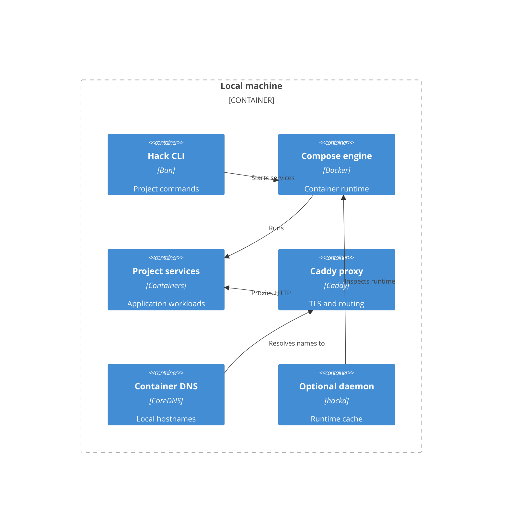
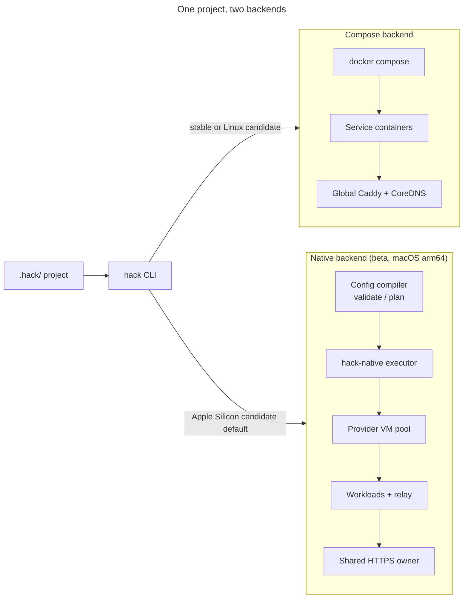
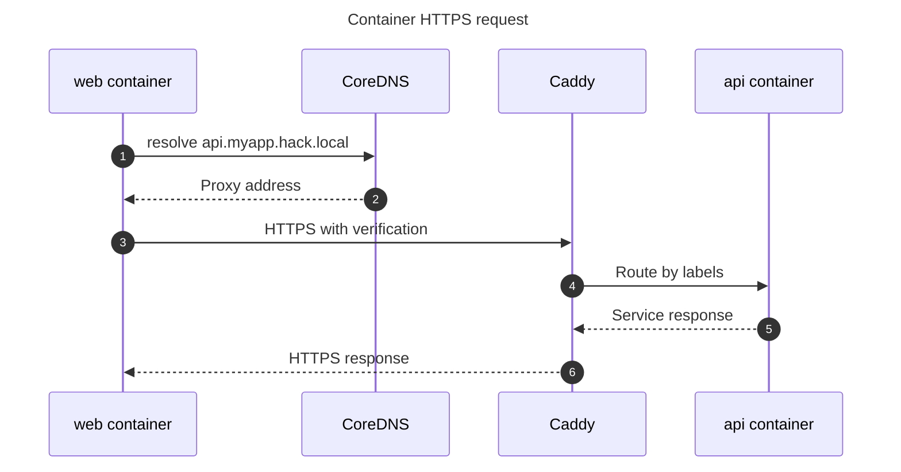
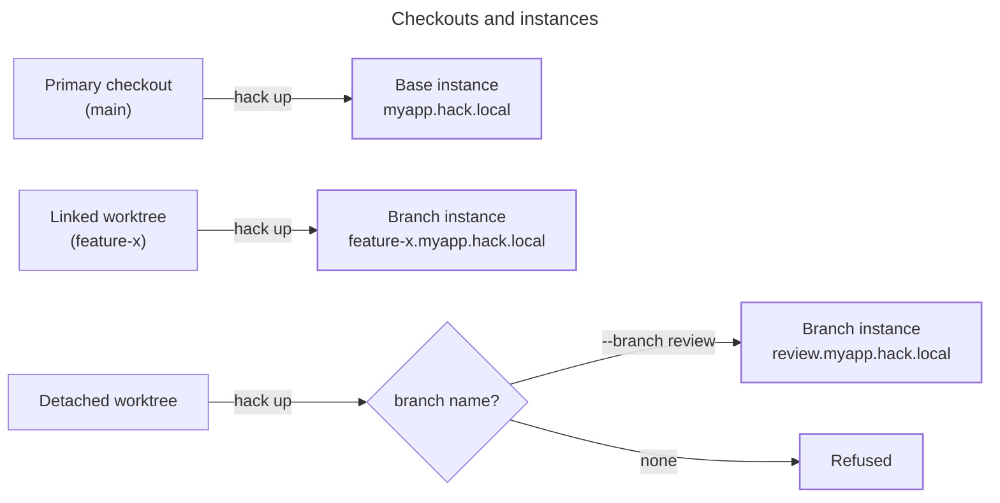
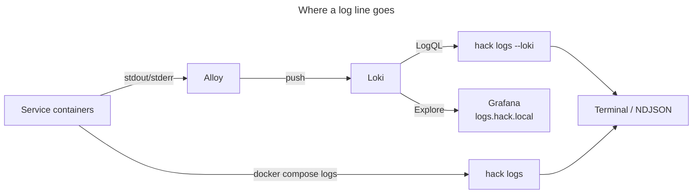
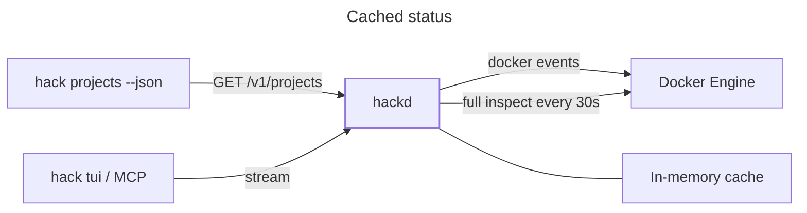
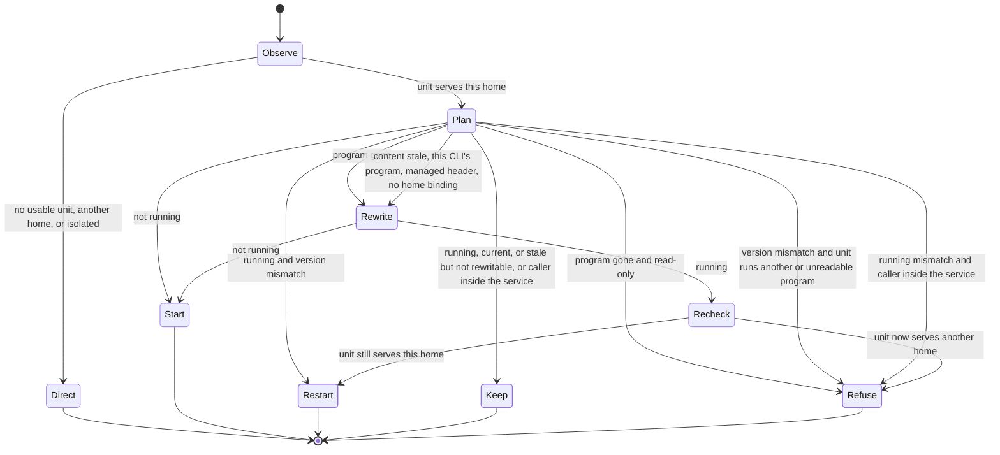
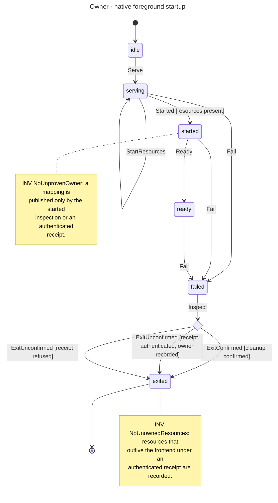
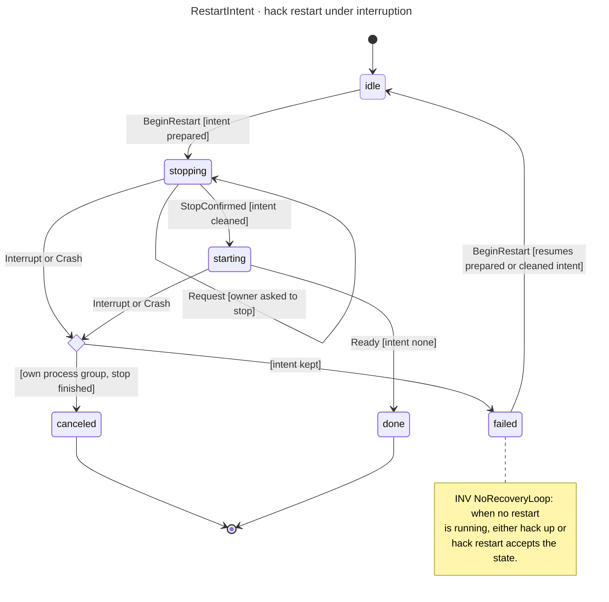
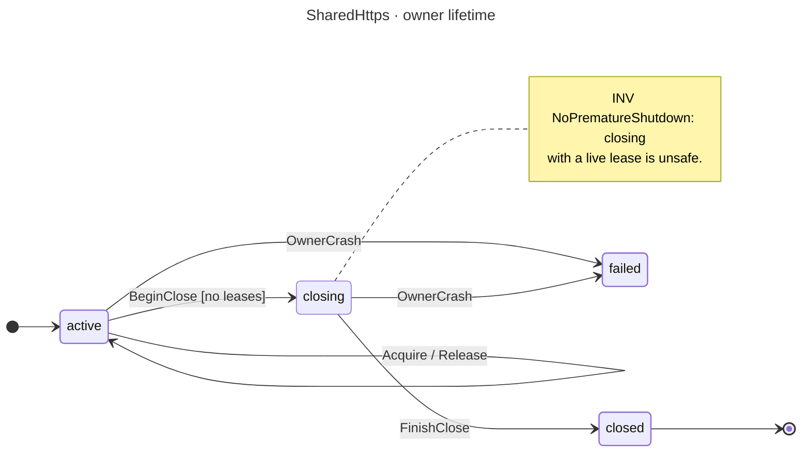

# Architecture

Hack is a local CLI that turns a small committed `.hack/` folder into a running
project: services, environment, secrets, trusted HTTPS, logs and host-side helpers.
Everything runs on the developer's machine. There is no hosted component.

Two kinds of state exist. **Global state** under `~/.hack/` (overridable with
`HACK_HOME`) holds the shared infrastructure every project uses: the proxy, DNS,
the logging stack, the project registry and the optional daemon. **Project state**
under `<repo>/.hack/` holds that project's definition and is committed, apart from
machine-local generated files that Hack keeps ignored.

## System overview

The Compose view separates executable responsibilities: the CLI controls the engine,
while DNS resolves proxy addresses, Caddy proxies requests and the optional daemon
reads runtime state for cached queries.



C4 containers here mean executable units, not only Docker containers. The CLI and
optional daemon run on the host; Caddy and CoreDNS belong to global setup. The
native backend has its own explicitly prepared routing path, described below.

- **Caddy** terminates TLS with a locally trusted CA and routes
  `https://<service>.<project>.hack.local` to containers by their Docker labels.
  Existing `.hack` names, `.hack.gy` OAuth aliases and custom domains route the
  same way.
- **CoreDNS** gives containers the same `*.hack.local` names as the host, so a
  service can call another service by its public local URL.
- **Alloy, Loki and Grafana** collect container logs and keep searchable history.
- **hackd** is an optional daemon that caches Docker state for fast `--json`
  status. The CLI works without it.
- **Schemas** for the project config files are served by Caddy at
  `https://schemas.hack.local` for editor validation.

## Backends

The CLI reads the same `.hack/` project on either backend. Stable `hack` uses
Docker Compose. The current `hack-next` prerelease defaults to native on Apple
Silicon macOS and uses Compose on supported Linux. Native is the planned default
for stable v5. The native beta runs prepared projects inside a Linux VM pool with
its own routing and a bounded command set.



The native backend selects a verified executor binary and a private native home,
plans the project through the config compiler, and runs workloads under a
foreground owner process that holds the run until it is stopped. Its supported
commands are whole-project `up` and `restart`, owner-mediated `down`, saved-run
`ps`, `logs` (live following is under verification), `exec` (interactive on a
terminal since next.17) and finite `run`. See
[the native backend guide](guides/native-candidate.md) and
[native authored commands](reference/native-authored-commands.md). A Compose flag
in these docs does not imply native support.

## Global vs project scope

- Global scope (`~/.hack`)
  - Caddy proxy on 80/443, routing by Docker labels
  - CoreDNS for container DNS (`*.hack.local` and legacy `*.hack` → Caddy)
  - macOS DNS helper: dnsmasq plus `/etc/resolver` entries selecting the local resolver
  - Logging stack (Alloy → Loki → Grafana)
  - Global config `hack.config.json` and the project registry `projects.json`
  - Networks `hack-dev` (ingress) and `hack-logging`
- Project scope (`.hack`)
  - `docker-compose.yml` defines services and Caddy labels
  - `hack.config.json` stores the project name, dev host, log preferences, OAuth
    alias and browser launch preference
  - `hack.env.default.yaml` and optional overlays hold committed env, with
    per-value encryption for secrets
  - `hack.branches.json` is an optional committed branch registry
  - `.internal/` and `.branch/` hold generated, machine-local files. Hack
    rewrites them on every run; keep them out of Git. `hack doctor` reports tracked
    copies and `hack doctor --fix` untracks them.

## Project lifecycle

`hack up` and `hack down` run more than Compose. Hooks and managed host processes
declared in `.hack/hack.config.json` run around the services, inside a dedicated
tmux session that Hack owns and can tear down. The exact ordering is in
[Lifecycle](lifecycle.md).

The [lifecycle outcome and phase diagrams](lifecycle.md#runtime-behavior) distinguish
failed startup, owned helper cleanup and an unconfirmed stop. They describe
whole-project Compose operations; native limits and service-scoped commands differ.

Lifecycle state is checkout-local at `.hack/.internal/lifecycle/state.json`, one
entry per instance. A random token mirrored in the mux session and in that state
proves ownership. Teardown never trusts a session name or a reused process group
on its own: `hack down` stops the saved process groups only while a matching
session still proves ownership, and `hack doctor --fix` removes a stale session
only when its instance is absent and a second check agrees. Fixed-port helpers
such as database or SSM tunnels can declare a `singleton` listener set so Hack
reuses an equivalent helper instead of starting a competing one; see
[shared host helper lifecycle](reference/shared-host-lifecycle.md).

## Environment and secrets

Env lives in committed YAML. Secrets are encrypted per value with a key that stays
out of Git. At runtime Hack merges the layers below and injects the result into
Compose, host commands and lifecycle processes. Nothing decrypted rests on disk:
the generated Compose override holds only `${HACK_ENV_...}` references and the
values travel through the `docker compose` process environment.

The [environment resolution diagram](env.md#merge-rules) applies scopes inside each
ordered file layer. A later file wins even when it supplies a global value over a
service value from an earlier file; host scope is not delivered to containers.

Later layers win. The primary-checkout layers apply only in a linked git worktree,
which also inherits the primary checkout's secret key through the shared git
directory. `HACK_ENV_SECRET_KEY` covers CI and other detached environments.
[Environment and secrets](env.md) covers the file format, delivery matrix,
rotation and the external secret-store backends.

## Internal DNS and TLS

When `internal.dns` and `internal.tls` are enabled, `hack up` writes a Compose
override that points each service at CoreDNS, mounts Caddy's local CA and the
combined trust bundle, sets the usual `SSL_CERT_FILE`-style variables, and adds
`extra_hosts` entries for runtimes that ignore custom DNS. Containers then use the
same `https://*.hack.local` names as the host. If Caddy's IP changes,
`hack status` and `hack doctor` warn and `hack restart` refreshes the mapping.

Caddy and CoreDNS hold reserved addresses on `hack-dev` (`172.30.0.2` and
`172.30.0.53`). Docker can report a proxy container as running while it is
attached to no network, to another network, or at another address; a plain
`docker compose up -d` leaves such a container as it is, and a project container
can then take the reserved address. `hack doctor` (`proxy network`) and
`hack global status` (`proxy_network` in `--json`) report it, and `hack global up`
takes the proxy stack down, moves any project container off the reserved
addresses, and starts the stack again.

A container resolves its peer through CoreDNS and receives the HTTPS response
through Caddy, which forwards the request to the peer's service port.



## Workflow: init, up, logs

For detached Compose startup, the CLI owns sequencing while proxy discovery and the optional daemon
observe the engine independently rather than coordinating the start.

```mermaid
---
title: Compose startup responsibilities
---
swimlane-beta TB
  subgraph CLI
    Env[Resolve env]
    Before[Before hooks]
    Processes[Host processes]
    Up[Start detached]
    After[After hooks]
    Verify[Check states]
    Env --> Before --> Processes --> Up --> After --> Verify
  end
  subgraph Engine
    Services[Containers]
  end
  subgraph Proxy
    Labels[Read labels]
    Routes[Routes]
    Labels --> Routes
  end
  subgraph Daemon
    Events[Events]
    Cache[Cache]
    Events --> Cache
  end
  Up --> Services
  Services -->|labels| Labels
  Services -->|events| Events
```

The daemon lane is optional. Observer arrows indicate metadata and event inputs,
not a readiness acknowledgement: successful startup does not prove that a browser
can reach a route. After hooks run before service-state verification; an after-hook
failure ends startup there (see [Lifecycle](lifecycle.md#hack-up)).

## Branch instances

`--branch <name>` generates a per-branch Compose override that prefixes hostnames
(`api.myapp.hack.local` → `api.<branch>.myapp.hack.local`) and the Compose project
name, so parallel checkouts never collide on ports or names. In a linked git
worktree, `hack up` selects a branch instance named after the branch automatically.
A detached worktree has no branch to derive a name from, so Hack refuses to target
the base instance silently; pass `--branch`, or set `worktree.auto_branch=false`.



`hack doctor` checks linked checkouts for divergent secret keys and `dev_host`
collisions. See [Worktrees and watchers](guides/development-runtime-safety.md).

## Logging pipeline

`hack logs` has two backends. **compose** streams `docker compose logs` directly
and is the default for following output. **loki** adds searchable history and
LogQL filters and is the default for snapshots (`--no-follow`), falling back to
Compose with a one-line notice when Loki has nothing for the selection.
`hack logs --json` emits NDJSON `start`, `log`, `error` and `end` events for
agents and the TUI.



Alloy discovers containers by polling Docker every five seconds and includes exited
containers, so a one-shot service such as a migration is shipped after it stops as
long as Docker keeps the container. A container removed between two polls never
reaches Loki; use `hack logs --compose` or the command's own output for those.
Alloy keeps its read positions in a named volume across `hack global down` and
`up`; `hack global logs-reset` clears positions and Loki data together. Loki
retention defaults to one week in the global template; per-project
`logs.retention_period` applies when `hack down` prunes logs.

## Daemon (hackd)

`hackd` is an optional local daemon that watches Docker events and keeps a cached
view of running containers behind a Unix socket at `~/.hack/daemon/hackd.sock`.
It powers `hack projects --json` and streaming consumers such as the TUI and MCP.
`hack ps` queries Compose directly so failed startups are visible immediately. If
the daemon is missing or version-mismatched, the CLI falls back to direct Docker
calls.



The daemon treats the container runtime as ephemeral: it fingerprints the engine,
detects resets, performs one bounded refresh, and marks cached state stale with
`runtime_*` metadata when the runtime is unavailable. Scripted and noninteractive
commands never autostart it. v5 prerelease launchers (`hack-next`, `hack-v5`)
never autostart it either, because autostart would run the stable daemon on PATH;
`hack doctor --fix` under those launchers skips its hackd repair and names the
command to run yourself. On macOS the launchd service belongs to the default
`~/.hack` root only; an isolated `HACK_HOME` runs hackd directly.

### Keeping hackd running

`hack daemon start` runs hackd in its own session and process group, with its
output going only to `~/.hack/daemon/hackd.log`. hackd's local API has no
authentication, so before it binds its sockets hackd makes `~/.hack/daemon`
owner-only (`0700`), and it sets each socket to `0600`. It changes the mode only
after checking that `daemon` is a real directory you own (not a link) under
directories others cannot replace, and it refuses to start when the directory
cannot be made private. The same goes one level down (`gateway/`). Once the directory
is private, hackd refuses to start if it holds anything it did not create
(another account's entry, a symlink, a hard-linked file), and it removes
group and other write from its own logs and pid file. The gateway token store
is written owner-only (`0600`). A store that others could write, such as one
written before this under umask `0002`, is not used: the gateway accepts no
token from it until you remove it and issue tokens again
(`rm ~/.hack/daemon/gateway/tokens.json && hack x gateway token-create`; the
gateway is an unsupported retained surface). Closing the terminal, or an agent
harness killing the process group that ran the command, does not stop it. It does
not survive logout or reboot. For that, install it as a login service with
`hack daemon install`:

- **macOS**: a launchd agent (`~/Library/LaunchAgents/dance.hack.hackd.plist`).
- **Linux**: a systemd user unit, `hackd.service`, written to
  `${XDG_CONFIG_HOME:-~/.config}/systemd/user/`, enabled for `default.target` and
  started with `systemctl --user`. `hack daemon uninstall` stops, disables and
  removes it.

On Linux, once the unit is installed, `hack daemon start` and `hack daemon stop`
go through `systemctl --user`, so a single manager owns the socket and pid file.
`stop` goes through systemd even when the pid file is missing or stale, which also
cancels a restart systemd has scheduled after a crash. When systemd runs or is
about to restart `hackd.service` but the managed unit file is gone (or the unit
is loaded from another directory), `stop` refuses and prints the
`systemctl --user` commands to review and stop it, instead of reporting hackd as
stopped, unless the unit is shown to be another home's (below). `uninstall` does the same in that case instead of reporting
that nothing was installed. If systemd cannot report the unit's state at all (the query
fails, times out, loses the user bus, or `systemctl` cannot be run), both refuse
in the same way. Only a unit systemd reports as inactive or not found, or a
failed query whose only message names `hackd.service` itself as absent
("Unit hackd.service could not be found."), counts as nothing to do. `start` and `stop` act on the unit only when its effective environment
serves the shell's Hack home. A unit that serves another Hack home is left alone:
`start` starts this home's hackd directly (its socket, pid file and lock live in
this home's `daemon/` directory), and `stop` stops only this home's own hackd. When the unit has a live main
process, `stop` proves from that process which Hack home it serves (a hackd
holding a socket in this home's `daemon/` directory), not from the loaded
configuration: a reload without a restart changes the configuration, not the
running daemon. A hackd main process that does not hold this home's socket is
left alone only with positive evidence that it is another home's daemon: the
configuration names another home, and the process is proven (identity stable)
to hold a socket in that home's `daemon/` directory, or it exited while being
checked. Then the unit is left alone and this home's own hackd is still
stopped, whether or not the managed unit file is present. Without that
evidence `stop` refuses: the daemon may still be starting (it has not bound
its socket yet), its sockets may be unreadable, or a reload changed the
configuration to this home under a running daemon; the message says to run
`stop` again or how to stop it by hand. A main process that cannot be
identified (its process details cannot be read, or it is not a hackd) is
refused, with the `systemctl --user status` and `stop` commands. With no live
process (a pending restart), the configuration decides, and `stop` still
cancels the restart. A failed query of the unit's state or main process is
not "no process": it is refused with the manual commands, installed unit or
not. Just before `systemctl --user stop`, `stop` reads the unit's state again
and refuses if the main pid changed or the read fails. That narrows the gap
without closing it: `systemctl stop` acts on whatever runs when it lands, so a
change after that read, or a pid reused in between, is not detected.
When the Hack home cannot be read with certainty (for example an
`EnvironmentFile=`, an `ExecSearchPath=`, a `PassEnvironment=` naming
`HACK_HOME`, `HOME` or `PATH`, a relative `HOME`, or an escaped quote or
backslash in `Environment=`), both exit 1 and print the `systemctl --user`
command to use by hand. The effective environment is built the way systemd
builds it: the user manager's environment, then the unit's `Environment=`
(drop-ins included), then `UnsetEnvironment=` last; with no `HOME` left, the
account's home from the password database is used, as hackd does. `start`, `stop` and `clear` remove stale pid and socket
files only while they are still stale: the socket is removed only if, right
before removal, the pid file is still the stale one, the socket is the same file
that was checked, and nothing answers on it. So they never delete the files of a
daemon that another start or a systemd restart just wrote. `install` stops a
hackd that was started directly and lets systemd start it.

Every signal Hack sends to a hackd goes through one proof, whether it comes from
`stop`, `restart`, `install`, replacing an incompatible hackd, or the sweep for
untracked ("orphan") daemons in `start` and `clear`. The proof needs all of:

- the exact argument list and the resolved executable (Linux `/proc`, macOS
  `KERN_PROCARGS2` and `proc_pidpath`), never `ps` text. The executable must be
  a Hack binary (named `hack` or `hack-*` once symlinks are resolved) or `bun`
  running this checkout's entry file, and the arguments must be a
  `daemon start --foreground` in any option order. A script named `hack` that
  runs another interpreter does not count;
- an open socket in this `HACK_HOME`'s daemon directory;
- a start time that does not change while it is checked (clock ticks on Linux).

The whole proof runs again immediately before each signal, SIGKILL included, and
must give the same executable, arguments and start time, so a reused pid or a
process that `exec`ed another program is never signalled. A process that fails
the proof is reported with its pid and left running. When a proven hackd cannot
be confirmed stopped, `stop` exits 1 and says it is still running, and `restart`,
`start` and the `install` handover stop there. A pid file that survived an unclean
shutdown and now names another program does not count as a running hackd. If
systemd runs an incompatible hackd from a unit that points at another `hack`
(another file, not a link to this one),
`hack daemon status`, `hack doctor` and `hack daemon restart` all point to
`hack daemon install`, because a restart would start the same version again.
`install` reports success only when systemd runs the hackd that answers. The unit:

- runs `<hack> daemon start --foreground`, where `<hack>` is the absolute path of
  the `hack` found on `PATH` at install time. Symlinks are kept as they are, so a
  stable link such as `~/.local/bin/hack` keeps working when an upgrade moves the
  real binary;
- restarts hackd after a crash (`Restart=on-failure`), at most five times a
  minute, but not after `hack daemon stop`. After a crash loop,
  `hack daemon start` clears the failed state before starting it again;
- keeps systemd's default `KillMode=control-group`: stopping or restarting the
  service also stops the processes hackd started;
- sends stderr to the journal (`journalctl --user -u hackd.service`); hackd's own
  log stays in `~/.hack/daemon/hackd.log`.

`hack daemon install` writes the whole unit file. Before writing it, it makes
sure `$XDG_CONFIG_HOME`, `systemd/` and `systemd/user/` are directories you own
that your group and other users cannot write: it creates them `0755` whatever
the umask and removes group or other write from ones you own, and it refuses
(with the `chmod` to run) when that is not possible, because whoever can replace
the enabled unit runs code as you at the next login. Only an explicit
`install` repairs those modes. Every automatic path (`start` and `restart`,
the reconcile after `hack update`, the check before a running daemon is
stopped) refuses a group- or other-writable unit or drop-in directory with
`blocked: "untrusted-unit"` and changes nothing. While such a directory was
writable, another account may already have planted a unit there. That holds
inside an automatic rewrite too. The installer it shares with `install`
repairs nothing and does not replace an untrusted unit file unless the
caller is explicit `install`, so a directory that becomes writable after the
earlier checks refuses the rewrite. Nothing is written, reloaded or
restarted, and the mode is left as it is.
`hack daemon stop` neither repairs nor refuses such a directory (see below).
For the same reason,
`install` and `start` check `hackd.service.d/` and `service.d/`: every drop-in
there must be a file you own that others cannot write, or they refuse to use the
unit until you review it. `start` (and autostart) also runs the unit only when
`hackd.service` is a regular file you own that others cannot write, in
directories that pass the same check; a symlinked unit is refused. A unit or
drop-in file that others could write is refused, not repaired, since its contents
may already be someone else's; `install` replaces such a unit file with a fresh
one. The
directories above `$XDG_CONFIG_HOME`, up to `/` and through any symlinks, must not
be writable by your group or others either (Hack refuses and prints the
`chmod go-w` to run; it does not change your home directory). Right before
it starts or restarts the unit, Hack asks systemd which files it loads
(`FragmentPath` and `DropInPaths`, which cover every user-unit load directory,
`$XDG_DATA_HOME` included): the fragment must be the unit Hack manages, and
every drop-in and its directory must belong to you or root and not be writable
by others. Every directory systemd loads user units from (its `UnitPath`) gets
the same check, even when it is empty or does not exist yet (then its nearest
existing parent is checked), because another account that can write one could
add a drop-in for the next login. The program the unit runs gets the same check when you install the
unit and before each start: the `hack` binary, the file it resolves to, and every
directory above them must belong to you or root and not be writable by your
group or others (sticky directories such as `/tmp` excepted). Hack does not
repair these, even inside `HACK_HOME`: a program or directory others could
write may already have been changed, so it refuses and prints the
`chmod go-w` to run. Another regular user's program is never trusted; a file
owned by a system account (below `UID_MIN`) is accepted only in a root-owned
directory nobody else can write, as package managers install setuid tools.

What systemd runs for the unit is an allowlist: exactly one `ExecStart` running
`<hack> daemon start --foreground`, and no other `Exec*` setting. The program
must be a hack executable: named `hack` or `hack-*`, resolving to a binary named
the same way or to a `#!` launcher whose interpreter is an absolute path that
passes the same ownership check (with no argument, or `env <program>`, which
is looked up through the checked `PATH`). Any other program, such as an interpreter
that would run a script named `daemon`, is unknown, and the unit is left as it is. A drop-in that
adds `ExecStartPre=`, `ExecStop=`, an interpreter wrapper or a second
`ExecStart` makes `install` and `start` refuse. `hack daemon stop` and
`hack daemon uninstall` first make the same unit-file, load-directory and drop-in checks
as `start` (a stop also starts units a drop-in names, such as `OnSuccess=`),
and refuse while an `ExecStop`/`ExecStopPost` hook is loaded, because stopping
runs it (systemd runs stop hooks even after `systemctl kill`); remove it and run `systemctl --user daemon-reload` first. A
unit whose `hack` was removed can still be stopped and uninstalled. `install`
also refuses to enable a unit that a drop-in points at another `HACK_HOME`. Before it
writes anything, `install` also refuses to replace a unit systemd is running
(wherever it was loaded from) that serves
another Hack home, or whose Hack home it cannot read, since its restart would
stop that daemon. hackd runs helpers such as `docker` and `git` through its
`PATH`, so every directory on the service's `PATH` (the one Hack writes at install,
and the effective one the service gets before each start, including a `PATH`
inherited from the user manager) must not let other users
add or create programs there either. Variables that load code before the checked program
(`LD_PRELOAD`, `LD_LIBRARY_PATH`, `BASH_ENV`, `SHELLOPTS`, `NODE_OPTIONS`,
`BUN_OPTIONS` and similar) are removed by an `UnsetEnvironment=` line in the unit
Hack writes, so values from the user manager's environment never reach hackd,
at login either. If a drop-in brings one back, `install` and `start` refuse. A unit
that runs in another file namespace (`RootDirectory=`, `RootImage=`, bind mounts,
images) is refused as well, because the paths Hack checked on the host need not
be what systemd runs there. Put local settings, such as
`DOCKER_HOST` for rootless Docker, in a drop-in (`systemctl --user edit hackd`).
`install` writes the `hack` it was run from, and warns when that path is in a
temporary directory, a package cache or a source checkout.

`hack daemon start` reads `ExecStart` only when it is a single plain absolute
path. A prefix (`-`, `@`, `:`, `+`, `!`), a specifier such as `%h`, an escape or
several `ExecStart=` lines make the program unknown: `start` leaves that unit as
it is and says so, and `hack daemon status` and `hack doctor` report it. An unknown
program is never treated as a missing one.

`hack daemon start` and autostart never rewrite a unit that runs another existing
`hack` (not this CLI's executable or a link to it): they say so, and
`hack daemon install` switches the service. If systemd runs an incompatible
hackd from such a unit, `start` reports it instead of replacing it, because
systemd would only start the same version again. A stale unit that runs this
CLI's executable and starts with Hack's managed header is rewritten and
restarted; see
[After an upgrade](#after-an-upgrade-a-stale-service-is-repaired-by-start). When the unit's program no
longer exists, `start` retargets it, but only to a durable location: the path
and the file it resolves to must both be outside temporary directories, package
caches and source checkouts. The unit keeps the path as written. It then replaces just the
program in `ExecStart` and keeps every other line, including your edits;
otherwise it reports the problem and asks you to run `hack daemon install`. If an
earlier `daemon-reload` failed (`NeedDaemonReload=yes`), `start` and `install`
reload before they start. Other edits to the file show up as drift in
`hack daemon status` and `hack doctor`. `hack daemon install` replaces them, and
so does `hack daemon start` when the unit runs this CLI's executable and still
starts with Hack's managed header. Put local changes in a drop-in
(`systemctl --user edit hackd`).

A systemd user manager runs only while you have a login session, unless linger is
on. `hack daemon install` and `hack daemon status` report linger. When it is off,
they print the command, `loginctl enable-linger`, which keeps your user services
running without a session and starts them at boot. Hack never turns linger on for
you.

Where `systemctl --user` cannot be used (no systemd, a container, WSL without
systemd, or an SSH session with no user bus), `hack daemon install` explains why,
writes nothing, starts hackd directly instead and exits 1.

`hack daemon status` reports who manages hackd: `managed_by` (`launchd`,
`systemd` or `null`) and a `service` object in `--json`, and a `systemd:` line in
the text output on Linux. The text and JSON give the same next step. On Linux,
`hack doctor` adds a `daemon service` check. It warns when the unit is missing,
has drifted or is disabled (fix: `hack daemon install`); when the unit has failed,
or the running hackd was started directly rather than by systemd (fix:
`hack daemon restart`); or when linger is off. `hack doctor --fix` offers
`hack daemon install` only interactively, because it writes outside the project
and enables a login service. It skips the install without a TTY, and also skips it
under the same conditions that skip the hackd repair. Without a TTY, or when you
decline the install, its hackd repair may still start hackd, but it never writes
or reloads the unit (`hack daemon` runs with `HACK_DAEMON_SERVICE_READ_ONLY=1`).
`hack daemon uninstall` exits 1 and says what it already did when the final
`daemon-reload` fails. The unit belongs to the
default `~/.hack` root: an isolated `HACK_HOME` or `HACK_SYSTEMD_DISABLE=1` turns
systemd management off (`HACK_SYSTEMD_ALLOW_ISOLATED_HOME=1` opts in).

### After an upgrade: a stale service is repaired by `start`

`hack daemon start` and `hack daemon restart` bring an installed login service up
to the running CLI. The service is stale when:

- `content`: the unit (or launchd plist) differs from what this CLI writes for
  the same program, for example after an upgrade changed the unit's `PATH`;
- `program-missing`: the program it runs no longer exists;
- `version-mismatch`: the hackd it runs reports another version than the CLI.

On Linux, `start` rewrites a `content`-stale unit automatically only when both
of these hold:

- the unit runs this CLI's executable: a path that resolves (every symlink
  followed) to a file with the same device and inode as this CLI's, checked
  when the decision is made. Equal path strings alone do not count, because a
  pathname can be replaced after the CLI started from it;
- its main file starts with Hack's managed header
  (`# Managed by hack: written by \`hack daemon install\`...`), whose next line
  says local changes are replaced on the next install.

"This CLI's executable" means the binary that is running, not the `hack` first
on `PATH`. `hack update` runs the new binary by its path while an older `hack`
may come first on `PATH`, and a service running that older one is not this CLI.
A source invocation (`bun index.ts`) has no executable a unit or plist could
name, so it never counts as running the service's program. The `hack` on `PATH`
is still what `hack daemon install`, and a retarget of a missing program, write
into the service. When the service runs another program and the daemon is of
another version, `start` refuses (`blocked: "other-program"`) with
`hack daemon install` as the next step instead of restarting it into the same
version. The launchd checks use the same rule.

A unit without that header was written or edited by hand. It keeps the earlier
behaviour: `start` reports the drift with `hack daemon install` as the next step
and does not rewrite it. A managed unit whose main file sets the service's Hack
home (`HACK_HOME` or `HOME` in `Environment=`, or any `EnvironmentFile=`) is not
rewritten either, because the unit Hack renders would drop that binding and move
the service to the default home. Neither is a managed unit with any continued
line (a line ending in a backslash, which systemd joins with the next one): Hack
does not re-read the joined setting, so it cannot rule out a binding there. Move
the setting into a drop-in
(`systemctl --user edit hackd`), then run `hack daemon install`.

Trust comes first on every path that changes the unit. Before `start` reads the
unit to keep its other directives, rewrites it, retargets a missing program,
completes a pending `daemon-reload` or restarts the service, and before it stops
a running daemon to make room for the service, it runs the checks that `install`
and `enable` run. The unit file must be a regular file owned by this user and not
writable by others, and the directories above it and its drop-in directories
must be safe from other accounts. Every user-unit load directory systemd reports
(`UnitPath`) must be safe too, as must the fragment and drop-ins systemd has
loaded, because a rewrite of the main file keeps them. If any check fails,
nothing is written, reloaded, stopped or restarted, and `start` exits 1 with
`blocked: "untrusted-unit"` and `hack daemon install` as the next step. The check
must come first because a rewrite replaces the file as this user: a check after
it would pass for directives another account planted, such as a `Wants=` of
its own unit, which a retarget keeps.

systemd also starts every unit listed in `hackd.service.wants/`,
`hackd.service.requires/` and `hackd.service.upholds/`, in any user-unit load
directory, together with hackd. Hack's renderer and `install` create none of
these (`systemctl enable` links into `default.target.wants/`). So before any
reload, start or restart, each must be absent, or an empty directory owned by
you or root that others cannot write. A link, any entry in one, or a writable
one refuses with `blocked: "untrusted-unit"`, and nothing is reloaded,
started or restarted. `install` makes the same check. `hack daemon stop` does
not, and is not blocked by a writable unit directory either. A stop loads and
runs no new unit code and Hack never reloads to stop, so it should not stop
you from shutting hackd down exactly when something looks wrong. Stop keeps
its own checks: that the daemon it stops is this home's, that the unit file is
a regular file you own that others cannot write, that the files systemd has
loaded are trusted, and that there are no stop hooks.

The rewrite keeps the program path as written, so a stable symlink stays a
symlink, and an enabled unit stays enabled while a disabled one stays disabled.
It makes the same checks as `install`: the program and every directory on the
unit's `PATH` must be safe from other accounts, and the unit directories are
checked and created the same way. A program at a location that may not last is
reported, as `install` does. When hackd is running under the unit, `start` reads
the unit's Hack home again after the `daemon-reload`, refuses if it no longer
serves this home, and otherwise restarts it with `systemctl --user restart`,
after the loaded-file, program and stop-hook checks that `stop` makes. A hackd of
another version under this CLI's unit is restarted the same way, even when the
unit was not rewritten, so the new executable runs. "This CLI's unit" means
both the main file and what systemd has loaded: the single loaded `ExecStart`
(drop-ins included, read with `systemctl --user show`) must be this CLI's
executable by file identity. A drop-in that runs another `hack` keeps the
daemon as it is (`blocked: "other-program"`). A loaded `ExecStart` that cannot
be read (none, or several) keeps it too (`blocked: "unproven-owner"`). This
check gates every automatic restart, whatever asked for it: a version mismatch,
a pending-restart marker (which then stays), or a rewrite. Retargeting a
missing program, or rewriting the unit, changes what systemd loads, so the
loaded `ExecStart` is read again after the `daemon-reload` and before the
restart. A retained drop-in that still selects another program stops the
restart there. While a reload is pending (`NeedDaemonReload=yes`) for a unit
file that runs this CLI, which happens after a repair whose `daemon-reload`
failed, the loaded copy is stale by definition. `start` then retries the
reload first (not in read-only mode, with the same home check) and judges the
newly loaded `ExecStart` before restarting, so a later start finishes the
repair.

Before such a restart, and again just before it lands, `start` proves that the
unit's live main process is this home's hackd. This is the same proof `stop`
needs: a hackd holding a socket in this home's `daemon/` directory, or this
home's hackd as the direct child of a launcher main process. That this home's
pid runs in the unit's cgroup is not enough. This home's hackd may have been
started by a job of another home's daemon, or a reload may have pointed the
configuration at this home while the running daemon serves another. Without the
proof, `start` exits 1 with `blocked: "unproven-owner"` and changes nothing.
The final proof uses a fresh read of the unit's state. If that read fails or
systemd is unavailable, the restart is refused the same way; an earlier read
is never reused, because a failed read reports no main process.
When an earlier repair wrote the unit but its `daemon-reload` failed, the next
`start` finishes that reload (and checks the unit's home again) before it
restarts. If the reload fails again, the restart is not attempted and the
restart-pending marker stays for the next run.

`start` never rewrites or restarts the service from inside it. On Linux it
compares its own cgroup (`/proc/self/cgroup`) with the unit's `ControlGroup`. On
macOS it checks whether the launchd job's process is one of its ancestors. A job
that hackd started (for example a supervisor job running `hack daemon start`)
would otherwise stop itself. From inside, a compatible daemon is kept: `start`
exits 0 with action `none` and `blocked: "inside-service"`. A daemon of another
version is refused with exit 1 and nothing is stopped. The check fails closed:
`start` treats the caller as inside when systemd reports no `ControlGroup` (or
an empty one) for the running unit, when `/proc/self/cgroup` is unreadable,
empty or malformed, or when launchd reports no usable pid for the loaded job or
the ancestry cannot be read. Known limit: an explicit `hack daemon restart` run
from inside the service is not guarded, and stops the service it runs in.

`start` does not repair the service, and goes on as before, when it cannot
prove the service is this CLI's:

- the unit runs another existing `hack` (one you may have chosen): it is not
  rewritten; a running hackd of another version is refused with
  `hack daemon install`, which switches the service;
- systemd cannot say what the unit runs (an `ExecStart` Hack does not read): a
  running hackd of another version is refused;
- the unit serves another Hack home, or Hack home isolation
  (`HACK_SYSTEMD_ALLOW_ISOLATED_HOME`, `HACK_SYSTEMD_DISABLE`) keeps this CLI
  off the user service: hackd is started directly, as before;
- `HACK_DAEMON_SERVICE_READ_ONLY=1` (`hack doctor --fix` without a TTY): the
  unit is never written or reloaded. A hackd of another version under this
  CLI's unit is still restarted, which does not change the unit. A pending
  reload or restart stays pending and is reported (`blocked: "read-only"`), but
  on its own it never restarts a hackd that already runs this version, so
  repeated read-only starts do not keep restarting it.

On macOS, Hack reads the plist only at its own LaunchAgents path for its label
(`dance.hack.hackd`). launchd has no drop-ins, so the systemd header rule does
not apply there. A plist counts as Hack's when it carries Hack's managed marker
(a `<!-- Managed by hack ... -->` comment that `hack daemon install` now writes)
or its `Label` is Hack's. That covers plists written by earlier Hack versions,
which have no marker.

The program is read as launchd reads it: `Program` when present, else
`ProgramArguments[0]`, and only from keys of the plist's root `<dict>`. Keys
inside nested dicts (such as `EnvironmentVariables`) and inside comments do not
count. Some plists cannot be read:

- the text is not a property list, or its root is not a dict;
- it has CDATA, an unterminated comment, a malformed or unbalanced tag, or a
  value type the reader does not know;
- a root key repeats, or uses an XML entity or character reference (launchd
  reads `Progr&#97;m` as `Program`). Keys are compared exactly as written, so
  ` Program ` with spaces is another key;
- the program value is not a plain string, uses an XML escape, or is not an
  absolute path exactly as written (it is not trimmed).

Such a plist is never replaced automatically; `start` reports it and
`hack daemon install` replaces it.

- A plist whose program is gone is retargeted to this CLI. Gone means no program
  at all, a compiled-binary virtual path, or a path that `stat` reports as
  `ENOENT` or `ENOTDIR`. Any other `stat` error (for example `EACCES` or `EIO`)
  means the program cannot be checked, and the plist is left alone. The
  retarget target (the `hack` on `PATH`) must pass the same checks as a systemd
  retarget. It may not be a source file (`.ts`, `.js`...) or a `#!` script run
  by bun. It must be durable, outside temporary directories, package caches
  and checkouts, and safe from other accounts. Otherwise start refuses
  (`blocked: "rewrite-refused"`) with `hack daemon install` as the next step.
- While hackd runs (start found it running, or launchd reports the job
  running), a rewrite would unload and restart it. Only an eligible CLI may do
  that: a compiled binary that is the same file as the program the plist will
  run. Otherwise the job is not touched and the daemon keeps running
  (`unproven-owner` from a source checkout, `other-program` for another
  binary). A stopped job may still be repaired from any CLI. The same rule
  applies before `start` or `restart` stops an incompatible hackd that runs
  under a plist whose program is gone. The start after the stop would
  retarget the plist, so the target must pass the retarget checks
  (`rewrite-refused`), and the CLI must be a compiled binary that is that
  target. Otherwise nothing is stopped.
- A plist that runs this CLI's executable (same file) is rewritten with the
  marker when it differs from what this CLI writes, if it is Hack's or its
  output paths are not `/dev/null` (the earlier output repair). launchd then
  restarts hackd from it. One that is not Hack's (no marker and another
  `Label`) is only reported.
- Every automatic rewrite, a refresh included, checks the program the new
  plist will run last, right before the plist is written and the job is
  booted out and bootstrapped. A refresh keeps the plist's program, and that
  program must pass the retarget checks: not a source file or bun script,
  durable, and safe from other accounts along its whole path. Otherwise
  nothing is written, unloaded or loaded, and start refuses
  (`blocked: "rewrite-refused"`) with `hack daemon install` as the next step.
  Without this check, someone able to replace that pathname would have
  launchd start their program as this user. hackd also runs helpers such as
  `docker` by bare name, so every directory of the PATH the new plist gives
  hackd (`/usr/local/bin`, `/opt/homebrew/bin`, `/usr/bin`, `/bin`,
  `~/.bun/bin` and `~/.hack/bin`) must pass the checks systemd makes for its
  rendered unit's PATH. A directory another account can add programs to, or
  create, refuses the rewrite the same way, with nothing unloaded or written.
  An explicit `hack daemon install` on macOS makes the same PATH check before
  it touches launchd. The check that runs before `start` or `restart` stops a
  running hackd makes the program and PATH checks for a refresh or retarget
  the start would run.
- Hack runs `launchctl` as `/bin/launchctl` and the macOS ancestry check's
  `ps` as `/bin/ps`, never looked up on PATH. These run automatically after
  `hack update` and during `start`, and a planted `launchctl` or `ps` in an
  earlier PATH directory would otherwise run as this user. The daemon's
  process proofs, the orphan sweep and the ownership proof an automatic
  replacement runs, read `ps` and `lsof` only from fixed paths. On macOS
  those are `/bin/ps` and `/usr/sbin/lsof`. On Linux they are the first of
  `/bin/ps` or `/usr/bin/ps`, and of `/usr/bin/lsof` or `/usr/sbin/lsof`,
  that another account cannot replace. When none qualifies, the observation
  is unknown: nothing is stopped, and the start does not go on as if no
  orphan held the socket. On Linux, `systemctl`, `loginctl` and `getent` are
  still found on PATH, but one whose path another account could replace is
  refused before it runs.
- Every automatic start of the launchd job checks the plist launchd will
  load or start, current or just rewritten, before anything is unloaded,
  bootstrapped or kickstarted. That covers `start`, `restart`, the reconcile
  after `hack update`, a stopped-service start and autostart. The plist must:
  - run exactly `<program> daemon start --foreground`: its complete
    `ProgramArguments`, with `Program` taking precedence as launchd does;
  - name a program that is safe from other accounts along its whole path;
  - set its own `PATH`. launchd's default or inherited PATH is never assumed,
    because it can hold a directory another account writes.

  Every directory of that `PATH` must pass the same PATH checks. Hack has
  always rendered `PATH` and that exact command (the first launchd renderer
  already did). A Hack plist without them is refreshed through the checked
  repair, which writes them. Any other such plist is not started
  automatically.
- A kickstart runs the configuration launchd has loaded, which can differ
  from the plist on disk until the job is reloaded. The loaded job is read
  from `launchctl print gui/<uid>/dance.hack.hackd`. It must run exactly the
  checked plist: the same program, Hack's arguments, and the same explicit
  `PATH` in the job's own environment. When it does not, or cannot be read,
  the job is reloaded from the checked plist, but only if a status read made
  just before the bootout shows it stopped. A running job is not reloaded,
  because that would stop hackd. After a successful reload, a re-read that
  positively differs still refuses. A re-read that cannot be parsed is
  accepted, because launchd has just loaded the plist that passed every
  check. Reading real `launchctl print` output is a compatibility point that
  has not been verified against every macOS release, and this fallback keeps
  the service available if that format moves.
- The plist file itself is checked before anything is unloaded, written or
  bootstrapped: install, refresh, retarget, reload and autostart's implicit
  install. It must be a regular file (not a link), owned by this user and
  not writable by group or others. `~/Library/LaunchAgents` must not let
  others add or replace entries, and no directory above it may be
  replaceable by another account. Nothing is repaired, because a file others
  could write may already hold their content. A failure refuses with
  `blocked: "untrusted-unit"`. The bytes are bound too:
  - a reload reads the plist through a descriptor that does not follow
    links, and those bytes must be exactly the ones checked;
  - right before `launchctl bootstrap` it reads the plist the same way
    again, and requires the same bytes, device and inode;
  - an install writes a fresh file renamed onto the path (a link there is
    refused) and binds the bootstrap to those bytes the same way.

  A plist replaced in between is not loaded, and so not kickstarted.
- On a refusal launchd is not asked to start the job, and `start` exits 1
  (`blocked: "rewrite-refused"`, or `untrusted-unit` for the plist file,
  with `hack daemon install` as the next step).
  Before `start` or `restart` stops a running hackd under a current plist,
  it makes the same plist checks and refuses a loaded configuration it cannot
  read. So a running daemon is never stopped for a start that would be
  refused. Every plist install (explicit, autostart's implicit install,
  refresh or retarget) also checks the program it writes, safe from other
  accounts along its whole path, before it unloads, writes or loads anything.
- On Linux, a stopped-service start checks the loaded unit's programs and
  effective PATH just before `systemctl start`. The program a rewritten unit
  keeps passes install's program checks just before the unit is written. An
  automatic restart checks the exact loaded program and the effective PATH
  as its last step.
- A plist that runs another existing `hack` is left as it is, even an older
  versioned install path. A running hackd of another version under it is
  refused with `hack daemon install`. A stopped service under it is not
  kickstarted (earlier Hack versions retargeted such a plist to the running
  CLI instead), and `hack daemon restart` refuses before it stops anything.
- When a needed rewrite does not complete (unloading, writing or loading the
  plist fails), `start` exits 1 with `E_DAEMON_SERVICE` instead of reporting
  hackd as running: the unload may already have stopped it.
- Before any automatic rewrite (a refresh or a retarget), the loaded job must be
  this home's. If the plist's `EnvironmentVariables` sets `HACK_HOME`, or a
  `HOME` other than the one Hack writes for this home, it is left alone
  (`blocked: "home-binding"`). If the job is running, its pid must be proven to
  be this home's hackd, holding a socket in this home's `daemon/` directory
  (the proof `stop` uses). Otherwise it is left alone
  (`blocked: "unproven-owner"`). A running job without a pid counts as
  unproven. A job counts as not loaded only when `launchctl print` says so
  itself: exit 113 with "Could not find service". Any other failed query is an
  observation failure. It is treated as unproven, so nothing is unloaded,
  rewritten or loaded.
- When `start` finds this home's hackd running directly and incompatible, it
  replaces that daemon by stopping it and starting through the service.
  Before it stops anything, it checks that the start would go through. On
  macOS the loaded launchd job must not bind another home and must be this
  home's. On Linux, the check uses the same planning and unit-rewrite
  computation as the start itself, without writing anything. The start would
  refuse when:
  - the unit is untrusted, its Hack home cannot be read, or Hack cannot vouch
    for its loaded files or program;
  - a missing program cannot be repaired in read-only mode;
  - a needed rewrite would be refused: no durable `hack` to retarget a missing
    program to, or a program or service `PATH` that fails install's checks,
    including a `PATH` or program that a drop-in the rewrite keeps supplies.

  If the start would be refused, `start` refuses first (exit 1,
  `E_DAEMON_SERVICE`, with `home-binding`, `unproven-owner`, `untrusted-unit`,
  `read-only` or `rewrite-refused` as `blocked`) and leaves the running daemon
  alone.
  `hack daemon restart` runs the same checks before it stops a running hackd.
  Its start after the stop then gets the same direct fallback as a replacement
  in `start`.

  The check cannot foresee everything: a change between the check and the
  start, or a write, reload or start that fails at runtime. So when the service
  cannot start the replacement after the stop, `start` starts this home's hackd
  directly instead, the way it does when the unit serves another home. It
  reports action `restarted` with `fallback: "direct"`, keeps the service's
  `blocked` reason, and warns to run `hack daemon install` (a directly started
  hackd stops at logout or reboot). Only if that direct start fails too does
  hackd stay stopped, and `start` reports the error. The post-update
  reconcile-only mode uses the fallback as well, because that daemon was
  running before.

  A replacement's direct start runs this CLI itself: the executing compiled
  binary, or the same runtime and entry point for a source invocation. It
  never runs the `hack` first on `PATH`. It also never gives hackd the
  caller's `PATH`, whether or not a service is installed: hackd runs helpers
  such as `docker` by bare name, so the direct start gets the `PATH` a service
  would give it (the systemd unit's, with this CLI's directory first, or the
  launchd plist's) after the same directory checks the service gets. A fresh
  start with no running daemon to replace keeps the caller's environment, as
  `hack daemon start` always has. If a directory on it is unsafe, the direct
  start refuses, hackd stays stopped, and the error names the next step,
  `hack daemon install`. `hack update` runs the new binary by
  absolute path while an older `hack` may come first on `PATH`, and starting
  that one would bring back the old version. After any replacement start,
  through the service or directly, `start` checks that the daemon answers on
  this home's socket and reports this CLI's version. A pid and a socket are
  not enough. If it does not, the replacement failed: `start` exits 1 with
  `E_DAEMON_SERVICE` and action `none`, never `restarted`, and the update
  result records `daemon.status: "failed"`. Ordinary starts with no running
  daemon to replace keep starting the `hack` they always did.

  The fallback covers an early refusal (before the manager was asked to start
  anything), a failed start, and a start that throws. It never starts a second
  hackd next to one the manager may still start, so it runs only on positive
  evidence that the manager is idle:
  - systemd: `ActiveState` is `inactive` or `failed`, `SubState` is not
    `auto-restart`, and no `Job` is queued (or the unit is not loaded);
  - launchd: only when `launchctl print` for Hack's label answers not-found
    (exit 113, "Could not find service"). Hack asks launchd even when the plist
    file is gone, because moving or deleting the file does not unload the job.
    A loaded job is never idle, whatever its plist file says: the loaded
    configuration can differ from the file, and `KeepAlive`, `RunAtLoad`,
    `StartInterval`, `StartCalendarInterval` or `WatchPaths` can start it
    again. On macOS the fallback therefore runs only once the job is unloaded.

  When the manager may still start hackd, or cannot be checked, `start`
  returns the service's error with `blocked: "service-pending"` and says the
  service may still start hackd. Whether hackd was asked to start comes from
  what the start itself reports, not from the `--json` record.



After `hack update` installs a release, it checks for an installed login service
and for this home's hackd. A live pid is not enough: hackd must answer on this
home's socket. When both are found, it runs the new executable's
`hack daemon start --json` in reconcile-only mode (`HACK_DAEMON_RECONCILE_ONLY=1`).
In that mode `start` does nothing (action `none`) when no hackd of this home is
running, so a daemon that stopped in the meantime is not started. The flag
applies to that one invocation only. A daemon it starts to replace an
incompatible one never inherits it, and a `--foreground` start ignores it, so
the replacement runs normally. The step never
fails the update, including when it cannot read the service state. A failure is
reported in the update result (`daemon.status: "failed"`) with
`hack daemon install` as the next step. A stopped service picks up the new
version at its next `hack daemon start`.

The new executable is run only after two checks, made right before the
spawn:
- its path must be safe from other accounts (the program checks a login
  service gets), with no link at the final component;
- it must still be the file `hack update` published: the same device, inode
  and sha256 that the publish step recorded.

With a custom install directory that another account can write, a payload
could otherwise be renamed over the binary and run as the updating user. If
either check fails, nothing is run, and the update result records
`daemon.status: "failed"` with `hack daemon start` as the next step. The
update itself still succeeds.

`hack daemon start|stop|restart|install --json` print one envelope and nothing
else on stdout (human lines go to stderr). They follow the shared rule in
[Machine-readable output](reference/machine-readable-output.md): exactly `ok`
and `data` at the top level, with the versioned schema inside `data`. Success
is `{"ok": true, "data": {...}}` with:

| Field | Meaning |
| --- | --- |
| `schema` | `hack.daemon-<command>.v1` |
| `manager` | `systemd`, `launchd` or `none` (hackd runs directly) |
| `action` | `none`, `started`, `restarted`, `reinstalled`, `stopped` or `installed` |
| `stale`, `stale_reasons` | whether the service or daemon was stale, and why: `content`, `program-missing`, `version-mismatch` |
| `blocked` | why a stale service was left as it is, or `null`: `read-only`, `other-program`, `unknown-program`, `unmanaged`, `home-binding`, `inside-service`, `unproven-owner`, `rewrite-refused`, `service-pending`, `untrusted-unit` |
| `fallback` | `"direct"` when a replaced daemon was started directly because the service could not start it, else `null` |
| `cli_version` | this CLI's version |
| `daemon` | `running`, `pid`, `version` and `compatible` after the command |

A failure is `{"ok": false, "error": {"code": "E_DAEMON_SERVICE", "message",
"detail"}}`, where `message` is the last warning or error the command printed and
`detail` is the same data. Access refusals keep their own code (`E_PERMISSION`),
and `start --foreground --json` is `E_USAGE`. Exit codes are unchanged.

## Native backend internals

The native backend is built around explicit ownership: every run has one owner,
every resource it creates is recorded before it can outlive the frontend, and
cleanup is confirmed rather than assumed. These rules are checked against finite
TLA+ models under `tests/models/tla/`; the charts below are drawn from those
specifications, and [the model coverage map](reference/v5-model-coverage.md)
records what each model does and does not prove.

### Foreground startup owner

A native `hack up` serves the run until it is ready, fails or is stopped. The run
reaches `started` (every container started, by Compose's rule) before `ready`
(every service goal met). At `started` the owner checks the run's ownership and
saves the run mapping, with or without `--wait`. Without `--wait`, `up` then
commits the down-hook debt and returns, and the run shows as `warming` until it
is ready. With `--wait` it returns at `ready`. A `down` while the run is warming
queues a stop. The owner accepts it between passes of its start loop, which
cancels its wait, and never half-way through a service publication. A failure after resources
were created must leave them owned: either cleanup is confirmed, or the
frontend's final read-only inspection authenticates the owner receipt and
records it.

The run states between started and ready are drawn in
[the owner state chart](https://github.com/hack-dance/hack/blob/next/tests/models/tla/native-startup-owner/state.svg),
and [the model's coverage](https://github.com/hack-dance/hack/blob/next/tests/models/tla/native-startup-owner/COVERAGE.md)
maps each step to the source. The chart below is the failure path.



Source: [`Owner.tla`](https://github.com/hack-dance/hack/blob/next/tests/models/tla/native-startup-owner/Owner.tla). A refused
inspection is a known coverage gap: nothing can be authenticated, so only the
runtime journal retains the graph.

### Interrupted restart

`hack restart` saves a `prepared` intent bound to the exact old run, asks the old
run's owner to stop, and marks the intent `cleaned` only after that stop is
confirmed. `hack up` refuses while an intent is pending, so an interrupted restart
must always leave a state that `hack restart` itself accepts.



Source: [`RestartIntent.tla`](https://github.com/hack-dance/hack/blob/next/tests/models/tla/native-restart-intent/RestartIntent.tla).
The restart's stop request runs in its own process group so a terminal Ctrl-C
reaches only the restart frontend and lets the stop finish.

### Shared HTTPS owner

Native runs on one machine share a single HTTPS owner. Clients lease it, prove
cleanup, and release; the owner may begin closing only once no lease remains.



Source: [`SharedHttps.tla`](https://github.com/hack-dance/hack/blob/next/tests/models/tla/shared-https-lifetime/SharedHttps.tla).

Other models cover registry writers and lock recovery, publication journals,
persistent data enrollment, dependency rebinding, engine restart policies and MCP
startup. A finite model checks a property over a bounded domain; it does not
qualify the installed binary, real filesystems or an application.

## Files and directories

- `~/.hack/` (default; override the whole root with an absolute `HACK_HOME`)
  - `hack.config.json` (global config and extension settings)
  - `projects.json` (project registry; `hack projects prune` removes stale entries)
  - `daemon/hackd.sock`, `daemon/hackd.pid`, `daemon/hackd.log` (capped at 5 MiB)
  - `caddy/docker-compose.yml`, `caddy/Corefile`
  - `caddy/ingress-addresses.json` (the proxy and DNS addresses and container ids
    Hack last read, with the generation token read before that read and the
    Docker engine it came from, so another `DOCKER_HOST` or context reads its own) and
    `caddy/ingress-generation.json` (the token `hack global up`/`down` and the
    doctor proxy repair replace, unsettled during the change and settled after;
    one change runs at a time under `caddy/ingress-change.lock`, reclaimed only
    from a dead owner; a record is trusted only under the current settled token; see
    [the record chart](./diagrams/ingress-address-record.svg) and the model in
    `tests/models/tla/ingress-address-record`)
  - `compose-overrides/<project>-<digest>/<instance>.yml` (the generated internal
    Compose override: DNS, `*.hack` host entries, local CA trust; `@base` or the
    branch slug)
  - `logging/docker-compose.yml`, `logging/alloy.alloy`, `logging/loki.yaml`, `logging/grafana/`
    (written only while the opt-in logging stack is on; an existing
    `logging/docker-compose.yml` keeps the stack on while `logging.enabled` is unset)
  - `schemas/hack.config.schema.json`, `schemas/hack.branches.schema.json`
  - `certs/` (mkcert output for non-Caddy services)
- `<repo>/.hack/`
  - `docker-compose.yml`, `hack.config.json`, optional `hack.branches.json`
  - `.gitignore` (committed; created by `init` and repaired by `doctor --fix`)
  - `hack.env.default.yaml` and optional `hack.env.<overlay>.yaml` (committed env)
  - `hack.env.local.yaml` and `hack.env.<overlay>.local.yaml` (worktree-local)
  - `.env` (only when explicitly materialized) and `.env.state.json`
  - `.internal/compose.env.override.yml`, `compose.runtime.override.yml`
    (`.internal/compose.override.yml` is no longer written; one written by an
    older Hack is passed to `exec` until this version renders the instance's
    override in `up`, `restart` or `run`, which removes it)
  - `.internal/extra-hosts.json`, `.internal/branch-usage.json`
  - `.internal/lifecycle/state.json` and `.internal/lifecycle/*.log`
  - `.branch/compose.<branch>.override.yml` and `.branch/compose.<branch>.runtime.override.yml`
  - `hack.project.json` (experimental authored project file, a bounded subset) and
    `native/adaptation.json` (native backend only)

## Key design choices

- Compose provides the execution backend for stable v4 and the Linux prerelease.
- Caddy routes by container label, so no project carries reverse-proxy config.
- CoreDNS gives containers the same `*.hack.local` namespace as the host.
- Logs default to `docker compose logs` for speed; Loki holds history and filtering.
- The daemon keeps JSON queries fast without becoming a dependency.
- Config lives beside each repo in `.hack/` so projects stay isolated and portable.
- The native backend records ownership before effects and confirms cleanup, and
  those rules are model-checked.

## Unsupported retained surfaces

Remote, gateway, node and dispatch code, the extension dispatcher and the macOS
app remain in the repository for explicit maintenance. They are outside the
supported local CLI and are hidden from default help. See
[unsupported retained surfaces](extensions.md).
