# Documentation scope

Public documentation describes supported local CLI workflows, configuration,
architecture, optional agent integrations and contributor verification.

- Add user guides under `docs/guides/` and link them from the relevant index.
- Keep exhaustive CLI flags in the generated `docs/reference/cli.md`; regenerate
  from command definitions rather than editing it manually.
- Keep contributor workflows in `AGENTS.md` and real skills in `.ai/skills/`.
- Keep internal plans, specs, reviews and benchmark receipts in gitignored `_docs/`.
  These files are local-only and must not be required by public tests or builds.
- Preserve executable specifications and test fixtures under `tests/`; they are
  maintained verification assets, not historical planning documents.
- Do not restore retired hosted features or unsupported remote walkthroughs to
  onboarding. The exhaustive generated reference may still describe retained commands.

See the [documentation index](README.md) for supported guides.

## Planned docs map (proposal)

This is the planned top-level navigation for the docs site and for `docs/`. It is a
proposal: pages marked "new" do not exist yet. Pages marked "generated" are written
by a script from the repository and are never edited by hand.

```mermaid
---
title: Planned docs map
---
flowchart TD
  Docs["Hack docs"]
  Docs --> Start["Start"]
  Docs --> Tasks["Tasks"]
  Docs --> Config["Config reference"]
  Docs --> Ref["Reference (generated)"]
  Docs --> More["Agents, native (beta)"]

  Start --> S1["Overview"]
  Start --> S2["Install: macOS, Linux"]
  Start --> S3["Getting started"]
  Start --> S4["What's new, Upgrade from v4"]
  Start --> S5["Core concepts, Architecture"]

  Tasks --> T1["Up, down, restart"]
  Tasks --> T2["Logs"]
  Tasks --> T3["Exec and run"]
  Tasks --> T4["Env and secrets"]
  Tasks --> T5["DNS and routing"]
  Tasks --> T6["Branch instances"]
  Tasks --> T7["Sessions, Doctor, Daemon"]

  Config --> C1["Which file is which"]
  Config --> C2["Project, global, Compose, env files"]
  Config --> C3["Schema types (generated)"]

  Ref --> R1["Command reference"]
  Ref --> R2["JSON results and error codes"]
  Ref --> R3["MCP tools"]
```

### Start

- Overview
- Install, one page per platform (new): macOS, Linux, and a short note on
  unsupported platforms. Each page covers what is supported there, the install
  command, the global setup as it really works on that platform, how to verify it,
  and known limits. The Linux page links to the Linux setup guide instead of
  repeating it.
- Getting started
- What's new in 5.0, and Upgrade from v4
- Core concepts
- Architecture

### Tasks

One top-level page per task (new, except where an existing page is promoted). Each
page opens with a diagram where one helps, then says what the command is for, the
common tasks, how the Compose and native (beta) backends differ, the failure
messages and what to do about them, and ends with a link to the generated
reference.

- Up, down, restart (from Lifecycle)
- Logs (new)
- Exec and run (new)
- Env and secrets (existing page, with its resolution diagram first)
- DNS and routing (new)
- Branch instances (new)
- Sessions (existing)
- Doctor (new)
- Daemon (new)
- Side-by-side development with `hack dev` (existing)

### Config reference

- Which file is which (new): every file Hack reads or writes, where it lives, who
  writes it, which one wins, and an annotated example of each.
  - Project config, `.hack/hack.config.json`
  - Global config, `~/.hack/hack.config.json`
  - The Compose file, `.hack/docker-compose.yml`, and the generated files under
    `.hack/.internal/` that you do not edit
  - Env files, `.hack/hack.env.*.yaml`, and the secret key
  - `.hack/dev.json`
  - Authored project config, `.hack/hack.project.json`, and local config (native
    backend, beta)
  - Native settings files: the committed adaptation and the per-machine settings
- Schema types (new, generated): one entry per type and field with its type,
  default, allowed values, description and an example, for
  - the authored project schema (`hack.project.schema.json`),
  - the local schema (`hack.local.schema.json`),
  - the legacy project config schema served at the schema URL.
  A `docs site` check fails when these pages differ from the schemas. Gaps are fixed
  in the schema descriptions, not in the generated pages.

### Reference (generated)

- Command reference (existing, generated from the command definitions)
- JSON results and error codes (new, generated from the result envelope and the
  `E_*` code registry)
- MCP tools (existing contract page)

### Agents

- Agent handoff
- Agent integrations

### Native backend (beta)

The existing section: Overview, Try it, What works and known limits, Install the
prerelease, Reference map, Command contract, Config import, Full reference.

- Cloud credentials (AWS and gcloud) (new): for services that mount `~/.aws` or the
  gcloud application-default-credentials file. The page covers the problem the
  credential adapters solve, a sequence diagram from the lifecycle login hook
  through the adapter to short-lived credentials in the selected services, how to
  turn each adapter on, what is accepted and refused, expiry and renewal, what
  `exec` and `run` do, and how Compose differs (plain bind mounts, no adapter). The
  lifecycle and env pages link to it.

### Guides

How-to pages that do not fit a task page: project setup, worktrees and watchers,
managed environments, macOS connectivity and certificate trust, global settings,
the Linux setup guide.
