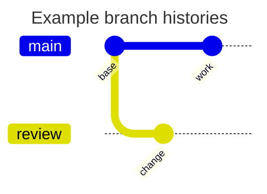

# Development runtime safety

Hack's development defaults must preserve hot reload without manufacturing host-wide CPU, memory,
or storage pressure. This guide records the runtime contract added after the 2026-07-30
OrbStack/Next investigation.

## Root cause and scope

The generated Compose path used to inject both `CHOKIDAR_USEPOLLING=true` and
`WATCHPACK_POLLING=true` into every discovered service. The injection was unconditional: Next and
non-Next services, small repos and bind-mounted monorepos, and runtimes with working native file
notifications all received the same polling policy. In the observed Apple Silicon workload,
polling combined with an unnecessary `linux/amd64` override and multi-gigabyte persistent `.next`
volumes. The result was sustained emulation/watcher CPU, very high cumulative writes, and a large
set of stopped branch containers and cache volumes.

The bounded comparison removed those project-level overrides without changing application code:
the Next 16 development server ran as native arm64, hot reload remained available through native
notifications, and idle container CPU settled near zero. A slow-filesystem warning remained for the
`.next` volume, which identifies storage as a latency factor but does not justify forcing polling.

Hack owns only two parts of that failure chain:

1. generated Compose defaults must not impose polling;
2. lifecycle targeting and optional cache cleanup must not silently abandon branch-owned resources.

Image platform selection and application health-check cadence remain explicit project configuration.
Hack does not rewrite them.

## File watching contract

Generated services rely on the container runtime's native file notifications. Hack does not add
Chokidar or Watchpack polling variables. A project can still set either variable on an individual
service when a measured runtime requires it:

```yaml
services:
  web:
    environment:
      CHOKIDAR_USEPOLLING: "true"
      WATCHPACK_POLLING: "750"
```

Keep polling service-scoped and measure CPU plus write activity after enabling it. Next's local
development guidance notes that Docker filesystem access on macOS and Windows can be slower than
host-local development; OrbStack likewise documents that bind mounts cross the macOS boundary
while named volumes remain on the Linux side. Those storage tradeoffs are separate from watcher
correctness.

## Branch rename contract

An illustrative Git fork gives the primary checkout and a linked review worktree
different source histories, while their Hack instances keep separate runtime names.



The shared proxy routes to each instance independently; a branch name does not
merge containers or give one checkout ownership of the other's runtime.


The base and review instances use different Compose project names and hostnames.
Explicitly shared dependency caches can still be shared; this diagram does not
promise a security boundary between equally trusted worktrees.

An implicit `hack down` in a linked worktree uses Docker's Compose labels and exact
`com.docker.compose.project.working_dir` evidence:

- no owned runtime: use the current sanitized Git branch, preserving normal behavior;
- exactly one owned runtime: target it, including when it is Created or stopped and the Git branch
  now has a different name;
- multiple owned runtimes: fail before Compose mutation and require `--branch <name>`;
- explicit `--branch`: always target that branch without inference;
- detached HEAD: continue to require an explicit branch;
- primary checkout: continue to target the base instance by default.

Canonical checkout paths prevent one worktree from stopping a sibling's runtime.

## Disposable cache cleanup contract

Ordinary `hack down` preserves every named volume. `hack down --prune-caches` is a narrow,
confirmation-gated addition for build caches. It removes only exact volume names observed on the
target containers, then independently verifies the volume's Compose project and logical-volume
labels. A named volume is eligible when every observed destination ends in `.next`, or when the
top-level Compose volume explicitly declares `hack.cache.disposable: "true"`.

The explicit label makes cleanup framework-agnostic without guessing whether destinations such as
`.turbo`, `target`, `.gradle`, or a generic `cache` directory contain disposable output:

```yaml
services:
  worker:
    volumes:
      - build-cache:/app/target

volumes:
  build-cache:
    labels:
      hack.cache.disposable: "true"
```

Runtime inventory mount records now expose the Docker volume `name` separately from `source`
(the engine storage path), so callers can inspect the same removal identity without guessing.

The cleanup intentionally excludes:

- bind mounts;
- database, Redis, application-upload, and dependency volumes unless explicitly marked disposable;
- external or unlabeled non-Next volumes;
- volumes owned by another Compose project or checkout;
- loose volume-name matches.

Use `--yes` only after reviewing the same project-scoped evidence. Hack does not infer disposability
from arbitrary volume names or mount paths because those signals cannot distinguish generated build
output from durable application data.

## Check an existing project

Projects created by older `hack init` versions can still carry the defaults described above. On
the Compose backend, `hack doctor` (and `hack doctor --json`) reports them for the selected
project:

- **`emulated services`** (warning): a service's running container uses an image whose
  architecture differs from the engine's, or the Compose file pins a `platform` that differs from
  the host even when nothing is running. Doctor inspects the image each container was created
  from; the Compose file alone cannot prove which variant runs. Each entry names the service, and
  the file and line of the pin when there is one.
- **`polling watchers`** (warning): a service sets `CHOKIDAR_USEPOLLING` or `WATCHPACK_POLLING` to a
  truthy value, with file and line. A numeric `WATCHPACK_POLLING` interval and an opt-in default
  such as `${CHOKIDAR_USEPOLLING:-false}` are deliberate and are not reported.
- **`shared volume architectures`** (warning): containers of one instance on different
  architectures mount the same named volume. Requires Docker.
- **`dev image tags`** (a note, not a warning): a service that bind-mounts project source uses a
  `:latest` or untagged image while the repository declares Node or Bun versions (`package.json`
  `engines` or `packageManager`, `.nvmrc`, `.node-version`, `.bun-version`, `.tool-versions`,
  `mise.toml`).

These checks do not run for an adopted Compose project (`hack config adopt`), whose inputs
belong to the adoption, or on the native backend, which has its own `amd64 emulation` check.
The `dev image tags` note covers images whose name contains `node` or `bun`.

`hack ps --json` adds `emulated: true` to each Compose item whose image architecture differs from
the engine's, so other tools can show the same fact.

### Three traps when fixing an emulated project

1. **Removing `platform:` is not enough.** With `image: <name>:latest`, Docker keeps using the tag
   it already has locally, which can still be the other architecture. Pull the native variant
   explicitly (`docker pull --platform linux/arm64 <image>` on an Apple silicon Mac), or build
   from a base image pinned by a multi-architecture digest, then recreate the services. Rerun
   `hack doctor` and check that no container is still reported as emulated.
2. **A cached mutable tag can be stale.** The same local `:latest` can also be older than the Node
   or Bun versions the repository declares. Prefer a version tag that matches them, or a digest.
3. **Do not mix architectures on one dependency volume.** When services of one instance share a
   named volume such as `node_modules`, a one-shot install that ran under emulation leaves native
   modules for the other architecture, and the native services crash on them. Move every service
   of the instance to one architecture, then reinstall dependencies into that volume (for
   example, remove the volume after `hack down` and let the install step run again).

### Repairs

Platform pins and images are project configuration: Doctor reports them and never edits them.
Plain `hack doctor --fix` does not change them or the watcher settings.

The polling lines old `hack init` generated have one opt-in repair. It removes only map entries
exactly of the form `CHOKIDAR_USEPOLLING: "true"` and `WATCHPACK_POLLING: "true"`, and an
`environment:` block left empty by that removal:

```sh
hack doctor --fix --only 'polling watchers'        # print the diff, write nothing
hack doctor --fix --only 'polling watchers' --yes  # apply it, then verify
```

The diff shows the removed polling lines as they are. Everywhere else it keeps only plain keys
and replaces values, other text and comments (including one on the `environment:` line) with
`[REDACTED]`, so a neighbouring credential never reaches the output; the file keeps them. Other forms (list entries, comments on the line, other values) are left for you to edit. The
repair refuses when the change would alter anything else in the parsed Compose document or when
the file changes while it runs. Recreate the services afterwards (`hack restart`).

## Doctor boundary

Doctor does not add threshold-based warnings for CPU, stopped-instance counts or volume size;
those signals depend on workload context that static configuration cannot prove. The
existing-project checks above report deterministic facts (an image architecture, a pin, a
variable) and leave the decision and the edit to the project, apart from the opt-in polling
repair.

## References

- [Next.js local development](https://nextjs.org/docs/app/guides/local-development)
- [Next.js Turbopack reference](https://nextjs.org/docs/app/api-reference/turbopack)
- [OrbStack volumes and mounts](https://docs.orbstack.dev/docker/file-sharing)
- [OrbStack efficiency](https://docs.orbstack.dev/efficiency)

### Root-owned checkout files on Linux

`hack doctor` checks the checkout for root-owned files left by container tools.
It scans breadth first, includes ignored directories, and skips `.git` and
symlinks. A scan that finds nothing stays OK and reports any bound it hit. Where a writable Compose bind mount and an
unset `user:` match a path, Doctor lists possible services and shows the
`user:` line to set for those services. Doctor lists topmost root-owned
directories. Before changing ownership manually, stop all containers and other
processes that can write to the checkout. Verify each target is inside the
checkout and that no component of its full path is a symlink. Only repair
ownership while those paths can be kept stable. Doctor prints no privileged
repair command because paths can change after the scan.

When the global router is unavailable on Compose, the routing warning shows a
published port when it can identify one, or a running container address on
Linux. If it has neither, it shows how to publish a local port.
