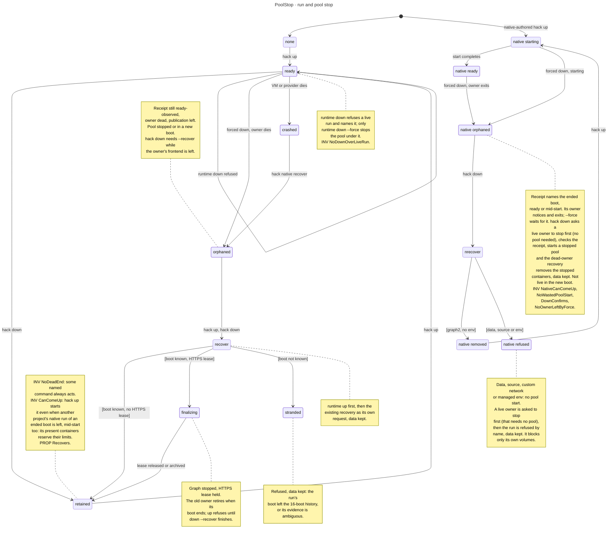
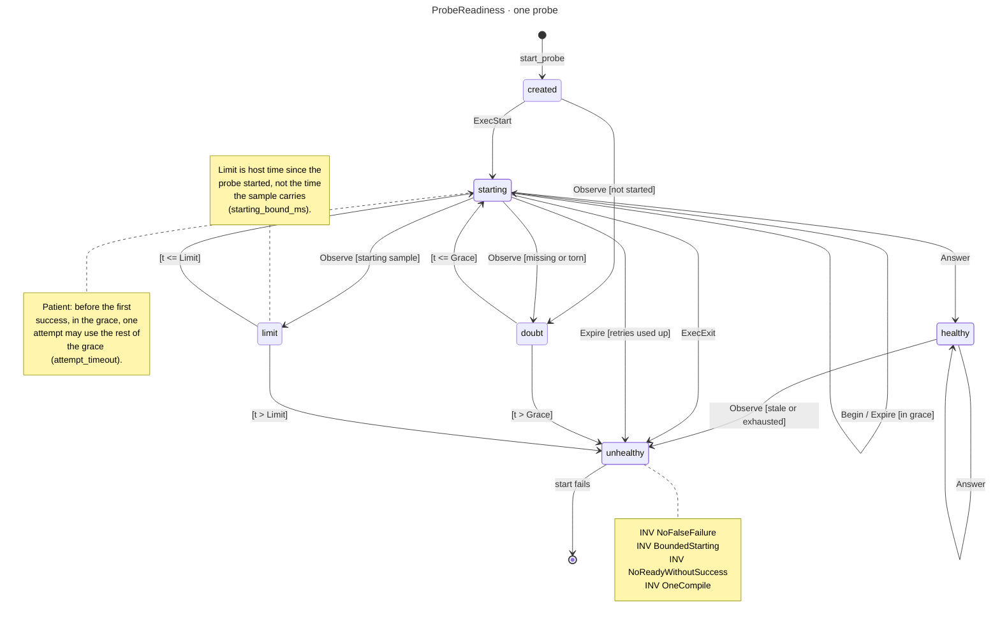

# Native backend reference

This is the detailed reference for the native backend (beta). It is long and
precise. For the first run, use [Try native on Apple Silicon](https://hack.foo/docs/v5/native/start).
The [overview](../native/README.md) and
[known limits](../native/limits.md) explain its scope. The
[reference map](../native/reference.md) lists this page's sections by topic.

The native backend is beta. `hack-native` is an opt-in Apple Silicon macOS executor installed alongside
Hack's supported CLI. It does not replace `hack`, select a Docker context, migrate
projects, or install DNS or trust automatically. Its graph commands support a
bounded subset;
this bundle is not application parity or release qualification.

Build with the repository's pinned Bun 1.4.4, Rust 1.97.1 and Zig 0.15.2 toolchain, Python 3,
and the Rust `aarch64-unknown-linux-musl` standard library already installed. The
build requires a clean checkout and refuses missing prerequisites; it does not install toolchains:

```sh
mise exec -- scripts/build-native-candidate.sh /absolute/new/hack-native-bundle
```

The executor includes `native-config-plan` for explicitly selected authored
projects. Packaging checks the copied executable's pure native planner with a
private synthetic project and requires the candidate home to remain empty. This
checks compiled planning capability; it does not start a provider, change the
default backend or qualify live authored execution.

The destination must not exist. The bundle contains `hack-native`, the static Linux
ARM64 `hack-relay-guest`, `hack-storage-root-witness` with its `native-storage-tool.json`
byte manifest, compiled normal CLI `hack-cli`, the `hack-v5` entrypoint,
the compiled `hack-config-compiler`, generated `hack.project.schema.json` and
`hack.local.schema.json`, provider pins, this guide, `SHA256SUMS`, and one content-addressed shared MCP bundle
under `mcp/BUNDLE_ID/`. Its manifest and native adapter, owner, and compiled backend
are included in the outer checksums. The relay uses
the committed guest Cargo lockfile and Zig linker wrapper, with a separate build
target directory. Packaging verifies its ELF architecture and absence of an
interpreter or shared-library requirements before publishing the bundle. It contains no provider installation, runtime
state, project data, or credentials. It can be copied outside the source checkout;
Rust, Zig, Bun and the checkout are not needed to run the resulting executable.
Host system utilities and the pinned provider remain runtime prerequisites.

Authored persistent mounts resolve the witness tool only from the explicitly selected
native binary's sibling bundle, before hooks or native startup. The helper is built from
the same checkout with the pinned musl target and Zig linker; packaging checks static
Linux ARM64 ELF structure and records its hash, size and source revision. Admission holds
both manifest and helper descriptors, rejects changed bytes or file identities, and passes
the captured path/hash to Rust for independent admission before provider effects. No
download, host execution or emulation fallback occurs. Saved inspection and cleanup use
the already installed, receipt-pinned guest helper and do not require the host artifact.
The byte manifest is not proof of kernel ABI, durable storage or application acceptance.
The first supported qualification corpus is explicit UID/GID0 Bun with SQLite; arbitrary
owner changes and stock PostgreSQL handoff remain refused pending separate qualification.
For versioned candidate packages, channel rules and publishing gates are described
in the [prerelease guide](https://github.com/hack-dance/hack/blob/next/docs/guides/prereleases.md),
and the separate `hack-next` installation path is described in the
[candidate installer guide](https://github.com/hack-dance/hack/blob/next/docs/guides/candidate-install.md).
The build re-signs the compiled frontend, config compiler, and MCP backend with local ad-hoc signatures and
strictly verifies all macOS executables before generating checksums. This checks
code integrity; an ad-hoc signature does not establish a publisher identity or
provide Apple notarization. Verify `SHA256SUMS` after copying the complete bundle.
`hack-relay-guest` runs inside the Linux guest, not on macOS. For graph dependency
selections, set `artifact` to this bundled file's absolute path and
`artifact_sha256` to its entry in `SHA256SUMS`; the runtime verifies it again before
delivery. The `native-stream-relay` feature does not replace this dependency relay.

The compiler and both generated schemas stay beside `hack-cli` as one checksummed
group. Packaging and installation refuse partial, changed, or aliased groups. The
compiler is executable; the schemas are private data. Older bundles with no compiler
or only the complete compiler/project-schema pair remain installable and selectable.
A local schema always requires the compiler and project schema alongside it.
An existing channel with an older retained installer must explicitly run `upgrade-manager` with the reviewed installer before selecting
a bundle with the new group, or use a fresh channel root. This upgrades the manager;
it does not migrate the retained runtime homes.

Shared MCP remains opt-in. Select the verified nested bundle with the existing
installer; substitute `--cursor` or `--codex` as needed:

```sh
/absolute/bundle/hack-cli mcp install --claude --scope user \
  --bundle /absolute/bundle/mcp/BUNDLE_ID --cli /absolute/bundle/hack-cli
```

This selects the normal CLI for tool calls. It does not activate a native project
runtime or change other clients. Keep the complete bundle while clients reference
it. To return to standard stdio, remove the selected client's Hack entry and
reinstall it without bundle options. Channel rollback does not rewrite those client
entries. Older prereleases without MCP assets remain installable. The candidate
installer verifies the complete nested inventory, identity, checksums, modes and
code signatures before selection; it never auto-enrolls clients.

Verify the copied bundle, create a dedicated home, and explicitly select it:

```sh
cd /absolute/copied/hack-native-bundle
shasum -a 256 -c SHA256SUMS
mkdir -m 700 /absolute/private/candidate-home
./hack-native --candidate-root /absolute/private/candidate-home info --json
./hack-native --candidate-root /absolute/private/candidate-home --version
```

The home must already exist, be owned by the current user, and have mode `0700`,
except that `runtime setup` and its read-only `inspect` accept an absent home.
Setup creates missing directories privately after consent.
Use its canonical absolute path without symlink components (on macOS, use
`/private/tmp` rather than `/tmp`). Every lower-level `hack-native` command requires this explicit home,
including help and version. Its `checkout` field is the historical receipt name
for this stable home; `channel` reports `installed-candidate`. State remains under
`<home>/.hack-local`. Keep this home fixed across binary upgrades: receipts and
child processes bind to its identity. Moving an executable is supported; moving
an active home or adopting another installation's state is not.

For normal project commands, follow the short
[native start page](https://hack.foo/docs/v5/native/start). Manual bundle users
use the adjacent `hack-v5` entrypoint and keep the bundle together. It defaults to
`$HACK_HOME/native-runtime` or `~/.hack/native-runtime`; an absolute
`HACK_NATIVE_HOME` overrides that default. The [candidate installer guide](candidate-install.md#test-both-backends)
defines backend selectors, private versus shared homes, stable-daemon quiescence
and returning to Compose. Prepare the provider explicitly with `native setup`.
Neither entrypoint migrates a project or falls back to Docker for an unsupported native command. An unversioned
local build reports its repository version; only a versioned bundle includes
candidate version provenance. The entrypoint alone does not identify a release.
`hack-v5` passes arguments, exit codes and signals through `exec`; it never replaces
the installed stable executable.

Native `up` accepts an explicit branch or the branch inferred from a linked Git
worktree when its exact source root can be shared with a fresh or matching pool.
The runtime checks source compatibility before startup hooks; `restart` repeats
this check before stopping the existing graph. A running VM's mounts never change, so
a root that a running pool does not already share needs a restart of the pool. When
nothing uses the pool live, `up` restarts it for the root and prints one line saying
so. Otherwise it refuses: stop the projects that use the pool (`down` in
each) and run `up` again. Projects and worktrees the pool was started with can run together; see
[one pool, several project roots](#explicit-writable-development-source).

Unfiltered writable source sharing still requires `HACK_NATIVE_SHARED_SOURCE=1`.
An exact repository at `$HOME/.codex/worktrees/<id>/<repo>` is allowed only when
bounded Git registration metadata verifies its worktree root, common directory and
backlink. The enclosing Codex directories are never exported. Sensitive ancestors,
aliases and unsafe ownership or permissions remain refused. Git can create
group-writable worktree directories and registration files under umask `002`.
Create a worktree intended for sharing with umask `022` or stricter, and ensure
its existing registration directories and metadata are also free of group and
other write permissions.

The internal planning path accepts a canonical lowercase DNS-label `--branch`.
It gives each checkout/branch pair a separate enrollment and source namespace;
omitting the selector preserves existing base-instance identities. The frontend
rewrites declared project, service, legacy and OAuth route names after applying
native aliases, then carries the same branch selector through original review,
normalized review, source capture and execution review. Original Compose files
and private environment values are unchanged. Hostnames outside the configured
project bases remain explicit, unchanged claims; normal route collision checks
still apply. A same-checkout branch namespace does not create an isolated source
tree. These planning contracts do not qualify multiple independent source roots
inside one VM pool.

An existing frontend branch mapping may retain a graph admitted before native
branch namespaces. If its current scoped review differs, the frontend first
checks native selection against that exact saved run, owner, namespace and plan:
restore selection for a stopped graph, or authenticated service selection for an
active graph. A native unbranched review of the same canonical project and unchanged
original Compose must then return the saved namespace. Only that retained run
continues with unbranched review and execution arguments and keeps its original
adapted route labels, before branch hostname rewriting. This preserves legacy
source contracts that did not enroll hostname changes. The selected generation,
restore selection and shared-source semantic compatibility are checked again
before admission; mappings, graph receipts and ownership namespaces are not
rewritten. Active legacy restart also rechecks its service, container, boot and
receipt generation after compatibility review, before cleanup eligibility. A
changed selection refuses before stopping the graph. This preflight check does
not make cleanup atomic with that generation; existing ownership and frontend
finalization checks still apply. Fresh and already branch-scoped graphs keep
their normal branch namespace. This compatibility path does not authorize
adopting an unrelated branch or project.

## Check a project before you start it

`hack up` on the native backend checks a Compose project in two places and stops
at the first refusal of each: the CLI's own admission, then the runtime review.
To see the findings together, run the preflight:

```sh
hack doctor --native-preflight            # in the project, or with --path <root>
hack doctor --native-preflight --profile dev,ops
hack doctor --native-preflight --json
```

It lists blockers, consent needed and notes for the project's `.hack/docker-compose.yml`,
each with a plain sentence and a fix. It judges what `hack up` judges: the
Compose document after the selected native adaptation and the project-wide
extra hosts are applied, reviewed with the profiles you pass.

The review includes the graph driver's own file-local start admission. A UDP
publication is a `graph_port_publication` blocker with the same reason as
foreground `up`; native publishes TCP only. Graph budgets, readiness, probes
and restart restrictions use the same admission checks. Inactive profile
services do not contribute publication blockers.

Graph subset and route refusals identify each affected service and field, with
a separate reason and fix. Incompatible plans show their underlying field
diagnostics instead of a second generic refusal. Invalid dependency-cache
declarations identify the offending labels across services; foreign-platform
findings name each service. Only names and field paths are shown, never authored
values. Structural parse errors can still stop review early; fix them and rerun.

Missing shared-source consent appears under **Consent needed**, separately from
configuration blockers. Review still runs without consent, including in a
non-interactive terminal, and `--json` retains the full discovered blocker list.
Reporting consent does not grant it or start the VM. The file-only native check in
`hack upgrade check` also reports outstanding consent separately and does not call
the project native-ready until it is granted; native readiness remains informational
for a Compose upgrade.

The Compose input must be a nonempty regular file of at most 256 KiB, not a
symbolic link. Unreadable, changing or oversized input is reported as
`compose_file_unreadable`; the check never waits for a FIFO writer.

It changes nothing in the project and starts nothing: no VM, no image pull, no
lifecycle hook. It accepts only `--path`, `--profile` and `--json`. The report
never prints authored values. A finding names a closed code, a service and a
field; environment values, label keys and values and image names are left out.
Environment-file findings may name their source path.

The runtime review half needs a native runtime, so run the preflight from the
`hack-next` launcher for the full list. Without native selection only the CLI's
checks run and the review is reported as `skipped`. The review needs no running
VM. A selected runtime also receives a read-only setup inspection. Incomplete or
unavailable setup is a `native_runtime_setup` blocker; run the `native setup`
command its fix prints (it names the launcher you used) before retrying. While setup is
`not_set_up` or `partial_resumable`, the runtime review still runs and its
findings are listed beside that blocker; for any other setup state, or when it
cannot run, it is `skipped` with `native_setup_incomplete`. Without native selection, setup is reported as unavailable.

Use a matching updated CLI and runtime. A runtime without start-admission review
is reported as `unavailable` with an update hint and cannot produce `ready: true`.
Image acquisition, private delivery, verified source/cache bindings, retained
ownership and actual service readiness are checked during `up`.

Preflight and start use one file-local admission collector. Preflight lists its
refusals; start returns its first refusal before acquiring runtime inputs. This
can change which reason start reports first when a file has several problems.
Review assumes routing is enrolled and cache initializers are admitted. The
readiness defaults are checked against the CLI over shared fixtures. Preflight
uses start's environment preparation, including allowed shell values, guarded
env-file reads and managed-env decryption. A missing decryption key is a blocker.
Only names and paths reach the report. Restart policies incompatible with private
delivery are blockers.
Credential adapters, image defaults, occupied ports and other inputs only known
at start remain runtime boundaries.
AWS/gcloud credentials are added after static review; a restart policy on a
service receiving only those adapter credentials can still be refused at serve.

With `--json` the report is the `data` of the standard result envelope:

Report version 2 moves `shared_source_grant_required` from `blockers` into
`consent_needed`. Consumers should use `ready` for the overall verdict and
inspect both lists for what remains to do.

Configuration finding `field` paths are relative to the named service (for
example, `labels.hack.dependencies.lockfiles`); plan diagnostics use absolute
paths such as `services.api.privileged`. Large configuration refusal batches
retain their code and service locations during authored startup as well as
preflight. Raw runtime stderr and startup output are not configuration findings.

```json
{
  "report_version": 2,
  "backend": "native",
  "compose_file": ".hack/docker-compose.yml",
  "ready": false,
  "runtime_setup": {
    "state": "ready",
    "installation_state": "ready",
    "code": "native_setup_ready",
    "fix": "Native runtime is set up."
  },
  "runtime_review": { "status": "completed" },
  "consent_needed": [],
  "blockers": [
    {
      "severity": "blocker",
      "gate": "cli",
      "code": "environment_file_input",
      "service": "web",
      "field": "env_file",
      "message": "A required environment file is missing or unsafe; values omitted.",
      "fix": "Check the named source; use an owned regular file that is not writable by others."
    }
  ],
  "warnings": []
}
```

- `ready` is true only when there is no blocker or missing consent, setup is ready
  and the runtime review completed.
- The exit status is `1` if blockers or missing consent remain, `0` otherwise. A skipped
  or unavailable review is not a blocker, so that run exits `0` with
  `ready: false`. With `--json` the envelope is `ok: true` in both cases; read
  `ready`, `blockers` and `consent_needed` for the verdict. `consent_needed`
  contains findings with severity `consent`, including `shared_source_grant_required`.
- `gate` is `cli` or `runtime`: which of the two checks reported the finding.
- `runtime_review.status` is one of:
  - `completed`: the review ran.
  - `stopped`: the review met a project problem it cannot continue past, such as
    a malformed mount (`invalid_mount`) or a mount outside the project
    (`source_escape`). `code` names it, it is listed as a blocker, and more
    findings can appear once it is fixed.
  - `skipped`: the review did not run. Without `code`, no native runtime is
    selected. `code` is `native_selection_incomplete` when
    `HACK_RUNTIME_BACKEND=native` is set without a candidate, and
    `native_adaptation_invalid` when the adaptation was refused: the unadapted
    document is not reviewed, because its findings would mislead.
    `native_setup_incomplete` when native setup is not ready and the review
    could not run before it; the text then lists what was not checked.
  - `unavailable`: the selected runtime did not return a review. `code`, when
    present, is the runtime's own failure code. This says nothing about the
    project.
- Codes are stable. The CLI's codes are `compose_file_unreadable`,
  `project_config_invalid`, `native_settings_invalid`,
  `native_adaptation_invalid`, `internal_hosts_unreadable`,
  `internal_hosts_without_dependencies`, `external_network`, `external_volume`,
  `reserved_label`, `unsupported_build`, `foreign_platform`,
  `invalid_service_name`, `invalid_service`, `build_requires_opt_in`,
  `unsupported_build_form`, `emulated_build`, `environment_file_input`, `missing_image`,
  `extra_hosts_without_dependencies`, `unsupported_logging`, `invalid_restart`,
  `unsupported_label`, `invalid_http_probe`, `managed_env_unreadable`,
  `environment_delivery`, `native_runtime_setup`, `shared_source_grant_required`,
  `route_probe_required`, `too_many_bridges`, `gcloud_adc_grant_required` (consent),
  `gcloud_adc_mount_refused`, `native_source_over_limit` and
  `native_source_unmeasured`. `build_requires_opt_in` keeps its name from when
  native builds were opt-in: it now means `HACK_NATIVE_BUILDS=0` turned builds off
  for a service that builds an image. Runtime findings use the
  review's own diagnostic codes, for example `privileged_service` or
  `invalid_mount`, and `review_incompatible` when the review does not admit the
  project and gives no finding this version can show. A code this version has
  no sentence for is still listed, by its code and field.
- With native setup ready, the preflight runs the source content check `hack up`
  runs (128 MiB by default, `native.sourceLimitMiB` up to 512): only when a
  selected service bind-mounts project source or declares a dependency cache, as
  on `up`. Source over the limit is the blocker `native_source_over_limit` with
  `up`'s own refusal text; a measurement that fails is `native_source_unmeasured`,
  because `up` refuses then too. An image-only project is not measured.
- With the native HTTPS frontend selected, the preflight asks this machine's resolver
  (hosts file and local DNS included) for each active routed hostname. A hostname
  that resolves to a non-loopback address is the warning
  `route_host_resolves_elsewhere`: it names the service and the answering address
  (Hack's Compose proxy is `172.30.0.2`), says native listens on `127.0.0.1:<port>`,
  and shows how to reach it (`curl --resolve HOST:<port>:127.0.0.1`). A hostname
  that resolves only to loopback while another listener, such as Hack's Compose
  proxy, answers on port 443 and native's port is not 443 is the warning
  `route_default_port_elsewhere`: a URL without a port reaches that other listener;
  `hack open` adds native's port. Hostnames are never printed, and an unknown
  lookup reports nothing.
- The runtime notes `route_binding_required` for every routed service. Preflight
  lists it only when no native HTTPS frontend is selected (machine `https` setting
  or the `HACK_NATIVE_CADDY_*` variables), because the route is then not served.

The preflight is a report, not an admission decision: `hack up` still runs its
own checks, and a clean report starts nothing. Foreground and detached `up`
also run the shared file-local start checks on the selected, adapted Compose
input before hooks, image acquisition or VM boot. A known static blocker such
as UDP publication refuses without starting a cold pool. Admitted builds use
review-only image placeholders for this check; startup still builds or selects
the real image and repeats its review before graph admission. Missing or invalid
static-review metadata refuses before boot and names the preflight command.
Detached `up` identifies a static refusal as “nothing was started” and names the
configuration fix and preflight command. Failures after startup begins retain
the guidance to inspect the run and preserve its recovery evidence.
The standalone preflight does not cover:

- A project with native project inputs: a native project file
  (`.hack/hack.project.json`) or a Compose file adopted into generated native
  inputs. Those take another admission path, and the preflight refuses them
  with a usage error.
- `--env`, and a retained run's environment. It uses the project's default
  environment to select the per-env adaptation and dependency files; `hack up`
  uses `--env` when given, or the environment of a run it resumes.
- Credential-adapter results and build arguments that only those later results
  can reveal as private. File and managed-environment admission now uses the same
  preparation as start, including decryption and permitted shell lookups; a
  missing project key is a closed preflight blocker.
- Image pinning. `hack up` reviews images by content ID after it has admitted
  and pulled them; the preflight reviews the references as written.
- What only a start can find: an image that cannot be pulled or admitted, a
  source tree over the size limit, a process wrapper a service cannot run, a
  host dependency without a binding, or a host port that is already in use.
- More than the first problem of a kind that stops the review. See `stopped`
  above.

## Compose projects that stay on the Compose backend

In v5, an unchanged Compose project (`.hack/hack.config.json` with
`.hack/docker-compose.yml`) that uses any of the following features runs on the
Compose backend. Native support for them is planned after v5.

| Compose feature | Kept on the Compose backend when |
| --- | --- |
| Foreign external network | Exact external names `hack-dev` and `hack-logging` map to fresh native-owned project bridges, including logical aliases; they do not attach to Docker networks or share cross-project container DNS. Native publishes routes independently of Docker’s global Caddy. Other external networks stay refused by name. A top-level network sets `external: true` or `external: {name: ...}`. A reviewed `x-hack-isolated: true` replacement is not external: it creates an owned internal bridge. A network that the selected adaptation (`HACK_NATIVE_ADAPTATION` or the committed `.hack/native/adaptation.json`; see [Native settings files](#native-settings-files)) lists in `isolatedNetworks` gets the same replacement, so it is not external either. |
| Duplicate Hack network aliases | Two logical declarations name the same `hack-dev` or `hack-logging` identity. Keep one declaration and attach its services to that declaration; native refuses instead of silently splitting connectivity. |
| External volume | A top-level volume sets `external: true` or `external: {name: ...}`. The native runtime only creates volumes it owns, and there is no native replacement for an external volume. |
| Build outside the basic form | With native builds on (the default; see below), a service `build` field other than `context`, `dockerfile`, `target` and `args`, or `image` together with `build`. Native build admission reviews the values of those four fields itself. With `HACK_NATIVE_BUILDS=0`, any `build` outside the basic form that [`hack config import --dry-run`](../reference/native-config-import.md#pure-basic-build-preview) accepts (a relative context and optional relative `dockerfile` and `target`) counts, and so does `image` together with `build`; build arguments, secrets, SSH, cache options, platforms and other build options are outside the basic form. |
| Non-native platform | A service sets a `platform` other than `linux/arm64` or `linux/arm64/v8`, for example `linux/amd64`. The native VM runs Linux arm64. A missing or `null` `platform` is unset and passes. `linux/amd64` passes only for a service that the `HACK_NATIVE_ADAPTATION` selection opts in to [amd64 emulation](#amd64-emulation-with-rosetta-2); every other platform value stays on the Compose backend. |

Native `hack up` and `hack restart` check for these features after selecting the
project and before branch, environment, lifecycle, storage or runtime work. They
refuse with `E_NATIVE_PROJECT_UNSUPPORTED` and one line that names each feature
found. Foreign external network names are bounded and named; volume names, label values, paths and platform values are omitted.
Nothing is started, stopped or written. Every service is checked, including
services outside the selected profiles.

The check reads only `.hack/docker-compose.yml`, as native start does. It does not
merge Compose override files, follow `extends` or `include`, or read environment
defaults such as `DOCKER_DEFAULT_PLATFORM`: a platform counts only when a service
sets its `platform` field. The native runtime's own review reports `extends` and
`include` as unsupported fields.

The check applies the selected adaptation first, as native start does:
`HACK_NATIVE_ADAPTATION`, else the committed `.hack/native/adaptation.json` or the
`adaptation.<env>.json` for `--env <env>`. Without `--env`, a network counts as
isolated only when every committed adaptation that could apply isolates it, because
the effective env is not known yet. An unchanged Compose file whose external network is listed in
`isolatedNetworks` therefore stays on native, and native start replaces that
network with an owned isolated one. A `linux/amd64` service that `amd64Emulation`
opts in stays on native the same way. The selection is read only when the Compose
file has an external network or a non-native platform. If it cannot be read, is not
version 1, its `isolatedNetworks` is not a list of unique names, or its
`amd64Emulation` is invalid, the command refuses with the same one-line
`E_CONFIG_INVALID` message native start gives, before any runtime request.

To run such a project, select the Compose backend:

```sh
HACK_RUNTIME_BACKEND=compose hack up
```

The bundle's `hack-v5` entrypoint and the `hack-next` launcher accept the same
selection; see [Test both backends](https://github.com/hack-dance/hack/blob/next/docs/guides/candidate-install.md#test-both-backends).

Other labels keep their native behavior. Routing (`caddy*`) and dependency cache
(`hack.dependencies.*`) labels are reviewed as before. Other ordinary labels, such
as `com.example.team` or `org.opencontainers.image.*`, are plain metadata: native
does not apply them to containers and reports the warning `labels_not_applied`.
Foreign router directives (`traefik.*` and unsupported `caddy*` keys) and unknown semantic `hack.service.*` or `hack.dependencies.*` declarations still refuse. Their bounded label keys are named; label values are omitted. Generated Hack and Compose metadata is ignored with a warning. The Compose prune label `hack.cache.disposable` grants no native cleanup authority; declare native disposable cache subpaths with `x-hack-disposable-cache` instead.

A `logging:` block with the `json-file`, `local` or `none` driver is accepted and
not applied (warning `logging_not_applied`): native keeps its own bounded container
logs, read with `hack logs`. Any other driver still refuses with
`external_logging_driver`.

Hack's own one-shot marker is not an ownership label. A service labeled exactly
`hack.service.one-shot: "true"` (or `hack.service.one-shot=true` in list form),
the label [`hack config import --dry-run`](../reference/native-config-import.md)
reports as `compose_one_shot_job`, is reviewed natively as a one-shot: the review
plan marks it `one_shot`, and native `up` waits for it to exit successfully
instead of waiting for it to keep running. The marker adds no container label.
Only that exact semantic key is recognized; unknown `hack.service.*` and `hack.dependencies.*` keys stay refused. Other Hack-generated and `com.docker.compose.*` metadata is ignored with a warning, including authored ownership labels. None is copied to native resources: ownership comes only from freshly generated Engine labels. The native review also refuses a marker whose value is not the string
`true` (`invalid_one_shot_label`), a one-shot with `restart: always` or
`unless-stopped` (`nonterminating_one_shot`), and a one-shot that also declares
routing labels (`one_shot_route_conflict`).

`hack config adopt`, including `--dry-run`, still requires the Compose backend,
because it reads and adopts the Compose backend's existing containers and
volumes. On the native backend it refuses before reading anything and names the
rerun: `HACK_RUNTIME_BACKEND=compose hack config adopt --dry-run`. See
[Legacy Compose adoption](../reference/native-compose-adoption.md).

Native image-project `up` builds Compose `build:` services by default (with the
usual `HACK_NATIVE_SHARED_SOURCE=1`). `HACK_NATIVE_BUILDS=0` is the only off switch:
with it, a `build:` service refuses before any hook or VM effect and names the
variable. Only the exact value `0` turns builds off. Any other value keeps them on,
including the earlier opt-in `HACK_NATIVE_BUILDS=1` and words such as `false`, `off`
or `no`. Launches that do not read your shell profile, such as login autostart and
the daemon's lifecycle restarts, do not see a `HACK_NATIVE_BUILDS=0` set only there,
so they build. With builds on:

- Accepted forms are `build: <context>` and a mapping of `context`, `dockerfile`,
  `target` and `args`. Paths follow Compose (the context is relative to the Compose
  file, the Dockerfile to the context) and must stay inside the project. `args` may be
  a mapping of literal strings or numbers, or a list of `KEY=VALUE` literals. Any `$`
  interpolation, a list item without `=` (host variable inheritance), `null`, other
  build keys (`secrets`, `ssh`, `cache_from`, `platforms`, `network` and the rest),
  remote contexts and `image` together with `build` refuse. Values are never shown.
  With builds on, `up` names the first such service and the field in the
  three-line form, for example `! build  web uses build.ssh (SSH agent forwarding into
  a native build is not supported)`, then the Compose-backend command. Only Compose's
  own build field names are printed; any other key is not.
- Build args are not secrets: as with Docker, the image records them in its history.
  A build arg whose value equals a `hack env` secret value of this project and
  environment refuses before any hook or VM effect, naming the service and the
  argument but never the value. The refusal does not suggest the Compose backend,
  because a Compose build would record the value in the image history too. Pass
  secrets with BuildKit build secrets instead; native builds do not support them yet.
- Every build refusal names the service. A refusal from the runtime's build source
  policy (for example a base image that is not a public Docker Hub reference) says
  that it is the build source policy and what to change. Other build failures name
  the service and keep the runtime's message.
- After the runtime is up, each distinct build runs once with
  `runtime build-image` (below), and its filtered output streams to your terminal.
  Every service with that build is then pinned to the built content ID, so review,
  readiness and restore treat it like an image service.
- An existing image for the same build inputs is reused without building. The build
  inputs include every file and directory in the build context that the effective
  ignore file (`<Dockerfile>.dockerignore`, else the context's `.dockerignore`) lets
  the build read: paths, file contents, permission bits and symlink targets. Editing a
  copied file builds a new image; editing an ignored file does not. An ignore file with
  syntax Hack does not reproduce exactly (character classes or `\` escapes) counts as
  excluding nothing: that never misses a change, but it can cause extra rebuilds, and
  it can refuse the build when an otherwise ignored entry is unreadable, special or
  pushes the context over its bounds. A context with more than
  200,000 included entries or 4 GiB of included file content, deeper than 256 path
  components, or whose included paths total more than 32 MiB, or with an unreadable
  entry or a socket, FIFO or device the ignore file does not exclude, refuses.
- Hack remembers each context file's size, timestamps and inode in a private cache, so
  an unchanged context is not read again. The cache misses only a change that keeps the
  size, inode, modification time and change time identical, which needs a deliberate
  clock or timestamp manipulation; set `HACK_NATIVE_REBUILD=1` after one.
- A changed network response in a `RUN` step or changed cache mount contents do
  not trigger a rebuild. Native checks base-image tags according to the image tag
  policy and rebuilds when the selected base digest changes. `hack up --offline`
  uses locally recorded selections even after they expire. `hack up --refresh-images`
  checks the registry for current tags. Ordinary expiry is checked after readiness.
  `HACK_NATIVE_REBUILD=1` forces BuildKit to run with the recorded selection.
  Cold solves let BuildKit fetch missing bases by digest. Background retention
  tags a verified local base or downloads and loads it after readiness.
- When an image is actually built, BuildKit reads a private copy of the included
  context, made and checked against the build key right before it runs, so edits during
  a build never reach the image. The copy keeps hard links as links and gives every
  entry one fixed modification time, so it holds nothing the key does not describe. A file that changed between computing the key and
  making the copy refuses; run `up` again. The copy costs time and disk only when a
  build runs (about 2.7 s for 20,000 files and 632 MiB on a loaded Linux host); reusing
  an image makes no copy.
- Every `up` asks the runtime for each build, including an `up` that restores a run
  stopped with `hack down`. The retained image is reused only while its build inputs
  are unchanged (Dockerfile, ignore file, target, args, build context); an edited
  Dockerfile or copied file builds a new image and the run's containers are recreated
  from it, keeping named volumes when the stopped run can be restored.
- `hack restart` resolves every build before it stops anything: a failed build, or a
  rebuilt image the retained run could not take, refuses while the current graph keeps
  running. It then stops the graph and starts it again on exactly the images it
  resolved, rebuilt ones included; nothing is built after the stop, and a build
  service added or changed in the meantime refuses instead.
- "Unchanged" means the same Compose bytes. A run that mounts no project source and
  uses no dependency cache still restores after its Compose file was edited and put
  back, or after any project file was touched that its builds do not read.
  Its review then differs only in the project source inventory (file sizes and
  modification times), which such a run never reads, and restore keeps the retained
  ownership plan, images and data.
- Native selects Compose profiles from the same sources, in the same order, as
  Compose under Hack: `--profile`; else `COMPOSE_PROFILES` in the managed env of the
  selected env (for example `.hack/hack.env.default.yaml`), which overrides the shell;
  else `COMPOSE_PROFILES` in the shell. `*` selects every declared profile. The
  project's root `.env` is not read on native, so it is not a source. This selects
  the profiles of a fresh start. A retained run keeps the profiles it started with,
  because `up` and `restart` never replace its data with another selection; when the
  environment now selects others (read for the run's own env), `up`, `up -d` and
  `up -d` on a running graph print a notice naming both and how to change them
  (`hack down --remove-data`, which deletes the data volumes, then `hack up`). An
  explicit `--profile` that differs still refuses. `hack up` (foreground or detached)
  prints one line naming the services the selection leaves out. A
  `COMPOSE_PROFILES` name the Compose file does not declare selects nothing, as in
  Compose, and is dropped before use: it never reaches a runtime argument, the saved
  run or any output, and is only counted in the notice (`COMPOSE_PROFILES` can hold a
  value copied from decrypted managed env). Notices never print a profile name that
  came from `COMPOSE_PROFILES` or a retained run, only how many there are; a name you
  pass with `--profile` is printed. A `COMPOSE_PROFILES` stored as a secret in the
  managed env is never used as a selector (profile names reach runtime arguments and
  the saved run): it selects nothing, and `up` says so. Store it as a plain value, or
  pass `--profile`.
- As with Compose `up`, only services in the selected profiles are built, pulled and
  pinned. A service in a profile you did not select is neither built nor acquired from
  its registry, and restore and restart need no image for it; selecting its profile in
  a later fresh `up` builds or pulls it then. Native builds are `linux/arm64` only;
  `platform: linux/amd64` is still refused.

Native review reads Compose `ports` without reading environment values. Each
entry may be short (`[host_ip:][published:]target[/protocol]`, with an IPv6 host
in brackets such as `[::1]:8080:80`) or long (`target`, `published`, `host_ip`,
`protocol`). The host IP and published port may each be one interpolation with a
literal default, such as `"${SEARCH_BIND:-127.0.0.1}:${SEARCH_PORT:-8108}:8108"`.
Native always uses the literal default, even when the variable is set, and warns
with `interpolated_port_default`; the plan records only the variable names. A
reference without a literal default (`${PORT}`, `${PORT:?message}`), a nested
default, an interpolated target or protocol, or one reference that spans several
components is an `unresolved_port_binding` error at
`services.<name>.ports[<index>]`. The review still reports every other finding,
and a service in an unselected profile does not block the plan.

Native publishes only on host loopback. `127.0.0.1` and `::1` are kept. A bare
port or an all-interface binding (`0.0.0.0`, `::`) is narrowed to `127.0.0.1` or
`::1`, with a `proposed_loopback_binding` warning. Compose would bind every
interface in that case; native does not expose development services to the
network. A specific non-loopback address, such as a LAN address, is an
`unsupported_host_binding` error. Keep such a project on the Compose backend.

Native foreground `hack up` publishes the reviewed ports of active services on
host `127.0.0.1`. Each published port is forwarded through an owned application
bridge to the container's target port, after the graph is ready. The rules:

- Only TCP with an explicit host port is published. UDP, an engine-assigned host
  port (a bare `"3000"`), and IPv6 loopback (`::1`) publication are refused with
  `graph_port_publication` before VM boot, including detached `up`; keep those
  projects on the Compose backend.
- One graph publishes at most 16 ports. Routes and published ports share the
  pool's 32 application bridge sockets.
- Two active services, two graphs in the same pool, or a graph and any other
  host process cannot hold the same host port. Before graph admission, and again
  under the provider lease just before binding, native refuses a host port that
  already accepts connections on `127.0.0.1` (`published_port_in_use`, or
  `E_CONFIG_INVALID` from the frontend check). The other listener is left
  untouched.
- A connection is forwarded only to the container incarnation the bridge was
  started for. A replaced container does not receive traffic from an older
  publication.
- Routes and published ports start as one batch: one reservation, one provider
  lease that starts every bridge together, then every host listener launched at
  once. Before and after the bridges start, and again before each listener
  launches, each target container's identity (ID, network attachment, start
  time, VM boot) and health are checked again; a bridge whose container changed
  or became unhealthy is stopped and `up` refuses with `bridge_generation_stale`.
- Stopping the foreground owner (Ctrl-C) closes every host listener of the
  graph (together) before its bridges stop, all in one guest call, and before
  the containers stop, then retires the publication. Dead-owner
  cleanup retires a publication only after proving its owner is gone. A
  retaining restart publishes the same ports again.
- `graph run` and other non-foreground paths do not publish ports and keep
  refusing them with `graph_subset`.

How one batch of bridges starts and how a run's bridges are released is
modeled in [bridge-batch](../../tests/models/tla/bridge-batch/COVERAGE.md):

<picture>
  <source media="(prefers-color-scheme: dark)" srcset="../assets/diagrams/bridge-batch-start.dark.svg">
  
</picture>

<picture>
  <source media="(prefers-color-scheme: dark)" srcset="../assets/diagrams/bridge-batch-release.dark.svg">
  
</picture>

The loopback check is point-in-time. A process that binds the same port on all
interfaces between the check and native's own bind can still share loopback
traffic with it; stop such listeners before `hack up`.

`hack doctor` reports the same features for the current project in its
`compose backend features` check. With `--json`, the check's `composeBackend.features`
lists the closed names `external_network`, `external_volume`, `reserved_label`,
`unsupported_build` and `foreign_platform`. On the native backend a found feature
is a warning; on the Compose backend it is informational. Native doctor applies
the same adaptation selection as native `up` without `--env` before it reports. When it
finds an external network, the message also names the `isolatedNetworks` selection
above, which keeps that network's project on native.

A basic build is not one of these features. By default doctor classifies builds the
way native builds admit them and reports no basic-build refusal. With
`HACK_NATIVE_BUILDS=0`, native image-project `up` refuses a basic build, so doctor
does not report it as ok then. On the native backend the check warns, names the
variable and the next steps (unset `HACK_NATIVE_BUILDS`, preview the authored native
conversion with `hack config import --dry-run`, or select the Compose backend), and
its JSON adds `composeBackend.nativeUpRefusals: ["basic_build"]`. On the Compose
backend the same note is informational.

Publication control tokens are delivered to the relay through a one-shot inherited
pipe (`--control-fd 0`), never through process arguments. The relay reads exactly
32 lowercase hexadecimal bytes, requires EOF, and closes the descriptor before
binding its listeners. Missing, malformed, or stalled input refuses startup; the
old token argument form is not accepted. Rebuild the runtime and relay together.

Tmux lifecycle sessions receive their owner token and environment through
`source-file -` on stdin. The owner token stays in the session environment;
existing sessions with the older owner option remain readable.
Commands sent to an existing tmux pane receive selected environment values through
a one-shot mode-0600 file inside a private mode-0700 temporary directory. The CLI's
internal launcher reads and removes that payload before starting the command,
preserving keys such as `UID` without value-bearing arguments. Leading command-local
assignments override selected values; the existing pane shell still parses multiline
commands and pipelines. The command keeps the pane's terminal stdin. Failed sends
remove their staged payload; if the pane never executes a successfully sent command,
the private payload remains until it is consumed or explicitly cleaned up.

### Started and ready

Native `hack up` and `hack restart` return once every container has started,
by Compose's rule: running, or exited `0` for a job another service waits on, in
dependency order; `service_healthy` and `service_completed_successfully` edges
still hold their dependents back. Health checks and route probes keep running
after that: the run is **warming** until every goal is met and every route
answers, then **ready**. `--wait` returns at ready, exactly as before, with the
same lines, exit codes and timeout text.

- **At started:** the run mapping is saved first, then `up.after`, the exit
  watcher and the down-hook debt; then `up` returns. The HTTPS routes and the
  removal of superseded build images wait for ready, because the runtime is
  still busy with the start until then. The closing line
  counts the routes still warming: `https://web.app.hack  up in 4.6s · native ·
  2 routes warming`. With `--json`, the result has `readiness: "warming"` (or
  `"ready"`) and `services.warming`.
- **`up.after` runs at started,** as with Compose `up -d`. A hook that calls one of
  the project's URLs needs `hack up --wait`.
- **While warming:**
  - `hack ps` shows a service still waiting on its health check as `warming`;
    `ps --json` has `readiness: "warming"`;
  - `hack open` opens the route at once, as before; it may not answer until the
    run is ready;
  - `hack exec` and one-off `hack run` wait for the whole project to be ready
    (one line on stderr), then run, so `hack up -d && hack exec api ...` keeps
    working;
  - `hack logs SERVICE` without `-f` prints what exists so far, in the same
    format as for a ready run;
  - `hack down` stops the run with data retained; the owner accepts the stop
    between start passes, after any publication in progress has committed or
    been withdrawn. `hack down --remove-data` waits for ready: stop first, then
    remove;
  - `hack restart` stops and starts again; a second `hack up` says the project is
    already running and names the services still warming.
- **Scripts:** whether `--json` and `--no-interactive` imply `--wait` is one
  setting, currently off. Pass `--wait` when a script needs live endpoints.
- **On the Compose backend,** `hack up -d --wait` passes `--wait` to
  `docker compose up -d`, which waits for running and healthy services.
  `--wait` needs `-d` (or `--json`) there, and `hack restart --wait` is native-only.

Native `hack up -d` (also `--detach`, `--json`, or both) starts the existing
frontend and Rust foreground owners in a background session, returning once
every container has started and up-after hooks ran (see "Started and ready"
below); `--wait` returns once every service is ready instead. The frontend keeps host lifecycle processes and
down hooks alive. From any terminal, use `hack ps`, `hack logs`, `hack exec`,
`hack restart` or `hack down` through the existing authenticated controls.
When the project is already up, `hack up -d` starts nothing and succeeds: it
prints `Project is already running.` and exits `0`, and with
`--json` returns the same result shape as a start, with `alreadyRunning: true`
and the running and completed services. That answer is given only for a ready
graph whose foreground owner answers and whose runtime it verified; any other
state launches a start as before. This no-op applies no configuration edits;
the message gives the `hack restart` command for the same project and branch
to apply them. Explicit `--env` and `--profile` must match the saved run. A
different selection, or a legacy record whose selection is unknown, refuses
instead of reporting success; stop that instance before starting a different
selection. When the graph is live but some services have not reached their
required state, `hack up -d` refuses with `E_STARTUP_INCOMPLETE`, names them,
and gives one shell-quoted `hack restart` command preserving the selected
`--path`, `--project` and `--branch`: native `up`
cannot start part of a running project. Nothing is started or stopped.
Completion is accepted only when the runtime receipt requires the service to
complete and its current observation is exit `0`. A long-running service that
exits `0`, or an exited service with an unknown readiness goal, is still down.
A ready graph containing only completed one-shots also succeeds without
launching another start. A running one-shot has not completed its required state.

Restart starts a new foreground generation; `restart --detach` remains unsupported.
`hack restart --json` instead runs the restart in a detached owner, waits for it to
be ready and prints one result envelope with the same fields as Compose
(`ok`, `data.action: "restart"`, `data.services`, `durationMs`); the services keep
running after it returns. Frontend recovery (`--recover-frontend`) stays in the
foreground and still refuses `--json`.
`hack open` on native writes native's HTTPS frontend port into the URL when it is
not 443 (for example `https://app.example.hack:18443`), from the same host settings
`hack up` uses.
Without these flags, `hack up` stays attached and Ctrl-C requests ordinary stop.
Detached startup has no terminal stdin and suppresses hook/owner output rather
than persisting potentially private values. Service logs remain available through
`hack logs`. Its JSON result uses the v4 lifecycle envelope.
When startup fails, the launcher reports the runtime's validated code and fixed
reason, including the service when available, in human and JSON output. Hook
output and arbitrary owner diagnostics remain suppressed.

A private IPC readiness/acceptance exchange transfers only launcher responsibility;
it creates no new runtime authority. Launcher loss before acceptance requests
ordinary graceful stop. After acceptance, terminal exit does not stop the owner.
An unconfirmed startup keeps the original recovery evidence: inspect `hack ps`
before retrying. Owner death uses the existing explicit recovery path, with its
same incarnation checks and retained-uncertainty limits. No daemon adoption,
automatic replay, or separate graph supervision tick is introduced.

Foreground image-project `up` prints each startup step (input, runtime, images,
services) and one started line, `Project started (SERVICES; run RUN)`, once every
container has started and its run mapping is published, then `All services ready`
once every goal is met and every route answers. With `--wait` it prints one ready
line, `Project is ready (SERVICES; run RUN)`, at that point instead. Under it, `up` lists each routed
service's reviewed hostnames as HTTPS URLs (with the `HACK_NATIVE_HTTPS_PORT`
port unless it is 443) and the published loopback ports. Without the native
HTTPS frontend it says that routes are not served on this host. Ctrl-C prints the
stop sequence and, once owned cleanup is confirmed, one stopped line that says
whether named volumes and the stopped run mapping were kept (`Native project
stopped.` when no run mapping was published). Until the ready line,
startup uses the runtime's exclusive provider lease for its effect stages.
`hack ps` observes without that lease, including when another project is starting
in the same pool. If the journal changes during its read, it reports
`runtime_busy` (exit 0); retry for a current snapshot. After the ready line,
`hack ps` and `hack logs` run alongside the foreground command.

While the project runs, foreground `up` reports each service container that stops,
as attached Compose `up` does (`SERVICE exited with code N`), including one-shot
services. It keeps running while any service runs; once every service container has
stopped, it prints that, stops the graph through the ordinary owned cleanup and exits
0, like Compose `up` without `--abort-on-container-exit`. A service whose restart
policy has a pending restart (`restarting`) is not stopped: `up` keeps running and
reports the service only if it later exits for good, for example when `on-failure:N`
runs out of retries. Unlike Compose, the exit that triggered an engine restart is
not printed separately. The monitor reads
`graph observe`, which takes no provider lease, so it never contends with `ps`, `logs`
or `exec`.

Runtime refusals print their code and, when the runtime marks its message as a fixed
literal that cannot carry values, that message and the service it concerns (for
example `Service web: Pinned image architecture or implicit volumes are
incompatible.`). Formatted runtime messages stay omitted. A start refused before the
runtime reserved any graph state reports that nothing was created and no cleanup is
needed, with the startup diagnostic, instead of unconfirmed cleanup.

### Network aliases and the Compose project name

Native review accepts `networks.<name>.aliases` on a service attachment, as
Compose does: each alias is an extra DNS name for that service on that network
only. Aliases must be literal DNS names (letters, digits, `-`, `_` and dots; case
is folded), at most 8 per attachment. Interpolated aliases and the other
attachment keys (`ipv4_address`, `ipv6_address`, `priority`, `link_local_ips`,
`mac_address`, `driver_opts`) remain `unsupported_field`. Native networking keeps
one owner per DNS name, where Compose would round-robin: an alias that two active
services declare on one network, an alias that is another active service's name
on a network both join, or an alias that is also one of the same service's
`extra_hosts` names refuses with `network_alias_collision`. When one of the two
services is left inactive by the selected profiles, review reports the warning
`inactive_network_alias_collision` instead; selecting that profile refuses. The
graph verifies every reviewed alias as part of each container's identity. `hack
run` one-off containers keep only the service name, so they never become a second
owner. Aliases are part of the reviewed plan: changing one is an ordinary plan
change, never a hostname-only change.

Compose also supplies its project name to interpolation as `COMPOSE_PROJECT_NAME`
and names each container `<project>-<service>-1`, which other containers can
resolve. When a service references `COMPOSE_PROJECT_NAME`, native `up` and
`restart` declare the instance's Compose project name (the same `<project>` or
`<project>--<branch>` the Compose backend passes to `docker compose -p`) as the
normalized document's top-level `name`. Review then binds the variable to that
name (warning `compose_project_name_binding`) and adds the container name as an
alias on every network the service joins, under the same collision rules. No
caller can supply a different value. The name must follow Compose's rule
(lowercase letters, digits, `-` and `_`, starting with a letter or digit), and a
container name longer than one 63-byte DNS label refuses with
`compose_container_alias_too_long`. A document that does not reference the
variable keeps identical normalized bytes and gets no container-name aliases, so
a hard-coded `<project>-<service>-1` name does not resolve natively; use the
service name or `${COMPOSE_PROJECT_NAME}`. Without a declared name, for example
when the internal planning path reviews the original file directly, review warns
with `compose_project_name_unbound` and execution refuses with
`execution_environment_missing`. Plans and receipts that carry the new fields are
not readable by older bundles; clean up with the owning bundle.

## Manual candidate upgrade and rollback

Manual candidate bundles are selected by their full path. The separate
[prerelease installer](https://github.com/hack-dance/hack/blob/next/docs/guides/candidate-install.md) manages verified versioned selections
with independent homes; it does not migrate runtime data. `hack-v5 update` refuses before discovering an
installed binary or contacting a release server; install a separately reviewed,
complete bundle to change the candidate.

1. Keep the previous complete bundle and its `SHA256SUMS`. Copy the new bundle into
   a separate directory and verify every checksum before using it. A checksum
   failure or incomplete copy is a failed installation; preserve it for inspection.
2. Retain application data with ordinary `down` for each owned graph, confirm its
   foreground owner and host processes have retired, and stop the owned candidate
   runtime. Keep existing bundles in place while any of their child processes live.
3. Select the new bundle's `hack-v5` by its full path with the same canonical
   mode-`0700` `HACK_NATIVE_HOME`. Check its `info` identity and update any explicitly
   selected guest-relay artifact paths to the verified complete bundle. Normal
   frontend `up` validates the retained selection offline, resumes its clean owned
   VM once if stopped, and then repeats live retained-data and restore-generation
   checks. Restore the application and read back a saved data marker before accepting
   the upgrade. A restore selection (`--expect-generation`) or recovery selection
   reviewed by an older bundle can use the previous retained-volume encoding (see the
   [volume identity audit](../reference/volume-identity.md)) and then refuses as
   changed even when no volume changed: run the review and selection again with the
   new bundle.
4. For rollback, retain-stop the new candidate in the same way, select the previous
   verified bundle with the same home, and repeat application/data readback. A prior
   binary refusing newer state is an unsupported downgrade, not a successful rollback.
   Preserve that state; do not rewrite receipts or adopt another home's data.

The provider runs with a short temporary HOME alias, `/private/tmp/hkl-<owner>`, a
symlink to `<home>/.hack-local/run/smolvm/home` that keeps its Unix socket paths
within the macOS length limit. A clean `runtime down` keeps this alias, so no other
local user can take its name while the pool is stopped. It removes only the provider
socket files the stop proved closed, through the real data directory.

On macOS, successful native setup and runtime startup check for old dangling provider
HOME links. The check keeps links to existing homes, including stopped homes and homes
with interrupted updates. It removes only this user's verified links for absent homes
that have been unchanged for at least five minutes. `hack native temp-aliases` lists
eligible names. Add `--fix` to remove them, or use `hack doctor --fix` where the native
runtime is installed. Ordinary doctor shows a count after its diagnostic checks.
The scan stops at its time
or entry limit and reports an incomplete scan when it cannot finish. Fix scans
resume from the previous batch, although repeated listing timeouts can still
leave some entries unseen. A later fix also recovers entries moved aside by an
interrupted sweep. Updating the link's timestamp with `touch -h`
extends its retention.

Automatic cleanup requires the recorded native home path to lie under the user's
home or the host temporary root. Doctor counts aliases outside those roots.
`hack native temp-aliases` lists their names and explains that the volume may be
unmounted or the home may be deleted. The automatic sweep and
`doctor --fix` keep these entries. After checking the volume yourself,
add `--include-unverified-volumes` to either command with `--fix` to include them.
The command still checks age, owner, identity and target absence.

On a fresh pool boot or a boot after stopping the pool, native waits up to 10 seconds
plus 1 second per bridge slot (20 seconds for 10 slots, at most 42) for every declared
bridge socket to appear with the required private ownership and mode.
The provider's guest-ready signal can arrive before its bridge threads bind. Native
rechecks the same provider identity around each observation; it never accepts a socket of
another type, user or link count, or removes one, to make startup pass. A socket of this user
that the provider left world-accessible has its group and other access removed, inside the
private socket directory. The agent and engine sockets, and the provider's other sockets in
that directory (`port-forward.sock`, `control.sock` and the rest), are treated the same way.
`runtime up --json` and `runtime status --json` list what was repaired for the running provider
as `repaired_sockets` (`count` and `names`), so a repair is visible without inspecting the
directory. Existing running-pool
audits do not wait. A socket timeout or identity refusal takes the verified failed-boot
stop path and names the recovery command. A timeout also says how many sockets were
still missing and how many were not yet private at the deadline (counts only). Use the same selected executor and identical
`--candidate-root` argument as the failed start, followed by `runtime recover --json`.
`hack native recover` does the same for the selected native home without naming the
executor: it runs the runtime's recovery and prints the state it left (for example
`recovered-unclean`), after which `hack up` starts again. `--json` passes the runtime
result through. A refusal names the condition it could not prove. On a home that is already
stopped (for example `recovered-unclean` after an earlier recovery) it changes nothing and
says there was nothing to recover, however often it runs; a clean stop stays clean.
If you explicitly selected an installed executor with `HACK_NATIVE_BINARY` and
`HACK_NATIVE_HOME`, use those same non-empty values:

```sh
"$HACK_NATIVE_BINARY" --candidate-root "$HACK_NATIVE_HOME" runtime recover --json
```

Otherwise use the bundled executor path and the selected home from the failed
invocation; do not run this variable-based example with either variable unset.

For a checkout-local executor, `--candidate-root` is the source checkout, not the native
home or `.hack-local` directory; from that checkout run `./hack-local runtime recover --json`.
Provider-verification failures during the wait carry this guidance too; recovery still
independently proves ownership before stopping anything. Then retry. This preserves
retained disks and records an unclean stop; it does not claim the guest shut down cleanly.
One exception: if the failed start was the pool's first and the disk templates it used do
not verify (`disk_template_untrusted`, for example after a first start ended in
`provider_timeout_uncertain`), recovery moves the never-adopted disks and the failed
templates into an `untrusted-first-boot-<n>` directory instead and returns the pool to
`stopped-before-engine`. The next start formats new disks. Those disks never held project data, and nothing is deleted.
`hack down` may say the project was not started because no project mapping was published.

Host cleanup or a reboot can still remove the alias. For a clean stop, observation
commands such as `runtime status` accept the absent alias and create nothing, and the
next `runtime up`, `runtime recover` or approved-host update restores the exact alias
under the pool lock before using it. If another entry (a file, a directory, another
user's link) holds that path by then, it is never followed, replaced or removed: the
pool records a fresh random `/private/tmp/hkl-*` alias in its receipt and creates
that one instead. A pool with dependency sockets refuses a fresh alias with
`socket_alias_collision`, because its provider record pins those socket paths under the
original alias; remove the entry at that path and retry.

For any other receipt with an absent alias, normal commands report
`provider_home_missing`; they do not initialize another pool or recreate the alias
during observation. Explicit `runtime recover --json` can restore only that
absent exact alias, after verifying the receipt-bound dead provider, both recorded
disks, free VM lock, closed disk handles, and no active provider command. Existing
files, directories, foreign links, a live or reused PID, and uncertain ownership
refuse without replacement. Recovery rechecks the receipt before exclusive creation,
then validates socket absence and flushes the disks before recording
`recovered-unclean`. If those final checks fail, it reports
`provider_home_restored_recovery_incomplete`, keeps the exact owned alias and retained
data, and requires inspection before retry. No guest is started by alias recovery.
Interrupted starts without a recorded process or both identified disks remain
outside this repair path.

`runtime down` refuses to stop a running pool while projects run in it. A graph run
(Compose or native-authored) is running when its receipt is live: running, starting,
restoring, stopping, or a failed start that kept its started services. The refusal
stops and releases nothing, exits non-zero with code `runtime_down_live_runs`, lists the
run ids in `live_runs`, and writes one line on stderr naming them. The ids are the same
as `live_runs` in `runtime status`; a project records the runs it owns in its Hack
directory (usually `.hack/`), under `.internal/native-runs/` (Compose) or
`.internal/native-authored-runs/` (native-authored). Run `hack down` in each project first, or `hack down --recover` for
a run whose `hack up` has exited. When the receipts cannot be read it refuses with
`runtime_down_runs_unreadable` instead. Usually a run directory under `run/graphs/` or
`run/native-graphs/` of the home has no readable `state.json`, for example after a start
crashed before its first save; `runtime status` then counts it in `graph_runs` and omits
`live_runs`. `runtime down --force` stops the pool in that case too.

Only a pool that really runs is refused: its record says `running` and its recorded
provider is alive. A stopped pool is never refused, and nor are retained runs, which
hold no containers. A pool whose provider died under it (`process-exited`, below) and
a down that stalled in `quiescing` get the same `runtime down` as before, whatever
their receipts say.

`runtime down` (plain or `--force`) waits up to 5 seconds for a provider lease that
another operation holds, such as a project start writing its receipt, and then refuses
`provider_busy`, naming the holder when the lock records one.

A `hack up` or `hack up -d` waits up to 35 seconds for the provider lease when another
operation holds it. The usual holder is another project's `hack down`, which holds
the lease for its whole graph stop: a service with the 30-second stop grace limit
keeps it for about 31 seconds. This applies to the waits that admit nothing: the
retained-start check, resuming the running pool, the pool boot's admission, and the
startup reads before a restore. A short holder such as `hack ps` costs only its own
hold, because the start takes the lease as soon as it is free. When the wait lasts
about 3 seconds, the start prints one line that names the holder, for example
`Waiting for the native runtime lock, held by a project stop.` The line appears at
most once per command, however many of the start's requests wait. A foreground owner
that stops its own run records itself as `project stop` in the lock, whether after
`hack down` or while it rolls back a failed start. The record is advisory and never
names the project. If the holder keeps the lease past 35 seconds, the start refuses
`provider_busy` with nothing started, names the holder, and tells you to retry the
same command once that holder finishes. You do not need `hack down` or a pool stop
first. `hack exec` waits up to the same 35 seconds for each of its two lease steps,
and in an authored project for its one request before it is sent
(see [Normal native exec](#normal-native-exec)). `hack ps` and `hack logs` keep their
short observer behavior, and the inspection a foreground start makes after it ends
(after Ctrl-C, for example) keeps its 5-second bound.

When two projects start on a stopped pool at the same time, the first boots it. The
second waits for the lease and, once it holds it, finds the pool running and joins
it, as it would have if it had started later. This holds for retained runs too (a
project stopped with `hack down` and started again, HACK-2732). The retained-start
check reads the pool only under the lease, so it waits out the first project's boot
instead of refusing it. A start whose check saw the pool stopped, before the other
project booted it, gets `graph_retained_pool_changed` from `runtime up`: the run, its
data and its pool's identity (owner token, machine, HOME alias, disks, root files,
profile, layout and this project's own share) are unchanged, and only the pool's boot
changed. Another project's change to the pool counts the same way: adding its own
project share (which stops an idle pool), or changing the network intent, socket
capacity or translation setting. `hack up` then checks the run once more and repeats
`runtime up` once, which joins the running pool; it prints no extra line. If the pool
changed again in between, the start stops with that code, nothing started and data
kept, and says to retry `hack up` (or `hack up -d`). A replaced owner, token or disk,
or a change to this project's own share, still refuses with `graph_retained_startup`.

While a start waits, it keeps its project's run lock. A `hack down` of the same
project during that wait is refused `provider_busy` for up to 35 seconds. Run it
again once the start has returned.

`runtime down --force` stops the pool anyway, as a crash or a host reboot would. The
projects' containers stop with the guest and their data is kept. Its JSON lists the
runs that were live in `interrupted_runs`, or sets `interrupted_runs_unknown` when they
could not be read. After the stop it waits, up to 10 seconds, for the owner of each
interrupted native-authored run to exit, and lists in `interrupted_owners` which
owners `exited` and which were still `running`. It also writes one line on stderr
saying how many it stopped, what each such owner did and, for each run, the command
that brings it back in its project:

The command depends on the kind of run and on the phase its receipt was in:

- A Compose run that was ready (or had every service started): `hack up` starts the
  pool again and recovers the run, data kept. If another project's command already
  started the pool again, `hack up` recovers the run in that running pool the same
  way, so the order in which the projects come back does not matter. On a running
  pool this also covers a run whose owner exited in the same boot: `hack up` stops
  its services that are still running, with data kept, and starts them again, where
  it used to refuse and name `hack down --recover`; it says so on one line. The
  `hack down` that recovers a run after its pool boot ended runs no live `down.before`
  or `down.after` hook, because its services stopped with that boot. It knows the boot
  ended when it started the stopped pool or recovered an exited provider itself, or
  when the runtime's owner selection carries a dead-owner recovery hint (boot evidence
  places the run in an earlier boot), however the pool came back. Without such
  evidence (no hint while the pool is not running, or a receipt with no boot
  evidence) the hooks run as before. A `down.after` that an earlier down left owed in
  the journal still runs once.
- A Compose run caught in a start that failed or never finished (`failed-retained`,
  `preparing`) or in its owner's own stop (`cleanup-intent`): `hack up` does not
  recover it. Once its owner has exited, the explicit `graph recover-cleanup` described
  under [Explicit cleanup after a dead foreground
  owner](#explicit-cleanup-after-a-dead-foreground-owner) clears it while the pool is
  stopped, data kept.
- A Compose run caught restoring or restarting (`restoring`, `restarting`): nothing
  recovers it, as before. Stop it with `hack down` before the pool stops.
- A native-authored run (`hack.project.json`) in any phase, including a start caught
  mid-way: `hack down`, then `hack up`. A native-authored `hack up -d` owner is a host
  process. It notices from the pool record, within about two seconds, that its boot
  ended, and exits without a cleanup effect as a crash would, keeping its records and
  its admission lock for the dead-owner recovery;
  `runtime down --force` waits up to 10 seconds for these owners and its line says,
  per run, whether each one exited or was still running. A pool whose provider
  crashed still records running (`runtime status` says `process-exited`); its owners
  also count a recorded provider proven gone as the end of their boot, and the native
  `hack down` (and `--recover`) first runs `runtime recover`, which records the pool
  stopped, as `hack up` and the Compose `hack down` already do. If an
  owner still runs when the pool is stopped, `hack down` first asks it to stop with
  the pool left stopped: the stop needs no pool, the owner's cleanup refuses without
  an effect, and `hack down` waits for the owner to exit. Then `hack down` (or `hack
  down --recover` once the owner is gone) runs the dead-owner recovery in the same
  command. On a running pool in a later boot, the owner's own stop clears the run. The
  recovery first starts a stopped pool exactly as recorded (`runtime up`, no project
  share asked for), saying so on one line, but only after the
  read-only `graph native boot --run-id RUN --json` shows that the run's receipt
  belongs to an ended boot and that its cleanup can proceed. If the recovery still
  fails after this command started the pool, it says that the pool is still running;
  it does not stop it again, because other projects may already use it. The cleanup
  removes the run's stopped containers, which the engine keeps on the pool's disk
  after the boot ends. A member whose create the start never recorded is looked up by
  its exact name: absent, it is recorded removed; present, it cannot be attributed
  (labels never authorize adoption), so the cleanup refuses before any effect and
  keeps it, and no command clears it yet. For a start caught mid-way with such a
  member, the forced-stop line says this instead of promising `hack down`, then
  `hack up`.
- A native-authored run with persistent data, a live source, a custom network or a
  managed environment: nothing recovers it from an ended boot yet, because that state
  is bound to the boot that made it. `hack down` never starts a pool for it. If its
  owner still runs, `hack down` first asks that owner to stop, because the stop needs
  no pool: the owner's cleanup refuses without any effect, and the owner exits and
  leaves its record as evidence. `hack down` then refuses the run by name
  (`native_graph_ended_boot_unsupported`), on a stopped pool and on a running one
  alike. The recovery refuses it before it writes any recovery state. Its containers,
  data and evidence are kept. Stop such a run with `hack down` before the pool stops.

A plain `runtime down` refusal names the same command for each live run before you
pass `--force`. A native-authored run of an ended boot does not block other projects,
except in the cases listed after these points:

- It is not live any more: its guest stopped, so it does not keep a plain `runtime
  down` refused in the new boot, and a stopped pool's `runtime status` lists no run in
  `live_runs`.
- Until it is recovered, the containers it still has count toward the pool's capacity
  for other projects' starts, as an exited Compose container does. A start caught
  mid-way counts each member it may have created, found by its recorded id or, without
  one, by its exact name.
- A start with persistent storage reads such a run's saved state without waiting for
  it. A pending helper call still refuses, and the run keeps its own volumes from any
  new consumer until its own recovery; volumes it does not name are not blocked.

These runs still block other projects until they are cleared:

- A Compose run caught restoring or restarting stays live, so a plain `runtime down`
  and the idle stop of another project's `hack up` refuse until it is stopped.
- A Compose run caught starting or stopping (`failed-retained`, `preparing`,
  `cleanup-intent`) stays live the same way until the explicit dead-owner cleanup
  clears it.
- A native run that a crash left with a `state.pending` beside its receipt cannot be
  read, so graph admission refuses every project's start until it is inspected.
- A native start caught mid-way whose unrecorded member is found by its exact name
  but fails the ownership check also makes graph admission refuse every start.

In its own boot, a start that is still in progress keeps refusing other starts, as
before, because its effects may still land. Hack's own scripts pass `--force` only
where they stop a pool on purpose, such as test disposal, the host watchdog and the
qualification run's emergency stop.

How a run moves across a pool stop. It is checked as the TLA+ model
`tests/models/tla/native-pool-stop`. A run left from a boot older than the previous
one is recovered too: another project's `hack up` or a `runtime up` by hand booted
the pool and it stopped again before this project recovered, or the pool stopped
again between a recovery's `runtime up` and its recovery. Each boot records the boots
it supersedes in a bounded history (`run/smolvm/boot-history.json`, the last 16,
bound to the pool), and recovery selects the one earlier boot the run's receipt
names, never the current one. A run whose boot has left that history, or whose
evidence names more than one boot, is refused with its data kept. Two paths stay
limited to the previous boot: a `graph recover-cleanup` selection made while the
pool was stopped (another boot in between may have restarted the run's containers),
and absent-publication cleanup after a host reboot.



`runtime down` first quiesces the guest engine, which leaves the pool in phase
`quiescing` until the engine exits. A guest agent that answers no ping lets `down`
or `recover` stop the provider. A guest that still answers pings but whose engine
did not finish quiescing is reported on the first attempt and stays `quiescing`.
The next `runtime down`, or `runtime recover`, resumes the quiesce once; if the
engine again does not exit, it stops this home's verified provider and records
`recovered-unclean`, so the pool never needs a manual signal. As after any unclean
stop, the next start checks the retained disks. A guest whose owner, boot or engine
identity does not match the receipt is never stopped this way: `down` and `recover`
report `guest_identity_mismatch` on every attempt and leave the provider running.
Once that provider has exited or its guest stops answering, `runtime recover` records
the stop.

A physical macOS reboot may also renumber the mounted filesystem device. Strict
disk and source checks still refuse a changed device number; missing-HOME recovery
does not waive them. For an offline **stock pool**, inspect the separate migration:

```sh
./hack-native --candidate-root /absolute/private/candidate-home runtime host-filesystem-recovery --json
./hack-native --candidate-root /absolute/private/candidate-home runtime recover-host-filesystem --expect-sha256 <selection_sha256> --accept-legacy-device-rebind --json
./hack-native --candidate-root /absolute/private/candidate-home runtime recover --json
```

Review the inspection before selecting its hash. This explicit legacy migration
requires an absent recorded provider whose start predates the current host boot,
no active provider commands, exclusive existing operation/VM locks and closed disk
handles. Both disk inodes, sizes and ext4 UUIDs, the exact source path/inode and its
ownership must be unchanged; only one common old-to-new device-number change is
allowed. The inspection is read-only. Publication atomically changes only the
owner's disk and source device numbers, retaining its phase and process record.
Normal commands keep their strict identity checks.

Legacy receipts have no original host boot UUID or filesystem volume UUID. Calendar
timestamps corroborate a reboot, and matching retained file identities constrain
the migration, but neither proves original volume continuity. The opt-in explicitly
accepts that limitation; copied or relocated pools are outside this procedure.
Prepared-base pools and pending owner/network/activation updates require separate
recovery and are refused. A torn owner publication preserves `owner.pending` and
blocks another migration; do not delete or adopt that file manually.

This does not start the VM, restore HOME, retire stale sockets or rewrite historical
graph receipts. Use ordinary recovery afterward. Historical shared-source graphs
retain the prior identity and may require verified cleanup plus a new generation;
successful metadata migration alone does not establish application recovery.

After that explicit provider recovery and one audited VM boot, a retained graph
from the immediately preceding guest boot can still carry old host device numbers
in its publisher, relay-control, and dependency-socket receipts. Inspect and select
one run's host-pin recovery separately:

```sh
./hack-native --candidate-root /absolute/private/candidate-home graph inspect-host-pin-recovery --run-id <run-id> --json
./hack-native --candidate-root /absolute/private/candidate-home graph recover-host-pins --run-id <run-id> --expect-selection <selection_sha256> --accept-legacy-device-rebind --json
./hack-native --candidate-root /absolute/private/candidate-home graph recover-cleanup --run-id <run-id> --expect-receipt <original_receipt_sha256> --json
./hack-native --candidate-root /absolute/private/candidate-home graph retire-recovered-publisher --run-id <run-id> --expect-owner <owner> --json
```

The first command only inspects. The second publishes a private, exact-run
witness before cleanup; it changes no graph, publisher, control, or dependency
receipt. It requires the provider's repaired current disks/source, unchanged
recorded inodes and raw receipts, dead owners whose recorded starts precede the
current physical host boot, refused socket listeners, and the immediate guest
boot transition. It also binds retained volume names and actual labels. Cleanup
and retirement can use the witness only for those selected old pins; ordinary
reads and later publisher generations remain strict. Missing or foreign pins,
active listeners, changed resources, pending journals, or further guest boots
refuse without adopting another run. A completed older cleanup journal is
retained as history and does not itself block a later selected generation.

Legacy receipts do not identify the original APFS volume. This explicit
device-number rebind cannot prove pre-reboot volume continuity. Completing these
commands retains the old run's data and proves cleanup of its dead generation;
it does not migrate `graph.source.shared`, restore the application, establish
route readiness, or claim overall v5 acceptance. Same-run source continuity
requires a separate explicit witness-bound transition after cleanup and
publisher retirement. If macOS removed the foreground or relay-control
directory itself during reboot, this command refuses: the old pin receipts no
longer exist, and absent pathnames cannot stand in for their recorded owner
identities. That case requires a separate selected absence-recovery procedure.

When a **physical host reboot** removed both the deterministic foreground
publication root and this run's relay-control root, inspect the distinct
absence path with the private original provider Owner and its exact
pre-migration host-filesystem inspection:

```sh
./hack-native --candidate-root /absolute/private/candidate-home graph inspect-absent-publication-cleanup --run-id <run-id> --original-owner-file <private-original-owner.json> --host-inspection-file <private-inspection.json> --json
./hack-native --candidate-root /absolute/private/candidate-home graph recover-absent-publication-cleanup --run-id <run-id> --original-owner-file <private-original-owner.json> --host-inspection-file <private-inspection.json> --expect-selection <selection_sha256> --retain-data --accept-unpinned-post-reboot --json
```

Inspection does not create a publication root. A failed selected action can
leave only its private lock reservation; inspection recognizes that exact
lock-only state. Recovery locks the foreground publication before acquiring
the VM lease, then durably records the selected absence before any cleanup.
It retains volumes, verifies the stopped receipt, and records a separate
absent-publisher retirement. Ordinary publication and cleanup cannot infer
ownership from missing paths. The old foreground PID and original physical
volume are not proved by legacy graph receipts; this path requires explicit
acceptance of that post-reboot limitation and refuses a changed boot, present
or foreign publication, stale selection, pending state, or changed resources.
An interrupted recovery can resume only its exact selected intent on the same
host and immediate guest boot. A later successful restore treats this witness
as history; it never grants cleanup of the new generation.

This operation does not change historical shared-source device identity.
Source-mounted projects require the separate selected source-continuity step
before normal same-run restore. The command's stopped/data-retained result is
not proof of application startup or routing.

The frontend project-run mapping also records directory device numbers. If native
inspection succeeds after provider recovery but ordinary project commands refuse
the mapping, inspect the exact instance with the current bundle:

```sh
./hack-v5 doctor --path /absolute/project --branch my-instance --native-run-mapping inspect --json
./hack-v5 doctor --path /absolute/project --branch my-instance --native-run-mapping repair --expect-selection <selectionSha256> --accept-legacy-device-rebind --json
```

Omitting `--branch` uses the same linked-worktree default as project commands;
detached linked worktrees require an explicit instance. Inspection writes nothing.
A mapping that still matches the checkout reports `state: "current"` with its run,
the native graph phase (or `null` while the pool is stopped), whether the graph's
run, owner, namespace and plan match the mapping, and `repairRequired: false`.
Only a mapping whose scope no longer matches goes through the legacy device-rebind
inspection below, which returns the `selectionSha256` that repair requires.
Repair requires the exact selection and explicit acceptance of unproven original
filesystem volume continuity. It changes only the three scope directory device
numbers, preserving canonical paths, inodes, branch, run, owner, plan, environment
selection, profiles and AWS selector. The selected graph and current project share
must still match native authority. An audit copy retains the original private
mapping. Held locks, pending restart state, substituted directories, stale hashes
and changed native identities refuse publication.

This is a metadata repair, not an app restart: it does not retire sockets, modify
graph history, remove data or establish browser readiness. Doctor's ordinary
`--fix` never applies it. Run the normal project command separately after reviewing
the result; its existing native graph and ownership checks still apply.

#### A run mapping from another native home

Each launcher version has its own native home, but the run mapping lives in the
project. After an upgrade, a mapping the previous version left behind names that
version's home. Project commands from the new home (`ps`, `up` in the foreground
or with `--detach`, `down`, `doctor --native-cleanup inspect`) refuse it with a line
that names the owning home and what to do. The refusal has its own code,
`E_NATIVE_RUN_MAPPING_FOREIGN_HOME`; with `--json` its `error.detail` carries
`owner`, `ownerHome`, `selectionSha256` and, for a clean stop, `releaseCommand`:

- **Stopped cleanly.** The owning home's frontend records show that the run's latest
  `hack up` acknowledged confirmed graph cleanup, HTTPS retirement and down hooks.
  The refusal names the exact release command. Inspection reports
  `state: "foreign-home"`, `owner: "stopped"` and the `selectionSha256` it needs:

  ```sh
  ./hack-v5 doctor --path /absolute/project --native-run-mapping inspect --json
  ./hack-v5 doctor --path /absolute/project --native-run-mapping release --expect-selection <selectionSha256> --json
  ```

- **Live.** The owning frontend's PID still exists. The refusal names the home and
  PID. Stop it with Ctrl-C in that `hack up`, or run `hack down` with the version
  that owns that home, then retry. Release refuses.
- **Gone (HACK-2524).** The recorded path no longer holds that home: it is absent,
  not a directory, or another directory, so its records cannot be read there. An
  absent path may be a disk that is not mounted: when the missing directory sits
  directly under `/Volumes`, `/mnt`, `/media` or `/run/media/<user>`, inspection adds
  `missingVolume` and the refusal says so. Mount it and stop the run there instead;
  its data is still on that disk.
  Inspection reports `owner: "gone"` with a `selectionSha256`, and the refusal names
  the same release command. The release first lists this user's processes. It
  refuses, naming each PID, while any process names the old home's path in its
  command line or works inside it. Otherwise it keeps the mapping, its restart intent
  and its down-hook journal in an audit file (`<scope>.gone-home-release-<sha>.json`;
  owed hooks are skipped, because their services went with the home) and removes
  them. A home that was moved rather than deleted, and started again from its new
  path, has processes that name only the new path, so this check cannot see it;
  release again from the moved home afterwards.
- **Interrupted or unproven.** The frontend exited without acknowledging cleanup, or
  the home has no readable record for the run (for example a legacy mapping). Use
  the owning version's `hack doctor --native-cleanup inspect` and `hack down`.
  Release refuses.

Release proves ownership; it never just overwrites. The stored scope must differ
from this checkout in its native home only, that home must still be the recorded
directory, and the release holds the owning home's finalization lock, so that home
cannot start the run again meanwhile. A retained `hack up` in the owning home records
an admission under that same lock before its last mapping check and before any
runtime effect, and keeps it until it registers its own frontend lifetime. Release
refuses while an admission exists (a live startup is reported as live; one whose
startup exited is reported as interrupted). Owning homes from versions without this
admission record are not covered by it. A changed selection, held project locks or a
pending restart refuse, as does a down-hook journal that is owed, unknown or another
run's. A completed record of the same run, which a successful stop keeps, is allowed.
Release removes only the project's mapping and keeps its exact bytes in an audit
file beside it. The previous home's
graph and named volumes stay in that home; this home's next `hack up` starts the
instance with fresh data.

Compatibility is qualified for specific bundle hashes and state formats. The
displayed version alone does not establish frontend/executor or downgrade
compatibility. V4 and candidate homes remain separate; this procedure does not
migrate V4 data into the candidate or replace the installed `hack`. DNS, trust and
client configuration are outside this bundle-selection procedure.

For ordinary setup and consent, use the short
[native start page](https://hack.foo/docs/v5/native/start#prepare-the-runtime).
The remainder describes the setup and recovery contract. `--no-interactive` (or
truthy `HACK_NO_INTERACTIVE` values `1`, `true`, `yes` or `on`, ignoring case and
surrounding whitespace) refuses with `E_INTERACTIVE_REQUIRED` unless
`--accept-downloads` explicitly consents. Interactive `up` can offer setup with
the same explicit consent; noninteractive `up` refuses until setup is complete.
The installer and probe never download provider files.
Setup lists the pinned SmolVM, Docker engine, four Alpine guest packages and the
BuildKit client (the image builder),
including exact compressed sizes, hosts, hashes, private cache and destinations.

Manual bundle frontends use `$HACK_HOME/native-runtime` or
`~/.hack/native-runtime` by default, with an absolute `HACK_NATIVE_HOME` override.
Managed `hack-next` uses the version's receipt-owned home. See
[native first use and moving homes](candidate-install.md#prepare-the-native-runtime-once).
The lower-level `hack-native --candidate-root /absolute/private/home runtime setup`
remains available for explicit runtime administration. Its read-only
`runtime setup inspect --json` reports installation records without creating a
home, acquiring a lease or hashing provider trees. Only the manager's
`--quiescence` inspection takes existing locks; startup verifies full content.

The executable embeds `provider-pins.json` and checks its hashes against the
manual preparation pins. HTTPS redirects may use only the original host and the
pin's explicit `redirect_hosts`. The GitHub release pin allows
`release-assets.githubusercontent.com`. The 15-second setup bound is a connection
timeout, not a whole-file timeout. Response headers also have a 15-second attempt
bound; body reads retain their 60-second read timeout. Before headers arrive,
connection failures and timeouts get at most three attempts per admitted redirect
hop, with 250 ms then 500 ms backoff (at most 45.75 seconds per failing hop).
An explicit 30-minute overall deadline per file spans retries, backoff, redirects
and body reads; progress does not renew it. HTTP errors, body interruptions,
length errors and checksum mismatches never trigger an automatic retry.
The pre-header transport classification also includes TLS handshake and certificate
errors. A deterministic certificate refusal can therefore consume all three bounded
attempts; this never bypasses TLS validation or retries file checksum verification.

Registry manifest GETs and token GETs use the same three-attempt/backoff policy
before headers arrive. Their existing 60-second bound covers each whole request,
including its body; the registry connection bound remains 10 seconds. Exhausting
three header attempts takes at most 180.75 seconds per hop, also capped by the
existing acquisition deadline. Registry blobs and OAuth refresh POSTs are not
replayed. A 4xx/5xx response, malformed body or digest mismatch is not retried
(the existing authentication challenge flow still applies). Final network errors
identify the host and number of attempts without exposing URL paths or credentials.
`size_bytes` pins the exact compressed length, shown in the prompt and checked on
responses, streamed bytes and complete-file verification. `max_bytes` remains a
separate sanity ceiling. Either a length or hash mismatch refuses publication.
Downloads never pass through a shell, proxy configuration, keychain or admin prompt.
Networks that require an HTTP proxy must use the offline form below; setup ignores
proxy environment variables.

Private partial files and verified archives are downloaded under
`<candidate-home>/.hack-local/setup/downloads`. After durable provider publication,
online setup removes its two recorded provider downloads, and a later setup retries
interrupted cleanup. Older or replaced files without matching ownership evidence are
reported and kept. Offline inputs and provider repair archives are kept.
A rerun resumes a partial download
when the server supports ranges, otherwise restarts it. Every complete file is
hashed before any extraction; a mismatch reports `setup_hash_mismatch` with the
filename and publishes no provider. A corrupt complete cache file is preserved
and reports `setup_cache_invalid` with its filename and recovery instructions;
setup error messages omit full local paths. `setup_pin_unavailable` means a pinned
URL returned 404 or 410: upstream no longer serves this pinned file; update Hack
or use the offline form. Alpine repositories can retire package revisions. The
weekly provider pin watch checks every pinned URL with bounded HEAD requests and
compares successful replies' `Content-Length` with `size_bytes`. Only 404 and 410
mean a file is no longer served. Timeouts, other HTTP errors (403, 429 or 5xx),
and a missing `Content-Length` are transient failures
and never reopen a closed issue by themselves. Size mismatches and policy
refusals are reported separately. A size disagreement must be confirmed by a
one-byte GET from the original pinned URL before it can reopen an issue. The
confirmation requests `Range: bytes=0-0` with identity encoding, asks for cache revalidation and shares the
first request's deadline. It requires a valid one-byte Content-Range, one byte and
EOF. An ignored range, inconsistent length or failed confirmation is transient.
A range total matching the pin reports the file as available. The watch never changes pins or mirrors files;
availability checks do not verify archive contents.
The current pins do not record external signature/checksum files: the repository
hashes decide acceptance, and the existing SmolVM prepare step also checks its
code signature. The qualification script's optional upstream checksum comparison
remains a separate check.

Successful `runtime setup --json` output includes `status`, `builder`, `probe` and a `files`
array. `status` and the archive entries describe the provider set (SmolVM, engine
and guest packages). `builder` describes the image builder: `installed` when this
run prepared it, `reused` when it was already prepared and verified,
`not_prepared` when the home has none and this run had neither download consent
nor the offline builder file, and `changed` when a builder is there that does not
verify against the pinned release. The builder's own file joins `files` when this run
read it.
Each archive read has `name`, `outcome` (`downloaded`, `resumed`, `reused` or `offline`),
`size_bytes`, `downloaded_bytes` and `reused_bytes`. The counts account for pinned
artifacts this invocation, excluding HTTP headers and discarded prefixes.
A resumed file counts only its new suffix as downloaded; a server that ignores
Range restarts the download and counts the whole file as downloaded. Offline
inputs report `offline`; verified cache files report `reused`. Both have zero
downloaded bytes. Complete-home reuse verifies the installed tree without reading
archives and returns `status: "reused"` with an empty `files` list, or with the
image builder's file alone when this run added it.
If another process finishes installation after this run read archives, the result
keeps those actual archive entries even though its final status is `reused`.
No input paths appear in these entries.

Setup calls the same three manual prepare functions in a private staging home,
verifies the complete provider set, syncs it, then publishes the provider directory
under the lifecycle lock. Interrupted staging is rebuilt on rerun. A complete
matching install is verified before consent and reused without a prompt, consent
flag, network or preparation; setup
ends with `runtime probe --profile development`.

After the provider set is published or reused, setup adds the image builder with
the manual `prepare-builder` function, under the lock that function takes. This
step is additive: it writes the builder's own directory and record and the
download cache, and never stages, publishes or prepares the provider set again,
which a running pool may be executing from. A builder that is already prepared is
verified and left alone. A complete home that has no image builder (a home set up
by an earlier build, or offline without `--builder`) is never refused and never
downloaded to without consent: `--accept-downloads` or the offline `--builder`
file adds the builder and nothing else, and without either the result is
`builder: "not_prepared"` with the home unchanged. `hack native setup` then prints
one line naming `native setup --accept-downloads`.

A builder that is there but does not verify never fails setup. The result is
`builder: "changed"` with exit 0 and the provider set reported as before, with or
without consent or `--builder`: setup never deletes or overwrites it. Builds and
`runtime probe` keep refusing it with `artifact_digest_mismatch`. `hack native setup`
prints one warning that names the builder's directory and record by their paths
under the native home (`.hack-local/providers/buildx-<version>-darwin-arm64` and
`.hack-local/providers/buildx.json`). To replace the builder, remove those two and
run setup with `--accept-downloads` (or the offline `--builder` file). Removing only
the directory works too: the stale record is replaced. An existing incomplete, changed
or differently pinned provider directory is preserved and refused as
`setup_existing_invalid`: finish the manual steps, repair a changed tree, or use
a fresh home. Setup never upgrades a home's provider pin in place.
If another runtime operation holds the lock, `provider_busy` asks you to rerun;
verified downloads stay cached.


For offline setup, supply every input together; this form never constructs a
network client:

```sh
./hack-native --candidate-root /absolute/private/candidate-home runtime setup \
  --archive /absolute/smolvm-archive.tar.gz \
  --engine-archive /absolute/docker-archive.tgz \
  --network-tools-directory /absolute/private/pinned-apks
```

Add `--builder /absolute/docker-buildx` (the pinned `buildx` release file) to
prepare the image builder in the same run. It is optional and accepted only with
the three inputs above; without it, offline setup works as before and reports
`builder: "not_prepared"`. On a home whose provider set is already installed, the
three archive inputs are not read again.

Or obtain the exact archives identified in `provider-pins.json` and run the
unchanged individual manual commands (also supported by earlier prereleases):

```sh
./hack-native --candidate-root /absolute/private/candidate-home runtime prepare --archive /absolute/smolvm-archive.tar.gz
./hack-native --candidate-root /absolute/private/candidate-home runtime prepare-engine --archive /absolute/docker-archive.tgz
./hack-native --candidate-root /absolute/private/candidate-home runtime prepare-network-tools --directory /absolute/private/pinned-apks
./hack-native --candidate-root /absolute/private/candidate-home runtime probe --profile development --json
```

For a `hack-next` install, `hack-native` is
`~/.hack-next/versions/<version>/bundle/hack-native` and its home is
`~/.hack-next/versions/<version>/native-home`. `runtime probe` checks the research
profile unless you pass `--profile development`; the research profile can report
"not admitted" on a Mac that the development profile admits. The Alpine package
hashes are listed in `provider-pins.json` and under
[network tool packages](#network-tool-packages).

The current SmolVM pin is 1.35.4 (`smolvm-1.35.4-darwin-arm64.tar.gz`, SHA-256
`4ad2b02be848219a9d88632ca9e6dc881d6e97343626aab9c11ac4a184929d9e`, the value
upstream publishes in the release's `checksums.sha256`). `provider-pins.json` is the
source of truth; the executor refuses any other archive.

**Provider pin changes need a fresh candidate home.** A home's guest rootfs copy,
disks and provider database are made by the SmolVM release it was prepared with. When
an executor pins a different release, every start and `runtime prepare` in that home
refuses with `provider_pin_changed` and names both versions. Nothing in the home is
changed: its volumes and prepared tree stay in place, and a build that pins the
recorded release still runs it. `runtime probe` and `runtime repair-provider-tree`
refuse the same way, and so does `runtime down` while the old provider runs, so stop a
running pool (`hack down`, then `runtime down`) before installing a build with a new pin; a pool left running must be
stopped with the build that started it. For an incompatible stranded home, use the native executor from the release that
started its pool to run `runtime down --json` on that home. Preserve the home for
its retained data, then prepare a fresh home for the new build.

A failed `up` can leave the native VM pool running, and the failure message says how to
stop it: once no other native project uses the pool, run `runtime down --json` on the
native home. `runtime status --json` shows whether it runs. Its `graph_runs` field counts
the graphs the home records, Compose and native-authored, running or retained after `down`;
fully removed native-authored journals are excluded only after strict same-owner
retirement validation. The count is `null` when the inventory cannot be read.
Its `pool_idle` field is `true` only when the
pool runs with a live provider and records no graph, environment allocation or exec
session, and `null` when that cannot be established. The `native pool idle` machine
check warns about an idle pool only for `pool_idle: true`, and gives the stop command.
Unavailable runtime status or unknown pool state produces an observation warning,
with `nativePool.state: "unknown"`, instead of an all-clear or a stop suggestion;
it never stops the pool itself, and `--fix` does not either.

Historical native environment-lease records are conservatively counted as pool users,
even after their native-authored graph is fully removed. Such a home can report
`graph_runs: 0` and `pool_idle: false`, so doctor may omit the idle warning. The check
does not classify or delete those allocation records.

An `invalid_state` failure
names the state path that exists but is not a directory, relative to the native home
(for example `.hack-local/run/graphs`), when that path lies in one of the home's own
state directories. Inspect that path; do not delete it to retry.
A retained earlier provider path is diagnosed as `provider_pin_changed`, not as a
changed PID file. Recovery across provider versions is not supported.
Prepare a new candidate home with the pinned
archives instead; there is no in-place provider upgrade.

Preparation keeps each archive it extracted (`providers/smolvm-installing/release.tar.gz`
and `providers/docker-installing/release.tgz`). If something outside Hack changes a
prepared tree, for example a cleanup or backup tool that prunes empty directories,
every start refuses with `artifact_digest_mismatch` and the message names the repair.
A stopped runtime's `runtime status` and `runtime down` still work, because they run
nothing from the tree, so an installer quiescence check is not blocked. To repair the
tree, stop the runtime and run:

```sh
./hack-native --candidate-root /absolute/private/candidate-home runtime repair-provider-tree --json
```

The repair holds the provider lock and requires a stopped (or uninitialized) runtime.
It requires the preparation record to match this executor's pins and the kept archive
to be an owned regular file with the pinned SHA-256. Group- or other-writable
archives and staging directories are refused. New preparations create both with
owner-only permissions. The repair then copies and hashes the archive again, extracts it, checks the code signature (SmolVM), and requires the fresh
tree to match the digest recorded at preparation. Only then does it rename the changed
tree aside as `providers/<tree>-changed-<id>` and put the fresh tree in its place. It
keeps the changed tree for inspection and never deletes it; remove it yourself once
you no longer need it. Runtime state, disks and volumes under `run/` are not touched.
An intact tree is reported with `repaired: false`. A repair that fails a check changes
no tree and keeps its private `-repairing-` staging directory. Without a kept archive the repair
refuses (`provider_repair_unavailable`); prepare a fresh candidate home instead.

The pins also name a BuildKit client (`buildx`, `darwin-arm64`), the image builder
for native image builds (on by default). `runtime setup` installs it, as
described above. The manual command stays for offline and manual homes:

```sh
./hack-native --candidate-root /absolute/private/candidate-home runtime prepare-builder --archive /absolute/docker-buildx
```

The command takes the exact release file named in `provider-pins.json`. It checks
the SHA-256 before it changes any state, then copies the file into private candidate
state and checks its code signature. If a prepared client exists, the command checks
it again and does not replace it. The record always carries the tree digest that the
pin describes (one executable with that name, mode 0700 and the pinned bytes), never
a digest read back from disk, so a file replaced after its check can never be
recorded as good.

A preparation that stopped after publishing the client's directory and before writing
its record is finished by running the command (or setup) again. The record is written
only when the directory is what preparation publishes: a real directory of yours with
mode 0700 that holds exactly the pinned executable. Any other directory without a
record is refused as changed, and its permissions and contents are left alone. A
record write that stopped halfway leaves `buildx.pending` beside the record; the next
preparation removes it under the provider lock when it is the private regular file
that write creates (yours, mode 0600, one link), and refuses with `foreign_state`
and leaves it in place when it is anything else, such as a symlink or a directory.

If the prepared tree changes, `runtime probe` and every build
refuse with `artifact_digest_mismatch`. `runtime probe` reports `builder_prepared`:
`true` when the client is present and unchanged, `false` for a home without it.

A native start can build distinct images together, including a retained start after edits. The
four-CPU development pool runs at most three builds at once. Identical build
requests still share one build. A failure or Ctrl-C requests cancellation of
the other builds, and the CLI waits for all started builds to settle before
returning. The foreground labels output by build and reports its elapsed time.

A home without the image builder refuses a build with `builder_not_prepared`:
"The image builder is not installed in this native home", with the setup command
that adds it, instead of a missing-file error. `hack up` prints that refusal with
the command for the launcher you ran. A home that an earlier build set up is in
this state until `native setup --accept-downloads` (or the offline `--builder`
file, or the manual command above) adds the builder; nothing else in the home
changes. `runtime setup inspect --json` reports the builder apart from readiness,
as `builder.state` (`prepared`, `not_prepared` or `changed`) with the builder's
`directory` and `record` paths under the native home. That state is read from the
record without hashing the builder, so bytes changed under an intact record still
read as `prepared` there; setup and builds verify the bytes. `hack doctor` on
the native backend adds a `native image builder` check: a warning with the same
remedy when the project has a `build:` service and the home has no image builder,
or one whose record does not match the pinned release. With `HACK_NATIVE_BUILDS=0`
the check is ok without asking the runtime: builds are off, so the project does not
need the builder (`nativeBuilder.builder` is `not_checked`).
Doctor never installs or downloads it, with `--fix` either.

Every message about the image builder names one setup command: the `hack up`
refusal, the `hack native setup` hint and warning, and doctor's message with its
JSON `detail`. A stable install prints `hack native setup --accept-downloads`. A
candidate launcher under your home prints its path from the home,
`~/.hack-next/bin/hack-next native setup --accept-downloads`, which runs as pasted
and shows no home directory, so a saved doctor report carries none. A launcher
outside the home, or one whose path needs shell quoting, keeps its full quoted
path. Other printed commands are unchanged and name a candidate launcher by its
full path ([printed commands](candidate-install.md#printed-commands-name-your-launcher)).

`runtime build-image --request <file> --json` builds one image in the running
runtime's engine with that client. Native `up` calls it for `build:` services unless
`HACK_NATIVE_BUILDS=0` turns builds off; you can also run it directly. The request is a private
JSON file (a singly linked, mode-`0600` file owned by you):

```json
{"version": 1, "project_root": "/absolute/project", "context": "app",
 "dockerfile": "Dockerfile", "target": null, "args": {"NAME": "literal"},
 "policy": "missing", "timeout_seconds": 1800}
```

- The context and Dockerfile must be inside the project and reached without symlinks.
  The Dockerfile is read, never run, to find every image it can pull. Each image must
  be a public Docker Hub reference; it is pinned to a digest before the build starts.
  Base images with stored `ONBUILD` triggers refuse. The client builds from a private
  copy of the Dockerfile and ignore rules that were scanned, so editing either file
  during the build has no effect on it.
- Build arguments are not secrets, exactly as with Docker: the built image records
  their values in its history, and an argument that selects a base image appears in
  the resolved base references that the receipt and the result report. Never pass a
  secret as a build argument. BuildKit build secrets are the right mechanism for
  secrets; native builds do not support them yet.
- A fresh recorded base resolution whose verified image is in the guest makes
  no registry request. An expired resolution checks the registry and can use the
  proven loaded base if the registry is unavailable. `hack pull` refreshes build
  bases as well as service images. The build key includes each base digest.
- BuildKit receives only attempt-owned local references to the verified bases.
  The source policy denies other image sources and remote `ADD`, git and image
  blob sources. A private cache tag keeps the base while attempt aliases are
  removed, including on recovery after an interrupted build.
- Argument values reach the client only through a private definition file (mode
  `0600`, removed after the build), never its command line or its environment; the
  client's environment is a fixed list of its own settings. Names must be plain
  identifiers. Names BuildKit or buildx interpret themselves (`BUILDKIT_*`,
  `BUILDX_*`, `SOURCE_DATE_EPOCH`) and the platform arguments refuse.
- Build output is shown on stderr after filtering, as defense in depth: every
  argument value is replaced with `[redacted]`, also when quoted or escaped the way
  the client prints values, terminal control characters are removed, lines are cut at
  16 KiB and output stops after 4 MiB.
- `missing` reuses a verified image for the same build key without running the client;
  `rebuild` always builds. The key (version 2) covers the Dockerfile and
  `.dockerignore` bytes, target, arguments and versions, and every context entry the
  ignore file lets the build read: its path, kind, permission bits, contents, symlink
  target and hard-link group, as described with native builds above. It does
  not cover network responses, cache mounts or a moved base-image tag.
- The runtime must have network egress and the isolated build network that a runtime
  started by this version sets up. An older runtime refuses with
  `native_build_runtime_restart`: stop it and start it again.
- `runtime down` refuses while a build runs. Ctrl-C or SIGTERM cancels the build and
  stops the client's whole process group; so does the time budget (default 30 minutes,
  at most 2 hours). Both also apply while base images resolve, before the client
  starts: the budget covers the whole operation.
- A cold build needs at least 6 GiB free on the runtime's storage disk, or twice the
  last image of the same build if that is larger; otherwise it refuses with
  `native_build_storage` and deletes nothing. After each successful build, BuildKit's
  cache is pruned to 4 GiB. The cache holds only build steps; pruning never removes
  images, containers or volumes.

`runtime reclaim-build-images --json` removes build images that newer builds
replaced. For each build declaration (project root and branch, context, Dockerfile and
target) it keeps the image of the most recently built or reused key (`current`) and of
the one before it (`previous`, for a quick revert). It also keeps every image that any
retained run's saved state mentions, apart from its restore history (a diagnostic
record recovery only compares against; nothing starts a container from it), every image a container still uses (the engine
refuses those), every image of a receipt written before this rule, and every image
whose ownership labels are not exactly this runtime's. An `up` that built an image runs
it with `--best-effort` once the project is ready: that form never fails, reports a
refusal as `skipped`, and never delays or fails the start. Each removal deletes that one image only, never its untagged parent
images. It refuses while a build runs, and removes nothing if it cannot read all
saved run state. The report lists removed images and why each other one was kept.

When explicit reclaim frees at least 256 MiB on the guest storage filesystem,
it also attempts a discard on `/storage` while holding the same pool lease.
A confirmed trim adds `trim.guest_bytes_freed` and `trim.seconds` to the JSON.
The byte count measures guest free space gained during reclaim. Host allocation
can fall by a different amount. A failed or interrupted trim does not undo
reclaim. The automatic `--best-effort` path does not trim.

### Network tool packages

Before startup, network-tool preparation additionally requires all four pinned
Alpine aarch64 APKs in a current-user-owned private directory (mode `0700`), with
regular, singly linked mode-`0600` files. Acquire the matching public package bytes;
the command never downloads packages or accepts substitute versions.

The pinned files come from the Alpine **v3.24** `main` repository for `aarch64`
(`https://dl-cdn.alpinelinux.org/alpine/v3.24/main/aarch64/`), matching the Alpine
3.24 guest in the pinned SmolVM release. Other Alpine releases publish packages with
the same file names but different bytes; those fail the hash check below. A home
prepared with the earlier v3.19 files is refused by the new provider pin (see the
provider pin note above), so prepare the new files in a fresh candidate home.

| File | SHA-256 |
| --- | --- |
| `iptables-1.8.13-r0.apk` | `9d22aef2e74346e9d537f6dc964786ab14b35580e3ccc0e4001dc3a725e8fe77` |
| `libmnl-1.0.5-r2.apk` | `0ca382c70f78affef3a4a28016aab25ad8c3ccf1bcdad59f3968d4536a7b2478` |
| `libnftnl-1.3.1-r0.apk` | `8b31395671e910c294d7f0e29d3ac3c7efe9d89264db255f39aa9944dd4b6cac` |
| `libxtables-1.8.13-r0.apk` | `7535f18d9c7229178bc5e3809e5fea171033e33dfa054d88846512e1f25eefa8` |

At each pool's first start the guest installs these files from the private copy and reads
only its installed package database: it never contacts a package repository, so pools
without internet access start the same way. An install that a failed first start
interrupted resumes on the next start; a guest receipt that names another pool or package
set is refused.

All APKs are validated before candidate state is changed. Installation publishes a
complete private directory atomically; an existing installation is revalidated and
reused without overwriting files. Corrupt installs or interrupted
`network-tools-installing` staging are retained and refused for manual review.
The executor bundle includes no APKs; prepare them explicitly before `runtime up`.
This command changes only host candidate artifacts and does not boot or modify a VM.

Preparation verifies the pinned archive hashes before extraction; SmolVM also
requires its existing signature verification. No fallback to global providers or
v4 state is enabled. Runtime startup is a further explicit operation subject to
host resource admission. Read `--help` for the candidate command surface.

The development profile reserves the declared 32 GiB storage disk and 10 GiB
overlay ceiling plus 16 GiB of host disk space before a fresh startup. Starting
again on a verified running pool, or restarting an exactly clean stopped pool whose
last `down` completed, reuses existing disks and reserves only the 16 GiB host
reserve; `runtime probe --profile development --json` reports the basis in
`disk_budget_basis`, and `retained_reserve_refusal` names why a stopped pool's
disks were charged again. A restart uses that reserve only when free disk is
below the fresh budget; with enough room it starts on the fresh budget as before.
Any other stopped pool keeps the fresh budget. The
unchanged memory budget is a 10 GiB free-plus-file-cache estimate: 6 GiB guest,
2 GiB provisional provider overhead and 2 GiB host reserve. Normal and warning
macOS pressure can qualify only with that headroom, normal thermal/performance
state and stable swapouts. Development samples before the startup lease and again
under the lease before allocation, keeping the same swapout baseline across both
windows.
Critical, unknown or incomplete observations refuse; there is no bypass option.
It reports host load without refusing solely because unrelated jobs raise the
one-minute average. The research profile keeps its normal-only pressure policy,
16 GiB raw-free-memory floor, 100 GiB disk floor and host-load qualification
envelope.

For live Development effects, the host headroom floor is 2 GiB under normal
pressure and 4 GiB under warning, plus measured provider footprint above the
6 GiB guest and 2 GiB provisional overhead estimate. Changed swapouts and thermal
warnings still refuse effects. This does not cap provider footprint or qualify
runtime efficiency. Admission JSON records the numeric pressure level and typed
state; the legacy `memory_pressure_normal` boolean remains false for warning.
Saved reports do not grant resource authority.

The normal `hack-runtime-candidate` / `hack-local` development build remains bound
to its source checkout, including when all Cargo features are enabled. Only the
separate `hack-native` binary opts into installed-home discovery. Existing provider
and receipt ownership checks remain in force.

For an existing owned graph, bounded service diagnostics use its run identifier:

```sh
./hack-native --candidate-root /absolute/private/candidate-home graph logs --run-id RUN_ID --service web --tail 200 --json
./hack-native --candidate-root /absolute/private/candidate-home graph exec --run-id RUN_ID --service web --json -- /bin/echo hello
```

Both commands select the current container and recheck its boot, receipt generation
and ownership before reading or executing. Logs include exited services, default to
200 lines (maximum 1,000), and return bounded, UTF-8-lossy text with a truncation flag.
`lines` lists the retained lines in engine order, so stdout and stderr interleave by
time; `stdout` and `stderr` hold the same lines per stream. Retention keeps whole
lines, newest first, within 32 KiB of JSON text and sets `truncated` when older lines
were dropped. Only a single line longer than that budget is cut. `hack logs SERVICE
--no-follow` prints `lines` in that order, each to its own stream. Authored projects
return only `stdout` and `stderr`, and each stream also stays within 16 KiB of JSON
text: older whole lines go first, and a newest line longer than that keeps its most
recent bytes.

`graph observe --run-id RUN_ID --json` reports each service container's current state
(`running` with the engine's health, `exited` with its code, `dead`, `created`,
`absent` or `unknown`) without taking the provider lease. It only reads, checks each
recorded container's ownership, runs no probes and grants no authority; foreground
`hack up` polls it to report service exits.

`project plan` without `--json` exits non-zero (`plan_diagnostics`) after printing a
report that contains an error diagnostic. With `--json` it exits 0 and the report is
the result: `diagnostics` and `enrollment_compatible` carry the outcome, because Hack
plans original input that its normalization adapts afterwards.
JSON exit 0 means a report was produced, not that execution is admitted. Automation
must check `plan.enrollment_compatible` and `plan.diagnostics` before proceeding;
parse, input and transport failures still exit non-zero in JSON mode.
Exec requires a running service and returns Base64 stdout/stderr to preserve arbitrary
bytes, an exit code, and a truncation flag. The CLI also exits with the command's exit
code. Retained exec output is limited to 1 MiB per stream.

Exec is noninteractive: stdin is closed, no TTY is allocated, and arguments are passed
literally without an implicit shell. The default wait is 30 seconds, configurable up
to 120 with `--timeout-seconds`. Timeout or transport failure means completion is
uncertain: the command may still run, and Hack does not replay it. An exec that delivers
fresh per-command values names the step that failed (`create`, `connect`, `start`, `hello`,
`deliver`, `release`, `output` or `inspect`) and why (`deadline`, `closed`, `io` or
`protocol`). A failure before the last value byte is sent cannot have run the command: it
reports `graph_service_exec_not_run` and is safe to retry. From `release` on, the command may
have run, and the error stays `graph_service_exec_uncertain`. The per-command values'
lifetime bounds only their delivery; the exec's own wait bounds the command. Output that is
still arriving when that wait ends is read to the end, allowing 5 seconds between bytes and
at most 20 seconds past the wait, so a command that finished on a slow or busy host is reported
with its exit code rather than as uncertain. Output already queued when a stalled host resumes,
even after that limit, is still read. Output that stays silent for 5 seconds without ending,
keeps going past that limit, or an exec whose exit cannot be read within 5 seconds of its
output ending is still uncertain. Exec inherits the container's static environment. When the selected service has a
committed private environment attachment on the current boot, it reuses that
service's exact read-only launcher mounts and original expiry. No values are copied
into engine metadata, and exec never renews credentials. With the current launcher,
managed exec resolves a command name such as `bun` against PATH inside the selected
container after applying its environment; an explicit path still runs literally.
Older launcher mounts require a restart before using command names. Changing
overlays is unsupported. A running service never takes new values: when the service
has env values that the run did not start with (for example after
`hack env set --service`), exec refuses with `graph_service_exec_environment_changed`
and starts no command; run `hack down`, then `hack up`, to start with them. A one-off
`hack run <service> <cmd...>` replaces the service's command and keeps its entrypoint,
as Compose `run` does, with or without `--` and whether or not the run started with
private env values. A run started with private env values by 5.0.0-next.28 or
earlier keeps appending the command to the service's own command after an upgrade,
because its running owner still serves `hack run`; one `hack down`, then `hack up`,
fixes it. Neither command persists application output in runtime
receipts; output can contain sensitive application values and should be handled
accordingly.

## The runtime service

One native home can run one runtime service: a small control process that later
releases will use to answer `hack` commands without starting a new runtime process
for each one. Today no `hack` command uses it, it never starts by itself, and it
serves only `hello`, `service.status` and `service.retire`. Stopping it does not stop
project services, the provider VM or anything else in the home.

```sh
./hack-native --candidate-root /absolute/private/candidate-home service serve [--idle-seconds <1..86400>] [--drain-seconds <1..60>] [--notify-fd <3..1023>]
./hack-native --candidate-root /absolute/private/candidate-home service status
./hack-native --candidate-root /absolute/private/candidate-home service stop
```

- **One per home.** It listens on `run/service/hack-runtime.sock` (mode 0600) and holds
  locks on `run/service/` and `run/service/service.lock`; a second `serve` on the same
  home reports `lost` and exits. Only the same user can connect.
- **Ending.** It exits after `--idle-seconds` (default 300) with no session, on
  `service stop`, or on SIGTERM, SIGINT or SIGHUP. Each finishes requests in progress
  for up to `--drain-seconds` (default 10) and removes the socket. Exit codes: `0`
  after one of those, `2` on an error, `3` when requests did not finish in time (the
  process then ends at once, and the next `serve` can start).
- **Starting it from a program.** `--notify-fd` names a pipe or socket the starter
  reads: the service writes exactly one line, `{"listening":…}`, `{"lost":true}` or
  `{"refused":{"code":…}}`, as the first thing that can fail is checked. If the
  `listening` line cannot be written within a second (the pipe or socket is full),
  the service stops before it serves anyone. A written line is not proof that the
  starter read it. "Listening" is not "ready": a client uses the service only after
  a `hello` has succeeded.
- **Environment.** It keeps only `PATH`, `HOME`, `TMPDIR`, `USER` and `LOGNAME`, and
  disables core dumps.

## Explicit normalized public Compose input

A frontend can pass a reviewed public Compose document without replacing the
original configuration or relaxing source exclusions. Add all three flags to
`project plan`, `project capture`, `project publish-source`, `project verify-source`,
or fresh `graph run` / `graph serve`:

```text
--normalized-file /absolute/public-normalized.yml
--expect-original <sha256-of-original-compose-bytes>
--expect-namespace <reviewed-workspace-namespace>
```

Keep `--file` pointing to the original Compose file inside the selected project;
relative paths retain that file's directory as their base. Obtain the namespace
from `hack-native --candidate-root HOME plan --project PROJECT --json`. Review the
normalized `project plan` result, then pass that exact `--expect-plan` to capture,
publication, and graph execution. Every operation rechecks the original hash and
namespace. The normalized file must be a nonempty regular file of at most 256 KiB;
symlink files and hardlinked files are refused. Its bytes are retained in memory,
not copied into candidate state. The input is public configuration only: managed
secrets still use the separate `graph serve --environment-stdin` private envelope.

The file-based enrollment, source-sync, `graph restart`, and `graph restore`
commands do not accept normalized input. A stopped normalized graph instead uses
`graph restore-selection --run-id RUN_ID --json`, followed by `graph serve-restore`
with the same run and original input identity, the returned
`--expect-generation`, a freshly reviewed plan, and fresh environment, dependency
and route selections.
Normal foreground `hack restart` performs this selection and retained-data restore.
It verifies the old containers and networks are absent and the retained volumes
still have their recorded identities; it does not silently create replacement data.
When the original Compose file is unchanged, retained startup also selects the
authenticated container image IDs from that stopped graph. Mutable tags are not
resolved again for those services. Missing images still refuse native admission;
this selection never replaces generation, source or resource checks. Changing the
original Compose file uses normal image resolution and the existing compatibility
rules, rather than silently adopting an old image for a new declaration.

A retained run stays startable after a later runtime boot fails before the runtime
recorded the guest's boot, for example `bridge_socket_timeout` or a provider that
exits during boot. After such a failure the runtime reads `failed-boot-stopped`. Run
`hack native recover` once, then `hack up` restores the retained run as usual. The VM may have started in that boot, but the container engine starts only
after the boot is recorded, so no container, network or volume of the run was touched.
Restore still checks the volumes' recorded identities. A failed boot that had
recorded its guest boot, and so may have started the engine, still refuses retained
startup.

Editing the Compose file of a stopped graph and running `hack up` again reconciles
the same run, as `docker compose up` does. Every container and network is
recreated from the new review, so changed commands, images, environment and added
or removed services take effect. A named volume whose key the run already retains
is reattached under its recorded name after the same label and identity checks; a
newly declared volume is created fresh; a retained volume the new file no longer
declares stays owned and unmounted until `hack down --remove-data` (Compose also
keeps project volumes). Retained data is only ever reattached to the run and
namespace that created it.

Graphs with `hack.dependencies.*` caches reconcile the same way. A cache's identity
covers only its own inputs: the initializer's service definition and resolved
command, entrypoint, environment and user, the cache declaration, its image, the
declared lockfile and runtime-file contents, and the cache volume layout: every
service that mounts the cache volume, with its target, subpath and `:ro` mode. Any
of those services can write the shared contents, so adding, removing or changing
such a mount is a cache input; mounts stay as declared, as in Compose and v4, and
are not forced read-only. Caches are shared across linked worktrees and branch
instances only while every service other than the initializers mounts them
read-only. A service that mounts the cache read-write can change its contents
through its own image, command, environment or source, which the identity does not
cover, so that cache is scoped to this checkout and branch instance and never
shared. To share it again, mount it with `:ro` in the other services. A run created
by an earlier build whose cache has such a writer moves to its own instance cache
once instead of reusing the shared one. Any other edit to another service, such as an
environment value on the app, keeps the cache. An edit to one of those inputs,
including a lockfile, selects the cache for the new identity as a fresh `up` would, so the initializer installs into it; the old cache
is shared and is only released by this run. Each such `up` publishes the current
source snapshot. A pool keeps at most 64 dependency cache volumes. When a new one is
needed at that bound, cache volumes that nothing refers to are deleted, oldest
created first, to make room (HACK-2576): no graph receipt that is not removed, no native-authored
receipt and no cache quarantine record names them, and the engine refuses to delete
one a container still uses. A retained run always finds every cache it recorded.
Only when every cache is still referred to does `hack up` refuse with
`graph_cache_capacity`, and it says to remove the data of a project you no longer
use. A retained named volume is never reused as a dependency cache:
declaring one refuses and names the service and the `hack.dependencies.cache-volume`
field. Caches recorded by earlier builds, whose identity also covered the whole
Compose file, are kept while that file is unchanged and replaced once on the first
edit. Live source, a cache scope carried across a source-device rebind or a pending
initializer cache release keep the narrower rules below: a Compose edit other than
a routed hostname change refuses there with `graph_plan_change_unsupported`, and a
hostname change mixed with other edits refuses with `graph_hostname_change` and the
service name. Every refusal says to revert the edit, or to run
`hack down --remove-data` and then `hack up`. `hack restart` of a stopped graph
refuses and points to `hack up`.
The home's active graph inventory (`run/graphs`) holds at most 64 runs. Removed
runs used to stay in it until an explicit `graph archive`, which no `hack` command
ran, so every `down --remove-data` and every failed fresh start used a place for
good, and the 65th fresh start refused for ever (HACK-2576). Now a start (or a source
job) that needs a new run and finds the inventory full archives removed runs itself, oldest first, under the
provider lease it already holds and with the same proof `graph archive` uses (every
owned resource absent, no pending journal). Runs that keep data are never archived;
when they alone fill the inventory, `hack up` refuses with `graph_retention_budget`
and says to remove the data of a project you no longer use. The archive keeps up to
256 runs; at that bound the oldest archived removed runs are exported (as
`graph export` does, into the home's `exports/graphs`) and pruned (as `graph prune`
does), and each keeps a consumed-ID tombstone so its run ID cannot start a fresh run
again. The store keeps 4096 tombstones; at that bound the oldest tombstones of fully
pruned runs go. That is safe because a tombstone only refuses a fresh start with
that ID, the CLI makes every fresh run ID from 128 random bits at the start, and a
restore needs the run's receipt, which pruning already removed. The export of a
fully pruned run is diagnostics: it is kept seven days, and at most 256 of them,
oldest first. An interrupted export or prune is resumed the next time. A removed run
archived under an earlier guest incarnation is pruned the same way: it holds nothing,
and its export, which proves every owned resource absent, is the evidence. Only runs
that cannot be proven removed keep their place; if 256 of those fill the archive,
`graph_archive_budget` refuses and says to inspect them. A project whose removed
run was archived this way before its `hack down --remove-data` confirmed the removal
still confirms it: inspection reads a removed run from the archive.
For a shared-source graph that reconciliation does not select (live source, a
carried cache scope, a pending source-device rebind or initializer cache release)
and that was admitted with a retained compatibility contract, ordinary
source-content edits may change the reviewed plan ID: restart checks the stable
execution, exclusion, mount and dependency-cache inputs before cleanup and again
under the provider lease. The original installer publication and graph ownership
remain pinned. Changed configuration or cache inputs refuse before cleanup;
older receipts without that contract continue to refuse source-edited restart.
Source exclusions and runtime ownership checks remain in force. Existing commands
without normalization flags keep their file-based behavior.

New normalized shared-source graphs also capture a separate hostname-change
contract. A retaining restart can change only the literal hostnames of already
routed services: the service set, upstream ports, TLS settings, probes, commands,
environment declarations, images, mounts, networks and volumes must stay the same.
The one exception is the reserved
[runtime host metadata](../cli.md#runtime-host-metadata) keys (`HACK_BRANCH`,
`HACK_COMPOSE_PROJECT`, `HACK_DEV_*`, `HACK_ALIAS_*`, `HACK_SERVICE_*` and
`HACK_RUNTIME_METADATA`) that Hack generates into the normalized Compose: their
public values are derived from the hostnames, so the normalized fingerprint ignores
them. A value you declare for one of these keys in `.hack/docker-compose.yml` is an
ordinary literal, so changing it still refuses. A metadata change without a hostname
change also still refuses. This includes changing `HACK_NATIVE_HTTPS_PORT`, and also
selecting or removing the native HTTPS frontend when its port is not 443, because the
advertised URLs gain or lose that port. Start the retained graph with the HTTPS
frontend selection and port it was admitted with.
Both original and normalized Compose declarations are checked; only fingerprints
are retained. Changed dependency-cache inputs still refuse. The old ownership
plan and named data identities remain fixed, while normalized input provenance and
route intent advance together. Returning to the old names requires the same
checks. Existing hostname claims are checked before cleanup and again at publication.
Older receipts without this contract cannot be retrofitted from their redacted
plans and continue to refuse hostname changes.

`doctor --domain-migration apply` remains a file-only operation. It retains old
aliases and does not restart the graph or activate DNS/trust. Run an explicit
retaining restart after reviewing its changes, and separately verify the exact
browser origin. A successful file rollback likewise requires a retaining restart
to change running routes; it does not imply a live migration succeeded.

Graph execution respects the declared container root mode: `read_only: true`
keeps the root read-only, while false or omitted permits a writable container
layer. Removing the owned container discards that layer; use named volumes for
durable data. Source bind mounts still require read-only publication. Writable
container layers do not imply writable source synchronization.

A service `restart` policy (`always`, `unless-stopped`, `on-failure` or
`on-failure:N`) becomes the guest engine's own restart policy, so restart timing,
backoff, retry counting and the manual-stop rule follow Docker. `no` or omission
keeps automatic restarts off. A one-shot service with `service_completed_successfully`
readiness accepts only `on-failure[:N]`, which retries until it succeeds or its
retries run out; `always` and `unless-stopped` refuse there, as in Compose. While
the engine waits to start the next incarnation, `hack ps` reports the service as
`restarting`, and it satisfies no readiness goal. A policy-restarted container
keeps its container ID but gets a new start time, so Hack treats it as a new
incarnation: any proof bound to the previous one refuses rather than adopting it.

The port and route bridges that serve published `ports` and local HTTPS routes
are bound to one incarnation and cannot yet follow a restart (HACK-1935). A
routed service, or a service with published `ports`, therefore starts without its
restart policy: the container runs with the engine policy `no`, and native
review reports `restart_policy_not_applied` for it. Foreground `up` prints one
line per affected service before startup, for example `Service web: restart:
unless-stopped is not applied. Restart policies are not applied yet to services
with published ports or routes (HACK-1935); the service starts without automatic
restarts.` Other services in the same project keep their policy. For the same
reason the graph refuses a restart policy, with `graph_restart_policy`, on other
services with a native HTTP probe, services with host dependencies and
dependency-cache initializers. Remove the `restart` key from those services, or
keep them on the Compose backend.

A service whose process receives private values (managed environment values or
privately resolved Compose interpolation) starts without its engine restart
policy instead of refusing:
delivery is single-use and time-bounded, and values are never kept at rest in
the container, so an engine restart would come back without them. Foreground
`up` and preflight name each such service, for example `Service web: restart:
unless-stopped is not applied, because the service receives private values that
native delivers once per container start. If it crashes it stays stopped until
you run hack restart, which restarts the whole project with a fresh delivery.` Preflight reports it as the warning
`restart_policy_not_applied`. A service that receives only a private file, such
as the gcloud ADC snapshot, keeps its restart policy: the file stays mounted for
the container's lifetime and its entrypoint is unchanged.

Every owned stop first sets the engine policy back to `no` and confirms that with a
fresh inspection, then requests the stop. A restart that was already pending is
cancelled by the stop, and cleanup still requires an observation that is neither
running nor restarting before it deletes anything. A guest engine restart or VM
reboot while a graph is still owned restarts its `always` and `unless-stopped`
containers, as Docker does; owned cleanup or recovery stops and removes them.
`hack run` one-off containers never inherit the service restart policy.

An image that declares `VOLUME` (for example a database image) runs natively only
when the service mounts a named volume at each declared path, as in
`db-data:/var/lib/postgresql/data`, or an anonymous volume at that path (see below).
The engine is never left to allocate storage on its own: a declared
path without exactly one whole named volume of the project refuses with
`graph_image_volume_uncovered`, and a read-only (`:ro`) mount, a bind mount, a
`volume.subpath` mount or a dependency-cache volume at that path does not count. On first use the engine copies
the image directory's contents, owner and mode into the new, empty volume; later runs
mount the retained data unchanged. With Docker's default capabilities (see
[Container capabilities and the security model](#container-capabilities-and-the-security-model)),
an image entrypoint that starts as root and hands the data directory to another
user (`chown` and then a user switch) works. A service whose `cap_drop` removes a
capability that handoff needs (`CHOWN`, `DAC_OVERRIDE`, `FOWNER`, `SETUID` or
`SETGID`, or `ALL`) without adding it back fails there; set an explicit numeric
`user:` that matches the image's data user instead. `hack doctor` warns about that
case and about data services on mutable image tags. A native graph can own at most
16 named volumes, dependency caches included.

### Container capabilities and the security model

On the native backend, the development VM is the isolation boundary between
project code and your Mac. Containers inside the VM are a compatibility layer: they
give each service the process environment it would have under Docker, not a second
security sandbox. This matches how the Compose backend runs on Docker.

Compose-file services therefore get Docker's default Linux capability set for
the pinned engine (Docker 29.5.2): `CHOWN`, `DAC_OVERRIDE`, `FSETID`, `FOWNER`,
`MKNOD`, `NET_RAW`, `SETGID`, `SETUID`, `SETFCAP`, `SETPCAP`, `NET_BIND_SERVICE`,
`SYS_CHROOT`, `KILL` and `AUDIT_WRITE`. Stock images that start as root, change the
owner of their data directory and then switch to an unprivileged user (most
database images do this) work without a `user:` override. `no-new-privileges`
stays on, so a process cannot gain capabilities through setuid or file-capability
binaries. `privileged: true` is refused.

`cap_add` and `cap_drop` follow Docker's rules. Names are case-insensitive, and the
`CAP_` prefix is optional. `cap_drop` removes names from the default set, and
`cap_add` is applied after it, so a name in both lists is kept. `cap_drop: [ALL]`
keeps only the names in `cap_add`. `cap_drop` accepts any capability the engine
knows. Unknown names are refused, as Docker refuses them. Interpolated names are
not resolved and are refused as unknown.

`cap_add` accepts the default names plus a closed set whose effect stays inside
the container's own namespaces or cgroup limits: `NET_ADMIN` and `NET_BROADCAST`
(the container's own network namespace), `SYS_NICE` (scheduling and NUMA policy,
often declared for database images), `IPC_LOCK` (memory locking, still charged to
the memory limit) and `IPC_OWNER` (the container's own IPC namespace). Plan review
refuses every other addition with `capability_refused`, including `cap_add: [ALL]`.
Projects and worktrees the pool was started with can run together. Hack runs its own helpers
inside service containers. These refused capabilities would act on that shared
kernel or on those helpers:

- `SYS_ADMIN`, `SYS_MODULE`, `SYS_RAWIO`, `DAC_READ_SEARCH` and `BPF` are known
  container escape or kernel attack primitives.
- `SYS_TIME`, `SYS_PACCT`, `SYSLOG`, `PERFMON`, `AUDIT_CONTROL`, `AUDIT_READ`,
  `MAC_ADMIN`, `MAC_OVERRIDE`, `WAKE_ALARM` and `BLOCK_SUSPEND` act on the VM as a
  whole: its clock, accounting, kernel log, performance events, audit or security
  modules, or power management.
- `SYS_PTRACE` would let an application trace Hack's in-container helpers (the
  dependency relay and the HTTP probe), bypassing the kernel's ptrace restrictions.
- `LINUX_IMMUTABLE` could make files in Hack-owned volumes impossible to remove
  during cleanup.
- `SYS_RESOURCE`, `SYS_BOOT`, `SYS_TTY_CONFIG`, `LEASE` and `CHECKPOINT_RESTORE`
  have no reviewed development use case yet.

Hack always writes the effective set explicitly (`CapDrop: ["ALL"]` plus `CapAdd`),
rather than relying on the engine's implicit default. Startup compares that exact
set against the inspected container. Authored native services, persistent-data
initializers and Hack's helper containers keep every capability dropped.

A stopped graph whose containers were created by an earlier candidate (with every
capability dropped) differs from this profile. `graph restart` on such a graph
refuses with `graph_config_mismatch`; it never adopts the old containers. Normal
`hack restart` and `hack up` recreate the containers around the retained volumes,
so they use the new profile.

The normal-CLI integration helpers prepare modern environment overlays and
worktree inheritance in memory, with null declarations in public normalized
configuration. An explicit AWS profile adapter can replace the recognized
read-only `${HOME}/.aws:/root/.aws:ro` mount with temporary, service-scoped
credentials. It preserves unrelated mounts and refuses custom credential-file
selectors. Credentials are not written to Compose or the project snapshot, and
are not automatically renewed after expiry. Normal native foreground `hack up`
uses these adapters within the capability limits described below.

### Compose fields with a native meaning

Native review accepts these Compose fields. Where the native result differs from
Compose, review reports a warning; nothing is dropped silently. A plan that does not
use a field keeps its earlier plan ID. A plan or receipt that does use one is refused
by an older bundle, so clean up such a graph with the bundle that started it.

- `depends_on.<service>.required: false`. When the selected profiles disable the
  target, the edge is skipped with the warning `optional_dependency_inactive`, as in
  Compose. When the target is active, native waits for its `condition` exactly as for
  a required dependency and fails startup if the condition is never met. Compose may
  only warn there, so review reports `optional_dependency_enforced`. A target that
  does not exist is still `missing_dependency`, and `restart: true` is still refused.
- `stdin_open: true` keeps the container's stdin open, so it never reaches EOF.
  No host input is attached, as with `hack up` on Compose. `tty: true` is accepted
  but no pseudo-terminal is allocated: stdout and stderr stay separate, and review
  reports `terminal_not_allocated`. Programs that need a real terminal (colors,
  prompts) stay on the Compose backend.
- A `caddy` hostname label with `caddy.tls: internal` and no `caddy.reverse_proxy`
  proxies nothing, so native treats it as inert: no route, hostname claim or relay is
  created, and review reports `inert_route_declaration`. The hostnames still appear
  in [runtime host metadata](../cli.md#runtime-host-metadata), as on Compose. Any
  other partial or extra `caddy*` label set is still refused. Inert hostnames are
  ordinary literals for a retaining hostname change, and
  `HACK_NATIVE_ADAPTATION` `additionalHostnames` refuses an inert service.
- Nested interpolation defaults such as `${A:-${B:-fallback}}` resolve inner
  expressions first, as Compose does, up to four levels and within the shared 1 MiB
  expanded budget. Only the `:-` and `:+` operators are supported at every level;
  `?`, unbraced `$NAME` and `$(...)` inside a default word are refused. A word that
  is not selected is still checked, but its inputs are not required.
- A reference to a Hack-managed value of the same service, for example
  `${TOKEN:-fallback}` when Hack delivers `TOKEN` to that service, refuses with
  `execution_environment_owner`. Managed values are delivered privately and are
  never interpolated into commands, users or health checks, and a
  default is never used in their place. Declare the key bare (`TOKEN:` or `- TOKEN`)
  to receive the managed value. Global managed values can interpolate privately
  inside service environment and env-file values.

### Environment files and interpolation

Native `up` and `restart` accept Compose `env_file` strings, lists and
long-form `path`/`required`/`format` entries. Optional missing files are skipped;
unreadable or unsafe files still refuse. `format: raw` preserves quotes and dollar
signs. Files are read relative to the selected Compose file and must stay inside
this project root. Reads do not follow symlinks, refuse other-owner or multi-link
files, and require owner-read access with no group/other write access. Ordinary
0644 files work; Hack never changes permissions.

The automatic interpolation file is `.env` beside the Compose file (normally
`.hack/.env`). A sibling `.env.state.json` causes a refusal: the file may be
obsolete output of `hack env materialize`. The refusal says which case it is:
- **It matches the current env layers exactly** (what `hack env materialize` would
  write now, for the selection its state file records): it holds nothing of your
  own, and native delivers those values itself. Run
  `rm .hack/.env .hack/.env.state.json`, then remove the `env_file` entry that names
  it (or mark it `required: false`).
- **It differs from what the layers produce** (out of date, or edited by hand): it
  may hold values of your own. Move them with `hack env set --local` first.
- **Its state file cannot be compared:** remove both files only if they hold
  nothing of your own.

The refusal never prints values. A root `.env` outside the
Compose directory is not read; start and preflight report once that it is
ignored. Dotenv alone does not inject values. The adjacent `.env` is now read on
every native start and preflight, even with managed env. Symlinks, other-owner or
group/other-writable files and project ancestors refuse, as do `COMPOSE_*` and
`HACK_*` entries and dotted/dashed identifiers. Use an owned regular file,
deliberately correct permissions and rename unsupported keys, or use managed env.
An ignored root `.env` still may not overlap a native build context or
Dockerfile input: Buildx reads raw host files. Such a build now refuses even
without `env_file` or adjacent `.env`; use disjoint inputs or a prebuilt image.

| Source | Precedence and delivery |
| --- | --- |
| Hack-managed values | Win the final container destination, as Hack's Compose override does. Global values also win interpolation; service-scoped values are not ambient sources. |
| Service `environment` | Overrides env-file values, including explicit empty values and unresolved bare keys. |
| `env_file` | Processed in order. Later resolved declarations win. An unresolved bare file key keeps the previous value. |
| Image defaults | Apply unless replaced or explicitly unset by service environment. |

Within service environment, managed globals win over allowed caller-shell values,
then dotenv. Within env files those sources win over resolved service environment,
then earlier file assignments. Native supports Compose interpolation operators,
embedded references, single-quoted file literals and double-quoted file escapes.
A missing plain reference produces an empty value with a names-only notice. A
bare service key with no source unsets the key, including an image default; it no
longer substitutes empty. The selected runtime must confirm these unset names.
Changing source presence can change reviewed names and plan identity; changing
only values cannot.
Service defaults such as `${PORT:-3000}` now take an allowed exported shell
value. Shell presence can therefore change the normalized declaration and plan
identity; the value stays private. Unset the variable to retain the fallback.

File and shell values stay in memory outside env fingerprints and travel only
through private stdin and the expiring guest allocation. The normalized document
contains bare names, never those values. Each start reports forwarded shell names
on stderr, including JSON starts, without values. Only referenced, allowed shell
variables are read. Hack key material is refused; `HACK_*` copies from files or
shell references are refused. Authored public runtime-metadata literals retain
their existing behavior. Shell
credential names under `AWS_*`, `GOOGLE_*` and `CLOUDSDK_*` remain excluded.
Literal cloud entries in an explicit env file are allowed unless a selected
credential adapter owns that destination.

In projects declaring `env_file` or containing an adjacent `.env`, interpolation
of private sources in public fields (images, commands, ports,
labels, builds, mounts, users and healthchecks) refuses before effects, including
when the expression contains a default. It never silently selects a different
fallback. Unset the ambient source or write the public value literally. Projects
with neither file source retain their previous public-field defaults, including
`${PORT:-3000}` when the caller exports `PORT`.
Runtime-bound `COMPOSE_PROJECT_NAME` remains public; private expressions
cannot combine it with other sources. Pure literal/default expressions that read
no private source retain their existing runtime behavior. File-derived private
values inherit the launcher's restart-policy limits; an edit to file values needs
an explicit `hack restart` to reach an existing run.

See [the full environment-file contract](../native/environment-files.md) for file
bounds, materialization, source exclusions and intentionally unsupported forms.
Syntax errors name the file and line; notices name the destination key rather
than tokens from values. The build-argument guard compares only nonempty managed
values explicitly marked `secret: true`, with no minimum length; ordinary file
and shell values do not join it. Preflight now reads allowed caller variables
and decrypts managed env; a missing key is a reported blocker with recovery
guidance, not a failure to produce the report.

Three consequences of the private delivery:

- A service that receives a value this way runs under the native process launcher,
  like a service with managed env. The launcher refuses a non-numeric `user`, an
  empty entrypoint and a few other settings; `hack up` names the service.
- The entry's own name, the variable the container receives, may not be referenced
  by another field of the same service. `PORT: ${PORT}` with
  `command: ... --port ${PORT:-3000}` is refused with `execution_environment_owner`,
  whose text says "Hack-managed"; here it means the value came from your shell.
- All private values of one service, counting managed env and delivered credential
  values, must fit in 32 KiB as JSON, in at most 256 variables, and at most 32
  services that run may receive any. `hack up` refuses a project over these limits
  and names the service. Services the selected profiles leave out are not counted.
  Delivered credential files share the same 32 KiB; only the runtime counts those,
  and its refusal does not name the service.

When shell values are forwarded, the complete private stdin envelope across active services must also fit in
256 KiB, including encoded credential files and envelope metadata. Both `hack up`
and `hack restart` check it after credential adaptation and profile selection.
Restart refuses an oversized envelope before stopping the current graph.

`hack exec` and a one-off `hack run` do not read your shell for these entries, so a
command started with either does not receive these values. The containers keep the values they started with
until the next `hack up` or `hack restart`.

## Registry image acquisition without Docker

The candidate can fetch a **digest-pinned image from any OCI distribution registry**
without Docker, OrbStack or a running guest: Docker Hub, GitHub Container Registry,
Google Artifact Registry and Container Registry, Quay, Amazon ECR, and private
registries on their own host names.

```sh
./hack-native --candidate-root /absolute/private/candidate-home runtime fetch-image \
  --reference '[registry/]repository@sha256:REVIEWED_MANIFEST_DIGEST' \
  --archive /absolute/private/new-image.tar
```

For an existing mutable image declaration, resolve it explicitly first:

```sh
./hack-native --candidate-root /absolute/private/candidate-home runtime resolve-image \
  --reference '[registry/]repository:tag' --json
```

Image references are normalized as the Docker CLI does before any request:
`alpine` is `docker.io/library/alpine:latest`, `alpine:3.21` is
`docker.io/library/alpine:3.21`, and `user/img` is `docker.io/user/img:latest`.
`index.docker.io` becomes `docker.io`. Tags, digests, registries, ports and
nested repository paths are kept as written; Docker Hub references must name a
`namespace/repository`. Repository names must be lowercase, and a normalized
name is limited to 255 bytes. Uppercase digests and malformed registry ports are
refused. Check a reference without network, credentials or candidate state:

```sh
./hack-native --candidate-root /absolute/private/candidate-home runtime admit-image \
  --reference 'alpine:3.21' --json
```

It returns the canonical `reference` and a `kind` of `docker_hub`, `registry` or
`image_id`; an unacquirable reference refuses with `registry_image`. Native
foreground `hack up` runs this admission for every authored service image before
startup hooks, the VM or any provider starts. Compose plan review applies the
same syntax rules, keeps the authored image text in the reviewed plan, and does
not change existing plan identities.

### Local registries

A registry on this host or its local network is refused unless it is named
exactly: `localhost` and `*.localhost`, loopback, private, link-local, CGNAT and
multicast IPv4 literals (including numeric spellings such as `0x7f.0.0.1`),
single-label hosts such as `registry:5000`, and mDNS `.local` names. The same
rule applies to the address a connection actually uses: a public-looking name
that resolves to any address that is not globally reachable unicast is refused
with `registry_local_address`. That includes loopback, private (including IPv6
`fc00::/7`), link-local, CGNAT, benchmarking (`198.18.0.0/15`), documentation,
multicast, reserved and other special-purpose blocks, local-use NAT64
(`64:ff9b:1::/48`), and IPv6 forms that embed such an IPv4 address. IP literals
follow the same rule. This covers the registry, its redirects
and its token endpoint. A private registry on an internal network therefore
also needs an explicit opt-in. Allow one
with `--allow-local-registry [http://]host[:port]` (repeatable) on `admit-image`,
`resolve-image`, `fetch-image` and `ensure-image`. Without `http://` the registry
must serve HTTPS; with it, plain HTTP is used for that registry only. Native
`hack up` reads a comma-separated list from `HACK_NATIVE_LOCAL_REGISTRIES`, for
example `HACK_NATIVE_LOCAL_REGISTRIES=http://localhost:5000`.

### Registry credentials

Requests start anonymous. When a registry answers `401`, the candidate first
requests an anonymous Bearer token, then uses the host user's existing Docker
credentials, in the Docker CLI's order: a `credHelpers` entry for the registry,
then `credsStore`, then an `auths` entry (`auth`, `username`/`password` or
`identitytoken`). Helpers run as `docker-credential-NAME get` from `PATH`; a
helper may show its own approval prompt, such as a keychain prompt, and is
stopped with its process group after 60 seconds. Processes a helper leaves
running cannot extend that wait. The configuration is `~/.docker/config.json`, or
`--docker-config DIR` (native `hack up` passes `DOCKER_CONFIG` when set).

Credential lookup is read-only: nothing is logged in, stored, erased or rewritten.
Credentials and tokens stay in memory for one acquisition, are sent only to the
registry's own origin or its token endpoint, never to a redirected blob host,
and never appear in output, receipts or errors. Only a `401` from the registry
origin itself is answered; a redirected blob host that refuses access fails with
`registry_redirect_refused` and no token or credential request. Docker Hub
tokens come only from `auth.docker.io`. For other registries, an anonymous token
may come from the registry origin or a public HTTPS host, but Docker credentials
are sent only to a token endpoint on the registry origin, or over HTTPS on port
443 at the registry's own host name or a parent domain of it (for example
`gitlab.com` for `registry.gitlab.com`). Any other token endpoint refuses with
`registry_realm_refused` before credentials are read. Run `docker login` (or
your registry's helper setup) yourself before acquiring a private image.

### Content, budgets and limits

Omitting the tag selects `latest`. Resolution returns `pinned_reference`,
`source_digest`, `manifest_digest`, `image_id` and `platform`; it downloads only
bounded metadata and verifies one unambiguous Linux ARM64 image configuration.
Pass the returned **pinned reference** to `fetch-image`, not the original tag.
Resolution creates no archive or runtime state and does not prove that all image
layers fit the budget or that the application starts. A missing tag or object
reports `registry_image_not_found`; no replacement image is selected.

The archive must not already exist. The result reports `source_digest`, the selected
Linux ARM64 `manifest_digest`, config `image_id`, `archive_sha256`, and archive size.
Pass that exact archive, hash and image ID to `runtime load-image` after preparing
the candidate guest. Fetching and importing remain separate operations.

The fetch accepts OCI and Docker v2 indexes and manifests. It verifies the pinned
index or manifest, the selected ARM64 manifest, the config and every layer against
its descriptor digest and size while streaming them to disk, then validates the
assembled archive again before publishing it. Layers may be gzip, zstd (including
multiple and skippable frames) or uncompressed tar, at most 128 per image; foreign,
non-distributable and external-URL layers refuse. The importer checks each decoded
layer against the config's `diff_ids`.

Sizes are bounded by an explicit, configurable budget instead of a fixed cap:

| Budget | Default | Range | Flag | `hack up` setting |
| --- | --- | --- | --- | --- |
| Compressed archive per image | 2 GiB | 16 MiB to 8 GiB | `--image-budget-mib N` | `HACK_NATIVE_IMAGE_BUDGET_MIB` |
| Decoded content per image | 5 times the archive budget | follows the archive budget | none | none |
| Image cache total | 16 GiB | 16 MiB to 256 GiB, at least one image budget | `--image-cache-mib N` | `HACK_NATIVE_IMAGE_CACHE_MIB` |

The manifest states every layer size, so an image larger than the archive budget
or the cache's remaining budget refuses before any layer transfer or disk write.
`load-image` applies the same flags. The whole acquisition has a 360-second
deadline; each layer request allows at least 1 MiB/s. Native `hack up` gives one
`ensure-image` request 10 minutes for acquisition and import, and a completed
archive is reused on the next attempt. Redirects stay on the registry origin,
Docker Hub's known blob hosts, or (for other registries) public HTTPS hosts on
port 443; local destinations and embedded credentials refuse. Proxy settings are
not used. TLS uses the bundled public root certificates, so a registry signed by
a private certificate authority is not reachable yet. Host names are classified
before connecting, and resolved addresses are checked again before each
connection (see [Local registries](#local-registries)).

Explicit fetch uses the requested digest. Keep the archive only as long as needed for owned
imports; fetch does not install a background cache or cleanup daemon. The complete
archive is synced, validated and published without replacing an existing path.
A failed write or verification leaves no final archive; process interruption may
retain a hidden temporary file beside the requested output. A directory-sync failure
reports that a complete archive was published but durability could not be confirmed.

`runtime ensure-image --reference REF [--emulation native|prefer-native|amd64] --json`
resolves, caches and imports one image into the running pool; the image policy flags
described above follow `--json`. Without `--emulation`
(or with `native`) it admits Linux arm64 only. `prefer-native` selects arm64 when the
index publishes it and otherwise the exact `linux/amd64` image; `amd64` selects only
`linux/amd64`. The result's `platform` names the imported platform, which the image
configuration must confirm. An amd64 archive is cached under its own address, never
reused for arm64, and imports only into a pool booted with translation; see
[amd64 emulation with Rosetta 2](#amd64-emulation-with-rosetta-2).

A completed load receipt bound to the requested registry pin lets
`ensure-image` check the running guest by exact image ID and platform without
a provider mutation lease or an archive read. A digest reference hashes the
stored registry manifest against the requested pin, then checks the configuration
digest. For indexes it also verifies the selected child manifest and platform.
A cache entry without the metadata fetches it once to establish the binding. A guest miss hashes the entire archive before taking the import
lease and checks the guest again before upload. Explicit `load-image` verifies
its input even if the guest already has that image.

### Mutable image tags

An ordinary native start uses a verified tag resolution for up to 24 hours.
Set `HACK_NATIVE_IMAGE_TAG_TTL_SECONDS` to a value from 0 to 2592000 seconds
(30 days). A value of `0` refreshes on every command. `hack pull` refreshes tags
and confirms their images in the native guest without starting services.
`hack up --refresh-images` refreshes tags when starting services. For an
already-running detached project, run `hack down` before refreshing.

Use `hack up --offline` to use recorded resolutions of images already loaded
without contacting a registry. An ordinary start can use a verified loaded
image when refreshing its tag fails. Hack reports the reason and the recorded
resolution time. Explicit refresh commands report the failure. Successful
refreshes record the new selection after the guest confirms the image.

`hack ps` and `hack status` show the recorded registry, source digest, selected
image configuration IDs and last resolution time for the project's mutable
tags. A running container keeps the image ID it was created with.

During native project startup, active services with the same canonical image reference
and platform policy share one validated image selection. If services request
different platforms for the same tag, their selections use the same immutable
registry digest.

### Explicit writable development source

An isolated development pool can opt into a direct host project mount with
`runtime up --profile development --project-share /absolute/project --unfiltered-source`.
`graph run` and `graph serve` select that mount with `--shared-source`.
This shares the entire approved project, including ignored local files, with guest
read/write access. Filtered source publication remains the default. Do not use the
unfiltered mode for a checkout whose local files must remain hidden from its services.
Only the exact canonical project root is accepted; home/credential directories,
aliased roots, and changes to a running pool's mount intent are refused.

Projects and linked worktrees the development pool was started with can run
together in one native home. The first root is the
pool's primary share. Native `up` in another root adds that root itself when the
pool is **stopped**, before any lifecycle hook runs, with the same unfiltered-source
consent the first root gave; the share is mounted at the next boot. The explicit
form is `runtime project-share add --project-share /absolute/other-project --unfiltered-source --json`.
A running pool's mounts never change. When it is **running but idle**, `up` in a root
outside the set stops it, adds the root as above and boots it again, before any hook
runs, printing `Restarting the native runtime to add this project's folder.`
(HACK-2535; `runtime project-share add … --stop-idle-pool --json`). Idle means no
project run whose receipt is live (running, starting, restoring, stopping, or a failed
start that kept its services), no pending dead-owner recovery, no open interactive
session and no image build. The runtime checks this under its provider lease before
any effect and again right before the guest stops, and holds that lease in between,
so a start that begins meanwhile waits for the lease (up to 5 s) and then finds the
pool stopped; it is never stopped itself. A pool found in use refuses with
`project_share_pool_in_use`. The host-side
releases of a stop (the managed hostname authority and the pool's publishers) follow
that second check, so either refusal changes nothing. The same rule applies to a
pool started by hand with `runtime up`. A pool in use, or one still starting or
stopping, refuses before hooks and says to stop the projects using the pool (`down` in
each), then run `up` again. It names up to three of them, from the live run ids that
`runtime status` reports (`live_runs`) and the run mappings of registered projects and
their worktrees, then "and N more"; when no registered checkout maps a live run, it
says so. A full or conflicting share set refuses with
`project_share_limit` before anything stops. See the [idle restart chart](../diagrams/native-idle-pool-restart.svg)
([source](../diagrams/native-idle-pool-restart.mmd)). Remove an additional root (for
example a deleted worktree) from a stopped pool with
`runtime project-share remove --project-share /absolute/old-worktree --json`; removal
refuses with `project_share_in_use` while any retained graph still names that
share, and the primary share is never removed. A pool holds at most eight shares.
Boot refuses with `project_share_stale` while any share's root moved, changed or
was removed. Every update is journaled like the stopped network extension, and
startup refuses while the journal is unfinished.

Projects in one pool are separated the way Compose projects in one Docker VM are:
each graph binds only its own root's share (bind paths stay under that share),
graph namespaces derive from the canonical root and branch, cleanup acts on one
run's own labelled resources, and resource admission is one budget per pool. The
VM boundary between projects that separate pools gave no longer applies inside one
pool. Legacy device-rebind and host-pin recovery stay single-root and refuse on a
pool with additional shares.

Shared-source graphs with dependency caches still require a freshly published
source revision. Cache initializer services read that immutable publication through
read-only source mounts; their named cache volumes remain writable. This prevents
concurrent host edits from changing the inputs halfway through installation.
Other services use the direct host mount with their declared read/write mode.
A mount may also carry Docker's host-only hints: `cached`, `delegated` or
`consistent` (for example `./src:/app:cached`, or `consistency:` in the long form)
and the SELinux flags `z` or `Z`. Native accepts them, ignores them and reports the
warning `mount_host_hint_ignored`; they tune host file sharing and change nothing
inside the container. Other mount options, such as `nocopy` or a propagation mode,
still refuse with `unsupported_mount_option`.

Because virtiofs preserves host ownership, those services keep `DAC_OVERRIDE`
(part of the default capability set) even when `cap_drop` removes it. This allows
root processes to access the explicitly shared tree; it does not bypass a read-only
mount.
An installer that needs to modify source files is not supported in this mode yet.
Restart after dependency-input changes with a new review and publication.
Moving or deleting a project prevents further activation, but does not prevent
owned runtime teardown. Teardown never removes the shared host tree.

An anonymous volume, written as one absolute container path (`- /app/node_modules`)
or as a long-form `type: volume` entry with no `source`, is accepted. Use the long
form with `read_only: true` for a read-only one; `/data:ro` is a bind of `/data`, as
in Compose, and is refused. Native stores each one as a named
volume the project owns, called `hack-anonymous-` plus 16 hexadecimal characters
derived from the service name and the container path, and reports the warning
`anonymous_volume_named`. This differs from Compose in two ways:

- The volume is kept across `hack down` and reused by the next `hack up`. Compose
  starts a new, empty anonymous volume after `down`. A rebuilt image therefore does
  not refill it; run `hack down --remove-data` to delete the retained volume.
  The next start fills the new volume from the image again.
- It counts toward the limit of 16 volumes in the running graph's selected profiles.


([diagram source](../diagrams/native-anonymous-volumes.mmd))

Two services that name the same path get separate volumes, as on Compose. A
volume name, mount source or cache-volume label that starts with `hack-anonymous-`
refuses with `reserved_volume_name`. A bind mount still needs a source, and a `volume.subpath`
still needs a named volume. A read-only anonymous volume does not cover an
image-declared `VOLUME` path; that cover must be writable. `hack doctor` gives the
same retained-data advisories for a service with an anonymous volume as for one
with a named data volume.

A mount whose source the review cannot resolve (`unresolved_mount_source`, for
example a home-relative file) is also refused by the start review, as
`graph_subset` on `volumes` with the message "A mount source is interpolated or
home-relative and was not resolved (unresolved_mount_source)". That refusal is the
same mount, not an anonymous volume on the service; fix the
`unresolved_mount_source` finding.

Service CPU and memory limits are optional. Services without an explicit Compose
limit share the admitted VM pool (Docker `NanoCpus: 0` and `Memory: 0`); the VM's
CPU and memory admission bounds remain unchanged. Explicit limits retain per-service
validation and aggregate reservation checks, and graphs remain limited to 32
services. This preserves ordinary Compose omission semantics; it makes no
performance guarantee or claim about fairness between workloads.

### Frontend integration status

Two native frontends exist. An authored `.hack/hack.project.json` project is owned
by `src/lib/native-authored-command.ts`, which admits only the bounded macOS slices
in the [authored command contract](../reference/native-authored-commands.md):
foreground `up` and `restart`, owner-mediated `down` and `down --recover`, saved-run
`ps`, single-service `logs --follow` (available under verification), finite `logs --no-follow`, noninteractive
`exec` and bounded one-off `run`.
One-off `run` refuses members with source, persistent-data or private-env mounts;
`restart` requires a proven stop before a fresh foreground start. The
rest of this section describes the older Compose-file native frontend for
`.hack/hack.config.json` projects with a Compose file, which keeps its own
command coverage below.

Authored native `up` and `restart` deliver the same
[runtime host metadata](../cli.md#runtime-host-metadata) as native image projects.
The configuration compiler carries it as public `runtime` bindings in the reviewed
source selection, below managed values and authored directives, and the runtime
adds it to each workload's public environment, never to private delivery. A
selected non-443 `HACK_NATIVE_HTTPS_PORT` appears in `HACK_DEV_URL` (authored
native graphs are not routed, so they have no alias or service URLs); a partial HTTPS selection refuses before any input or runtime
work. `exec` observes the values stored in the running container, and one-off
`run` uses the admitted environment.

Under explicit native selection, `hack up`, `hack status` and `hack doctor` print one
line naming the native backend as a beta for Apple Silicon macOS, delivered by the
`hack-next` channel, with a link to
[the install guide](candidate-install.md). The line is omitted with `--json`.

When a native start needs a provider or image-cache lock already in use,
it can wait up to five seconds for the other operation to finish. If the wait
expires, startup reports the holder it observed and asks you to run
`hack up` again. A running pool still needs to already share the project's
root because its mounts stay fixed until it stops.

Explicit `HACK_RUNTIME_BACKEND=native` with absolute `HACK_NATIVE_BINARY` and
`HACK_NATIVE_HOME` selects native observations for normal `hack ps`, for
`hack status`, `hack logs SERVICE --follow` (available under verification) and bounded `logs --no-follow`. `hack status`
observes one project, the cwd project or `--project <name>`, with the same
output and `--json` envelope as native `hack ps`; outside a project it refuses
instead of listing Compose state, which cannot see native graphs (HACK-1988). They verify the project/branch run mapping
against the current native graph. Each live log reader follows one admitted start
generation; project restart requires fresh admission within a bounded wait.
Following holds no mutation lease, with bounded buffers and explicit refusals for unsupported
flags or TTY services. Loki queries remain unsupported. See the
[live log contract](../reference/native-authored-commands.md#followed-service-logs)
for limits and stop behavior.
A project with no admitted mapping reports not started. `hack ps` keeps container
observations separate from the last graph receipt; an exited container's state
shows its exit code, as in Compose (`exited (1)`). For a ready foreground graph,
it also checks the live owner: `owner_unconfirmed` means the
owner could not be authenticated, while `runtime_degraded` means its runtime check
failed. A stopped candidate runtime is an ordinary state for `ps`: with a mapping
present it exits 0 and reports `runtime_not_running` (no phase, no service rows),
and text output prints "Native runtime is not running; no services are running."
That includes a pool left stopped by a failed or recovered boot (`failed-boot-stopped`,
`recovered-unclean`, `stopped-before-engine`) whose provider is not alive; before, `ps`
failed there with `runtime_changed`. When a command that needs the running pool finds it in any other phase (stopped,
or still booting or quiescing), it refuses with `runtime_not_running` and says only
that it did not connect: "The native runtime is not in its running state, so this
command did not connect to it; nothing was changed." `hack down` adds the next
commands: `hack ps --json` to see the phase, then `hack up` or `hack down --recover`
once the pool is stopped.
When the pool stopped or the VM died under a running project, the run's foreground
owner exits and the run is left neither running nor stopped (after a VM crash, run
`hack native recover` first so the pool is recorded as stopped). `hack up` then starts the
pool, recovers the run with its data retained, and starts it again. `hack down --recover`
(and plain `hack down`) start the pool to recover the run the same way, then leave the
pool running and say so; run `runtime down` to stop it. A run whose owner is still alive,
or that is already stopped with data retained, keeps the refusal above, and so does one
whose only recovery needs the boot it ran in (a failed start, or an interrupted
same-boot recovery): starting the pool begins a new boot, so it would not help.

A project with HTTPS routes also holds a lease on the shared HTTPS owner, a host
process bound to the pool boot it started in. `runtime down` does not stop it; the
owner retires on its own within a few seconds once its boot has ended (the pool
stopped, crashed or booted again), keeping its records. The recovery then archives
those records and releases the run's lease, waiting up to 20 seconds for an owner
that is still retiring. If a recovery stopped the run but could not finish that step,
`hack up` refuses with `E_RECOVERY_REQUIRED` and names `hack down --recover`, which
starts a stopped pool to finish it, with data kept.

A detached start (`hack up -d`) whose pool stopped or booted again ends on its
own, as a crash would: within about a second once it is ready (its services went
with the guest), or about 11 seconds later while it is still starting, so it can
finish or unwind first. The next `hack up` or `hack down --recover` waits for that
process to be gone, then recovers its run. A `hack up`, `hack restart` or `hack down
--recover` that meets that start still exiting (the pool record shows the pool
stopped) says so in one line and waits up to 15 seconds for it before it decides as
for an exited owner; a live foreground owner on a running pool still refuses at once.
An owner that is ending can read for a moment as neither running nor exited (its
process exited but is not yet reaped, or its publication is read mid-change); the
runtime reports that as `graph_foreground_owner_uncertain`, and the same wait covers it. A command that finds an earlier start of the instance
still running says so on stderr and waits up to two minutes for it.
A provider that dies while the pool record still says `running` (killed, crashed, or
lost across a sleep) leaves the pool `process-exited` in `runtime status`, and
`runtime down` refuses it (`process_identity_unavailable`). The run's detached start
notices that its provider's process is gone and ends as for an ended boot, and
`hack up` and `hack down` run `runtime recover` first (under the provider lease,
with the recorded provider proven gone by its identity), say so in one line, and
continue as after any pool stop (HACK-2579).

This also covers a run that `hack down` had already stopped with its data kept
while the pool kept running, when the provider dies afterwards: killed, crashed, or
the Mac restarted before the pool went idle (HACK-2730). `runtime recover` records
that pool `recovered-unclean` with the boot it was running, and the retained-start
check accepts it, as it accepts a boot whose engine failed after the boot was
recorded (`stopped-after-engine-failure`). It does so only when the recorded provider
is proven gone, the run's receipt is still that acknowledged stop (the engine
acknowledged removing every container and network, volumes kept) and no owner,
share, network or graph update is pending. The disk, root file, owner token and
registry checks are the same as for a clean stop, and the restore after the next boot
checks the volumes and the absence of the containers live. So the next `hack up`
starts the pool and the run again, with no `runtime up` by hand. Nothing needs
recovering in the run itself, so `hack down --recover` on that stopped pool changes
nothing and says the runtime is not running; `hack up` is the command to run.

The receipt records that the engine removed the containers, not that the removal
reached the guest disk. A `hack down` now flushes the disk before it records the
removal, but a receipt written by an older build carries no such proof. If the
provider died before the removal reached the disk, the boot that `hack up` starts can
list the run's containers again, stopped. `hack up` then refuses with nothing
started and data kept, and says to run `hack down --recover`, which removes them
again on the running pool, then `hack up`. An earlier `hack down --recover` of that
kind that ended before it confirmed the removal is durable makes `hack up` refuse at
once (`graph_lost_removal_pending`) and name the same two commands. The pool that
`hack up` booted may go idle and stop before you run that down. `hack down
--recover` then starts the pool again for the repair (HACK-2731): the refused
`hack up` leaves a marker for that run beside its run mapping, and the runtime
reports an unconfirmed repair from its own marker. Earlier versions answered that
the runtime was not running, and the next `hack up` printed the same refusal
again. The marker grants nothing: the runtime still checks the receipt and every
container, and a verified stop removes it. A plain `hack down` does not start the
pool for it.

A cleanup that removed containers or networks reports a storage flush that did not
confirm, by its deadline or with a failed guest command, as `graph_cleanup_uncertain`
("Run hack down again"). Any other failure keeps its own code: a VM that was
replaced meanwhile is `guest_identity_mismatch` and a changed runtime is
`runtime_changed` (HACK-2731), not a slow flush.

A foreground `hack up` (or `hack restart`) watches its pool the same way
(HACK-2096). When its provider VM dies or the pool stops under it, it prints which
VM was lost (the provider's pid, or the boot that ended), that it ends with exit
code 1, and what to run next, which depends on how far the start got:

- Ready (the runtime reported the run's graph ready and the run mapping is
  saved): `hack down --recover`, which retires the run with its data kept
  (running `runtime recover` first when the provider exited, and starting the
  pool), then `hack up`, which starts it again. This holds with or without a
  published port: a run with no port has no bridge routes, and the runtime
  then proves its dead owner's relay by that relay's clean exit (HACK-2711).
  That proof needs a settled relay startup: a run with no published port whose
  host dependency services never released their startup is refused
  (`relay_owner_refused`). The start asks the runtime once the VM is gone, and
  for such a run it names no command and says to keep the native home for
  inspection (HACK-2731); `hack down --recover` does not start the pool for it.
- Before any service was requested (while it resolved, reviewed, built or
  pulled images, or selected the restore): for a run with a record (a resumed
  stopped run, or a restart's old run), the same `hack down --recover`, then
  `hack up`. A fresh `hack up` has no record yet, so the message names only
  `hack up`.
- After its services were requested and before it was ready and mapped: for a
  run with a record, the same `hack down --recover`, then `hack up`
  (HACK-2714). The start's owner leaves the run `failed-retained` when its own
  unwind runs, or `preparing` or `restoring` when it dies without one (killed,
  or taken down with the CLI), and the down starts the pool and retires that
  start across the boot with its data kept. The runtime admits it only with a
  settled relay and host dependency startup and no cleanup marker, and the down
  starts the pool only then. The lost start asks the runtime for that once the VM
  is gone, and names `hack down --recover` only when it holds; otherwise, as for
  a restart in progress (`restarting`), which has no such retirement yet, it
  names no command. A fresh `hack up` has no record yet for the down to
  find, so the message names no command and says to keep the native home for
  inspection. A plain `hack up` that returned at "Project started" is in this
  stage until its services report ready: the runtime has not confirmed that
  start yet. A `hack up` run against such a run names `hack down --recover`
  too (`graph_foreground_owner_exited_unadmitted`).

A `hack restart` lost while it checks and pulls the new images, before it
stops anything, gets the ready-stage message: its old run is still the live
run. The same sequence follows a lost `hack restart`: if its replacement was lost
before the restart finished, its old run was already stopped, so `hack down
--recover` also retires the pending restart (it says so in one line) and `hack
up` resumes the retained data; a `hack restart` then would refuse, because
nothing is running to restart. The replacement releases the restart's operation
lock before it exits, so a later `hack restart` is never refused as "already
owned". If that lock is still held when `hack down --recover` runs (by another
restart, recovery or data removal), the down keeps the pending restart and names
the lock in one line; if the pending restart cannot be read, the down still
stops the run and says the restart was not retired. An `up.after` command still
running when the VM is lost is not waited for: it can outlive the exit until it
finishes.

The start's own error often comes first: a runtime request, image preparation
or the start's unwind fails within about a second of the provider's death
(`process_identity_unavailable`). That error ends the start with the same
message, chosen by how far the start got, not by which error fired, followed
by the start's own error on one `(cause: …)` line. The pool record decides: a
provider pid it names that is gone proves the loss in any phase, including a
stop that died part way (`quiescing` or `stopping`); an error on a pool still
recorded `running` with a live provider keeps its own message, even when it
carries that code, because the runtime also reports it for failures on a
healthy VM. A VM lost
seconds after a `hack down` can also bring that down's removed containers back,
stopped, on the next boot (the guest engine's removal had not reached its
disk). A cleanup now flushes the guest disk before it records any removal, so
a down made by this version does not leave that state behind (HACK-2719). For
one an earlier version left, `hack down --recover` removes them again, says so
in one line, and then confirms the run stopped with its data kept: the
runtime removes exactly the recorded, stopped containers (and networks) by
their recorded ids, under the retired foreground owner's lock, without the
owner. It keeps the named volumes and the run's data; a container's anonymous
volumes go with it, as in the original down. A plain `hack down` still refuses that state, and nothing is removed
while any of them runs. If the runtime cannot prove the owner retired or a
container's identity, `hack down --recover` says so, names no command, and
leaves the data and the home as they are for inspection; `hack up` refuses that
run until the containers are gone.

The start exits within about a
second once it is ready, or about 11 seconds later while it is still starting or
stopping; earlier versions waited on the lost VM and never exited. Once the
run's graph has stopped, the pool counts as idle and may stop under the start
while it still runs `down.after` and its cleanup; that is not a lost VM, and the
start finishes on its own. A lost-VM exit ends the process as a crash would: the
run's receipt, finalization and recovery evidence stay for `hack down
--recover`, and so does the advisory env fingerprint record (which `hack exec`
uses to report stale env; the next `hack up` writes a new one).

Each such recovery moves the run's earlier completed recovery record aside as history
(`dead-owner-cleanup-retired-<digest>.json`; failed-start recoveries keep
`interrupted-start-cleanup-retired-<selection>.json` the same way). A run keeps the
eight newest records of each kind: the next one removes the oldest record that is
proven finished, under the recovery's own locks (HACK-2576). A file there that cannot
be proven finished is never removed and does not count. Earlier versions refused the
ninth recovery instead, and every later `up`, `down` and pool stop refused with the
data intact; a home left that way recovers with a plain `hack up` on this version.
Status reads take no provider lease and never reap publishers or write journals.
A journal change during a read is an ordinary transitional state: `ps` exits 0
and reports `runtime_busy` (no phase, no service rows). Status is presentation,
not a storage-witness or source-continuity proof; mutating commands keep their
locked verification.
`hack ps --json` prints the standard `{ok: true, data}` envelope; `data` holds
`backend: "native"`, `status` (`not_started`, `pending`, `runtime_not_running`,
`runtime_busy`, `observed`, `owner_unconfirmed` or `runtime_degraded`), `run`,
`phase` and `items`. Before a mapping exists, `pending` means a frontend start's
advisory marker still has a possibly present owner; run and phase are null and
items is empty. It proves neither process liveness nor service readiness. A crashed
owner proven absent no longer counts as pending; PID reuse or inaccessible owners
remain uncertain. Reading `ps` never retires runtime resources or deletes markers.
Bounded
logs refuse a stopped runtime with `E_DOCKER_UNAVAILABLE` and exit 1. Native `exec` and `run` refresh admitted host dependencies once before
command selection and managed environment preparation. They proceed only with
fresh ownership and runtime proof, even if containers still appear running.
Unconfirmed ownership or an incomplete refresh requires inspection and explicit
retaining recovery; command requests are never replayed.
Foreground whole-project `hack up` additionally requires
`HACK_NATIVE_SHARED_SOURCE=1` or `"sharedSource": true` in the
[machine settings](#native-settings-files): it exposes the exact
project tree, including ignored files, with each mount's declared write mode. Use
an explicitly prepared candidate home and the binary from a complete native bundle.
It acquires public images, privately supplies managed environment values, runs
lifecycle hooks, and publishes the run mapping after native readiness. Ctrl-C waits
for owned cleanup and keeps the stopped run mapping and named volumes after
confirming cleanup. The VM remains available until explicit runtime shutdown.
If startup fails after the graph started resources and the frontend cannot
confirm their cleanup, it publishes the authenticated failed run as the project's
run mapping before exiting, so `hack ps`, `hack down` and
`hack doctor --native-cleanup inspect` select that run instead of reporting the
project as not started; nothing is stopped or replayed to do so. When the
receipt itself cannot be authenticated, nothing is recorded and the runtime
journal keeps the graph for explicit recovery. When the graph owner exited
before reserving any runtime state (for example a configuration refusal during
execution compilation), inspection finds no journal for the run: startup then
reports the failure code and that nothing was created, instead of an
unconfirmed cleanup.

Managed values are declared on every authored service, so the reviewed plan is the
same for every profile selection, but they are delivered only to the services the
reviewed plan marks active. A service outside the selected profiles receives none.

A fresh start that fails or is interrupted before it publishes its run mapping,
and whose compute cleanup is confirmed, leaves no run that `ps`, `down` or a later `up` can select; the next fresh start
creates a new run with new volumes. After confirming compute cleanup, `up` therefore
removes that unpublished graph's volumes with `graph cleanup --remove-data` and
confirms the removed receipt; shared dependency caches are only released. It still
reports the original startup failure. A retained or restored run, and a run whose
mapping write was attempted (its reply may have been lost), keep their data. When
removal is not confirmed, `up` prints one line naming the run and the explicit
`graph cleanup --run-id RUN --remove-data --json` request, and keeps the graph.

Ctrl-C during startup exits with status 130 once the frontend's existing cleanup
checks confirm the interruption. The CLI reports that startup was interrupted.
An image fetch or a before hook can be interrupted before a graph is reserved.
Any existing retained data stays subject to the usual ownership and cleanup rules.

Ctrl-C (or SIGTERM) on a ready graph whose `up.after` completed stops the project the
way `hack down` does on the Compose backend: `down.before` runs first, then graph
cleanup, then lifecycle-process retirement, then `down.after`. Hooks use the
environment selection of the running `up`. A second Ctrl-C cancels a running down
hook and proceeds to cleanup; a canceled `down.before` is not followed by
`down.after`. A failed `down.before` still stops the graph, because you asked to
exit, and the command reports `E_LIFECYCLE_FAILED`; a failed `down.after` reports
the same after cleanup was confirmed. Ctrl-C while `up.after` is still running stops
the graph without any down hook. With down hooks declared, the graph owner runs in
its own process group, so the terminal's interrupt reaches only the `hack` frontend,
which decides when the owner stops. Each down hook run by Ctrl-C also runs in its own
process group with stdin closed. Canceling it signals the whole group (SIGTERM, then
SIGKILL once the hook's shell exits or after a two-second grace), and output from a
canceled hook is drained for at most that grace, so a child such as `sleep` in
`sleep 600; echo finished` cannot keep the stop waiting. The frontend keeps handling
interrupts until `down.after` and its finalization acknowledgement are settled.

A private, value-free journal beside the run mapping records an intent before each
down hook starts and its known completion after the hook's process exits. It holds
only the run identity, a random writer identity and a phase, never commands, values
or output. A later `hack down` reads it: completed (or failed) phases are not rerun;
phases still owed, for example after the frontend was killed before or between the
hooks, run once; a phase that started but whose completion is unknown (the frontend
or `down` died while it ran) refuses with `E_LIFECYCLE_FAILED` "Native down hook
completion is unknown; inspect before retrying." and nothing is replayed. That
refusal also blocks the next `up` before any hook. After checking what the
interrupted hook did, remove `.hack/.internal/native-runs/*.down-hooks.json` to
clear it. A `hack down` from another terminal and the frontend's Ctrl-C claim the
same journal record, so concurrent stops run each hook at most once. If that `hack
down` is still running `down.before` when you press Ctrl-C, the frontend says so and
waits for the hook to finish before it stops the graph; it runs `down.before` itself
only if the other attempt failed and handed the record back. Press Ctrl-C again to
stop without waiting. A new `up`
supersedes any other leftover record; it does not run an earlier generation's owed
hooks. Projects without down hooks keep the previous stop behavior and write no
journal.

Without that grant, `up` and `restart` refuse with `E_PERMISSION` before any stop or
runtime request; set it and run the command again.

This path does not support selected services, `--target`, or the Compose features
listed in
[Compose projects that stay on the Compose backend](#compose-projects-that-stay-on-the-compose-backend),
such as external networks. `--target` and service names each refuse with a one-line
`E_USAGE` message that names the option and the supported form. `hack up --detach`
and `hack up --json` start the same owners in a background session, as described
under native `hack up -d` above. `hack restart --detach` still refuses with
`E_USAGE`: run `hack restart` in the foreground in its own terminal and use
`hack ps` and `hack logs` from another. Routed services and host dependencies require the
explicit native selections described below. Unsupported Compose or environment input
(for example an unsafe environment file or private interpolation in a public field) and
unreviewed route labels refuse with `E_NATIVE_PROJECT_UNSUPPORTED`. The input
refusal names its cause and, where known, the service and Compose field (for
example `service api field env_file` and its source path), never values or file contents. Secret
managed env without a project env key refuses with `E_CONFIG_INVALID` and names the
recovery actions; other unreadable managed env refuses with `E_CONFIG_INVALID`
without layer excerpts. Invalid branch
hosts, project adaptations, AWS selections and changed fresh-exec environments refuse
with `E_CONFIG_INVALID`, as do an unbounded `--profile` selection, a malformed
`HACK_NATIVE_DEPENDENCIES` listener selection and an occupied HTTPS port. A runtime
reply, saved mapping or retained graph that changed or cannot be confirmed (for example
a startup receipt for another run, or a mapping owned by another run) is an integrity
or ownership refusal, not a configuration one: it prints one closed line naming what
was not confirmed, and `--json` reports it as `E_UNEXPECTED`. Each prints one closed
line and drops nothing. Existing
`hack.dependencies.*` cache declarations publish the reviewed source snapshot and
require successful initializer completion before dependent services start. Cache
initializers receive immutable source mounts and writable named cache volumes;
workspace installs that write elsewhere still require explicit volume mappings.
An isolated trial of a real 14-service application reached native readiness, completed Google
sign-in, and rendered authenticated search results and images over browser-trusted
HTTPS. A normal `restart` kept its run and Redis data after a source edit. This does
not establish every application workflow, crash recovery or comparative performance.
Native `down` requests retaining cleanup from the graph owner and verifies container
absence while keeping the exact run mapping. It then retires that branch's owned host
lifecycle processes before running after hooks. A stopped graph (after a foreground
stop or a previous recovery) also retires remaining owned host processes without
replaying guest cleanup; it runs only down hooks the journal above still owes, once,
after the original frontend's finalization is acknowledged. Uncertain ownership
refuses retirement and leaves the retained mapping intact.
Before capturing live bridge helpers for cleanup, the owner retires an exited
helper only after confirming its current guest boot, run, container, network and
reservation. An interrupted retirement requires a fresh exit observation or an
exact stopped slot fence with the allocation and socket absent. A live, replaced
or unconfirmed helper remains a refusal; named volumes and sibling runs retain
their existing ownership protections.
Successful `down` also requires acknowledgement of the exact frontend attempt
captured before cleanup. Missing, changed or unacknowledged finalization refuses
success even when compute is already stopped; the run mapping and volumes remain
available for explicit recovery. Restart retains its own captured finalization
barrier so its selected dead-frontend recovery can run before replacement startup.
If the foreground owner concurrently retires its tmux session, cleanup accepts a
fresh explicit absence proof. Missing ownership metadata or an unsuccessful query
alone does not prove absence, and retirement preserves any replacement owner's state.
The next ordinary `up` verifies that
stopped receipt and restores the same run and volumes, including when its clean owned
VM has been stopped. It requires the retained frontend's exact finalization to be
acknowledged before hooks, storage preparation, VM startup or shared HTTPS admission.
This observation never recovers an interrupted frontend automatically, and the later
startup ownership check still refuses a concurrent replacement. Offline `graph retained-preflight` returns durable eligibility
only; it never fabricates volume observations or a restore generation. Startup checks
the saved environment, profiles and AWS selector before hooks and binds the exact
owner and receipt selection to `runtime up` with paired `--expect-retained-run` and
`--expect-retained-selection` flags. Native startup holds publication retirement and
revalidates the selection under the provider lease and immediately before boot. After
resume, live inspection must still prove absent compute and present owned volumes;
the existing restore selection pins the current boot and volume identities. Cancellation
or timeout has an uncertain outcome and never replays runtime up or graph restore.
It refuses an active, changed
or uncertain mapping rather than allocating a new data volume. When a Compose edit changes
the graph's images, volumes or other resources, the retained data cannot be adopted and
`up` says so. Either revert the edit, or discard the data explicitly with
`hack down --remove-data` (Compose parity: `docker compose down --volumes`). Run
`hack down` first on a running project. During a service append, confirmed
`hack down --remove-data` can ask the appending owner to cancel the start and stop
the run before attempting removal. The owner refuses this stop if the append
has already completed. The command asks for confirmation (`--yes` skips the
question; `--json` requires `--yes`), runs no lifecycle hooks, and asks the graph owner to
delete only the volumes that this run created. Shared dependency caches are released, not
deleted. The request uses `graph cleanup --remove-data --retained-only`: the runtime
re-checks that the graph is still stopped while holding the lock a restore also needs, so if `hack up` in
another terminal restored the run in the meantime, removal refuses
(`graph_cleanup_not_retained`) instead of stopping it, and nothing is deleted. The run
mapping is retired only after every owned volume is confirmed absent, so
the next `up` starts a new run with new empty volumes. If removal is interrupted or
cannot be confirmed, the mapping is kept and running the same command again resumes from
the owner's durable cleanup intent. Ctrl-C (SIGINT) or SIGTERM ends the owned runtime
request and releases the operation lock before the command fails. If the process is
killed outright, the rerun reclaims the abandoned lock only after its recorded process has
exited; a live owner, or a lock held by restart or recovery, still refuses. Output names
no volumes or paths. Down hooks resolve
fresh managed host values using the environment selection saved by `up`; hook output goes to stderr with `--json`. A before-hook failure
prevents cleanup; an after-hook failure reports that graph cleanup already completed.
Environment/profile/target changes and cache pruning remain unsupported.

New mappings record the effective overlay name, or explicit `null` for base-only
configuration; no environment values are persisted. New readers accept legacy
mappings with missing selection, but refuse down hooks for those mappings rather
than guessing an overlay. Missing selected overlay files also refuse before cleanup.
Older binaries may reject extended mappings: this is backward state-reading
compatibility, not support for rolling back binaries over new state.
Whole-project foreground `restart` retains the recorded environment, AWS selector,
profiles, run identity and data volumes. It checks development runtime admission
(including disk headroom), reviews the normalized plan, and verifies each selected
host dependency listener before cleanup. For unchanged original Compose input,
active preflight reuses the admitted immutable image IDs, matching retained startup
even if a registry tag has moved. It authenticates the complete live graph through
native service selection and rechecks the same receipt generation, container and
boot after review. Completed initializer services remain eligible. Edited original
input uses ordinary image resolution and compatibility review; image reuse grants
no authority to bypass native source, resource or ownership checks.
Executable selections rediscover the
current listener; fixed-PID selections require a deliberate update when their
listener changes. Preflight remains immediate and does not adopt an unverified
process at the same port.
It saves a pending restart intent and waits for the previous frontend
to confirm graph, HTTPS and lifecycle cleanup before starting its replacement.
Changed selections and unknown legacy startup/finalization records refuse before
cleanup. A failed replacement retains its intent: retry `restart` after resolving
the reported problem; a fresh `up` cannot bypass it. When the saved intent confirms
cleanup, retry independently inspects the exact native run: its journal must be
complete, containers and networks absent, and retained volumes present. A matching
retained frontend mapping may remain; the mapping and intent alone do not prove
cleanup. Retry still reviews the public dependency intent and all source, plan,
environment, network and admission checks. It captures
listener identities after the startup hooks recreate them, rather than requiring
already stopped listeners before those hooks run. An interrupted operation lock
requires ownership inspection rather than automatic removal.
Ctrl-C while restart stops the previous run lets that stop finish: the stop's
runtime requests run in their own process group, so the terminal's interrupt
reaches only the restart. It then exits 130 as a stopped project with data
retained, and a plain `up` resumes it. A preflight runtime child ended by SIGINT
or SIGTERM cancels before cleanup with exit 130 or 143, even if its exit is
observed before the frontend signal handler runs. A stop request child ended
by either signal reports `stopping` and the interrupted-stop guidance, retaining
the prepared intent and exit 1 because cleanup is unconfirmed. If the stop cannot
be confirmed (for example the restart itself was killed, or a down hook failed),
the saved intent stays and `up` refuses with `use hack restart`. Run `hack restart`
then: it resumes the exact saved run, owner and plan, stopping the previous run
if it is still active or confirming from fresh native observations that its
own owner already stopped it, and it waits for that owner's frontend to finish
before starting the replacement. Restart does not
implicitly migrate a shared pool's network policy or interrupt other projects.
When an interrupted frontend cannot write that final acknowledgement, an explicit
`restart --recover-frontend --expect-finalization-attempt <32-hex>` can resume
the saved, already-cleaned restart intent. It can also preflight an exact graph
that was stopped before the frontend saved an intent: fresh native observations
must prove absent containers/networks and present retained volumes, and repeat
that proof after review before cleanup. The normal intent, retaining down,
frontend recovery and startup sequence still runs. An active graph keeps its
authenticated service selection and live-listener checks; uncertain observations
cannot select the stopped path. Stopped preflight retains the admitted
image IDs when the original Compose input is unchanged, matching retained startup
instead of resolving mutable tags again. Changed original input keeps normal
image resolution and the existing compatibility checks. New attempts retain their frontend
PID and HTTPS port in the private token. Older v1 attempts additionally require
`--expect-frontend-pid <previously-observed-pid>`; a guessed PID is not recovery
evidence. Recovery requires the exact stopped graph receipt with its volumes
present and containers/networks absent, no managed HTTPS authority or owner
lock, a free recorded HTTPS port, and empty lifecycle state. Legacy recovery
also refuses while another packaged Hack frontend is running. The separate
recovery marker records that the old owner was proved gone; it does not claim
the old frontend ran its finalizers. A live or uncertain owner still refuses,
and no managed state file should be edited to bypass the refusal.
Before restore, the explicit recovery path also retires the exact dead graph
publisher only when its completed dead-owner cleanup receipt, current boot,
retained volumes, absent compute, and host relay cleanup still match. The
publisher's socket and owner record are moved under a durable inode-pinned
journal; interruption between those moves resumes against the same identities.
The backend operation is also available as
`graph retire-recovered-publisher --run-id RUN --expect-owner OWNER --json`.
An ordinary clean restart does not run this recovery operation.
The in-development native `run` path requires a running project started by a
matching candidate. It creates a separate service container with fresh managed
environment values and the admitted image, mounts, dependency cache and network.
It does not publish service ports or aliases. Commands are noninteractive and
bounded to 300 seconds; omitted arguments retain the service's default command.
The CLI returns command output and exit status only after owned job cleanup is
confirmed. There is no automatic command replay or fallback to Compose.
`run` uses the running project's environment and profiles. `--env` and `--profile`
are optional; when given they must equal the selection recorded at startup
(profiles compare as a set). A different selection, or a legacy mapping without
recorded selectors, refuses with `E_USAGE` before any runtime request. An empty
value (`--env ""`, `--profile ""`, or one that is only spaces or commas) also
refuses with `E_USAGE`: it does not mean "inherit" or an empty selection. Omit
the option to inherit. A profile list is empty only when every entry is, so
`--profile "web,"` asks for `web`. On the native backend the empty check runs
first, before the project is selected, so an authored `hack.project.json`
project refuses an empty value with the same `E_USAGE` line rather than its
`E_NATIVE_PROJECT_UNSUPPORTED` refusal of any `--env` or `--profile`. An
authored project on the Compose backend refuses an empty value with the same
line before any compiler work, so every native `run` agrees; a legacy Compose
project keeps its meaning, where an empty `--env` selects the base layers.
Native `exec` uses the running service environment. An empty `--env` or
`--profile` refuses with one closed `E_USAGE` line before the project is
selected, for authored and legacy projects alike. A non-empty value also
refuses: a legacy project with the same line, an authored project with its
`E_NATIVE_PROJECT_UNSUPPORTED` refusal, as for `run`.
`run` never restarts the project to change its selection.
Services with no managed environment values also support `run`; they keep the
admitted image's environment without creating a private environment mount or
launcher. The one-off request still carries an explicit empty, identity-bound
envelope. Its original deadline remains binding through container creation and
start even when there are no environment mounts; expiry refuses a new effect
without blocking owned cleanup. Missing or malformed delivery refuses, as do
values for another service; ordinary graph startup environment delivery retains
its nonempty requirement.

The running-project noninteractive path has a live smoke check against a real multi-service application:
`hack run www -- bun --version` completed after a same-run restart, and a command
exiting 7 returned its stdout and exit status. Both left no job resource and
preserved the healthy parent graph and its volume identities. An
interrupted one-off also completed explicit dead-owner cleanup with data retained.
Closing a live one-off client confirmed exact job removal while the parent remained
`ready-observed`, with the same volumes and healthy HTTPS route.
Stopped-project bootstrap, interactive input, and repeated crash recovery after a
restored one-off remain open. An uncertain shutdown retains its mapping and evidence
for recovery; do not delete managed state to retry.

After starting an owned native pool, `runtime ensure-image --reference REF --json`
resolves a registry tag (including Docker Hub shorthand such as `alpine:3.21`) or
accepts an explicit digest, reuses the verified
archive cache, and imports through the existing content-ID-checked loader. Tags
are resolved on each call; a warm explicit digest needs no registry request.
It accepts the [image policy flags](#registry-image-acquisition-without-docker).
The cache holds at most 64 archives within its configured budget (16 GiB by
default); an incomplete or conflicting entry requires inspection, and the command
never prunes existing data. Lowering a budget keeps existing entries readable, but
the loader refuses an archive larger than the current per-image budget. This command
is a startup building block, not evidence of complete normal `hack up` support.

Explicit Compose `shm_size` supports positive sizes up to 1 GiB, including
`shm_size: 1gb`; omission retains Docker's 64 MiB default. This tmpfs ceiling is
not preallocated memory and is not added again to graph memory reservations.
Actual shared-memory allocation remains constrained by an explicit container
memory cap, when present, and by the admitted VM pool. Restart review preserves
the exact shared-memory setting; zero, malformed and oversized values are refused.


For a project using the recognized read-only AWS home mount, explicit
`HACK_NATIVE_AWS_PROFILE` (and optional `HACK_NATIVE_AWS_REGION`) applies the
service-scoped AWS adapter after the normal login hook. It removes only recognized
AWS mounts/selectors and supplies temporary credentials through private stdin.
Expired or unsupported profiles fail startup; credentials are not persisted or
refreshed automatically. Unrecognized mounts and other unsupported bindings still
refuse admission. Because the exported credentials are a startup snapshot, the
foreground prints one value-free line to stderr ten minutes before they expire and
another at expiry: `AWS credentials delivered to N services expire at HH:MM; run
hack restart to renew.` `hack exec` keeps exporting fresh values for each request.

### gcloud Application Default Credentials (file mode)

For a project whose services bind the gcloud ADC file read-only, for example
`~/.config/gcloud/application_default_credentials.json:/config/adc.json:ro`,
explicit `HACK_NATIVE_GCLOUD_ADC=file`, or `"gcloud": {"mode": "file"}` in the
[machine settings](#native-settings-files), applies the gcloud adapter after the normal
login hook, beside the AWS adapter. That one consent is the only step: the Compose file
keeps its mount line. The variable wins over the machine value; an empty
`HACK_NATIVE_GCLOUD_ADC=` withholds a machine consent for that command. Native preflight lists a missing consent as
`gcloud_adc_grant_required` for each service with the mount. It reviews the
project as the adapter will deliver it, without the host mount, and so does the
static review that `up` runs before lifecycle hooks. Accepted sources are that path written with
`~`, `${HOME}`, `$HOME` or the absolute home directory, in short syntax with `:ro`
or long syntax `{type: bind, source, target, read_only: true}` with no other keys.
The target must be an absolute container file path outside `/proc`, `/sys`, `/dev`,
`/run` and `/var/run` that no other mount or tmpfs of the service equals, contains
or sits under. Writable or directory mounts, other gcloud paths and two matches in
one service refuse; so does selecting the adapter when no service matches.
`GOOGLE_APPLICATION_CREDENTIALS`, when declared, must equal the mount target and
stays public. `CLOUDSDK_CONFIG`, `CLOUDSDK_AUTH_ACCESS_TOKEN_FILE`,
`CLOUDSDK_AUTH_CREDENTIAL_FILE_OVERRIDE`, `GOOGLE_EXTERNAL_ACCOUNT_ALLOW_EXECUTABLES`,
`GCE_METADATA_HOST` and `GCE_METADATA_IP` in a selected service refuse. Ambient
`GOOGLE_APPLICATION_CREDENTIALS` and `CLOUDSDK_CONFIG` on the host are not consulted.

The adapter reads only `<home>/.config/gcloud/application_default_credentials.json`:
a regular file (not a symlink) owned by you, not group- or world-writable, 1 to 16 KiB
of UTF-8 JSON, unchanged during the read. It admits `authorized_user` credentials and
`impersonated_service_account` credentials whose source is `authorized_user`.
`service_account` key files are refused, as are `external_account` types and any
`credential_source`, whose host files, URLs or executables do not exist in the guest.
It then runs `gcloud auth application-default print-access-token` once with prompts
disabled, a clean environment and a 30-second limit, and discards the token unread.
A missing `gcloud` refuses with a message naming the CLI; a failed mint or an ADC
file that changed during startup refuses. Other refusals use one closed line with
values omitted.

Each selected service then loses the bind mount from public Compose and receives
the same bytes as a private file member through the version 2 private envelope. The
runtime stages it mode 0400 for the container's numeric user in that container's
environment allocation and binds it read-only at the authored target. A service
with no other private values keeps its own entrypoint and health check; only a
numeric image or Compose user is required.

File mode places the ADC refresh token inside the VM for the container's lifetime.
That is no wider than the Compose bind mount it replaces: only the selected services
receive it, as a read-only snapshot owned by the container user, retired with the
container. Google client libraries refresh access tokens from it over normal
egress. Host re-login or revocation is not propagated; run `hack restart` to deliver
a fresh snapshot. The run mapping records only `gcloud: {"mode": "file"}`; restart
and retained restore keep that selection and deliver a fresh copy into new
allocations. On `up`, an empty `HACK_NATIVE_GCLOUD_ADC=` does not restore a retained
gcloud selection: it refuses ("cannot change the retained run's … gcloud
selection"), and nothing is read or delivered. Run `hack down` and then `up`
without the selection. `hack restart` always uses the retained selection. `hack exec` delivers nothing new: the file is already in the
container, and exec only rechecks the mount and selectors. One-off `run` does not
apply the adapter. A mapping with a gcloud selection refuses on earlier candidates.

New immutable source captures use manifest schema 2: the revision binds both
selected content and its selection receipt. This prevents an ignored mountpoint
appearing after startup from colliding with an earlier publication containing the
same bytes under a different selection. Existing schema-1 manifests remain
verifiable; they are not rewritten or deleted. Cache keys still derive from their
declared dependency inputs and execution identity.

Source inventory and immutable captures exclude agent-local directories, including
`.codex`, `.claude`, `.cursor`, and `.agents`, at any depth. This also excludes
Cursor skill aliases into `.agents`; those aliases do not block project planning.
Application symlinks into excluded directories and explicit source mounts of those
directories are still refused. Adding the Cursor exclusion changes source-selection
identity for affected projects; existing reviewed receipts are not silently adopted.
These exclusions do not filter an explicitly authorized writable host project share.

Normal native foreground startup requests outbound public internet access by
default. Package downloads and external APIs do not require per-host configuration.
This does not publish inbound ports or grant host-service access; the provider's
private, loopback and metadata-address restrictions remain separate.

Set `HACK_NATIVE_ALLOW_HOSTS` only to opt into restricted outbound access: a
comma-separated list of at most 32 unique lowercase DNS names, such as
`registry.npmjs.org,example.com`. Wildcards, IP addresses, local names, whitespace,
trailing dots and empty entries are refused before lifecycle hooks. The provider
permits each selected domain and its subdomains, including TTL-learned public
addresses; this is not a URL, port or exact-host-only policy. Redirect destinations
also need approval in this optional mode.

Existing pools retain their network policy. To change an existing pool to the
normal internet mode, stop its owned runtime and run:

```sh
./bundle/hack-native --candidate-root /absolute/private/candidate-home runtime network internet --json
```

The transition preserves disks and caches and does not start the VM. Remove
`HACK_NATIVE_ALLOW_HOSTS` for subsequent normal foreground starts. Startup refuses
a policy mismatch instead of silently changing an existing pool.

To add an approved host to an existing pool, first stop the owned runtime, then
explicitly extend its policy:

```sh
./bundle/hack-native --candidate-root /absolute/private/candidate-home runtime network extend \
  --allow-host pkg-npm.githubusercontent.com --json
```

This preserves disks and caches and does not start the VM. It supports additive
changes to an existing approved-host policy, not switching an isolated pool to
networked mode or removing hosts. A recorded interrupted transition blocks startup until
the same command reconciles its exact before/after states. Incomplete staging or
foreign changes remain refused for inspection. Include the resulting
complete host list in `HACK_NATIVE_ALLOW_HOSTS` on subsequent foreground starts;
ordinary startup still refuses a different policy.

Normal native foreground startup recognizes the bounded `caddy`,
`caddy.reverse_proxy`, and `caddy.tls` label contract alongside dependency-cache
labels. It requests minimum bridge capacity for declared routed services before pool
startup and enrolls only active routes from native review. A fresh pool creates that
capacity; an existing pool with equal or greater capacity is reused unchanged.
Insufficient capacity refuses startup without resizing or replacing the pool.
The internal `runtime up --minimum-bridge-sockets N` command expresses this
requirement; `--bridge-sockets N` retains its exact-capacity contract. Neither
option promises free slots: graph admission still reserves those separately.
Host dependencies use the equivalent `--minimum-dependency-sockets N` selection;
`--dependency-sockets N` remains exact. Each direction can independently request
an exact capacity or a minimum. The combined physical transport limit still applies
to the pool's actual capacities, including any spare slots. A minimum does not resize
an existing pool or guarantee that enough slots are currently free.
Each routed service needs a matching native route probe (see
[Native HTTP readiness probe](#native-http-readiness-probe)). If no `healthcheck`
key was authored, native infers one on the reviewed Caddy route port without
changing the Compose file. A routed service with a command healthcheck (`CMD` or
`CMD-SHELL`) uses the same inferred probe instead: a command check cannot establish
route readiness, and native never runs an engine check beside an HTTP probe. The
review reports `route_command_healthcheck_replaced`. As with any inferred route
probe, a dependent with `condition: service_healthy` on that service still refuses
(`missing_healthcheck`); `service_started` works. Declare `healthcheck.x-hack-http`
to probe a specific path. A disabled healthcheck on a routed service still refuses.
An `x-hack-http` healthcheck is never replaced. Native review still validates
hostnames, ports, networks and labels. Foreground graph ownership supervises and
retires Unix route publishers. Without explicit HTTPS selection, this enrollment does not start a hostname authority
or Caddy HTTPS server. It never installs trust, configures DNS, or widens an existing pool.

The frontend requests `--route-slot SERVICE=auto` for each active route. The
native graph owner selects distinct free ingress slots across the whole pool
under its mutation lock and reserves the complete route set before starting its
route relays or publishers. Slots held by another graph, including slots awaiting
cleanup, remain unavailable. Insufficient capacity refuses the reservation without
publishing a partial route set. Internal callers can still select an exact slot
with `--route-slot SERVICE=N`; a busy slot is refused rather than reassigned.
Retained starts resolve automatic selections again against current ownership.
This allocation does not resize a pool or enable multi-worktree source sharing.
Shared HTTPS lifetime uses separate graph leases.

An empty shared HTTPS configuration left by failed startup is not a released
lease. The experimental source API `archiveEmptyNativeHttpsOwner` can archive
only the explicitly selected generation and configuration digest after proving
the original observed spawner exited, the selected endpoint/port/authority and
publications are absent, and the same pool incarnation remains running. It
preserves configuration bytes/inodes and Caddy data. Current startup and archival
share a short admission lock; uncertain intent publication retains its barriers
for inspection. Older binaries do not honor that lock and must remain quiescent
during this explicit recovery. Changed, active or ambiguous state refuses; this
is neither automatic recovery nor a public CLI command.

A nonempty shared HTTPS owner from the immediately preceding guest boot requires
a separate retaining recovery. The selected graph must already have an exact
current completed dead-owner cleanup proof, a retired publisher, retained volumes
and no compute, bridge, publication or hostname authority. Stop other uses of the
recorded frontend, runtime and Caddy executables first; legacy binaries do not
honor the new admission lock. Recovery refuses a live or uncertain process using
any of these executable paths, including Caddy serving another candidate home.

Explicit `restart --recover-frontend --expect-finalization-attempt ATTEMPT` can
select this transition for its exact v3 finalization lease. The internal native
operation binds every lease field:

```sh
./hack-native --candidate-root /absolute/private/candidate-home runtime archive-previous-boot-shared-https \
  --run-id RUN --expect-owner-generation GENERATION --expect-lease-id LEASE \
  --expect-attempt ATTEMPT --expect-owner OWNER --expect-namespace NAMESPACE \
  --expect-plan PLAN --json
```

The operation holds shared HTTPS admission, retired-publisher protection and the
provider cleanup lease while checking the immediate boot transition, original
executable hashes, owner/lease files, CA and exclusive port availability. It
archives original owner and lease files by same-filesystem rename and signals no
process. A present control socket and parent must match their selected identities
and be inactive; the socket is renamed within its unchanged parent. If both
socket and parent are absent,
that absence must remain true throughout archival, alongside the independent
process, port and graph proofs. A partial or replaced socket path refuses.

An interrupted archive retains its journal and admission barrier. Only the exact
selection with a verified dead recovery process can resume; do not remove lock
files or synthesize missing ownership records. Completion preserves Caddy data,
volumes and original lease evidence. Explicit frontend recovery consumes that
completion as a distinct recovery proof, never as an ordinary live-owner lease
release. Keep other shared HTTPS startup quiescent until frontend finalization
completes. A newer active owner blocks completed-archive replay; this recovery
does not adopt or stop it. Archival alone does not start the application or
establish browser access.

Normal foreground startup also selects `--auto-dependency-slots`. Each graph's
logical dependency groups receive distinct physical pool slots under the provider
lock. The complete assignment is recorded before listeners bind, so concurrent
starts and a crash before binding cannot claim the same capacity. Cleanup verifies
owned graph resources, closes its dependency listeners, and releases its reservation
before reporting success. A sibling graph's reservations and listeners remain owned
by that sibling. Low-level callers without this flag keep exact slot semantics and
must also respect existing reservations.

Before starting the VM, foreground startup checks explicit `host_pid`/`host_port`
selections with read-only `graph dependency-check --host-pid PID --host-port PORT`.
A refusal names the service, binding, aliases and ports without exposing process
values. This observation grants no durable authority; dependency planning and
execution still capture and verify the exact listener again. Malformed dependency
selection files report invalid UTF-8 JSON without including parser excerpts.

`graph dependency-reservations --json` inspects the durable claims. A dead owner
that never enrolled a graph can release a coherent claim with
`graph recover-dependency-reservation --run-id RUN --expect-reservation SHA256`.
Recovery verifies the owner is dead and any recorded socket still has its original
identity and no listener. Torn records and sockets without complete ownership
evidence remain unavailable; do not delete them to force allocation. Recovery of an
already enrolled graph requires verified graph cleanup instead.

`HACK_NATIVE_DEPENDENCIES`, or `dependencies` in the
[machine settings](#native-settings-files), selects a regular JSON file with
explicit host listeners; the variable takes an absolute path. The CLI reads it after lifecycle hooks, so a hook can
prepare current listeners before selection. For example:

```json
{
  "version": 1,
  "dependencies": [{
    "service": "web",
    "binding": "search",
    "guest_port": 443,
    "aliases": ["search.example.com"],
    "host_pid": 12345,
    "host_port": 8443
  }]
}
```

Replace the example PID with the actual listener process. Up to 128 service-specific
bindings and eight exact aliases per binding are supported, within 32 listening transports shared with the pool's route bridges.

When several services need the same binding, version 2 lets one entry list them
with `services` instead of repeating the entry for each `service`:

```json
{
  "version": 2,
  "dependencies": [{
    "services": ["web", "worker", "api"],
    "binding": "search",
    "guest_port": 443,
    "aliases": ["search.example.com"],
    "host_executable": "/usr/local/bin/tunnel",
    "host_port": 8443
  }]
}
```

Hack expands each such entry into one version 1 entry per listed service, in order,
with the same binding, ports and host authority, and then validates the result exactly
as version 1. Each listed service receives the binding's aliases that it declares as
`host-gateway` extra hosts (native review accepts no others), so when every listed
service declares every alias, both forms produce the same dependency plan. The limits
count expanded entries: at most 128 bindings in all. An entry sets at most one of
`service` and `services`; a version 2 entry that names neither applies to every service
that declares one of its aliases, as described with project-wide host aliases
below. A service listed twice, or a binding name used by more than one entry, refuses
as a duplicate. Version 1 files keep working unchanged.

For a listener started or rotated by a lifecycle hook, replace `host_pid` with
`"host_executable": "/absolute/path/to/the/listener-binary"`. Hack discovers
the current PID after the hooks and again before restart cleanup, requiring one
same-user process with that exact executable and an exclusive IPv4 loopback
listener on `host_port`. It passes the discovered PID to native review without
rewriting the private selection file. The native dependency plan pins the
process and socket generation again before admitting the graph. A missing,
ambiguous, wrong-executable or substituted listener refuses; an already running
graph stays up when restart preflight refuses. Fixed `host_pid` selections remain
supported and carry no permission to follow a replacement process.

Executable selections may also set `"host_supervisor_depth": 2` when a retained
wrapper launches a replaceable session process which launches the listener.
The depth is an integer from 1 through 8 and defaults to 1 (the immediate parent);
it is forbidden with a fixed-PID-only selector. Hack captures exactly that
many ancestry links, pins the final ancestor's PID, native start time, user and
executable, and retains the intermediate executable paths in order. A retry may
replace intermediate processes only beneath that exact live ancestor, with the
same executable chain and user. Native review rechecks the complete bounded
lineage twice; it never searches for a common ancestor or infers a stable wrapper.
Bindings sharing one listening transport must select the same executable, depth
and reviewed ownership policy. A replaced ancestor, changed chain, adopted
listener or inconsistent shared selection refuses before relay grants change.

A listener that Hack itself starts can instead be selected by its owner, with no
PID, path or depth in the file. Replace the authority fields with exactly one of:

- `"host_lifecycle": "NAME"`: a persistent `up.before` hook (its `name`, or
  `hook-N` when unnamed) or a `lifecycle.processes` entry of this instance. Hack
  reads the pane PID from its lifecycle state and requires the live tmux session
  to carry the recorded ownership token and that pane to be alive. Interactive
  workspaces require tmux; legacy zellij lifecycle records have no pane PID and
  refuse. See [sessions and migration](../sessions.md).
- `"host_shared_helper": "NAME"`: an enabled `lifecycle.sharedHelpers` entry
  whose claim is `owned` and `ready`, lists this instance as a holder, and whose
  PID and birth time are live. An adopted helper refuses.

After the hooks, Hack asks native discovery for the one same-user exclusive IPv4
loopback listener on `host_port` and requires it to be the owner process or its
descendant within eight ancestry links; it then proves the owner again. A
listener outside the owner's tree refuses with "Native host dependency listener
does not run under its selected owner"; this includes a listener the hook only
adopted, or one that detached (for example with `ssh -f`), even if it was started
by the hook. Use a `host_executable` selection for those. A listener deeper than
the owner is reviewed as an executable selection at the discovered depth whose
final ancestor must be exactly that owner process (PID and native start time), so
a refresh follows replacements only beneath it. An owner that is itself the
listener is a fixed-PID selection without replacement authority. Bindings sharing
a host port must name the same owner. The owner names never reach native review,
and the frontend never persists the resolved PIDs. Restart preflight resolves the
same owners against the running instance; a cleaned retry validates the intent
only and resolves owners after its hooks.

Startup waits for persistent hooks to create each discovered listener
(`host_executable`, `host_lifecycle` or `host_shared_helper`), with cancellable
waits and bounded read-only discovery requests. Each binding may wait up to its
`host_wait_seconds`, an integer from 1 through 900 that defaults to 60. Every
binding's wait is measured from the moment the `up.before` hooks return, and
independent listeners are discovered at the same time, so a slow binding never
shortens another one, whatever their order in the selection. When several entries
share one listener, it is discovered once and the longest wait among them applies. A fixed `host_pid` entry is never
waited for and refuses `host_wait_seconds`. For example, a hook that opens
tunnels taking about three minutes needs:

```json
{
  "version": 2,
  "dependencies": [{
    "binding": "search",
    "guest_port": 443,
    "aliases": ["search.example.com"],
    "host_executable": "/usr/local/bin/tunnel",
    "host_port": 8443,
    "host_wait_seconds": 240
  }]
}
```

While a listener is still missing, foreground `up` prints `Waiting for host
listener BINDING (service SERVICE, host port PORT): N s of LIMIT s…` on the first
retry and then every ten seconds.

Discovery retries only native endpoint-identity refusals; malformed selections and
other failures stop immediately, and stop the discoveries still waiting. A refusal is one `E_CONFIG_INVALID` line that names the
reason and the affected entry by position, service, binding, aliases, guest port and
host port, each shown only after it validates. For example, a listener that never
appears on the selected port reports `no listener owned by host_executable answered
on host_port before the discovery deadline`, followed by how long it waited, the
names of the persistent `up.before` hooks and lifecycle processes that ran, and the
`host_wait_seconds` default and maximum. A missing listener does not stop the
other bindings: startup keeps resolving them, each against its own wait, and when
more than one is still missing the single refusal lists every one of them with its
wait, in selection order. Host PIDs, executable paths, hook commands and the contents of
unrecognized fields are never printed.

A `host_executable` listener needs a running parent process: native review pins
at least one supervisor link and refuses a parent at PID 1. A listener started
with `nohup … &`, `ssh -f` or another daemonizing fork from a shell that then exits
is adopted by launchd, so discovery refuses it at once, without retrying or
starting the VM: `the listener on host_port has no supervising parent process (its
parent is PID 1, …)`. Start it under a parent that stays running, for example a
persistent `up.before` hook that `exec`s or `wait`s for it.

A listener must pass the complete ownership checks before any VM or graph effects.
Restart preflight does not wait or stop the graph when its current selection cannot
be verified.

For an already ready foreground graph, `graph refresh-dependencies --run-id RUN
--json` asks its authenticated live owner to refresh stale admitted listeners.
With a packaged candidate, invoke it as:

```sh
./hack-native --candidate-root /absolute/private/candidate-home graph refresh-dependencies --run-id RUN_ID --json
```

Only `host_executable` selections (including owner-scoped selections deeper than
their owner) can follow a replacement, using the original
executable, host port and unchanged same-user ancestor selected by
`host_supervisor_depth`, retaining the reviewed intermediate executable chain. A matching
executable or port alone is insufficient. Missing or ambiguous listeners,
replaced supervisors, fixed-PID drift and changed ownership refuse. The owner
retains the admitted services, bindings, aliases, guest ports and transport slots;
the request cannot add or edit them. Successful refresh changes affected relay
generations without restarting application containers or replacing volumes.
An unchanged graph returns a verified no-op.

A service declared `completed` that has successfully exited can share those
dependencies with running services. Refresh checks its exact container, image and
original start time, and requires exited state, PID zero, exit code zero and no
dead or OOM state. It journals retirement before revoking every historical binding
and proving the old helpers absent. Its receipt then records `relay_startup` phase
`completed` with no helper process records; it receives no replacement grant or
helper. Running siblings still refresh together. Started/healthy services that
exit, and failed completed jobs, refuse this path. One-off commands retain the
admitted template and create fresh job intent; this state never permits exec in
the stopped container.

When a physical dependency slot is used only by completed jobs, refresh can select
a replacement for later one-off commands under the same executable and ancestry
policy. A separate empty fence requires every old target to be retired, preserves
the exact graph and old generation, and commits the new endpoint before future job
admission. It issues no grant or helper for the completed containers. A later
one-off uses fresh job intent and credentials; old credentials remain revoked.
An interrupted empty fence refuses further admission until ordinary owned cleanup
and restart, and is never retried or replayed automatically.

The rebind journal's optional `completed_services` and per-slot `terminal_only`
fields record terminal retirement and empty fences explicitly. Older journals
without these fields remain readable, but a previous bundle cannot be assumed to
understand the new completed startup phase.
Use the current owning bundle for retaining cleanup and journal archival before
selecting an older bundle; do not substitute an older binary against active state.

If a required startup listener exits with a service declared `started` or
`healthy`, the stopped receipt preserves the owned service name, container ID and
exit observation before cleanup, including exit code zero. A successful
`completed` service is not recorded as a startup failure. This evidence contains
no command, environment or application log values. Older bundles may refuse the
new zero-exit evidence; use the owning bundle for diagnosis and retaining cleanup.

A host-dependency listener's transport usually ends before the engine records the
container's own exit, for example when a quick initializer finishes. Startup then
re-inspects the container for up to 10 seconds before it classifies the exit, so a
`completed` service that exits 0 is accepted and a crashing service reports its own
exit. Only a container that still runs after that window reports
`graph_startup_running_listener_lost`.

Startup cleanup removes a failed service's container and its logs. Before that
cleanup, the foreground owner reads a bounded tail of each failed service: the
recorded startup failure first, then other failed services by name, at most three.
Each tail holds Docker's last 64 lines of the service, with at most 4 KiB of
whole lines per stream (stdout and stderr), so at most 8 KiB per service. A line
is never cut; a single line over the bound is omitted and the report says lines
were omitted. The tail travels only in the foreground failure reply. The runtime
never writes it to the receipt, journal or any other file, so persisted failure
evidence stays value-free.

The frontend still holds the managed environment values it delivered. It redacts
all of them, for every service, from the tail before printing it under the
startup failure report, and it never saves the tail or the report:

- Terminal escape sequences are removed first.
- A value of four or more characters is replaced as `[REDACTED]` wherever it
  occurs, even inside a longer word. Its JSON-escaped form and each line of a
  multi-line value that is four or more characters long, with and without
  surrounding whitespace, are replaced too.
- A value of one to three characters is replaced only as a whole token: not next
  to a letter, digit or underscore. Values like `1` or `on` therefore do not
  shred unrelated output.
- Other control characters except tab and newline are shown as U+FFFD.

Private credential files, such as gcloud Application Default Credentials, are
redacted the same way: the whole file text, each of its lines, and every JSON string
value of four or more characters, such as a refresh token or private key. When a
service received a credential file that is not UTF-8 text, or looks like JSON but
does not parse, its output is withheld from the report instead; read it with
`hack logs SERVICE`.

Redaction covers only managed values and credential files. Application output can
still hold other sensitive data, such as values a service read from its own files.

A Docker container can remain `created` with a nonzero error when its first start
fails before a process runs. Retaining shutdown accepts this state only with
verified ownership, no running PID, no pause/restart/dead state and no OOM flag.
The original exit code remains failure evidence; it does not become a successful
application exit or a claim that Hack sent a stop request.

If that failure interrupted enrolled cleanup, the candidate frontend can inspect
and select a separate retaining recovery after the exact native foreground has
exited. The private controls are `graph inspect-interrupted-start-cleanup
--run-id RUN --json` and `graph recover-interrupted-start-cleanup --run-id RUN
--expect-selection SHA256 --retain-data --json`. They require the same guest
boot, exact dead foreground, matching pending coordinator operation, and unchanged
selected resources and retained volumes. The relay publication must either match
its original pinned owner or have both owner and socket absent after foreground
exit. The absent pair is bound to the existing operation lock, unchanged parent
identity and exact selected coordinator owner, process, publication and attempt;
a mixed pair, live process or replaced lock refuses recovery. This is not a
general retry of a coordinator effect. Its own journal records each cleanup step.
Shared dependency caches stay retained, with their original cache bindings and
volume provenance rechecked at effect and completion boundaries.
An uncertain stop is never sent again merely because the container still appears
running. A crash between stop intent and request can therefore require later
terminal evidence before recovery can advance.

The same controls select a failed start whose foreground owner had already stopped
every container and committed that stop (its `shutdown.json` terminal records match
the current container generations), and then exited before its removals finished.
This happens when the engine cannot remove a container and leaves it `dead`, for
example a failed dependency initializer whose writable layer could not be deleted.
The receipt's recorded startup failure names the failed container; containers the
owner already removed are accepted as absent, and a `dead` container is terminal.
Removing a `dead` container of that exact generation is the one deletion recovery
may ask for again after a failed attempt; nothing is stopped or started. `hack down`
selects this recovery on the same guest boot, and `hack doctor --native-cleanup
inspect` reports such a run as `interrupted_startup_candidate` with a `dead` count.
If the engine still cannot remove the container, `hack down` refuses and keeps the
run. Once the graph is stopped with data retained, `hack down` names
`hack down --recover`, which verifies and retires the failed `hack up`'s
recorded dead frontend attempt in the same command. A run restored from that
retained data that fails again treats the earlier, finished recovery journal as
history (`interrupted-start-cleanup-retired-<selection>.json`).
Likewise, a pending guest helper, probe or environment deletion advances only
after complete absence is independently verified. An interruption partway through
a guest cleanup script can remain fenced; this control does not replay that
script or guarantee automatic recovery from every internal deletion boundary.

Successful recovery requires independent compute, helper, probe and environment
absence, then current cleanup acknowledgement, exact publisher retirement and
dependency reservation release. The frontend rechecks retained data and completes
its existing finalization contract. It still reports the original startup failure.
If retirement is interrupted after acknowledgement, a bounded native journal hint
prompts fresh inspection of the exact original selection before finishing only
the remaining publisher and reservation transitions. The hint grants no effect
authority, and a stopped graph alone does not establish complete retirement.
Completed recovery journals remain as evidence. A later interrupted startup on
the same retained run cannot reuse that earlier generation's selection: native
recovery reports `graph_interrupted_start_cleanup_stale`. Archiving a completed
journal at the verified restore boundary is a separate follow-up; never remove
the journal manually to enable another recovery.
A component acknowledgement is not application readiness, and this recovery does
not diagnose or fix an upstream engine panic. Changed or incomplete evidence
remains available for inspection; do not remove journals or ownership pins to retry.

Native `hack exec` and `hack run` make this request once with a 220-second frontend
budget before selecting their command or reading managed environment values. The
request first waits up to 35 seconds for the provider lease, which a ready owner
holds briefly and another project's `hack down` holds for its whole stop. The
owner's answer waits up to 15 seconds, because it waits on the owner's only loop.
If the request's own wait expires, it has sent nothing to the owner, so the command
says that nothing ran, names the holder, and tells you to retry once that holder
finishes (see [Normal native exec](#normal-native-exec)). The same applies when the
owner's own 15-second wait expires before its rebind (another waiter took the
lease first): the owner answers `graph_dependency_refresh_lease_busy`, and the
command says that nothing ran, with the holder unavailable.
If refresh refuses after that, the frontend preserves only reviewed native error
identifiers such as `graph_owner_recovery: graph_dependency_rebind_incomplete`.
Subprocess text and unknown codes remain omitted. These diagnostics do not confirm
whether refresh effects occurred or authorize replay; the command is not dispatched.
`ps` and `logs` remain observations and do not request refresh. Authenticated relay
traffic reports a stale endpoint to the foreground owner, which attempts bounded
refresh without idle polling. The owner also watches each admitted replaceable
listener process for exit (a kernel exit notice, not a scan), so a replaced
listener is refreshed before the next request reaches it. Attempts run one at a
time. When no replacement is listening yet, the refusal happens before any
effect, and the owner retries after 1, 2, 4, 8, 15 and 30 seconds; after that only
a new stale notice re-arms it. Once a rebind has written its journal and not
completed, the owner never retries automatically. The affected application
request can fail; it is never replayed, and later traffic can use a verified
replacement. The explicit
operation is also available before traffic. Refresh does not renew startup
environment allocations. A lost reply or interrupted transition is never replayed.
Partial transitions remain fenced and refuse new admission; inspect owned state and
complete retaining cleanup/restart to rebuild the relays. Ordinary recovery keeps
the run's persistent volumes. Do not delete managed journals or mappings to retry.

Bindings in different services targeting the same pinned host listener can share
a transport slot; authentication, cancellation and expiry remain per binding.
The CLI groups selections by host PID and port in first-appearance order, and
native review requires the complete captured endpoint identities to match.
Multiple bindings within one service retain distinct slots.
Aliases must match the service's declared `extra_hosts` entries targeting
`host-gateway`. No general host-gateway access is enabled. Native dependency review
pins the same-user process and exclusive loopback listener generation, then checks
that identity again during admission. A stale PID, replaced listener, undeclared
alias, extra field, symlink or malformed file refuses admission. This file contains
selection metadata only, never credentials. It does not adopt or stop the selected
host process; lifecycle hooks retain ownership of listeners they launch.
Restart preflight checks those selected listeners before stopping the graph.
Startup admission repeats the check after lifecycle hooks, so a listener that
changes between preflight and startup still refuses without adopting it; the
stopped run and its volumes remain available for a corrected retry.
Selected services receive `init: true` when omitted because the guest relay launcher
requires a reaping init process. An explicit `init: false` is refused, not replaced.

Project-wide host aliases from `internal.extra_hosts` in `hack.config.json`, plus
checkout-local `hack internal extra-hosts` entries, follow the Compose backend:
native `up` and `restart` declare each one on every service as a `host-gateway`
extra host. Native has no general host gateway, so every profile-active service
must then have a selected binding for each alias it declares. A missing binding
refuses with `E_NATIVE_PROJECT_UNSUPPORTED` ("Native host alias has no reviewed
host dependency binding; configuration was not dropped."), before any runtime
work; with no dependency selection at all it refuses before lifecycle hooks.
The refusal lists every unbound alias with the services that declare it and
where it comes from: the service's Compose `extra_hosts`, `internal.extra_hosts`
in project configuration, this checkout's `.hack/.internal/extra-hosts.json`, or
the main checkout's map that a linked worktree inherits. It then names the
`aliases` a binding needs and how to remove the alias instead
(`hack internal extra-hosts unset <alias>` hides an inherited entry in this
worktree). Listener values are never printed.

Native preflight reports the same gap as `extra_hosts_without_dependencies` per
service and `internal_hosts_without_dependencies` for the project. It counts the
aliases without naming them, except the fixed `host.docker.internal`, says what such
names are usually for, and gives the version 2 entry to add:
- `host.docker.internal` usually reaches a process on this machine, such as a
  database proxy, a dev server or a tunnel;
- names ending in `.hack` are usually Hack routes that Compose internal DNS sends
  to the host proxy;
- other names are usually tunnels or remote names that a host process serves.

There is no setup-free form: native's VM has no route to the host except
through a binding, and one alias reaches one host listener. A project that uses
`host.docker.internal` for two host ports needs a separate alias for each.
An entry whose target is not `host-gateway` (for example a fixed address), a name
that is not an exact lowercase DNS name, or a service that already maps the name
to a different target also refuses. Service-declared names are matched in the
form native execution compiles them to: Compose interpolation resolved as the
native runtime resolves it (no ambient environment, so `${UNSET:-word}` selects
`word` and `${UNSET:+word}` selects nothing), then one trailing dot removed and
lowercased. So a service that declares `API.Example.` or
`${UNSET_PREFIX:+x-}api.example` is covered by a binding for `api.example` and
does not receive a second copy of a project-wide `api.example`. A service whose
declarations compile to the same alias twice refuses with `E_CONFIG_INVALID`,
naming the service and alias, before any runtime work; native execution would
refuse it only after the VM started. A name that refers to a required variable,
a Hack-managed value or `COMPOSE_PROJECT_NAME` is left to native review and
execution. Earlier native builds ignored these entries,
which let a container resolve the public name instead of the local listener.
Native reads these aliases before lifecycle hooks, because they are part of the
reviewed configuration; unlike the Compose backend, a hook that changes them makes
`up` refuse after hook cleanup. The check after hooks reads `hack.config.json` and
the checkout-local alias map again, so an edit to either is caught. A local alias map
that exists but cannot be read refuses with `E_CONFIG_INVALID` instead of being
treated as empty. Projects without project-wide aliases are unchanged.
Unlike a Compose host gateway, which reaches every host port, a service reaches
each alias only on the one guest port its binding selects.

To avoid repeating one listener for every service, a version 2 selection names
each binding once:

```json
{
  "version": 2,
  "dependencies": [{
    "binding": "search",
    "aliases": ["search.example.com"],
    "guest_port": 443,
    "host_port": 8443,
    "host_executable": "/absolute/path/to/the/listener-binary"
  }]
}
```

Without `services`, the entry applies to every profile-active service that
declares one of its aliases, and each service receives only the aliases it
declares. `"services": ["web", "worker"]` limits it to those services, in that
order, each of which must declare at least one of the aliases; `"service": "web"`
is shorthand for a one-element list, and an entry sets at most one of the two.
The CLI expands the entry into the version 1 bindings shown above before
discovery and review. The same listener authority applies to every expanded
binding, and the 128-binding and 32-transport limits apply after expansion. A
repeated binding name, an alias no selected service declares, both `service` and
`services`, or an unknown or inactive service refuses.

Fresh pools reserve the number of distinct dependency transports from that
selection. Existing pool capacity cannot be silently widened. The selection is copied into the temporary exact-plan
dependency request and removed when foreground startup exits. No durable listener
authority is inferred from a saved selection file. Image-only services omit graph
shared-source mode; active project bind mounts still use the explicit project share. A
bind source may be a directory or a single regular file inside the project root (for
example `./scripts/entrypoint.sh:/entrypoint.sh:ro`), reached without symlinks; a
source that is not refuses with `graph_bind_source`, naming the service.

#### Fast first health check

A command `healthcheck` that sets no `start_interval` runs every 250 ms during its
startup period, and one that sets no `start_period` gets a 60 s startup period. So
`service_healthy` and readiness see the first passing check within about a quarter
second, not one `interval` (30 s by default) after the container starts. The first
success ends the startup period, and after it the check runs every `interval`.
Failures inside the startup period don't count toward `retries`, as the engine
defines it. Declared values are kept, and a disabled check gets neither. Authored
native readiness (`readiness.exec`) gets the same cadence. A container started by an
earlier build, without these fields, is still accepted as the same container.

For a Compose service that mounts a data volume created during this start, native
uses the authored timing when `start_interval` is omitted. Restoring with the
retained volume uses the fast defaults again. For Postgres, use
`pg_isready -h 127.0.0.1` so a temporary socket-only server during initialization
cannot release dependents before the final server starts.

The 250 ms cadence applies only inside the startup period that follows a container
start. After a pause and resume the container's startup period is not restarted, so
the check runs every `interval` from the resume, and readiness can take up to one
`interval` to see it.

#### Native HTTP readiness probe

For a complete Caddy route with no authored `healthcheck`, native reviews a default
probe: `GET /` on the route port, a 1000 ms timeout, three consecutive
failures, and a 240000 ms initial startup grace. It checks every 250 ms until its
first success, then every 30 seconds for the rest of that probe generation.
This allows slow first-page compilation, including a server first answering after
120 seconds. With a full timeout on each request, the grace plus three failed
startup samples takes at most about 246 seconds of probe time, leaving about
54 seconds of the default 300-second graph budget for earlier startup work.
An inferred probe observed unhealthy names its service and route port. For a
missing listener or HTTP 5xx during boot, check `hack logs <service>` in the same
project/branch, fix the route
port, or declare `healthcheck.x-hack-http` with a longer `start_period_ms` and a
readiness path that answers 2xx.

Until its first success, inside `start_period_ms`, one probe request may run for
the rest of the startup period instead of `timeout_ms`. An app that compiles its
first page on the first request gets one request that waits for the page, not a
series of abandoned requests that each start the compile again. After the first
success, or once the startup period has passed, each request has `timeout_ms`.

Inside the startup period a start is not failed on one doubtful reading. A probe
process that hasn't started yet, a status file that is missing or unreadable, or
a "starting" status that is late because one request is still waiting all read
as starting. A service fails only on a definite unhealthy result: failures used
up after the startup period, the probe process gone, a status still missing or
unreadable after the startup period, or a "starting" status read later than the
startup period, the patient attempt and `retries` further attempts allow, counted
on the host from when the probe started, whatever time the status itself carries. The failure message says which of
these the probe saw, how many requests it made, how many failed in a row, how
long the last one took and how long after the probe started it was seen.

The host's reading of one probe. It is checked as the TLA+ model
`tests/models/tla/probe-readiness`; `Grace` is `start_period_ms` and `Limit` is the
bound described above.



The graph start deadline (300 seconds by default) belongs to the whole graph; it
is not renewed when a service starts. Slow earlier services or `service_healthy`
dependencies consume it too. A routed service started after a dependency taking
240 seconds can reach the graph deadline before its own probe finishes. An
explicit probe with a longer grace does not extend the whole-graph deadline.
For a graph that legitimately needs longer (many services, slow first starts, a
loaded host), set `native.startTimeoutSeconds` in `.hack/hack.config.json` or
`HACK_NATIVE_START_TIMEOUT_SECONDS` (whole seconds, 60 to 600, the runtime's
own bound; the variable wins). The budget is configurable rather than progress-aware because the runtime
owns the deadline and reports nothing per service before the graph is ready.
When it runs out, `graph_timeout` names each service that had not reached its
readiness goal, what it was doing and how long it was waited on. The runtime
removes a failed start's containers before it reports, so these states come from
the graph's status as read while the start waited (every 5 seconds, startup views
only); the message says how old that read was, and without one from the last 30
seconds it keeps the runtime's generic `graph_timeout` message. For example
`Not ready after 300 s of the 300 s graph start budget: api (wanted healthy;
running, starting)`. Use `hack logs` and inspect the dependencies as well as the
route. A guest that is too small can page heavily and miss this budget; the
error does not yet report guest memory pressure (`hack doctor` shows the
memory the pool reserves for its guest).
A successful TCP connection and complete HTTP/1.0 or HTTP/1.1 response headers are
required. HTTP 200–499, including `/` returning 404, is ready; 5xx, EOF, non-HTTP
bytes, a timeout or partial headers are not. Redirects are not followed. At most
four interim 1xx responses may precede the final response, within the same 8 KiB
header and timeout budgets. The request uses `Host: 127.0.0.1:<port>`.

This proves endpoint readiness, not application correctness. After the first
success, three consecutive failures at the 30-second interval make the service
unhealthy. Status no longer exposes a ready route endpoint, and a new publication
or rebind cannot proceed until healthy evidence returns. This does not stop or restart the
container, withdraw an existing publication, or close its existing relay: route
traffic continues to the application and may receive its error responses. A
later successful check restores health; it does not resume one-second probing.
An inferred probe does not satisfy `depends_on: condition: service_healthy`:
that condition still requires an explicit enabled healthcheck, as on Compose.
Final HTTPS publication verification accepts 2xx–4xx only with a fresh challenge added
by the upstream proxy response handler. Authority denials and routing errors do
not qualify as the application's 404. No readiness decision follows an external
redirect. Explicit probes retain the stricter policy below. The generated
`policy` field is internal and refuses in authored `x-hack-http` declarations.
The native bundle embeds the matching guest probe; its content hash binds the
published helper. An older helper refuses the new policy argument. These inferred
defaults are retained-run compatibility values and cannot change without migration.

Native reserves `X-Hack-Probe-Request` and `X-Hack-Upstream-Proof` for the HTTPS
verification exchange. The challenge is stripped before either the authority or
application sees it. Normal traffic has no challenge, so no non-empty proof
header is emitted. The shared HTTPS reader permits up to four interim 1xx
responses before the final status for both inferred and explicit routes; explicit
final-status and reviewed-redirect rules remain unchanged.

`healthcheck.x-hack-http` declares an explicit readiness probe native startup uses for a
service. It must be the only key in that service's `healthcheck`: it cannot be
combined with `test`, `disable`, `interval`, `timeout`, `start_period`,
`start_interval` or `retries`. Docker Compose ignores the extension field. The first
six fields are required, `start_interval_ms` is optional, and no other field is accepted:

| Field | Type and range | Meaning |
| --- | --- | --- |
| `port` | integer, 1–65535 | Container port the probe connects to on the container's loopback address (`127.0.0.1`). For a routed service it must equal the port in `caddy.reverse_proxy: "{{upstreams PORT}}"`. |
| `path` | string, starts with `/`, at most 512 bytes | Request path. Only printable ASCII without spaces is accepted; `#` is refused. The probe sends `GET <path>` with `Host: 127.0.0.1:<port>`. |
| `interval_ms` | integer, 10–3600000 | Time from the start of one request to the start of the next. |
| `timeout_ms` | integer, 1–60000 | Limit for connecting, sending the request and reading the response headers. |
| `retries` | integer, 1–100 | Consecutive failed samples that make the service unhealthy. |
| `start_period_ms` | integer, 0–3600000 | Startup grace. Failures in this period do not count until the first success. |
| `start_interval_ms` | optional integer, 10 up to `interval_ms` | Time between requests until the first success; 250 ms when absent. After the first success the probe uses `interval_ms`, and an unhealthy sample never brings the fast cadence back. |

A sample succeeds only when the response status line is `HTTP/1.1` or `HTTP/1.0`
with a `2xx` status. A redirect (`3xx`) or any other status is a failure, so point
`path` at an endpoint that answers `2xx` without a redirect. A service is starting
until its first success, healthy after a success, and unhealthy after `retries`
consecutive counted failures. Failures count once the service has succeeded once or
the start period has ended; one success resets the count. A sample older than
`interval_ms + timeout_ms + 1000` milliseconds counts as unhealthy.

```yaml
services:
  web:
    labels:
      caddy: web.hack.local
      caddy.reverse_proxy: "{{upstreams 3000}}"
      caddy.tls: internal
    healthcheck:
      x-hack-http:
        port: 3000
        path: /health
        interval_ms: 1000
        timeout_ms: 2000
        retries: 60
        start_period_ms: 120000
```

`hack init` writes this probe with path `/` and the values above for each routed
service when the native backend is selected. The `httpProbes` adaptation below
accepts only `port` and `path` and fills the other four fields with the same values.

For projects whose checked-in Compose file needs explicit native health probes,
an adaptation file adds them. Commit it as `.hack/native/adaptation.json` (see
[Native settings files](#native-settings-files)), or select any absolute JSON file
with `HACK_NATIVE_ADAPTATION`. This leaves the Compose file unchanged and preserves
its identity in native review. Only the following bounded adaptations are accepted:

```json
{
  "version": 1,
  "isolatedNetworks": ["hack-dev"],
  "httpProbes": {"web": {"port": 3000, "path": "/health"}},
  "additionalHostnames": {"web": ["web.hack.local"]},
  "additionalHostAliases": {"web": ["host.docker.internal"]},
  "workspaceCache": {
    "volume": "node_modules",
    "root": "/app",
    "workspaces": ["apps/web", "packages/db"]
  },
  "amd64Emulation": {
    "default": "prefer-native",
    "services": {"legacy-worker": "amd64", "db": "native"}
  }
}
```

Networks must already be declared external; selection explicitly replaces their
connectivity with the owned isolated network. Native `up`, `restart` and doctor
then treat those networks as owned, not as external Compose networks (see
[Compose projects that stay on the Compose backend](#compose-projects-that-stay-on-the-compose-backend)). Probes apply only when no existing
healthcheck is present. Additional hostnames append to existing Caddy labels.
Additional host aliases append explicit `host-gateway` declarations and still need
separate pinned dependency selections; they do not enable general host access or
override fixed-address aliases. Conflicts are refused. Choose actual application
health endpoints; a probe is an application readiness contract, not a workaround
for failed startup.

The optional workspace cache layout mounts subdirectories of the existing declared
dependency volume at each workspace's `node_modules`. This allows an installer to
populate nested workspace dependencies while its project source remains read-only.
Every service already consuming the root dependency volume receives the same layout,
including the root mount's read-only setting. Unrelated services are unchanged.
The layout participates in native dependency-cache identity. This shares compatible
workspace installations; it does not implement a cross-project package store or
claim deduplication across different lockfiles.

### amd64 emulation with Rosetta 2

The native VM is Linux arm64. On an Apple silicon Mac with Rosetta 2 installed
(`softwareupdate --install-rosetta`), `amd64Emulation` lets selected services run
`linux/amd64` images under Rosetta 2 x86_64 translation inside the VM. It is off unless
the selection opts a service in, and each service takes one mode:

| Mode | Image platform |
| --- | --- |
| `native` (default) | Linux arm64 only. A declared `platform: linux/amd64` keeps the project on the Compose backend. |
| `prefer-native` | The arm64 variant when the image publishes one, so multi-arch images stay native even when the service declares `linux/amd64`. An image that publishes only `linux/amd64` runs under emulation. |
| `amd64` | The `linux/amd64` variant under emulation, even when the image also publishes arm64. Use it when the workload needs x86_64 binaries, for example prebuilt native modules. |

`default` sets the mode for every service without its own entry in `services`; omit it
to keep `native`. A named service must exist, a service that declares a Linux arm64
`platform` cannot opt in, and an unknown mode refuses with `E_CONFIG_INVALID`. Only the
exact `linux/amd64` platform is emulated; microarchitecture variants such as `v3` and
other platforms are never selected.

When any service opts in, native `up` requests a pool with translation
(`runtime up --amd64-emulation`). A fresh pool is created with SmolVM's `--rosetta`;
a stopped pool is updated with `machine update --rosetta` before it starts; a running
pool without translation refuses with `amd64_emulation_restart_required` and nothing is
stopped. Stop every native project that uses the pool (`hack down` in each), stop the pool
(`runtime down --json` on the native home), then start again. A pool recorded as running
whose provider process has exited (for example after the VM process was killed) refuses
instead with `pool_process_exited`: run `runtime recover --json` on the native home, which
proves the process exited and records the stop, then start again. A pool keeps
translation once it has it, so other projects sharing it are unaffected: their services
still resolve arm64 images. Without Rosetta 2 the start refuses with
`amd64_emulation_unavailable` before any VM effect.

Every boot audits translation against the pool's recorded intent: the provider's
stored machine setting, its running configuration, and the guest's `binfmt_misc`
`rosetta` registration (the x86_64 ELF match with the Rosetta translator at
`/mnt/rosetta/rosetta` as the fixed interpreter). A pool without translation must have no such registration. The image
cache keeps amd64 archives separate from arm64 ones. Under `prefer-native`, a cached
amd64 archive is reused only after the pinned image is confirmed not to publish arm64.
The runtime admits an amd64 image only for an opted-in service
(`x-hack-amd64-emulation: prefer-native` or `amd64` in the reviewed Compose service,
which the adaptation writes) in a pool booted with translation. A service that is not
opted in still refuses a declared `linux/amd64` in native review.

The mode is part of the reviewed plan. Restart and restored `up` reuse a service's
retained image only when the retained graph recorded the same mode for it; after a mode
change the service's image is selected again under the new mode.

Each container whose image is linux/amd64 gets the guest's Rosetta 2 runtime bound
read-only at `/mnt/rosetta`: the translation wrapper starts the translator from that
path inside the container. A service that mounts anything at `/mnt/rosetta` itself
refuses with `graph_rosetta_mount`.

Emulated services are slower than native ones and can behave differently from arm64
builds. `hack doctor` on the native backend reports an `amd64 emulation` warning with
the number of opted-in services in each mode (counts only, no service names), and
names the Rosetta 2 install command when it is missing.

### Native settings files

Every native selection above can also come from a file, so a project runs with plain
`hack up` instead of a set of exported variables. There are two kinds of file, because
they carry different authority:

| File | Holds | Where | Commit it? |
| --- | --- | --- | --- |
| Project adaptation | The adaptation above (`isolatedNetworks`, `httpProbes`, `additionalHostnames`, `additionalHostAliases`, `workspaceCache`, `amd64Emulation`) | `.hack/native/adaptation.json`, and optionally `.hack/native/adaptation.<env>.json` | Yes. Every checkout and worktree shares it. |
| Machine settings | Grants and host authority: the project share, the AWS profile, host dependency files, HTTPS, prepared base and approved hosts | `${XDG_CONFIG_HOME:-$HOME/.config}/hack/native/<project>/settings.json` | Never. It is per machine. |

The project adaptation has the same authority as the Compose file it adapts. It grants
nothing: its schema is the closed adaptation schema above, so a grant such as
`sharedSource` in it refuses with `E_CONFIG_INVALID`. Hack reads only
`adaptation.json` and `adaptation.<env>.json` from `.hack/native/`, where `<env>` is
a lowercase env name. `hack doctor` warns about any other file there.

The machine settings file lives outside the project because the project tree is
shared read/write with the native VM: a container could rewrite a grant stored in the
tree before the next `up`. `<project>` is the project name Hack uses (the Compose
`name:`, else `name` in `hack.config.json`, else the directory name), lowercased with
other characters replaced by `-`. Linked worktrees and branch instances of one project
therefore find the same machine file.

Any checkout can claim a project name, so the file grants only the checkouts it lists
in `projectRoots`: absolute paths of project roots (at most 16). Hack compares the
canonical path of the current project root with the canonical path of each entry, so a
symbolic link to a listed root works. An entry that no longer exists is skipped. Branch
instances share their checkout's root; list each linked worktree you want to grant.
Create the file once per machine:

```sh
dir="${XDG_CONFIG_HOME:-$HOME/.config}/hack/native/my-app"
mkdir -p -m 700 "$dir"
chmod 700 "$dir"
touch "$dir/settings.json" && chmod 600 "$dir/settings.json"
```

```json
{
  "version": 1,
  "projectRoots": ["/absolute/path/to/my-app"],
  "sharedSource": true,
  "aws": {"profile": "dev-sso", "region": "us-east-1"},
  "dependencies": "dependencies.json",
  "dependenciesByEnv": {"qa": "dependencies.qa.json"},
  "https": {"caddyBinary": "/opt/caddy/bin/caddy", "caddySha256": "<sha256>", "port": 443},
  "preparedBase": {"mode": "prefer"},
  "allowHosts": ["registry.npmjs.org"]
}
```

Every field except `version` and `projectRoots` is optional. The other fields match
the variables:

| Field | Variable it stands for |
| --- | --- |
| `sharedSource` (`true` or `false`) | `HACK_NATIVE_SHARED_SOURCE=1` |
| `aws.profile`, `aws.region` | `HACK_NATIVE_AWS_PROFILE`, `HACK_NATIVE_AWS_REGION` |
| `gcloud.mode` (`file`) | `HACK_NATIVE_GCLOUD_ADC=file` |
| `dependencies`, `dependenciesByEnv` | `HACK_NATIVE_DEPENDENCIES` |
| `https.caddyBinary`, `https.caddySha256`, `https.port` | `HACK_NATIVE_CADDY_BINARY`, `HACK_NATIVE_CADDY_SHA256`, `HACK_NATIVE_HTTPS_PORT` |
| `preparedBase.mode` (`prefer`, `require` or `off`), `preparedBase.store` | `HACK_NATIVE_PREPARED_BASE`, `HACK_NATIVE_PREPARED_BASE_STORE` |
| `allowHosts` (a list) | `HACK_NATIVE_ALLOW_HOSTS` (a comma-separated list) |

`dependencies` and `dependenciesByEnv` name host dependency files (the format above)
in the same directory: plain file names, never paths. The machine settings do not
select the adaptation, the native binary or the native home. Any other field refuses.

Hack refuses the machine file with `E_CONFIG_INVALID` before any branch, lifecycle,
storage or runtime work unless all of these hold:

- the directory is a real directory owned by you with mode `0700`;
- the directory is outside the project root, and the project root is not inside it;
- `settings.json` is a regular file owned by you with mode `0600`, not a symbolic or
  hard link, at most 64 KiB, and unchanged while it is read;
- every field is valid, including a field that a variable overrides. `aws.profile`
  and `aws.region` must be selectors that native AWS adaptation accepts, and so must
  `HACK_NATIVE_AWS_PROFILE` and `HACK_NATIVE_AWS_REGION`.

Before it reads any other field, Hack refuses the file with `E_PERMISSION` when
`projectRoots` is missing or does not list the current project root. The refusal
happens before any lifecycle hook runs, even when variables override every setting.
A file written before `projectRoots` existed therefore grants nothing: add the
project root to it to grant that checkout again.

A missing directory or file means no machine settings.

**Precedence.** For each setting, a variable that is set wins entirely, even when it
is empty, then the machine settings, then the committed project file. Values are never
merged. For example, `HACK_NATIVE_ADAPTATION` replaces the committed adaptation, and
`HACK_NATIVE_SHARED_SOURCE=0` withholds a share that the machine file grants. A
non-empty `HACK_NATIVE_AWS_PROFILE` selects the AWS variables; `HACK_NATIVE_AWS_REGION`
without it is ignored, as before. Existing scripts that export the variables keep
their exact behavior.


**Per-env files.** `adaptation.<env>.json` and `dependenciesByEnv.<env>` replace the
base file for runs whose effective env is `<env>`: the `--env` you pass, the env a
retained run recorded, or the project's default env. This holds even when the project
has no `hack.env.*` files, or has `hack.env.default.yaml` but no `hack.env.<env>.yaml`.
Otherwise the base file applies. A fresh start, a retained start and a restart of one
run therefore always select the same files. The run records which managed env files
its env had at startup (none, the base only, or the overlay). A later `restart`,
retained `up` or fresh `exec` refuses when that changed, and names the file: an
overlay that existed is gone, or an overlay (or, for a run started without any, a
managed env file) appeared. To apply an appeared file, run `hack down`, then `hack up`.
`down` hooks of such a run get the values it started with (none, or the base values),
so `down` is not blocked. A removed overlay can be restored to keep the run; `down`
hooks of a run that started with it refuse, naming the file, until it is restored.

**Identity and recovery.** Settings resolution only reads files. It writes no state,
so Ctrl-C needs no cleanup, and `down`, `ps`, `logs`, `exec` and `run` keep using the
saved run mapping without reading the settings. A file-selected run and a
variable-selected run with the same contents review the same native plan, so
`restart` retains the run either way.

`hack doctor` on the native backend adds a `native settings` check. It reports where
each setting came from (`env`, `machine`, `project` or `unset`), never its value, and
the machine settings path with your home shown as `~`. With `--json`, the check's
`nativeSettings` holds `origins`, `adaptationFiles`, `machineSettings` and closed
`warnings`:

| Warning | Meaning |
| --- | --- |
| `shared_source_not_granted` | Native `up` and `restart` refuse until the project share is granted. |
| `internal_dns_tls_not_applied` | `internal.dns` and `internal.tls` in `hack.config.json` are not applied on native, so containers cannot reach routes by their HTTPS names. Set both to `false` to silence it. |
| `routes_without_probes` | `routesWithoutProbes` routed services have a disabled or timing-only healthcheck after the adaptation for the default env; native `up` refuses them. A routed service with no healthcheck or a command healthcheck gets the inferred route probe and is not counted. |
| `aws_region_without_profile` | `HACK_NATIVE_AWS_REGION` is set without `HACK_NATIVE_AWS_PROFILE` and is ignored. |
| `unread_project_settings_files` | `.hack/native/` holds files other than `adaptation*.json`; Hack does not read them. |

When a host dependency selection is configured (`HACK_NATIVE_DEPENDENCIES` or the
machine `dependencies` or `dependenciesByEnv` setting) and the project has persistent `up.before` hooks or
`lifecycle.processes`, the check also notes the listener wait: native `up` waits
for each discovered binding up to its `host_wait_seconds` (default 60 s, at most
900 s) after the hooks. `nativeSettings.dependencyWait` holds `persistentHooks`,
`defaultSeconds` and `maxSeconds`. The note does not change the check's status, and
the selection file is not read.

An invalid settings file makes the check an error with the same closed line native
`up` prints. Each adaptation file (the base and every `adaptation.<env>.json`) is
checked against the Compose file with the validator native `up` uses. The check runs no runtime request, credential export or network call.

### Source size limit

Native `up` reads the selected project source into memory to bind a source
revision when an active service bind-mounts project source or declares a
dependency cache (`hack.dependencies.*` labels). An image-only graph (no active
bind mount and no dependency cache) never reads source content, so the limit
does not apply to it and `up` and `restart` do not measure it. The selection
is every file the project's `.gitignore` and `.ignore` files do not exclude,
minus the fixed credential, generated and dependency exclusions (`.git`,
`node_modules`, `.env*` and similar). Its total size is limited to **128 MiB**
by default.

To raise the limit for a project, set `native.sourceLimitMiB` in the committed
`.hack/hack.config.json`:

```json
{
  "native": { "sourceLimitMiB": 256 }
}
```

The value is a whole number of MiB from 1 to **512**, the safe maximum. Capture
holds the selected content and its archive at once, so peak runtime memory is
about twice the limit. Another value refuses with `source_limit_config`. The
runtime reads only a regular `.hack/hack.config.json` (not a symlink); a missing,
aliased or malformed file keeps the default. The limit is an admission threshold
only. Changing it does not change the reviewed plan, so `restart` keeps the
retained run.

For a graph that captures source, native `up` and `restart` measure the selection
from file metadata first, before hooks, the runtime, image pulls or builds (and,
for `restart`, before the current graph is stopped). Over the limit, they refuse with
`E_NATIVE_PROJECT_UNSUPPORTED`. The message gives the total size, the limit, the
largest directories (first two levels) and the largest files. To get under the
limit, add paths the containers do not need to the project's `.gitignore` or
`.ignore` file (for example `assets/video/`), or raise `native.sourceLimitMiB`.
Note that `.ignore` also hides files from tools such as ripgrep. The capture
checks the same limit again, so a project that grows between the check and the
capture still refuses before any content is read.

`hack doctor` on the native backend adds a `native source size` check. It reports
the selected size and the limit, and warns when the project is over the limit.
Doctor does not review the Compose graph, so it reports the size for image-only
projects too; their `up` is not limited. The
warning names the same largest paths and remedies. With `--json`, the check's
`nativeSource` holds `totalBytes`, `fileCount`, `limitBytes`, `limitOrigin`
(`default` or `project`), `maximumLimitBytes`, `withinLimit`, `largestFiles` and
`largestDirectories` (project-relative paths). The check reads metadata only,
through the runtime's `project source-size --project <root> --json`. Declared
`env_file` inputs are not known to that request, so the doctor total can include
them; the default `.env*` names are always excluded.

### Optional prepared base for a fresh pool

A prepared base formats a **new** pool's disks from an independently verified snapshot of a
sanitized seed pool instead of the stock templates. It changes only pool creation: the first pool
in a candidate home, or one recreated during recovery. Existing pools and graph starts inside a
running pool are unchanged. It is off unless selected and is macOS APFS only.

Build and verify a base in a private store on the same volume as the candidate home. The installed
candidate defaults to `<HACK_NATIVE_HOME>/prepared-bases`; pass `--store /absolute/private/store` to
use another:

```sh
./bundle/hack-native --candidate-root /absolute/private/candidate-home runtime prepared-base build --profile development --json
./bundle/hack-native --candidate-root /absolute/private/candidate-home runtime prepared-base verify --base-id BASE_ID --json
./bundle/hack-native --candidate-root /absolute/private/candidate-home runtime prepared-base status --profile development --json
```

`build` boots a disposable seed pool from cloned providers, with no project, sockets, graphs or
credentials. It installs network tools under the base owner, removes per-pool identity and
runtime residue, and publishes the stopped disks. `verify` boots a separate disposable verifier
from the published base and reads both disks before any setup; a base becomes usable only after it
passes. Both need the same host admission as a development pool while they run, and both delete
their disposable machine afterwards. If one is interrupted, `status` lists its work root under
`abandoned_work`, and the next `build` or `verify` removes it before starting, except while a
provider still runs there. `status` also reports each base under `bases`.

Then select it for normal foreground startup:

```sh
export HACK_NATIVE_PREPARED_BASE=prefer   # or require; unset or off disables
export HACK_NATIVE_PREPARED_BASE_STORE=/absolute/private/store   # optional
```

`prefer` uses the newest verified base bound to the pool's provider, engine, network-tools and
capacity pins, and otherwise keeps the stock templates; `runtime status` records the reason.
`require` refuses before creating the pool. An existing pool ignores the selection. Remove a base
with `runtime prepared-base remove --base-id BASE_ID`; a pool never depends on its base after the
first start.

`scripts/accept-native-frontend.py` checks this path end to end for one owned linked worktree.
- It builds and verifies a base, then runs ordinary `hack-v5 up` with `require`, so the frontend
  creates the pool from that base with the worktree as its exact share.
- It checks healthy HTTPS against the home's private Caddy root and writes a `/data` marker.
- It runs `down`, edits the served file on the host, and runs `up` again. It then requires the
  same run in a new container, HTTPS serving exactly the edit, and the marker.
- Finally it disposes of the pool, base, provider alias and fixture with readbacks.

It prints its plan unless `--run` is given and is a correctness check only. On any failure, or
when its `--budget` runs out, it issues no further commands and keeps all state for diagnosis.
The only process it can terminate is one of its own bounded commands, whose direct child
`subprocess.run` kills when its timeout expires; it never signals a foreground or a VM. Ambient
`HACK_NATIVE_*` variables are dropped, so only its declared selections reach the candidate. Its
stand-in controls run with
`python3 -m unittest discover -s tests/python -p test_native_frontend_acceptance.py`.

Add `--domain-migration` to qualify domain changes in that same linked worktree.
This opt-in starts with legacy `.hack` and OAuth `.hack.gy` project/service aliases,
runs the real Doctor preview and application, then performs a retaining restart
and requires every old/new `.hack.local` route to serve the exact source. Another
restart after Doctor rollback must restore the original route set and stop serving
the removed aliases. Both transitions retain the run, owner, plan, volume bindings
and exact data marker. Commands infer the branch from the linked checkout. The
driver also checks exact original file bytes/modes, unchanged primary checkout,
preview without effects, and refusal to roll back over an independent file edit.
Only audited `graph inspect` and `runtime status` observations may repeat an exact
structured `provider_busy` refusal, within a 15-second observation budget and the
overall run budget. Every attempt retains its output and result. Other errors,
malformed replies and timeouts stop the run; mutations, refresh and exec never
use this re-observation path.

The resulting `evidence/domain-roundtrip.json` records this narrower proof separately.
It does not qualify a simultaneously running sibling graph, system DNS, certificate
trust or a browser session: HTTPS uses the fixture's private root and `--resolve`.
Complete any normal-origin browser check separately before marking that acceptance
criterion complete. The driver never installs trust or DNS and still disposes its
owned fixture after success; there is no indefinite browser handoff or global change.
For a manual browser check, request a fresh phase-specific query (for example,
`/index.txt?phase=<unique-run-and-phase>`) and require the current fixture marker.
A new tab can still display cached content from an earlier certificate or route;
it does not prove a new TLS connection. Use an uncached request for both positive
checks and expected certificate-rejection controls, without bypassing warnings.

### Optional native HTTPS frontend

For routed foreground startup, explicitly set all three public selections:
`HACK_NATIVE_CADDY_BINARY` (absolute host Caddy executable),
`HACK_NATIVE_CADDY_SHA256` (its lowercase SHA256), and
`HACK_NATIVE_HTTPS_PORT` (1–65535, including 443). Unrouted graphs do not start
this frontend. The selected process and managed hostname authority belong to the
foreground invocation; unexpected loss aborts the graph and reports failure.
They close after graph cleanup, while private Caddy data and its CA remain under
`<native-home>/native-https/data`. An occupied frontend owner is refused.

The selected port must be available to the current host user. On hosts that restrict
port 443, use an unprivileged test port such as 18443 or separately configure
authorized host forwarding. Startup checks bind permission and leaves existing
listeners untouched; it never elevates privileges automatically.

Startup verifies each reviewed hostname using loopback, SNI, Host, and the private
CA, without relying on DNS or installing system trust. It requests the service's
reviewed native HTTP health path and requires a 2xx response, matching the guest
readiness policy. It does not render `/` merely to verify an alias. The guest
readiness probes remain required; a health response does not establish a usable
browser session. DNS and user-approved trust setup are separate prerequisites for
normal browser access.

With the native backend selected, `hack doctor --json` inspects the active
frontend owner, the exact Caddy listener and root certificate, and macOS
System-keychain trust. A retained root file or an older same-name certificate
does not count as current trust. Doctor also lists superseded Caddy roots still
in the System keychain, by count and SHA-256 fingerprint. It never removes them;
see [Superseded Caddy roots](macos-certificate-trust.md#superseded-caddy-roots)
for the removal steps you run yourself. To check a real app route, pass an exact HTTPS
origin with `--browser-url`; Doctor verifies that hostname over loopback with
the live root, checks that every host DNS answer points at its IPv4 loopback
relay, and reports normal macOS TLS separately. `--browser-result` records
your manual observation for that origin; CLI success alone does not prove a
browser session works.

The native candidate refuses `hack global install`: that command owns the
Docker global stack and could change installed v4 routing. For a dedicated
custom suffix alongside v4, run `hack global dns preview --domain v5.hack.gy`
and then `hack global dns activate --domain v5.hack.gy`. Without `--domain`,
these commands use the global `default_domain` only when it is a custom suffix;
changing that shared setting also changes the installed v4 CLI's default. With a
built-in default such as `hack.local`, they stop with a usage message that names
`hack doctor --fix` and the rollback command below. Preview is read-only;
activation shows the exact scoped claim and requires interactive confirmation
and a native administrator prompt. Run it from a terminal; the bounded privileged
steps preserve that terminal's sudo authorization and report the underlying
command failure if a step fails. If you approve but the administrator prompt
does not complete (it times out after 120 seconds, is interrupted, rejects the
password, or Hack is not the terminal's foreground job), activation fails during
authorization with that cause, says nothing changed, and suggests running
`sudo -v` in the same terminal first. Only answering no is reported as denied. Before changing files, the candidate checks that
the root-owned Homebrew system launchd job matches the inspected dnsmasq command
and configuration. It restarts that verified job directly through launchctl, so
activation does not need Homebrew metadata downloads as root. Missing, changed or
ambiguous service ownership refuses. It adds one owned dnsmasq include file and
one resolver file pointing the selected suffix to 127.0.0.1, while leaving
the built-in v4 DNS rules intact. An existing or overlapping foreign claim,
uninspected configuration source, or uncertain prior activation refuses.
Activation verifies direct and system DNS and conditionally removes only its
own files if verification fails. To remove this scoped claim, use
`hack global dns deactivate --domain v5.hack.gy`. It requires a matching active
private receipt and unchanged file identities across confirmation, then removes
only those two owned files, restarts dnsmasq and verifies the parent fallback.
The private receipt becomes `inactive` after proof so a later activation can
reuse the suffix. An interrupted activation retains a `pending` receipt; an
interrupted deactivation retains a `removing` receipt. Both refuse automatic
retry until the partial state has been reviewed and explicitly recovered; do
not delete these files or receipts blindly. The built-in `hack`,
`hack.local`, and `hack.gy` roots cannot be claimed wholesale by this command;
a dedicated `v5.hack.gy` subtree is supported when its v4 parent is verified.
Existing project hosts and reviewed routes are not migrated.
A suffix outside `.local`, such as `v5.hack.gy`, also avoids the macOS
Local Network grant that browsers other than Safari need for `.local` names;
see [macOS browser connectivity](macos-browser-network.md).

DNS activation alone does not prove that an app route, certificate, port 443,
or OAuth redirect is ready. Use `hack doctor --browser-url` for the exact app
origin and test the browser session. Google OAuth requires a separately
registered compatible redirect origin; `.local` may be rejected by the provider.

`hack doctor --fix --browser-url https://your-app.hack.local` can install only
the verified live root after interactive confirmation and the native macOS
administrator prompt. It checks the owner, root and route again after that
prompt and verifies trust after installation. A missing, stale or changed owner
refuses repair. The native `hack global trust` path directs you to this scoped
Doctor command instead of falling back to Docker's exported CA. The native
trust repair does not set up DNS or a browser's Local Network permission.
Both authorization and installation retain the caller's controlling terminal,
so terminal-scoped sudo authorization remains valid during the bounded repair.

Doctor's progress spinner stops before any repair asks a question. It stays off
through the native administrator prompt and the privileged steps that follow,
then resumes, so sudo's `Password:` prompt (or the Touch ID sheet) stays
visible. Doctor runs repairs one at a time. The administrator prompt (`sudo -v`)
runs in the terminal's foreground process group before any `sudo -n` step. If it
does not complete, the CA repair reports an error that names the cause and
suggests running `sudo -v` in the same terminal first. sudo itself prints
`a password is required` when its first password read is interrupted or times
out.

`hack.local` stays the default dev-host root. An older Docker-era install routes
it to Docker Caddy with `address=/.hack.local/172.30.0.2` in Homebrew's
`dnsmasq.conf`, which the native loopback relay cannot serve. On macOS, native
`hack doctor` reports a `native hack.local route` check (JSON field
`hackLocalRoute`), and `hack doctor --fix` proposes a separate DNS repair. It
rewrites only that one Hack-managed line to `address=/.hack.local/127.0.0.1`,
in place. It never adds a second line for the suffix, and the `.hack` and
`.hack.gy` lines and every other byte stay unchanged. If
`/etc/resolver/hack.local` is missing, the repair creates it with
`nameserver 127.0.0.1`. The repair proceeds only when all of these hold:

- The native relay owner is verified and listening on 127.0.0.1 at its receipted port.
- `dnsmasq.conf`, every `dnsmasq.d/*.conf` include file and the resolver file
  are bounded regular UTF-8 files with one link and are not symlinks.
- Neither `dnsmasq.conf` nor an include file loads a DNS source Hack did not
  inspect: `conf-file`, `conf-script`, `addn-hosts`, `hostsdir`, `servers-file`,
  or a `conf-dir` other than `<brew>/etc/dnsmasq.d,*.conf`.
- The line has the exact Hack-managed form and is the only `.hack.local` claim,
  including `dnsmasq.d` include files.
- The target is one Hack wrote (`172.30.0.2` or `::1`).
- The old target does not answer on port 443 within 1.5 seconds, so a running
  Docker Caddy is never broken.
- Any existing resolver file contains only `nameserver 127.0.0.1`.

Each unmet condition is a closed refusal reason: `relay-not-verified`,
`dnsmasq-config-missing`, `unreadable-config`, `uninspected-config-source`,
`no-managed-line`, `unmanaged-line`, `foreign-target`, `foreign-resolver`,
`old-target-live`, `pending-receipt`, `invalid-receipt`, `non-interactive`,
`declined`, `authorization-failed`, `busy`, `restart-unavailable` or
`inputs-changed`. `declined` means you answered no to the confirmation.
`authorization-failed` means you approved, but the native administrator prompt
did not complete: it timed out after 120 seconds, was interrupted, rejected the
password, or Hack was not the terminal's foreground job. Run `sudo -v` in the
same terminal, then rerun `hack doctor --fix` (or the rollback command). Refusal details
name files and lines by number and never repeat file contents. The repair needs interactive confirmation and the native macOS
administrator prompt; without a terminal it refuses and names `hack doctor --fix`
to run in one. Only one repair or rollback runs at a time; a second one refuses
with `busy`. After the prompt the repair checks that the dnsmasq launchd job can
be restarted (`restart-unavailable` otherwise), then inspects everything again
and refuses if anything changed. Before changing files it writes a private
receipt to `<native-home>/native-dns/hack-local-route.json` with the old line,
new line, SHA-256 hashes of the exact file bytes and timestamps. It replaces the
file atomically and keeps every other byte, including a leading byte-order mark.
It then restarts the verified dnsmasq launchd job, flushes the DNS cache and
verifies live resolution. If a later step fails, it restores the earlier line
automatically; when the failure came before any change, it reports that nothing
changed. `hack global dns preview --domain hack.local` shows the same proposal
without changing anything.

The repair routes names to 127.0.0.1 but does not change ports. With a
`HACK_NATIVE_HTTPS_PORT` other than 443, such as 18443, URLs still need that
port, for example `https://app.hack.local:18443`. The confirmation prompt names
the relay port.

To undo the repair, run `hack global dns deactivate --domain hack.local`. It
needs a terminal and refuses with `non-interactive` and the same command
otherwise. It refuses with `unreadable-config` and changes nothing when
`dnsmasq.conf` is not a bounded regular UTF-8 file. It restores the exact earlier line and verifies the whole-file hash
against the receipt. It removes the resolver file only if the repair created it
and its identity still matches, then restarts dnsmasq. If dnsmasq is not
running, or the job cannot be restarted safely, the rollback still restores the
file and says that dnsmasq was not restarted; the line loads on its next start.

An interrupted repair leaves a `pending` receipt, and Doctor refuses another
repair until the same rollback command handles it. Sometimes `dnsmasq.conf`
changed after the repair, for example when a Docker-era `hack doctor --fix` or
`hack global install` rewrote the built-in roots. In that case, or when the
receipt names another `dnsmasq.conf` path, restoring would overwrite those
changes. The rollback command then never writes the file. Instead, after a
plain confirmation, it marks the receipt `released` and leaves `dnsmasq.conf`
and any resolver file as they are. Doctor then inspects the current file again.
Restore the recorded line yourself only if you still want the earlier route. A
Docker-era `hack doctor --fix` or `hack global install` still rewrites all
three built-in roots to whichever target answers, which can undo the native
repair.

The runtime's read-only `runtime inspect-host-listener --pid PID --port PORT
--executable /absolute/caddy --json` reports the selected same-user loopback
listener identity. The optional `--peer-port PEER_PORT` proves Caddy accepted
that exact still-open TLS socket, including when Caddy enables `SO_REUSEPORT`.
Doctor and native startup use the peer proof before accepting a TLS route.
A PID, file path or listener fingerprint alone is not proof of an owned
frontend or CA.

The probe pins its TCP connection to loopback independently of SNI and Host.
Failed HTTPS verification reports a reviewed TLS/transport error code or
`VERIFICATION_TIMEOUT_HANDSHAKE` / `VERIFICATION_TIMEOUT_RESPONSE`, without peer values. Unknown errors use
`TLS_OR_TRANSPORT_ERROR`. Startup saves the project run mapping only after these
checks succeed. Confirmed graph cleanup preserves the original startup error. If final
inspection or cleanup cannot be confirmed, the error instead reports retained-state
uncertainty alongside the sanitized startup diagnostic. Any published mapping remains
intact; inspect owned runtime and bridge state before retrying. A native cleanup
error code is included when available, without its raw output or message. When a
foreground owner refuses cleanup, the CLI also preserves its bounded cause code
alongside `graph_owner_recovery`; raw owner diagnostics remain omitted. Failed
cleanup is never automatically replayed.

Stop failures can also include `stop_failures` version 1 with at most 32 distinct
admitted service names and fixed stages: `connect_timeout`, `connect`, `timeout`,
`response`, `worker`, `transport` or `deadline`. `response` covers a rejected or
unreadable response; these stages describe the request failure, not whether the
container stopped. A batch sends at most four stops at a time and joins every
stop worker before the failure is returned. Only `connect` and `connect_timeout`
are retried inside the batch, because no request reached the engine; these stages
mean the engine stayed unreachable for that stop's 30-second retry window or the
batch deadline. Container IDs, response bodies, transport messages and credentials are
omitted. The authenticated foreground client validates the private receipt and
checks matching service membership and container generations before and after
the request. Detail never grants retry or deletion authority.

### Inspect a partial retaining shutdown

A pending cleanup of started container generations is different from a failed
container start. A completed historical startup journal does not make the pending
shutdown eligible for interrupted-start recovery. The native `graph inspect`
response includes a read-only `pending_cleanup` version 1 hint when applicable:
`partial_shutdown`, `interrupted_startup_candidate` or `unclassified`. A startup
candidate must still pass the separate exact native selection before recovery;
the hint itself is not an ownership, cleanup or acknowledgement proof.

Inspect a mapped project through the selected candidate:

```sh
HACK_NATIVE_HOME=/absolute/private/candidate-home /absolute/bundle/hack-v5 doctor \
  --native-cleanup inspect --path /absolute/project --branch feature-api --json
```

Omit `--branch` for the base instance, or let linked-worktree auto-selection use
the configured branch policy. This command performs only native graph inspection,
reports aggregate container/volume observations and returns exit status 1 when
cleanup is pending. Missing volumes are reported as absent, not presumed retained.
It does not run hooks, repeat `down`, retire a publisher, restart the pool, repair
trust or acknowledge cleanup. The JSON envelope describes a successful inspection;
the exit status separately indicates pending cleanup. Older executors without the
hint report `unclassified` rather than inventing eligibility.

Preserve the run mapping and private receipt. For a partial ready-graph shutdown,
same-boot uncertain stops remain fenced; use the explicit previous-boot cleanup
flow below. Before stopping a pool, review every graph using it: a pool restart
affects live siblings. Stop/start must remain explicit, with the same pool identity
and profile, network, source and socket selections. Select the exact receipt hash
and follow the two-step recovery, then retire its exact recovered publisher and
independently verify container absence, retained volumes and unaffected sibling
data. Another boot rollover, changed receipts, missing data or stale ownership
refuses recovery. Do not edit journals, fabricate relay acknowledgement or repeat
stop requests to get past that refusal. Application restoration and frontend
finalization are separate checks after native cleanup succeeds.

Graphs without ingress routes use the same guarded flow. Recovery binds the
persisted empty pre-effect route selection to the pending cleanup and verifies
the dead predecessor publication. That selection belongs to the interrupted
operation; replacing a selection from an older restored generation still requires
independent restore-history proof.

### Quarantine a corrupted disposable build cache

Some frameworks keep a regenerable build cache inside a named volume next to other
generated output. When such a cache is corrupted (for example a Turbopack checksum
mismatch reported as a misleading `Module not found`), you can move exactly that
cache directory aside. Nothing is deleted, and other volumes and directories are
unchanged.

First declare the regenerable directories on the volume in the Compose file. Paths
are relative to the volume root. List at most eight distinct directories; one entry
cannot contain another:

```yaml
volumes:
  www_next:
    x-hack-disposable-cache:
      - dev/cache/turbopack
```

The declaration is part of the reviewed plan. It is recorded in the graph receipt
when the graph is admitted, and only a receipt-recorded entry can be selected later.
A volume that is also a shared dependency cache cannot declare disposable
directories. Declaring a path grants no automatic cleanup.

Stop the graph with an ordinary retaining `down` (phase `stopped-data-retained`).
With the owned runtime running, inspect the single target. This step is read-only:

```sh
./hack-native --candidate-root /absolute/private/candidate-home graph inspect-cache-quarantine \
  --run-id <run-id> --volume www_next --path dev/cache/turbopack --json
```

The response reports the target's `target_bytes` (regular-file bytes),
`allocated_bytes`, `entries` and a `selection_sha256`. The selection binds the exact
receipt bytes, the volume name, creation time and root directory identity, the
target directory identity and the measured bytes. Review it, then quarantine:

```sh
./hack-native --candidate-root /absolute/private/candidate-home graph quarantine-cache \
  --run-id <run-id> --volume www_next --path dev/cache/turbopack \
  --expect-selection <selection_sha256> --json
```

These commands, and `resolve-cache-quarantine` below, hold the provider mutation
lease. They refuse when any of these is true:

- the graph is active, its journal is incomplete, or interrupted cleanup is pending
- the path is not exactly a declared entry, or is absolute, traversing or empty
- the volume is missing, carries foreign ownership labels, or has changed
  incarnation (any inspected field other than `CreatedAt` differs, or the guest
  observes a different `_data` directory, as after the volume was removed and
  recreated under the same name)
- any container mounts the volume, including stopped containers
- a component of the path, or the target itself, is a symbolic link or not a
  directory
- the target directory was replaced after inspection

The guest renames the directory under a lock on the volume root into
`/var/lib/docker/volumes/<volume>/hack-quarantine/<id>`. That directory is beside
the volume's `_data` root, and no container can mount it. Before the rename the
guest checks that the source and the quarantine directory are on the same mount
(the same `findmnt` mount ID, not only the same device number). A rename within
one mount cannot fail with a cross-device error, so `mv` never falls back to
copying and then deleting the source. The result reports `quarantined_bytes` and
`reclaimed_bytes: 0`. The bytes remain for diagnosis until the owning volume
itself is explicitly removed (for example `graph cleanup --remove-data`). Restart,
restore and ordinary cleanup never collect them. Then use a normal retaining
restart. The framework regenerates its cache.

Quarantined bytes are outside the volume's `_data` directory. Docker's disk-usage
report, and therefore `graph storage-inventory`, does not count them, so the inventory
undercounts a volume that holds a quarantine. Every `inspect-cache-quarantine`
result, including `target_absent`, reports `retained_quarantine_records` and
`retained_quarantine_bytes`: the recorded bytes still held in the current
incarnation of that volume.

The first quarantine of a volume creates `hack-quarantine` beside `_data`. Docker's
`local` driver reports a volume's `CreatedAt` from the modification time of that
directory, so the reported value changes. The selection records `CreatedAt` as
observed evidence, but it is not volume identity: the move still settles, a pending
record still resumes, and its bytes are still counted. A digest reviewed before an
earlier quarantine of the same volume no longer matches; inspect again. If the
volume changes during the guest effect, the command fails with
`graph_cache_quarantine_unsettled` and the record stays pending for explicit resume
or resolution. A failed recheck inspection or guest directory-identity read instead
returns `graph_cache_quarantine_unobserved`: the command could not observe the
volume after a possible effect. It makes no claim that the volume changed. The
record stays pending, and explicit resolution can settle it once observation is
available again.

Retained-volume recovery and removal use stable inspection fields plus the guest
`_data` device/inode, so a quarantine does not invalidate their selection. See the
[volume identity audit](../reference/volume-identity.md) for covered workflows,
excluded protocols, and compatibility limits.

A successful guest exit with an unrecognized or truncated MOVE reply also reports
`graph_cache_quarantine_unsettled`: bytes may have moved, so the record stays pending
for explicit resume or resolution.

Volume identity has a residual inode-reuse risk. If an external actor removes and
recreates the volume between IDENTITY and MOVE with the same inspection fields and
reused device/inode numbers, quarantine cannot detect the replacement. Exclude
external volume removal/recreation during quarantine; the provider lease serializes
Hack mutations only. A Hack-written generation nonce is deferred because existing
volumes need a durable enrollment and interrupted-enrollment recovery contract;
quarantine must not silently create or repair identity for an existing volume.

A private record under the candidate home's `run/cache-quarantine/` is written
before the guest effect and marked `quarantined` after the guest syncs the move.
If the command is interrupted, `inspect-cache-quarantine` reports the recorded
digest with one of two phases:

- `resume_required`: the receipt and volume are unchanged. Repeat
  `quarantine-cache` with the same selection. Resumption accepts the recorded
  directory either still at its source or already at its destination with the
  same inode. It refuses a regenerated directory, a different destination or
  both present, and never moves new bytes.
- `resolve_required`: resumption is no longer possible, for example because a
  restart changed the receipt, or because the move keeps refusing. Settle the
  record without moving anything:

  ```sh
  ./hack-native --candidate-root /absolute/private/candidate-home graph resolve-cache-quarantine \
    --run-id <run-id> --volume www_next --path dev/cache/turbopack \
    --expect-selection <recorded selection_sha256> --json
  ```

  Under the same lease, consumer and ownership checks, the guest reads the
  recorded destination under the volume root lock. The record becomes
  `quarantined` when the recorded directory (same inode) is there, and
  `abandoned` when the destination is absent, which means nothing was moved. Any
  other layout, such as a symbolic-link quarantine directory or a different
  directory at the destination, refuses. After resolution, inspect again for a
  fresh selection.

You can also resolve a record that could still be resumed. While a record is
pending, other quarantines of that volume are refused. A torn record write
refuses automatic replay. Records are retained as diagnosis evidence and are not
collected automatically. Each volume admits at most 16 records, and the candidate
home holds at most 1024. Volume names are specific to a run, so a new run starts
with a fresh per-volume budget. When the global limit is reached, every new
quarantine is refused; this candidate has no command that collects records.

This operation does not classify the cause of the corruption. One checksum error
does not show an interrupted write or a storage integrity fault. Container health
also does not prove that application routes work; check the public route
separately after restart.

### Explicit cleanup after a dead foreground owner


Foreground Compose `up` and `restart` isolate their graph owner from the
terminal's process group, including projects without hooks. Each port publisher
also has its own group. Ctrl-C asks the owner to stop through the frontend;
publisher retirement must still prove exit before graph cleanup is confirmed.
If the frontend is killed or its terminal closes, the owner observes its exact
parent's exit and requests retaining cleanup, including authenticated publisher
retirement. A publisher crash also wakes the owner: it reaps its direct child
and persists the exact incarnation's exit proof before cleanup. Frontend death
alone never proves that services stopped.

`hack down --recover` uses the ordinary authenticated stop when the graph owner
is still running, including when its frontend was lost. It does not treat a live
owner as dead or bypass its cleanup checks.

After a lost foreground `up`, the owner's own stop races the `down --recover`
that follows (HACK-2097). When the authenticated stop finds the owner it selected
as running already gone (`graph_owner_recovery`), `down --recover` (and plain
`down`) selects the owner again. While the owner is still running or its
publication reads `uncertain` (a retirement in progress), it waits up to 15 s,
says so on one line, and selects again every 250 ms; it never treats such an
owner as dead. Then it acts on what it finds. An owner that retired its
publication after its own stop leaves a stopped receipt, which the command
confirms (receipt `stopped-data-retained`, containers absent) without replaying
cleanup or hooks. An owner that died before its stop is recovered with the
same-boot `graph recover-live-owner` for the newly selected receipt, and one that
died after its stop wrote the retained receipt is retired with
`graph retire-unadmitted-owner`. In each case the lost frontend's shutdown is
then recovered as below, so `hack up` starts the run again with its data. An
owner still running or retiring when the wait ends is refused with the next
step: wait for it to exit, then run the same command again. An owner that died
during its own stop (receipt `cleanup-intent`) is refused by name: the same-boot
recovery does not resume that stop, and the refusal points to the explicit
`graph recover-cleanup` across a pool stop described below, whose `prepare`
admits `cleanup-intent`. Refusals name the command that ran, `down` or
`down --recover`. The sequence is checked as the TLA+ model
`tests/models/tla/native-down-lost-frontend`.


If the runtime still cannot prove a same-boot recovery
(`graph_live_owner_recovery`), the refusal keeps data and evidence and names the
next step: wait for an owner that is still running or stopping, then run
`hack down --recover` again. If it still refuses after the owner exited, the run
cannot be recovered in this boot. A start that failed or never finished
(`failed-retained`, `preparing`) or an owner that died during its own stop
(`cleanup-intent`) uses the explicit `graph recover-cleanup` across a pool stop
described below. That cleanup refuses a restore or restart in progress
(`restoring`, `restarting`): an owner that died there has no supported
retirement, and the refusal says so instead of naming it.

`hack up` and `hack restart` refuse a run whose foreground publication is still
present and name the next step: a running owner must be stopped with Ctrl-C or
`hack down`; an owner that exited while its services were running is stopped by
plain `hack down` (or `hack down --recover`). That command selects the run's exact receipt with the
read-only `graph foreground-owner --run-id RUN --json` and then uses the
same-boot `graph recover-live-owner` described below, retaining data and
retiring the stale publication. If its recorded frontend also exited before
confirming cleanup, the same command verifies the exact captured attempt,
stopped graph, HTTPS ownership and lifecycle-process absence, then records
frontend recovery. Success exits zero with data retained; plain `hack up` can
start it again. Recovery remains distinct from the old frontend completing its
own finalizers. Legacy finalization tokens without a recorded PID still require
the existing explicit operator proof.

An owner of a retained run that exited before the runtime admitted its restore
is also retired by `hack down --recover`. The admission's first durable write
replaces the acknowledged `stopped-data-retained` receipt, so an unchanged
receipt proves the attempt never reached the guest. That command calls
`graph retire-unadmitted-owner --run-id RUN --expect-receipt SHA --json` with
the receipt it selected. The runtime holds the publication gate, the provider
lease and the dead owner's publication lock, requires the full retained-start
eligibility of that exact receipt, and releases only the relay publication and
dependency reservation that name the same dead process before it retires the
foreground publication. It records the selected relay publication durably
before it unlinks either relay path, so a retry after an interrupted relay
retirement resumes from that exact selection and refuses any other. Nothing in
the guest is stopped, created or removed,
and data is retained. Then `hack up` restores the run. An owner that exited
after its restore was admitted is still reported without a supported
retirement.

`hack ps` uses lock-free reads for both adopted and authored projects. Finite
`hack logs` and inspections used by mutating commands retain their existing
lease behavior. Startup's initial bounded wait preserves its deadline and
names the recorded holder kind when it expires. That advisory record grants no
authority. A second concurrent mutation still refuses under the existing rules.
Authored `up` readiness still uses locked `status`; only authored `ps` uses the
presentation-only `observe` action. Contention between two starts is unchanged.

For adopted projects, plain `down` also selects exact-proof recovery of a
`failed-retained` start when every startup binding is settled (`released` or
`completed`), initializers are resolved, and the journal has no pending effect.
Recovery rechecks owner death, boot, incarnation, selected receipt and resource
inventories under its lease. Unsettled bindings, uncertain owners, corrupt or
partial journals and changed identities still refuse by name; they grant no
cleanup authority.

For authored projects, plain `down` and `down --recover` use the same recovery
proof when the frontend never saved Ready. A saved start and source envelope,
an absent Ready mapping, an exact dead admission owner (or a freshly held
admission), and a settled native receipt are required. Runtime Ready, failed,
and cleanup phases may be selected; `preparing`, pending writes and uncertain
resource effects refuse. Never-created resources must have no ID and must be
proved absent by exact name and labels before cleanup marks them removed.
Existing host-process and hook records require proof of settlement; recovery
does not signal saved PIDs. The original receipt and resource identities stay
fixed, cleanup progress only advances, and files retire only after authenticated
Removed with null observations. A version 3 frontend intent keeps incomplete
recovery blocking startup, including the gap between admission release and
completion. Graph2 and fully enrolled Graph4 receipts are supported; source and
topology recovery remain outside this proof. Nothing recompiles or replays startup.

Failure evidence is retained by startup and effectful verification, and by owned
cleanup for listeners that exited before cleanup stops them. The first recorded
failure wins. Cleanup captures in memory and includes it in the required cleanup
journal commit, so an extra diagnostic write cannot obstruct stopping. Settling
an exited listener may add up to ten seconds per inspected listener to cleanup.
Incomplete-rebind cleanup does not capture new listener-exit evidence; restore
cleanup admits no listener children. Status reports live classifications but
never writes them. If an owner crashes after a post-ready listener exit and
before cleanup, dead-owner recovery can observe container state but cannot
reconstruct that host child's exit. This was also unguaranteed when recording
depended on an incidental `ps` call.

HACK-2110 live acceptance remains a lead-owned Mac check: poll `ps` every 0.5 s
across ten starts, require all starts and polls to succeed, and verify plain
`down` after an injected post-service startup failure. Also poll project A while
project B starts in the same pool. Portable tests and the interleaving model do
not qualify that VM behavior.

For a fully ready graph whose foreground owner died while its pool remains on the
same boot, `graph recover-live-owner --run-id RUN --expect-receipt SHA256` selects
only that graph. It requires matching dead foreground and relay-owner identities,
unchanged receipt and resource inventories, and exclusive publication locks.
A ready graph left by an older build may already have a pending cleanup
enrollment. Recovery binds that exact coordinator's raw bytes, operation, effect,
graph and process incarnation to the saved bridge and environment inventories.
It writes a distinct recovery intent and preserves the old coordinator; it
never replays its admission or invents an acknowledgement. Recorded publishers
are retired only through their original authenticated stop and native exit
proof, before guest cleanup. Live or reused process identities, changed journals,
partial publications and unknown inventories still refuse. Recovery resumes its
own durable intent after an interruption and releases bridge capacity only after
confirmed publisher/bridge-helper absence; compute absence is verified separately.
If interruption leaves a synchronized publication-registry removal pending,
recovery validates the existing single-entry journal and rechecks its recovery
fence before completing the rename. Malformed journals, live publisher identities,
changed entries and changed recovery evidence retain both registry files.

If the pool already has an audited immediate successor boot, `down --recover`
selects `graph recover-cleanup` and then retires the recovered publication. For a
legacy Ready/Pending enrollment, that path pins the old boot's exact coordinator
and dead process before any effect. It does not restart the pool, infer an
arbitrary older boot or treat uncertain publisher exit as absence.
After interruption, a stopped receipt alone does not complete recovery: `down
--recover` resumes the selected cleanup until its exact completion digest is
committed. Once committed, retries resume publication retirement without replaying
guest cleanup, including an interrupted publication rename.

The relay endpoint may also be absent after the managed owner exited: both relay files
must be absent under the original held operation lock, and the exact dead
foreground process and ready receipt must select the control root derived for
this run, runtime owner, and current guest boot. Recovery persists that absence
witness and rechecks its directory/lock identity, process death, endpoint absence,
and receipt bytes at cleanup boundaries. A partial publication, replacement
endpoint or lock, legacy unscoped root, or changed receipt is refused. This path
does not recreate relay metadata or invent a live-owner acknowledgement. The
operation stops verified guest dependency listeners, removes owned containers and
network resources, retains persistent data, retires stale foreground and relay
publications, and releases the graph's dependency reservation before unlocking the
pool. It does not restart the pool. Pending startup, one-off or dependency
rebind state is refused. A completed dependency refresh is accepted only for the
current boot and exact ready receipt generation, with matching terminal services
and helper markers. After owned absence is independently verified, its journal is
archived before stale publications are retired. An interrupted archive resumes
from the committed cleanup proof and exact journal bytes; it never replays refresh.
Completion records owner-death evidence independently of
the live relay acknowledgement protocol.
When a restored publisher is admitted, older absence-retirement records remain
validated history; the exact current cleanup proof supplies retention authority.

Before the main recovery intent, the operation journals and normalizes owned
bridge reservations that never launched (`reserved` with no relay intent) or whose
exact reservation-v1 helper has exited. The journal binds the original receipt,
boot, owner witnesses and complete same-run bridge inventory. It resumes confirmed
stop/removal interruptions, including canonical pending fence writes, without
removing a replacement socket, helper, allocation or reservation. A helper may
remove its own socket on exit; its exact process identity and retained private
socket receipt remain required. An originally live, unchanged bridge that exits
before main intent enrollment can be added to the journal with fresh exit proof.
Starting reservations, unknown or partial metadata, added assignments and replaced
identities refuse. Live helpers are left for the existing main recovery path;
other graphs are not selected. The normalizer does not run on an existing main
intent retry. Completed normalization journals are generation-bound history after
an independently verified retained restore.

After completion, retained restore can create a fresh owner;
`graph retire-recovered-publisher --run-id RUN --expect-owner OWNER` remains an
idempotent compatibility operation. Interrupted cleanup retains its journal for an
explicit retry with the original receipt hash. A pool boot
change, replaced process or socket evidence, or ambiguous ownership refuses recovery.
The separate previous-boot operation below preserves its existing ownership
requirements.

If current-boot cleanup is already confirmed and retained data is intact, but
the dead foreground publisher still has its owner and socket while its operation
lock pathname is missing, ordinary retirement must refuse. First inspect with
`graph inspect-missing-publication-lock --run-id RUN --json`. After placing the
exact candidate home in a maintenance window that prevents older Hack binaries
and background clients from starting new operations, use
`graph retire-missing-publication-lock --run-id RUN --expect-selection SHA256 --accept-quiesced-candidate-home`.
The explicit action creates a selected private replacement lock, then reuses the
current-boot cleanup proof and publisher-retirement journal. It does not alter
graph receipts, guest resources or retained volumes. An interrupted repair
blocks ordinary publication until the same selected operation resumes and its
completion is verified. The CLI cannot itself prove that older binaries obey
the publication gate; process listings alone do not establish that maintenance
window. Keep the VM and its guest boot unchanged during this recovery.

An interrupted publisher can also leave its separate relay-control publication
after cleanup is acknowledged. Selected acknowledged retirement verifies that
relay's exact dead process, socket and confirmed cleanup operation before removing
its publication. A durable record bound to that publisher permits an exact retry
after interruption; records from earlier publishers grant no authority over a
replacement. Restore checks for incomplete retirement before reserving dependency
slots or creating a relay listener. Relay admission shares the existing bounded
provider-admission deadline when waiting for a concurrent recovery operation.

Repeating a completed missing-lock repair can finish the same stopped generation's
relay retirement. If the graph has moved to a later generation, the old completion
is historical evidence only. A failed current cleanup or ownership check is not
permission to discard files; preserve the evidence and use the selected recovery
operation.

A graph with completed host-dependency startup and no inbound routes can also use
its exact dead relay publication as the previous-boot proof; an empty bridge
registry alone never grants cleanup authority.
A completed previous-boot or same-boot recovery may remain as historical evidence
after restore.
When its exact stopped receipt remains in bounded restore history, that receipt
must match the completion proof. After history eviction, only a self-consistent
proof for the same graph and a different container generation can be treated as
inert history; the verified truncated history must independently contain a later
stopped generation. This does not establish the evicted completion hash as current
authority. Same-boot history also requires validated listener retirement.
Incomplete, foreign, one-off, conflicting or missing-history records
refuse without modification. Current owner, boot, process, receipt and resource
checks still authorize cleanup independently, including on retries.
A later previous-boot recovery may archive that validated older completion even
after its exact stopped receipt has been evicted. It preserves the original proof
bytes and inode by renaming it; it does not reconstruct an evicted receipt or use
historical evidence as current cleanup authority. Pending or incomplete proofs,
changed graph identities and an unchanged container generation still refuse.
Retention and recovered-publisher retirement prefer a completed previous-boot
proof that matches the exact current stopped receipt. An older same-boot proof
must still pass historical validation; its presence cannot redirect these
operations away from the current proof. Pending, incomplete, malformed or
conflicting same-boot records continue to refuse both operations.
An already completed prior-boot dependency archive is likewise historical
metadata. Restore may leave it untouched after validating its original generation,
boot, journal and exact artifact hashes, with no active or pending journal and an
independently confirmed current retention proof. Eviction of its old stopped
receipt does not require repeating completed archival. First-time or interrupted
archival still requires the exact selected cleanup proof and ownership checks.
An explicitly requested data removal can select a completed same-boot recovery
after publisher retirement. It pins the exact completion, current guest boot and
archived publisher identity; retries keep the selected proof source and refuse
changed evidence. This does not fabricate a relay acknowledgement. Native routed recovery has been
qualified with repeated owner crashes, retained data and an unaffected sibling's
HTTPS route; this does not establish normal source-mounted worktree parity.

`graph recover-cleanup --run-id <run> --expect-receipt <sha256>` is a retaining,
explicit two-step recovery for a failed enrolled graph. Select the SHA256 of its
private `state.json` receipt while the owned runtime is confirmed stopped. The
first invocation records the exact receipt, dead foreground owner, and old boot;
it returns `awaiting-runtime-start` without guest effects. After explicit ordinary
`runtime up`, repeat the same command and original receipt hash. Recovery requires
the same pool incarnation and the selected previous boot, removes only verified
owned containers and networks, and retains named volumes and dependency caches.
It neither marks incomplete package caches valid nor replays initializers.

If a foreground owner died after its graph reached `ready-observed` and the pool
has restarted since, the same explicit command can select recovery on any later
boot. It requires the retained dead-owner identity, exact receipt hash, the one
earlier boot of the pool that the receipt names, and bridge assignments belonging
to that boot. The recovery intent pins those assignments before effects and refuses replacements on retry.
A remaining legacy device-rebound dependency reservation also requires the
original recovery boot and host-pin witness. A further boot change refuses its
release; no automatic recovery command for that state is implemented.
Do not restart while a selected recovery is unfinished: its intent is bound to the
boot it was selected on, and another boot refuses it. Old guest helper absence follows the verified boot transition;
it is not recorded as a live helper acknowledgement.

Recovery retains its own durable intent and completion evidence. A guest completion
commit can precede host dependency-reservation release. Repeating `down --recover`
finishes that release during publisher retirement, including after its publication
paths have been archived. Success requires reservation absence under the exact
retired owner, receipt and provider proofs; a changed proof retains evidence and
refuses. It does not forge
a relay acknowledgement. A normalized graph can explicitly retire its recovered
publisher and select a fresh foreground restore using the retained data. Missing
or replaced foreground evidence, pending graph journals, unfinished explicit page-cache release, changed
inventories, another boot rollover, and unsupported prior cleanup enrollment
refuse. Preserve these files and use the reported reconciliation path rather than
editing receipts. Receipt-only export/prune still requires its existing relay
acknowledgement. Runtime restart and actual cleanup remain explicit operations.

After recovery completes, explicitly remove that graph's retained data with:

```sh
./hack-native --candidate-root /absolute/private/candidate-home graph cleanup --run-id RUN_ID --remove-data --json
```

This separate destructive request requires the retained dead-owner identity and
completed recovery evidence on the same boot. It also works after explicit
`retire-recovered-publisher`: the archived publisher must match the recovery's exact
owner fingerprint and completed receipt, with unchanged archived record, socket and
lock identities. No application restore is required first. Partial retirement,
missing evidence or another boot still refuses removal. Ordinary acknowledged
cleanup keeps its own authority even when an older recovery record exists.
Before removal it verifies the receipt's ownership labels and journals the current
volume inventory. Retries refuse changed ownership or replacements relative to
that removal inventory. The older recovery receipt does not independently pin a
volume's creation timestamp before the first removal request. An interrupted
removal can resume against its recorded inventory; it does not authorize removal of
another graph's volumes. Recovery alone continues to preserve data. Keep the
recovery evidence until cleanup finishes; deleting it is not a repair.

Private environment delivery preserves the selected numeric image or Compose
`User`, including UID-only values. Docker resolves the application's primary and
supplementary groups from the image; the wrapper does not replace them with group
zero. UID-only private files and relay/probe helpers use group zero as their own
storage/helper metadata, not as the application's identity. Payload files remain
owner-only mode 0400 with exact UID, regular-file, single-link, size, and no-follow
checks. Named users/groups remain unsupported for private delivery and refuse
instead of silently becoming root. An image with no user retains Docker's normal
root default; an explicit Compose numeric user takes precedence.

Services with private environment values and services with host dependency
bindings (including every service when project-wide host aliases exist) run their
process through a wrapper. The wrapper runs exactly what Docker would: the image
or Compose `entrypoint` followed by `command` (with no entrypoint, `command`
alone), and a bare executable name such as `docker-entrypoint.sh` or the
`mysqladmin` of `CMD mysqladmin ping` is resolved through the container's own
PATH after the environment is applied. A shell-form health check (`CMD-SHELL`
or a string `test`) runs through the image's shell (`/bin/sh -c` by default), as
Docker runs it. Stock images therefore need no absolute paths. What a wrapper
still cannot run is an empty process, a health test that names no executable, a
user name the image does not define, a stop signal other than SIGTERM, SIGINT, SIGQUIT or
SIGKILL, and a volume target at `/`, `/run` or a reserved wrapper path. Native
`up` refuses the Compose-declared cases before the VM starts, and the runtime
checks settings inherited from the pinned image before reserving anything. Both
name every refused service and field at once (for example
`service db user (use a numeric UID or UID:GID)`). A named user, from Compose `user:`
or the image's `USER` (`postgres`, `app:staff`, `1000:staff`), is resolved from the
pinned image's own `/etc/passwd` and `/etc/group` before any reservation: a bare name
becomes its UID, so the engine still applies the image's groups, and `name:group`
becomes `UID:GID`. IDs compare as numbers (`01000` is UID 1000). A bare name stays
unresolved, and so is refused, when an earlier account has the same UID or an earlier
entry's UID is not plain digits, because the engine would pick that other account and
its groups. Account lines that start or end with whitespace other than ASCII also leave
the name unresolved. `hack doctor` on the native
backend reports the Compose-declared cases in its `native process wrappers`
check, for every service native may wrap. Only profile-active services are
checked by `up` and `restart`; a service behind an unselected profile never runs
and cannot block them, so `doctor` lists such services as information only.

### Approved-host DNS on pool restart

The pinned Smol provider re-resolves approved hosts at each boot and appends the
results to its retained runtime CIDRs. The candidate accepts at most 512 runtime
entries, including duplicates, only when all original pinned addresses remain
present and every entry is a canonical public IPv4 `/32` or IPv6 `/128` address.
Private, loopback, metadata, broader subnet, missing-pin and oversized results
remain refused. The durable provider database must still match the approved host
list and original CIDRs exactly; restarting does not expand the approved hosts.

This audit trusts fresh DNS resolution by the pinned provider. It does not
independently prove which hostname produced each added address. Existing dynamic
DNS and descendant-host policy semantics remain unchanged.

Native HTTPS startup probes each reviewed alias at its service's reviewed native
HTTP health path. A 2xx response qualifies directly. Redirects (301, 302, 303,
307, 308) qualify only when their chain ends at a verified 2xx response from another
reviewed alias of the same service and health path. Redirect targets must use HTTPS,
port443 or the selected frontend port, and no credentials, query or fragment.
Cycles, external names and cross-service redirects refuse startup. Every request
still connects to loopback with the selected private CA and the alias as SNI/Host;
redirect URLs never select network destinations. Response headers are bounded to
8KiB; malformed headers and duplicate Location fields are refused. Only bounded
headers are parsed and returned; unrelated repeated headers such as Set-Cookie
are allowed.

### Normal native exec

With the same explicit native binary/home selection used for `up`, run
`hack exec --path /absolute/project SERVICE -- /bin/echo hello`. The command targets
the current owned project/branch mapping, preserves binary stdout/stderr and the
command exit code, and never falls back to Compose. Output redirected to a file
(`> out.txt`, `>> log`, `2>&1`) is written like any other command's output, and a
stream with no output leaves its file untouched. With piped input/output or
`HACK_NO_INTERACTIVE=1`, it uses finite exec with a 30-second observation budget;
a timeout may leave the command running and is not
retried. A ready foreground owner holds the provider lease briefly and often, and
another project's `hack down` holds it for its whole graph stop (about 31 seconds
when a service has the 30-second stop grace limit). So exec, and the dependency
refresh it sends first, wait up to 35 seconds each for another holder to release
that lease. When nothing holds it, they take it at once and exec is as fast as
before. When a wait lasts about 3 seconds, exec prints one line that names the
holder, for example `Waiting for the native runtime lock, held by a project stop.
This command continues once it is released (up to 35 s).` The line appears at most
once per command. If the holder keeps the lease past 35 seconds during the
refresh, exec refuses `provider_busy` before it sends anything:

```text
hack exec could not acquire the native runtime lock (provider_busy); nothing ran.
Holder: project stop.
Retry hack exec once that project stop finishes.
```

If the refresh completed and the exec's own wait expires, the first line ends with
`the command did not run.` instead, because the refresh has already run. `hack run`
says the same with `hack run` when its dependency refresh cannot take the lease. A
refusal whose command never ran also releases a background command's admission
slot. Fresh per-command values sent with exec have a 65-second delivery lifetime,
which covers the whole 35-second wait. "Unconfirmed" is kept for outcomes where the command may have run: a
refresh or exec that was sent and whose answer did not arrive or did not match.
For compose-backed exec the 30-second budget starts after that wait.

An authored project's (`hack.project.json`) finite exec, interactive exec and one-off
`hack run` each send one request to the project's owner. Before it sends anything,
the requesting command waits up to the same 35 seconds for the provider lease to be
free, prints the same single progress line, and refuses the same way on expiry, with
`nothing ran`. When nothing holds the lease this is one lock attempt, so the command
is as fast as before. The finite exec and `hack run` requests have an 85-second
frontend bound: that wait, 5 seconds to send and the owner's fixed 40-second answer.
The owner then takes the lease on its only loop and waits at most 15 seconds, inside
the authored 30-second budget, so a long wait never holds up that owner's own
`hack down` or restart ticks. If another holder took the lease between the two waits
and the owner's wait expires, the owner answers `graph_authored_exec_lease_busy` (or
`graph_authored_run_lease_busy`) before it reads its journal or touches a container,
and the command says `nothing ran` with `Holder: unavailable.` and `Retry hack exec
once the holder finishes.` A pending Ctrl-C of the owner, its `hack down`, or a
changed owner publication ends the owner's wait at once; the owner then answers
`graph_authored_command_not_started`, and the command says it did not start, that
nothing ran, and to check `hack ps` and retry once the project is up. The command says the same when the owner exits while the command is still waiting for the lock, for example during the project's own `hack down`: nothing has been sent at that point. It also says the same when the request reached the owner's queue but the owner ended through that `hack down` without taking it: the owner closed the connection without a byte of answer, retired its publication and saved its run as removed, which proves it never processed the request. Every other failure after the request is sent keeps "unconfirmed". Any other
authored failure keeps its report, "completion is unconfirmed" included. An authored
one-off runs in a fresh container without the service's mounts, so `hack run` of a
service that mounts persistent storage, or in a project with a live source, is
refused with `graph_authored_run_mounts_unsupported` before anything is created: the
command says nothing ran and to use `hack exec <service> -- <command>` in the
service's own container instead. In a project with persistent storage, an authored
exec or run proves the storage identity once before its command and again after it,
before any output is released, rather than around each of its engine requests. A
compose project's one-off `run` is answered by its owner, which waits at most 15 seconds on
its only loop, within one 15-second bound for its selection and admission before its
job is reserved; a pending Ctrl-C or `hack down` ends that wait at once without
starting the command. When fresh values are delivered through private stdin, output that is still arriving
or already queued when that budget ends is read to the end, so a command that finished on a
busy host returns its exit code (see below). `--env` and `--profile` changes are refused. A command name such as `bun`
uses the selected container's PATH; no host PATH or implicit shell is used. For
adopted Compose services, `hack exec` resolves the saved startup overlay and AWS profile again, and delivers
fresh selected-service managed, allowed caller-shell and env-file values through
private stdin. These values can differ from startup; use `hack restart` when
the running service must receive changed inputs too.
Each request binds the reviewed plan, current container and generation, and has
its own short ingress lifetime. Startup leases and files are not renewed or rewritten.
The allocation is selected from the current container's exact read-only mounts and
checked against its committed current-boot intent. Historical allocations retained
by earlier restores do not compete with this selection; pending, mismatched or
ambiguous mounted allocations are refused.
Legacy mappings without explicit selectors and services with older launcher mounts
refuse before execution; restart with the matching candidate to adopt this path.
Services with no private values to deliver use ordinary exec. The native live qualification
of this fresh-delivery path remains separate from its unit and transport tests.

With terminal stdin and stdout in the foreground, `hack exec SERVICE -- /bin/sh` selects interactive
exec. It streams both guest output channels through the terminal, forwards resize
and terminal control bytes, and releases the provider mutation lease after attach.
`down` and `restart` can proceed while the session is open. Authored projects use
their foreground owner for admission and inherit startup environment values.

For adopted services with managed values, the pinned guest launcher disables echo
and enters raw mode before announcing readiness. Hack then sends a bounded base64
private envelope, waits for the launcher's acknowledgement after terminal
restoration, and only then forwards user input. The envelope cannot contain Docker
detach-control bytes. Old launcher mounts refuse before any value is sent; restart
the service with the matching runtime to enable this mode, or use
`HACK_NO_INTERACTIVE=1 hack exec SERVICE -- COMMAND` for finite exec. The launcher returns
125 if admission or exec fails, including an exec failure after acknowledgement.
This does not isolate values from other processes running as the same container
user, which already share access to the command's environment.

Interactive managed-env exec refuses if fresh delivery is unavailable; it does
not reuse mounted startup values. This requirement applies only to the selected
service: a peer service with no managed values still uses ordinary interactive exec.
Finite exec retains its existing behavior.

Normal stream closure plus a validated Engine exit returns the exit code and
restores the terminal before attempting to retire the session receipt. A busy or
failed receipt store preserves that known exit code silently and leaves the receipt
for later reconciliation. Surviving background processes are the
user's responsibility, as with Docker. Lost connections or processes before a
known outcome, uncertain create/start dispatch and failed inspection retain a
value-free receipt and `session_cleanup_uncertain` with the attempted session ID.
No uncertain command is replayed.
If an authored owner disconnects during handoff or its reply cannot be validated,
Hack checks only the attempted session ID for retained evidence. A confirmed
refusal before the intent does not query unrelated sessions.

| stdin | stdout | Foreground group | `HACK_NO_INTERACTIVE` | Selection |
| --- | --- | --- | --- | --- |
| TTY | TTY | Yes | unset or not `1` | Interactive |
| TTY | TTY | No (`&` job) | any | Existing finite exec |
| TTY | redirected | any | any | Existing finite exec |
| pipe or file | any | any | any | Existing finite exec |
| any | any | any | `1` | Existing finite exec |

`hack exec-sessions` lists current service names and run/session IDs without
taking a mutation lock or writing state. It works after project mappings are
retired because it selects the native home. `hack exec-sessions --reconcile`
clears only a validated known exec exit, exact same-boot container absence or
proven stopped-boot evidence; intents without an exec ID require one of the
latter two proofs. It reports the exact remaining count and IDs after its bounded
pass. Use `hack down` for an affected project if uncertainty remains. A new boot
alone is not proof. Ordinary successful exec does not consume the 1024 retained
session limit when retirement succeeds. `hack down` names remaining receipts only
for the selected run; receipts for other runs are reported as a count without
their service names or run/session IDs.

### Interactive exec acceptance

On the built current-branch runtime and CLI, exercise authored and adopted services:

- A shell with foreground/background jobs; Ctrl-C, Ctrl-Z, `fg` and resize.
- A 2000-line burst and exit 7, followed by finite exec, second and third terminal
  sessions, `down` and `up -d`; ordinary exits leave no retained receipts.
- `hack exec SERVICE -- stty size` reports the host terminal's dimensions on its
  first output, before any subsequent window resize.
- Ctrl-P Ctrl-Q disconnect, retaining its UUID and cleanup remedy.
- A background process that survives shell exit; a validated shell exit is silent
  and retires its receipt under the Docker-compatible policy.
- `down` and restart from another terminal while the session is active; the owner
  stays responsive and the old session never attaches to the new generation.
- Native child death and frontend death, including an idle terminal; attributes
  restore, owned children settle, and uncertain sessions remain discoverable.
- VM loss, followed by exact stopped-boot proof; a new boot alone cannot retire
  an older receipt.
- Fresh adopted env with a synthetic canary and detach-control bytes; no private
  bytes echo, the intended command receives the values, and an old launcher refuses
  before delivery.
- In a mixed adopted project, interactive exec also works on a service without
  managed values while another service has a managed environment.

Linux PTY and fake-Engine tests do not qualify these real Engine/VM effects.


Managed HTTPS authority startup waits up to 30 seconds for the provider lock, as
owned cleanup does. A routed run started with `hack up -d` takes its shared HTTPS
lease at the owner's ready line, which is exactly when that run's first `hack exec`
or `hack run` and a `hack down` arrive; a `hack down` holds the lock for its whole
graph stop. The wait ends early once the authority's owner is gone: before every
attempt it reads its stdin FIFO without blocking and stops at end of file, on macOS
as on Linux. Pool identity,
socket ownership and certificate admission are checked only after the lock is
acquired; expiry refuses with `provider_busy` and no authority is published.
Serving and cleanup are never replayed.

The shared owner's graph reads for a lease acquire or release, and its idle check
before retiring, read under the provider lock too. Each waits out a holder for up
to 15 seconds (one deadline per verification) instead of refusing at once, so a
command or a stop during route warm-up no longer makes the acquire refuse (which
stopped the whole run) or the release unconfirmed. Only `provider_busy` is
retried; a holder that outlasts the wait is still refused. Every frontend that
connects to a starting shared owner waits for its whole startup (about 55
seconds; a recorded startup failure ends the wait at once), including a second
project that found the owner already starting. A frontend's cleanup waits for an
acquisition still in flight before it releases or recovers the lease, so a
`hack down` during warm-up stops the run with confirmed cleanup.

A graph stop can hold the provider lock longer than the authority's 30 seconds,
for example for a service with a long `stop_grace_period`. The shared owner's
startup then fails with `authority-ready: provider_busy`, having admitted no
lease. When that run's lease is recovered (by its frontend after the graph
stopped, or by `hack down`), the failed owner generation is retired: its
owner directory, diagnostic included, moves beside a retired-owner record
(`native-https/released-leases/<generation>/failed-owner`), the release is still verified
against the stopped graph, and the next `up` starts a new shared owner. `down`
does not fail and the next `up` needs no recovery because of it.

A serving hostname authority also notices when its owner is gone. It reads its
stdin FIFO without blocking after every wake-up and waits at most a second, also
with no clients, so after the shared owner is killed (for example `kill -9`) the
authority stops serving within about 2 seconds, on macOS as on Linux. Whenever it
stops serving it asks its Caddy to stop through Caddy's own admin socket (a
graceful stop with a 1 second grace period, never a signal), then removes its
socket and receipt as a cooperative stop does. When its owner is gone it keeps
trying for up to 2 seconds while Caddy's session directory exists, so a Caddy
that was still starting when its owner was killed is stopped too. When the run's lease is then
recovered (by its frontend or by `hack down`), the exited owner generation is
retired: recovery proves, under the owner admission lock, that the owner had
published its endpoint, that its control socket refuses connections, that no
process runs its exact owner invocation, and that the pool still runs the
owner's boot. It waits up to 5 seconds for the authority and Caddy to exit. An
authority still serving after that (an older runtime, or a recovery faster than
its check) is stopped only through the runtime's cooperative stop, and only when
the dead owner's receipt names its exact socket, receipt hash and process;
anything else, or an HTTPS port that stays in use, is refused with a next step
(run `hack down` again shortly, or stop that process yourself) and every record
is kept; the message says whether the authority was already stopped. Records
that do not match (a malformed receipt, a non-empty owner lock) are refused
the same way and kept as evidence. The owner process is checked once more
before anything is removed. Retirement holds the owner admission lock, so
another command that waits for it may be told to retry in a few seconds.
The run's frontend does this itself once its owner connection has closed,
instead of sending its release to the closed connection (which waited out a
120 second timer while `hack down` waited for it, printing nothing). The
retirement is bounded: up to 5 seconds for the admission lock, then at most
about 30 seconds of process, pool and child checks; it usually takes a second
or two. The release is then verified against the stopped graph, which waits up
to 15 seconds for a busy provider lock. A release whose connection closes
before the owner replies tries this recovery once too. A `hack down` still waiting for its run's frontend after 5 seconds
says so in one line. Otherwise the receipt, the dead challenge socket and the empty owner
lock are removed, the owner directory moves beside a retired-owner record
(`native-https/released-leases/<generation>/exited-owner`), the release is still
verified against the stopped graph, `hack down` exits 0 and the next `up -d`
starts a new shared owner. The owner's temporary session directory is left for
the system to clear.

An authority child that exits before readiness can supply a bounded structured
native error code without exposing its stderr. Malformed, oversized or missing
output leaves the cause unknown. The `authority-ready` diagnostic now covers only
readiness; later socket-identity, permission-port and Caddyfile failures have
separate stages. These classifications do not acknowledge cleanup or permit an
owner to be adopted or replaced.

A detached HTTPS helper that fails during startup may retain a generation-bound
`startup-failure.json` beside its owner configuration. The CLI reports only the
reviewed startup stage and an allowlisted native error code; child output, paths
and application values are omitted. If lease cleanup also fails, the original
acquisition diagnostic remains visible alongside the unconfirmed cleanup status.
This record is diagnostic evidence only: it does not acknowledge retirement or
permit a replacement owner. The one exception is the expired authority lease wait
described above (`authority-ready: provider_busy` with child cleanup confirmed and
no endpoint published), which a lease recovery retires. A missing record (including a helper crash before
publication) leaves the cause unknown. Preserve the retained owner and finalization
records for inspection; do not delete them to force another startup.

When an HTTPS owner refuses an exact lease release, it now attempts a bounded
failure response containing only the release stage and a reviewed native error
code. The client verifies the complete lease identity and rejects extra or
noncanonical protocol data. This response is not a release acknowledgement and
never triggers a retry: transport loss still leaves the outcome unconfirmed.
For example, an observed `graph-verification: provider_busy` would locate the
refusal without exposing native stderr; it would not prove cleanup completed or
permit another owner to start. Preserve the original records while investigating.

### Shutdown evidence after Compose reconciliation

Restoring a stopped graph recreates compute, including when a service keeps its
logical name. After verifying all old containers and networks absent, restore
retains the stopped receipt and resets `shutdown.json` before admitting the new
compute generation. Removed services cannot poison the next retaining stop.
`shutdown-history.json` keeps the last eight distinct superseded observations,
including exit codes and stop-request evidence; it never authorizes cleanup.
This applies to unchanged restores too. Interrupted publication retains pending
bytes; normal stop still refuses unknown resource keys or uncertain observations.

For an older graph already stuck in `cleanup-intent` with
`graph_shutdown_uncertain`, first run `hack doctor --native-cleanup inspect --json` and
inspect the mapped run. Use the candidate executable belonging to that same native
home; do not create another home or edit its files. The following private runtime
commands repair only historical shutdown observations:

```sh
./hack-native --candidate-root /absolute/private/candidate-home graph inspect-shutdown-rebase --run-id RUN --json
./hack-native --candidate-root /absolute/private/candidate-home graph recover-shutdown-rebase --run-id RUN --expect-selection SELECTION --json
```

Copy `selection` from the inspection. Repair rechecks the receipt and shutdown
selection under the provider lease. Each removed observation must match an exact
immutable container ID in retained stopped restore history, and that ID must be
freshly absent from the engine. An old container still present (even exited), an
unknown ID, missing/truncated-away history, foreign identity, pending graph-state journal or
failed inspection refuses repair. For an enrolled foreground run on the same pool boot, use the existing explicit
interrupted-cleanup engine after repair (the command name also covers this narrow
repaired-shutdown case):

```sh
./hack-native --candidate-root /absolute/private/candidate-home graph inspect-interrupted-start-cleanup --run-id RUN --json
./hack-native --candidate-root /absolute/private/candidate-home graph recover-interrupted-start-cleanup --run-id RUN --expect-selection CLEANUP_SELECTION --retain-data --json
```

Copy `selection_sha256` from that second inspection. Recovery checks the dead
foreground owner, holds its publication locks, verifies the pending coordinator
operation and exact bridge/environment inventories, and journals each new stop
request. It never replays the old coordinator effect or retries a stop with an
unknown outcome. The rebase proof admits this path only for an unchanged
`cleanup-intent` receipt with fully started container records and no remaining
current shutdown observations. It does not admit arbitrary partial shutdowns.
Inspect again to confirm `stopped-data-retained` and no containers; `hack down`
can then finish the frontend mapping. A graph without foreground enrollment can
use ordinary retaining `graph cleanup --run-id RUN --json` instead. Do not stop
or restart a shared pool to perform this recovery: the foreground repair path
requires the original boot. Previous-boot owner/coordinator failures retain their
existing dedicated recovery gates and may still require operator investigation.

Inspection reports `pending_evidence` when an interrupted shutdown/history/proof
replacement exists. Explicit repair retains those bounded private bytes unchanged
before retrying publication; it never decodes them as authority. A pending
`state.json` replacement still refuses because graph ownership is uncertain.
Stopped upgrade receipts can also contain older stop IDs under a surviving
service key. Restore requires stopped history for that exact old ID and a fresh
engine absence observation before resetting it, even when the current service
was never created or had a different container ID.

Repair itself never stops containers, deletes volumes, clears owner or relay
acknowledgements, or turns an uncertain stop into success. It archives the old
shutdown observations before replacing only the proven retired entries. If repair
refuses, preserve the native home and follow the existing owned recovery process;
do not delete `shutdown.json` or drop current container evidence.


For native foreground `up` and `restart`, closing the terminal (SIGHUP) requests
the same retaining cleanup as Ctrl-C. The frontend waits for confirmed cleanup
and exits 129; an owner whose frontend disappears also requests retaining cleanup.
A publisher crash has a different effect: the owner reports the exit and keeps
the services running, with that published port marked down in `ps` and `status`.
Run `hack down` to stop the project with data retained. A publication notice is
not evidence that cleanup completed, and no publisher is restarted automatically.

Publisher exit observation never waits for the provider lease in the owner's
event loop. If another operation holds that lease, `ps` already marks the port
down and the runtime degraded. The owner retains the unreaped child and retries
the identity-bound journal commit; it announces the exit only after that commit.
Ctrl-C and authenticated `down` remain available. Healthy sibling publications
keep following their admitted restart policies; an exited publisher's own service
generation cannot recreate that publisher or rearm its route probe.
If one service has several publications, losing one pauses restart following for
all that service's publications until an explicit restart; other services continue.
Replacement readiness checks that replacement's own child and publication, so a
retained sibling exit (pending or committed) does not stop unrelated services.
Fresh startup still requires every publisher live. A replacement port conflict
requires that replacement's committed exit and an occupied port; its own live
listener is never classified as a conflict because another publisher exited.

New macOS frontend finalization records include the process birth time. Retaining
recovery can distinguish a reused PID without signalling its replacement. A
matching zombie also counts as exited. When `hack down` has just seen the frontend exit
without finishing its cleanup, an unreadable identity row (for example, `ps` timing out
under load) is read again, up to five reads 0.5 s apart, before down refuses. A readable
row that shows the frontend still running refuses at once. Unreadable identities still refuse; records
without a birth retain their PID-only behavior. Linux does not compare `ps`
births because clock corrections can change that observation. Failure to capture
the frontend's own birth falls back to the legacy behavior instead of failing up.

A pool started by a different provider version reports `provider_pin_changed`
through `ps --json`, detached `up` and `exec`, with the same original-release or
home-retirement guidance. This does not migrate the pool or permit cleanup by a
different provider version. When publisher identity cannot be confirmed, recovery
explains that it waits for the process holding that PID to exit and names
`hack down --recover` as the retaining retry.
