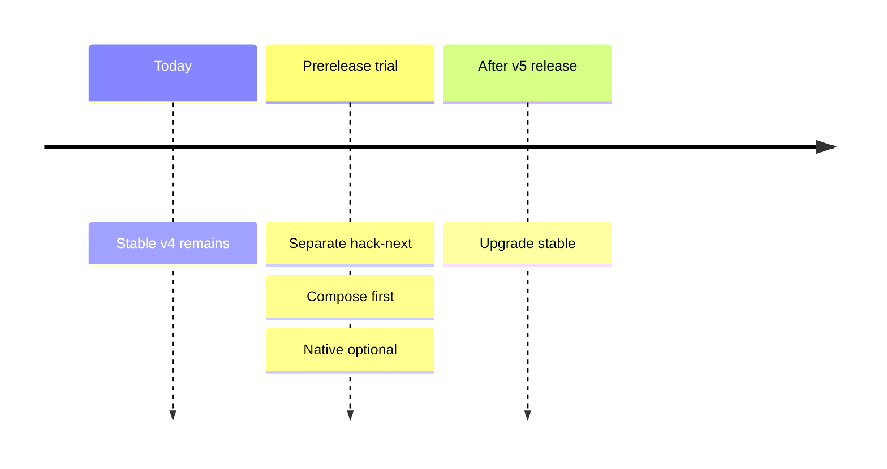

# V5 prerelease channel

V5 native prereleases use a separate release and installation channel. Stable
Homebrew `hack` keeps its existing executable and state. A candidate is selected
explicitly through `hack-next`; installing one does not migrate a project, start a
VM, install DNS or trust, or replace stable Hack.

Keep stable installed while trying the separate prerelease on Compose first, make
native testing optional, and upgrade the stable channel only after v5 is released.



These are adoption phases, not release dates or a promised schedule; each native
trial still needs the platform, provider and project prerequisites below.

The first supported package is for Apple Silicon macOS. Since `5.0.0-next.23`,
a release also carries a Compose-only package for Linux on x86_64 and arm64; it
has no native backend. Provider installation,
native project adaptations and host routing remain explicit prerequisites in the
[native candidate guide](native-candidate.md). A packaged candidate is not a claim
of full Compose parity, lower resource use, or compatibility with every project.

## Supported platforms and capabilities

Published candidate release notes link to this section at the candidate's own tag.
It lists what a candidate package covers. It does not list every project the
candidate can run.

### Supported platform

- `darwin-arm64`: the native candidate archive for Apple Silicon macOS. It also
  runs the Compose backend. This is the platform the release's `prerelease.json`
  records; there it means the native bundle's platform, not the only platform in
  the release (see [release metadata files](#release-metadata-files)).

### Compose-only Linux platforms

Since `5.0.0-next.23`, a release also carries these (`SHA256SUMS-linux` is in
its asset list; `5.0.0-next.22` and earlier have none). Each archive records its own
platform in the `prerelease.json` inside it.

- `linux-x86_64`: the Compose candidate archive for Linux on x86_64 with glibc.
- `linux-arm64`: the Compose candidate archive for Linux on arm64 with glibc.

A Linux archive holds the CLI, the launcher, the config compiler and its schemas,
the lifecycle supervisor, the install guide, checksums and provenance. It has no
native executor, guest relay, storage witness, provider pins or MCP bundle, and
its executables are not code signed. On Linux `hack-next` runs Compose by default;
`HACK_RUNTIME_BACKEND=native` refuses, and `hack-next native setup` reports
`E_UNSUPPORTED_PLATFORM`. See
[the Linux candidate](candidate-install.md#linux-the-compose-only-candidate).

### Unsupported platforms and surfaces

- Intel (x86_64) macOS. The installer refuses before it changes a channel.
- The native backend on Linux, Linux on other architectures, musl-based Linux
  such as Alpine, and Windows. The Linux guest relay in the macOS bundle runs
  inside the candidate VM; it is not a Linux host package.
- Homebrew installation of a candidate. Candidate releases never update the
  stable Homebrew formula.
- Remote, gateway, node and dispatch workflows, and the retained macOS app.
- Retired hosted account, team and dashboard flows, Hack Tickets, and the built-in
  GitHub and Linear integrations.

### Candidate capability limits

The [native candidate guide](native-candidate.md) qualifies a bounded subset.
These limits still apply to a packaged candidate:

- Changing the environment overlay, profiles or target of a retained native graph,
  and pruning dependency caches. See
  [frontend integration status](native-candidate.md#frontend-integration-status).
- Installers that modify source files in the writable development source mode. See
  [explicit writable development source](native-candidate.md#explicit-writable-development-source).
- Named users or groups for private environment delivery. They refuse instead of
  running as root. See the private delivery notes at the end of
  [explicit cleanup after a dead foreground owner](native-candidate.md#explicit-cleanup-after-a-dead-foreground-owner).
- Local registries without an explicit opt-in, registries signed by a private
  certificate authority, mutable tags passed directly to `fetch-image`, images over
  the configured image budget, and images without a Linux ARM64 variant. See
  [registry image acquisition without Docker](native-candidate.md#registry-image-acquisition-without-docker).
- Copied or relocated candidate pools. See
  [manual candidate upgrade and rollback](native-candidate.md#manual-candidate-upgrade-and-rollback).
- Downgrading onto newer state: an older candidate that refuses state written by
  a newer one is not a rollback. See [manual candidate upgrade and rollback](native-candidate.md#manual-candidate-upgrade-and-rollback).

### Known issues

- **Native command output can lose its end (HACK-2766).** On the native VM's
  pinned provider, an output stream can close before the output ends. Exec streams
  (native `hack exec`, and a `docker exec` sent to the native engine) lose their
  end from a few hundred KB upward, in about 1 in 4 runs. Attach streams (`hack run`,
  Compose-backed `hack run` and `docker run`) lose it when the Mac reads slowly.
  `docker cp` is not affected. Releases that include HACK-2759 mark the output
  truncated when the cut comes after the first 1 MiB of a stream, and fail the
  command when it comes inside it; earlier releases can return shortened output
  without saying so. For large output, redirect it to a file in the container and
  copy the file out with `docker cp`. A provider fix is verified; it ships with a
  new provider pin. See [known issues](native-candidate.md#known-issues).

## Versions and artifacts

Candidate versions have the form `BASE-next.N`, where `BASE` is the next
unreleased stable v5 line and `N` is a positive integer without leading zeros.
The current line is `5.0.0`, so candidates are `5.0.0-next.N` with the Git tag
`v5.0.0-next.N`. Each version is immutable: a failed or superseded release gets a
new number rather than replacing its tag or assets.

Semantic versioning orders `5.0.0-next.N` below `5.0.0`. After a stable release
ships, the line moves to the next unreleased version, for example `5.1.0-next.1`,
so candidates keep sorting above stable. `PRERELEASE_BASE` in
`scripts/prerelease-plan.ts` names the line, and a reviewed change on `next` moves
it. Planning refuses a version on any other line. Publication also refuses when
the line's stable tag or release exists, or when the latest stable release is at
or above the line.

The installer accepts any `5.MINOR.PATCH-next.N` version and orders versions by
line, then by number, so an upgrade from `5.0.0-next.N` to `5.1.0-next.1` is an
increase. Older managers, including those in every release through
`5.0.0-next.11`, accept only `5.0.0-next.N`. A channel created by one of them
cannot install a later line through its retained manager; use a fresh `--root`
with a newer installer.

The native archive is named `hack-BASE-next.N-darwin-arm64-native.tar.gz`, for
example `hack-5.0.0-next.12-darwin-arm64-native.tar.gz`. It
contains the complete frontend, executor, guest relay, storage root witness and its
byte manifest, config compiler and schemas, shared MCP bundle, launcher, provider
pins, guide, checksums and `prerelease.json` provenance. The compiled frontend
reports the candidate version. The provenance records the exact source commit and
platform; filenames alone do not establish either.

The Linux archives are named `hack-BASE-next.N-linux-x86_64-compose.tar.gz` and
`hack-BASE-next.N-linux-arm64-compose.tar.gz`, with the managers
`hack-next-manager-linux-x86_64` and `hack-next-manager-linux-arm64`. Their
checksums are in a separate release asset, `SHA256SUMS-linux`: the two archives,
then the two managers. They are not in `SHA256SUMS`, because every published
macOS manager reads that file expecting exactly its own archive line and refuses
any other, which would stop `hack-next --manager upgrade` on existing installs.
`SHA256SUMS`, `INSTALLER-SHA256SUMS` and the release's `prerelease.json` keep the
shape of a macOS-only release. One installer, `hack-next-install.sh`, serves every
platform: it carries the digest of each platform's manager and picks by `uname`.
`scripts/build-compose-candidate.sh` builds a Linux bundle on its own
architecture, and packaging accepts exactly the files and order it checksums.

### Release metadata files

A release with Linux assets has twelve assets, including two release metadata
files. Each archive also contains its own metadata file.

| Asset | What it says | Who reads it |
| --- | --- | --- |
| `prerelease.json` | The version, tag and source revision, and `"platform": "darwin-arm64"`. That field is the native bundle's platform, kept for published managers. It does not mean the release holds only that platform. | Every manager, macOS and Linux, when it installs or upgrades from the release. It checks the tag against the source revision. |
| `prerelease-platforms.json` (releases after `5.0.0-next.24`) | Every platform in the release: for each, the backends it runs and the names of its archive, its manager and the checksum file that lists the archive. | People and tools that want to know what a release holds. No manager reads it. |
| The `prerelease.json` inside each archive | That archive's own platform, with the same version, tag and source revision. | The manager, after it has verified the archive, and packaging. |

The release's `prerelease.json` cannot list the platforms itself. Every published
manager requires exactly its five keys and exactly `darwin-arm64` as the platform,
and refuses the release otherwise, which would stop `hack-next --manager upgrade`
on every existing install. Managers fetch the assets they ask for by name and
skip the rest, so a separate file is safe.

`prerelease-platforms.json` looks like this:

```json
{
  "schema": "hack.prerelease-platforms/v1",
  "version": "5.0.0-next.25",
  "tag": "v5.0.0-next.25",
  "source_revision": "<40-character commit>",
  "platforms": [
    {
      "platform": "darwin-arm64",
      "backends": [
        "native",
        "compose"
      ],
      "archive": "hack-5.0.0-next.25-darwin-arm64-native.tar.gz",
      "manager": "hack-next-manager-darwin-arm64",
      "checksums": "SHA256SUMS"
    },
    {
      "platform": "linux-x86_64",
      "backends": [
        "compose"
      ],
      "archive": "hack-5.0.0-next.25-linux-x86_64-compose.tar.gz",
      "manager": "hack-next-manager-linux-x86_64",
      "checksums": "SHA256SUMS-linux"
    },
    {
      "platform": "linux-arm64",
      "backends": [
        "compose"
      ],
      "archive": "hack-5.0.0-next.25-linux-arm64-compose.tar.gz",
      "manager": "hack-next-manager-linux-arm64",
      "checksums": "SHA256SUMS-linux"
    }
  ]
}
```

The set is checked against this file twice on the way to a release: when the
macOS job packages it, and again after approval, before the tag is created.
The chart shows the other gates only as exits. A run that only prepares stops
once the set is packaged, and a failed upload keeps its tag, which is never
replaced.

After upload, the workflow lists the release assets and compares their names,
sizes, and SHA-256 digests with the local release set. If an asset is missing,
still uploading, or has a null digest, the workflow checks again up to five
times, five seconds apart. A size or digest mismatch fails immediately. If
verification fails, inspect the existing release and do not re-dispatch the
same version.


Diagram [source](prerelease-publication.mmd); rendered with Pele 1.9.0.

Packaging writes it, and both packaging and publication refuse a set it does not
describe: it must list exactly the platforms that have an archive or a manager in
the set, with those asset names, each present; and each archive's own
`prerelease.json` must name its platform, the planned version and the planned
source revision. It carries no digests; the checksum files stay the one place for
those.

Packaging accepts exactly the files and order that `scripts/build-native-candidate.sh`
checksums for a versioned build, with fixed modes for the storage witness (`0500`),
its manifest and schemas (`0600`), and the config compiler (`0755`). The witness
manifest must match the witness bytes and the planned source revision.

Verify the archive checksum and every bundled file before executing the candidate.
The macOS executable signatures are ad-hoc code-integrity checks. They do not
establish a publisher identity or Apple notarization. The pinned official GitHub
release is the distribution source.

## Prepare and publish

Preparation and publication are separate operations. Preparation validates the
version and source, builds the complete native package, and retains reviewable
artifacts without creating a Git tag or release.

First freeze merges to `next` at the intended release head and obtain full CI:

```sh
gh workflow run ci.yml --ref next -f full=true
```

Wait for that exact SHA's full run to succeed. Ordinary `next` pushes can select a
subset and defer Intel compiler checks; even a green full unit selection is not a
release certificate. Every prerelease needs an explicit full dispatch. Its
`test` fan-in must execute `selection_mode=full` and `ci_evidence=release-full`,
and every shard and compiler host must succeed. Both plan and publish recheck
that evidence, the latest attempt and the selected run's required-check identities.
Cancelled runs never qualify. If only scoped evidence exists, the plan refuses
before building and prints this full-dispatch command. If a newer scoped push
run at the same SHA is running, failed or cancelled, wait for it to succeed or
rerun it with `gh run rerun RUN_ID` (the refusal names the run). An older full run
cannot supersede it. A new full dispatch can supersede it once the dispatch
succeeds; only successful scoped runs can be ignored in favor of older full evidence.
Manual full runs have a
separate concurrency group, so a new `next` push cannot cancel one; moving the
head still invalidates its release eligibility.

Review the **Linux first-run advisory** at the release SHA. It runs on `next`
pushes and changes to the covered PR paths. Once the workflow is on the default
branch, GitHub also starts it after a successful full `CI` dispatch on `next`,
using that dispatch's SHA. Its report is separate from required CI and
prerelease verification. Use `bun scripts/list-release-only-scripts.ts` to
list literal release script entry points that no other workflow invokes.

After full CI succeeds, dispatch the existing `Release`
workflow on that branch with an explicit version and its full commit SHA:

```sh
gh workflow run release.yml --ref next \
  -f channel=prerelease \
  -f prerelease_version=5.0.0-next.1 \
  -f source_revision=FULL_NEXT_COMMIT_SHA \
  -f publish_prerelease=false
```

Use the intended candidate's actual SHA in place of `FULL_NEXT_COMMIT_SHA` and an
unused version number. Download the `v5-prerelease-VERSION` Actions artifact from
that run to review the archive, provenance and checksum. The reusable candidate
workflow resolves from the same commit as its caller; no new default-branch
workflow registration is needed for this entry point.

A local versioned build uses the same native bundle builder and requires a clean,
committed source checkout:

```sh
mise exec -- scripts/build-native-candidate.sh /absolute/new/candidate-bundle \
  --version=5.0.0-next.1
```

This builds software and provenance only; it does not reserve the version number,
create a tag, or publish a release.

On Linux x86_64 or arm64, the Compose bundle builds the same way with the pinned
Bun and Rust and a clean, committed checkout:

```sh
scripts/build-compose-candidate.sh /absolute/new/compose-bundle \
  --version=5.0.0-next.1
```

The workflow's `build-linux` job runs it on `ubuntu-latest` and `ubuntu-24.04-arm`,
checks that the bundle starts its own `hackd`, packages the archive and that
architecture's manager, installs them through the installer into a clean home
without `sudo`, and runs `scripts/linux-first-run-check.ts` through the installed
`hack-next`. The macOS job then verifies both architectures' files, lists them in
`SHA256SUMS-linux` and renders the one installer.

Before anything is published, the build job also checks that an existing channel
can take the candidate. It installs the previous published prerelease into a fresh
root with that release's own standalone manager, then upgrades it to the candidate
with the documented `hack-next --manager upgrade` command, which runs the retained
older manager. If that fails, the job fails. Release assets can be replaced after
publication, so the gate runs the previous release only when its manager digest is
a reviewed predecessor in `scripts/installer/channel.ts` and both its manager and
archive digests are pinned for that release in `scripts/check-prerelease-upgrade.ts`.
Add them for each release when it publishes. The managers run without the workflow token, and the job fails if the
packaged candidate changed while the gate ran. It also reports whether the documented
`upgrade-manager` step would work. A release can pass on that step only with
`HACK_PRERELEASE_ACCEPT_MANAGER_STEP=1` and release notes that tell existing users to
run it.

The Linux jobs run the same gate for their platform, with pins in
`PUBLISHED_LINUX_RELEASES` in the same file. Those reviewed pins, not a release's
asset list, decide which leg runs. While no Linux release is pinned and the
previous release has no Linux assets, there is no Linux install to upgrade. The
gate says so, and instead installs the candidate into a fresh channel, deselects
it, selects it, rolls back and uninstalls it. Once a Linux release is pinned, the
previous release must be pinned for the platform and still have its Linux assets;
the gate then upgrades that install with its retained manager. It fails, and never
falls back to the fresh install, when a pinned release's Linux manager asset is
missing, when the previous release has no pin although Linux releases are pinned,
or when the previous release has Linux assets but no pin. Add both platforms' pins
and both Linux manager digests to `REVIEWED_PREDECESSORS` when a release with
Linux assets publishes.

The packaging job and the publish job each verify the Linux files themselves: the
installer's own extraction checks every member of each archive against the
archive's inner `SHA256SUMS`, the metadata must name the planned version, source
revision and platform, and each manager must pass a structural check: a complete
ELF64 executable header for its architecture, a program-header table inside the
file and at least one loadable segment. These checks establish that the set is
consistent and installable. They are not authentication: they do not show that a
file is the one the Linux job built.

Publication requires an explicit publish request for the exact protected `next`
commit, successful checks for that commit, and approval through a configured
`v5-prerelease` GitHub environment. An environment without required reviewers is
not an approval gate. Publication refuses missing protection or approval, changed
source, failed checks, and an existing tag or release.

To request publication after reviewing the candidate, dispatch the same command
with `publish_prerelease=true`. The workflow checks protection and exact-head CI
before scheduling review, then checks the head, checks, human approval and tag
absence again before publication. Only the first attempt of a workflow run can
publish. If publication fails after creating a tag, preserve it for inspection
and use a new version; do not force-push or overwrite it.

The verifier reads classic check requirements from the branch's protection
summary and combines them with effective ruleset requirements. These reads use
the workflow's existing repository read permissions. Missing policy metadata or
failed API reads refuse publication; no administrative token is required.

Candidate releases are marked as GitHub prereleases and excluded from “latest.”
They never update the stable Homebrew formula. The stable release workflow rejects
prerelease tags; stable semantic releases continue to use `main`.

The branch dispatch and same-commit workflow selection follow GitHub's
[manual dispatch](https://docs.github.com/en/actions/how-tos/manage-workflow-runs/manually-run-a-workflow)
and [reusable workflow](https://docs.github.com/en/actions/how-tos/reuse-automations/reuse-workflows)
contracts. The Linux bundles build on `ubuntu-latest` and `ubuntu-24.04-arm`, and
the release set is packaged on the Apple Silicon `macos-15` runner; application
VM tests remain on a separately qualified native host.

## Install, upgrade and return to stable

Use the [candidate installer guide](candidate-install.md) for the explicit
version-pinned installation commands and lifecycle controls. The installer keeps
candidate bundles and homes separate from stable `hack` and `~/.hack`; it does not
change shell configuration or silently select a candidate.

Bundles from `5.0.0-next.3` onward add the storage root witness and its manifest.
A channel created by the `5.0.0-next.1` or `5.0.0-next.2` installer keeps that
release's `manager.py`, which refuses the new layout by design rather than
selecting files it cannot verify. Before upgrading such a channel, stop its
runtimes, download and review the newer tag's installer, run its `upgrade-manager`
against the existing root, then run `upgrade`. See
[upgrade, roll back and return to stable](candidate-install.md#upgrade-roll-back-and-return-to-stable).
A fresh `--root` does not need this step.

Channels created by the `5.0.0-next.3`, `next.4` or `next.5` installer share one
manager. It accepts at most 17 archive members, the exact size of the layout those
releases ship, and no file names beyond it. Later installers use a fixed 64-member
ceiling, but every member must still be a reviewed name in a complete group. A
later bundle that adds a file therefore needs the same `upgrade-manager` step
first. Upgrading with that newer installer against such a channel also refuses
until you run it, and leaves the channel unchanged.

Bundles from `5.0.0-next.18` onward add the lifecycle supervisor executable
(`hack-lifecycle-supervisor`). A channel installed by `5.0.0-next.17` or earlier
keeps that release's compiled manager, which refuses the new member: `upgrade`
fails with "Foreign, duplicate or traversing archive entry." and leaves the channel
unchanged. The `5.0.0-next.18` standalone manager cannot take such a channel over
either, because no compiled predecessor was listed before it. Upgrade a channel
a compiled manager installed (`next.6` to `next.17`) to `5.0.0-next.19` or later
instead: run that release's standalone manager with `upgrade-manager` against the
existing root, then `upgrade`. The takeover refuses a channel layout it cannot
validate, such as one from the `next.1` to `next.5` Python installer; use a fresh
`--root` for those. Managers
from `5.0.0-next.19` onward name an unknown file and give that step when they
refuse. A fresh `--root` does not need it.

Compiled-manager downloads share one total deadline and an inactivity limit. Connection
interruptions and HTTP 502/503/504 receive up to three fresh attempts with bounded
backoff. Checksums, signatures, URL/size refusals and uncertain cancellation never
retry. There is no persistent byte-range resume: a rerun starts from byte zero.
A refused installation preserves the selection, retained bundles and homes.
The installer removes its stage; a later install under the exclusive manager lock
also reclaims abandoned stages with the expected private ownership and name.
Unsafe entries refuse before reclamation.

An upgrade retains the previous bundle and home. Selection changes require the
owning candidate CLI to confirm quiescence. A running runtime, timeout, malformed
receipt or uncertain ownership blocks the switch. Stop owned applications through
their ordinary commands before retrying; a failed probe is not evidence of an idle
runtime.

Rollback selects a retained, verified candidate installation. Each installation
keeps its own home; selecting a different one does not copy VM disks, credentials
or application data. Returning to stable selects the existing stable executable
and its original Docker state. Preserve candidate data for a later retry rather
than trying to make a v4 executable read v5 receipts.

### Uninstall without deleting candidate data

`hack-next --manager uninstall` previews removal without changing files or stopping
applications. `hack-next --manager uninstall --apply` requires every retained
version to confirm quiescence. It moves the complete channel, including its homes,
to a private sibling and prints a rollback manifest. Stable Hack, its home and your
shell PATH are unchanged. No candidate data is deleted.

Uninstalling does not stop Hack's global containers. If you ran `global install`
through `hack-next`, run `hack-next global down` before `uninstall --apply`;
afterwards the launcher is gone, and the proxy and logging containers would keep
running until you stop them with Docker.

To undo it, run the retained `manager` executable with the original `--root` and
`uninstall --rollback-manifest /path/to/manifest`. Rollback checks the retained
channel identity and refuses to replace an occupied original path. Keep the
manifest and retained directory together until you choose to dispose of them.

For stable CLI installations, `bun run uninstall:local` from a checkout removes
only `$HOME/.hack/bin/hack`; it can be repeated and retains user data. See
[upgrading from v4](upgrading-from-v4.md) for the stable updater's integrity and
backup boundaries.

Before accepting a candidate for a project, verify normal start, status, logs,
exec, run, restart and retaining shutdown, then exercise its browser sign-in,
data-backed pages and assets. Record the bundle version and source commit with
the result. Unit tests, hosted CI and a responding health endpoint do not replace
that application check.

### Lifecycle supervisor packaging

New release archives include `hack-lifecycle-supervisor` beside the CLI. The
standard and slim installers install it with executable mode 0755; Homebrew keeps
it beside `libexec/hack`. Source installs prepare it with
`bun run build:lifecycle-supervisor` (Rust 1.97.1, locked dependencies).
The slim runtime image includes the same sibling executable.

Stable archives build it for macOS arm64/x86_64 and Linux arm64/x86_64. The macOS
prerelease bundle's supervisor is ad-hoc signed and covered by the bundle
checksums. The Compose-only Linux prerelease bundles carry it unsigned, covered by
the bundle checksums. Retained managers accept older bundles without this helper. Packaging does not change the lifecycle runner default.

Self-upgrades stage the helper before publishing the CLI, retain its previous
bytes and SHA-256 in the backup, and restore it if publication fails.
Before publishing anything, a self-upgrade asks the staged CLI which helper
handshake it requires and refuses the release, leaving the installation
unchanged, if the staged helper is missing or answers differently. Releases
whose CLI predates the helper are still accepted. Keep the
helper with its matching CLI when moving an installation.
