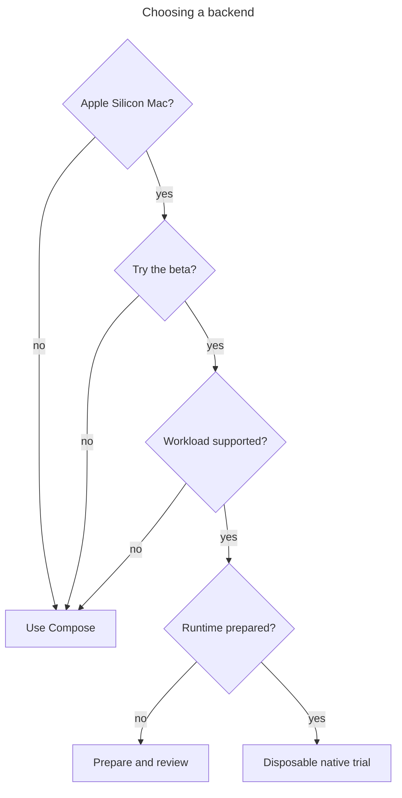

# Native backend (beta)

The native backend is a second way for Hack to run your project. It is a beta for
Apple Silicon Macs. Docker Compose is still the default, and nothing changes for a
project unless you choose native for it.

## What it is

Hack needs something to run your services in. Today that is Docker Compose, which
needs a Docker app running on your machine.

With the native backend, Hack runs admitted project workloads as containers in a
provider-managed Linux virtual machine. You do not need Docker Desktop or OrbStack
on the Mac. The pool runs its pinned Docker Engine inside the VM; it does not use
your host's Docker app. Preparing that provider pool is still a separate step.

It is not a different container format. Your images and your Compose file are the
same. Projects using the same native pool share that pool's VM resources.

Your project stays the same. The `.hack/` folder, the commands (`hack up`,
`hack down`, `hack logs`) and your env and secrets are the same on both backends.

## What it is not

- **Not the default.** Compose runs your project unless you select native.
- **Not in stable Hack.** It ships only through the separate `hack-next` channel.
  The stable release archives and the Homebrew formula do not contain it.
- **Not for every platform.** It runs on Apple Silicon macOS only. Intel Macs,
  Linux and Windows use Compose.
- **Not a full replacement for Compose yet.** It supports a limited set of commands
  and Compose features. See [what works and known limits](limits.md).
- **Not a migration.** Trying native does not convert your project or move your
  data. Your stable setup is left alone.
- **Not proven faster or lighter.** We have published no measurement that compares
  native with Compose, so we make no speed, memory or battery claims.
- **Not a wall between projects.** Projects in the same pool share VM resources.

## Control and traffic

For the Compose-file native frontend, the compiler prepares the workload plan and
the provider manages containers; published TCP traffic takes a separate loopback
publisher and application-bridge path into the VM pool.

The compiler does not carry application traffic. This picture covers published
TCP ports, not every routing mode or the authored frontend's separate capability
limits; see the [reference](reference.md) before selecting a workload.

## Why try it

What you get today:

- **No Docker Desktop install or licence.** Hack brings what it needs.
- **Ports stay on your machine.** A Compose port bound to every network interface
  (`0.0.0.0`) is narrowed to your own machine, so a dev service is not open to the
  network you are on.
- **You can limit where containers connect.** An optional list names the hosts your
  containers may reach.
- **Risky container settings are refused.** For example, `privileged: true` does not
  run.
- **Images are checked when pulled.** Hack verifies each image against its digest, a
  fingerprint of its exact contents.
- **Crashes are handled in the open.** Hack detects a crashed run and cleans it up
  with an explicit command. `hack down` keeps your data.
- **Safe to try.** `hack-next` installs beside stable Hack with its own files. It
  does not edit your PATH, your stable `hack`, or `~/.hack`.

What you give up today:

- Following logs live.
- Interactive shells in a container.
- UDP ports.
- Automatic restart for services that publish a port.
- A one-command setup. Preparing the runtime is still manual.

Use Compose if you need any of these.

## Who should try it

Try it if you use an Apple Silicon Mac, you are comfortable testing beta software,
and you have a project you can afford to break. Start with a disposable project
and synthetic data.

Stay on Compose if you need every Compose feature, you work on Linux or an Intel
Mac, or the project holds data you cannot lose.

Compose remains the default; a native trial requires a supported Mac, explicit
beta opt-in, supported workload features and a separately prepared runtime.

Eligibility is permission to try a disposable workload, not a claim of feature
parity, production readiness or better performance.

## Where to go next

1. [Try it](try-it.md): install, run one project on native, and switch back.
2. [What works and known limits](limits.md).
3. [Reference](reference.md): the detailed pages, by topic.
