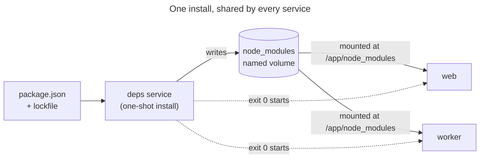

# Install dependencies in a deps service

Install Node and Bun packages (npm, pnpm, Yarn, Bun) **inside the container
environment**, not on your machine. Give the project one `deps` service that
installs once into a named volume, and let every Node or Bun service use that
volume.

The complete project is in
[`examples/recipes/deps-service`](../../examples/recipes/deps-service). Every
Node or Bun project in [Config examples](config-examples.md) uses the same
pattern.

## Why not install on your machine

Containers run Linux. Many packages ship a native binary for each platform, or
compile one at install time. A package manager installs only the binary for the
platform it runs on. If you install on macOS, or on a different Linux C library,
and mount that `node_modules` into the container, those packages fail to load.

For example, Rollup installed on a glibc Linux machine and then run in an
Alpine (musl) container fails like this:

```text
error: Cannot find module @rollup/rollup-linux-x64-musl.
```

On macOS you get the same kind of error for `darwin-arm64` binaries. Packages
such as esbuild, Rollup, SWC, Sharp, Prisma and bcrypt are typical examples.
A shared `node_modules` also mixes up two installs: your machine's and the
container's.

## How it works



## Steps

1. Add a `deps` service and a named volume. Mount the volume at the same path
   in `deps` and in every service that runs your code.

   <!-- include: examples/recipes/deps-service/.hack/docker-compose.yml -->
   ```yaml
   name: deps-service
   services:
     # One-shot installer: runs on every start, inside Linux, then exits.
     deps:
       image: oven/bun:1.4.4-slim
       working_dir: /app
       command: ["bun", "install", "--frozen-lockfile"]
       volumes:
         - ..:/app
         - node_modules:/app/node_modules

     # Every Node or Bun service mounts the same volume at the same path and
     # waits for the installer to finish successfully.
     app:
       image: oven/bun:1.4.4-slim
       working_dir: /app
       command: ["bun", "run", "dev"]
       volumes:
         - ..:/app
         - node_modules:/app/node_modules
       depends_on:
         deps:
           condition: service_completed_successfully
       labels:
         caddy: deps-service.hack.local
         caddy.reverse_proxy: "{{upstreams 3000}}"
         caddy.tls: internal
       networks:
         - hack-dev
         - default

   volumes:
     node_modules: {}

   networks:
     hack-dev:
       external: true
   ```

   The volume mounted over `/app/node_modules` hides any `node_modules` folder
   in your checkout from the containers.

2. Use a locked install with your package manager:

   | Package manager | Command |
   | --- | --- |
   | Bun | `bun install --frozen-lockfile` |
   | npm | `npm ci` |
   | pnpm | `pnpm install --frozen-lockfile` |
   | Yarn (Berry) | `yarn install --immutable` |

   Use the same runtime and package manager versions as the project pins. If
   the locked install fails, find out why (a stale lockfile, a different
   package manager version, the wrong package manager). Do not drop the flag to
   get a green start.

3. The project config needs nothing special for this pattern:

   <!-- include: examples/recipes/deps-service/.hack/hack.config.json -->
   ```json
   {
     "$schema": "https://schemas.hack.local/hack.config.schema.json",
     "name": "deps-service",
     "dev_host": "deps-service.hack.local"
   }
   ```

4. Start the project. `deps` runs, exits with status 0, then the other services
   start. `hack ps` shows `deps` as `exited 0`; Hack does not count that as a
   failed start.

   ```sh
   hack up -d
   hack ps
   ```

## After a lockfile change

`deps` runs on every `hack up` and `hack restart`. After you pull a lockfile
change, restart:

```sh
hack restart
```

To add a package, run the package manager in the `deps` container. It updates
`package.json` and the lockfile in your checkout and installs into the volume:

```sh
hack run deps bun add nanoid@5.1.6
hack restart
```

On Linux with Docker Engine, files the container writes in your checkout (the
lockfile here) belong to root. See [Common pitfalls](common-pitfalls.md).

## Branch instances and worktrees

Each branch instance is its own Compose project, so by default it gets its own
volume. A linked worktree (or `--branch <name>`) installs into
`<project>--<branch>_node_modules`. That is simple and safe, but every worktree
installs from scratch once.

To share one install between instances that have the same lockfile, label the
`deps` service and set its platform:

```yaml
  deps:
    image: oven/bun:1.4.4-slim
    platform: linux/arm64 # linux/amd64 on Intel and AMD machines
    working_dir: /app
    command: ["bun", "install", "--frozen-lockfile"]
    volumes:
      - ..:/app
      - node_modules:/app/node_modules
    labels:
      hack.dependencies.cache-volume: node_modules
      hack.dependencies.lockfiles: bun.lock,package.json
```

Hack then names the volume from a fingerprint of the lockfiles, the installer
image and the platform: `hack-cache-<project>-node_modules-<hash>`. Instances
with the same fingerprint use the same volume. When a worktree changes its
lockfile and restarts, it gets a new volume; the other instances keep theirs.

- Without a resolved platform, Hack prints
  `Shared dependency cache disabled` and uses the plain volume. Set `platform`
  in the file, or set `DOCKER_DEFAULT_PLATFORM` in your shell when your team
  uses different machines.
- The label selects a volume. It does not stop two installers from writing the
  same volume at once, and it does not prove the install is complete. For that,
  see the opt-in [locked installer protocol](../guides/dependency-cache-protocol.md).
- While instances share a volume, `hack run deps bun add ...` installs into the
  shared volume, so the other instances see the new package too. Change only
  the lockfile first, then restart; the new lockfile selects a new volume:

  ```sh
  hack run deps bun add nanoid@5.1.6 --lockfile-only
  hack restart
  ```

More detail: [Dependency directories and caches](dependency-directories.md).

## Monorepos and workspaces

Bun and pnpm also write a `node_modules` folder into each workspace package,
not only at the root. Give each of those folders its own named volume, and
mount all of them in `deps` and in every app service. The
[monorepo example](config-examples.md#monorepo-with-two-apps-and-a-shared-package)
does this with a YAML anchor:

```yaml
x-workspace-volumes: &workspace-volumes
  - ..:/app
  - node_modules:/app/node_modules
  - web_node_modules:/app/apps/web/node_modules
  - api_node_modules:/app/apps/api/node_modules
```

Add a volume when you add a workspace package that has dependencies. If you
miss one, the container writes that folder into your checkout.

## Recover a stale or half-written volume

An interrupted install, or a package changed by hand, can leave the volume
broken. A plain locked install may not notice: Bun reports `no changes` and
leaves a damaged package in place.

1. Try a forced reinstall into the same volume, then restart the app:

   ```sh
   hack run deps bun install --frozen-lockfile --force
   hack restart
   ```

   For other package managers, use their force or clean-install option. We
   tested this step with Bun only.

2. If that does not help, remove the volume and start again. Stop the
   instance first; Docker refuses to remove a volume that a container still
   uses.

   ```sh
   hack down
   docker volume ls --filter label=com.docker.compose.project=<project>
   docker volume rm <project>_node_modules     # or the hack-cache-... name
   hack up -d
   ```

   For a branch instance the project is `<project>--<branch>`.

`hack down` never removes the dependency volume, and neither does
`hack down --prune-caches`.

## What was tested

Each step on this page was run with Docker Engine on Linux (amd64). The
`platform: linux/arm64` value in the shared-volume example is for Apple
silicon; we ran it with `linux/amd64`. The macOS failure mode was not
reproduced; the musl example above was.

Related: [Dependency directories and caches](dependency-directories.md),
[Config examples](config-examples.md), [Common pitfalls](common-pitfalls.md).
