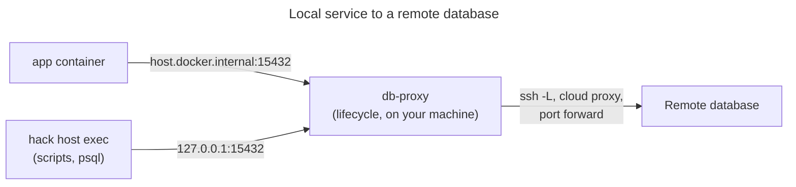

# Use a remote database from local services

Use this when local services must talk to a shared database, such as staging,
that is reachable only through a proxy or tunnel. You pick the database with an
env overlay. A lifecycle process runs the proxy. Guard rails stop you from
writing to production by accident.

The complete project is in
[`examples/recipes/remote-database`](../../examples/recipes/remote-database).
Its proxy, `scripts/tcp-forward.ts`, is a small stand-in for a real one. The
"remote" database is a local stand-in started from `stand-in/`.

## How it works



| Overlay | `DB_TARGET` | Database | Writes |
| --- | --- | --- | --- |
| none (base) | `local` | The `db` container | Allowed |
| `staging` | `staging` | Remote, through the proxy | Allowed |
| `production` | `production` | Remote, through the proxy | Refused: read-only connection, and `hack up` needs `ALLOW_PRODUCTION_DB=yes` |

## Steps

1. Run the proxy as a lifecycle process. `singleton` makes `hack up` fail
   instead of starting a second proxy when the port is already taken.

   <!-- include: examples/recipes/remote-database/.hack/hack.config.json -->
   ```json
   {
     "$schema": "https://schemas.hack.local/hack.config.schema.json",
     "name": "remote-database",
     "dev_host": "remote-database.hack.local",
     "lifecycle": {
       "up": {
         "before": [{ "name": "production guard", "command": "sh scripts/guard-production.sh" }]
       },
       "processes": [
         {
           "name": "db-proxy",
           "command": "bun scripts/tcp-forward.ts",
           "singleton": { "ports": [15432], "onConflict": "fail" }
         }
       ]
     }
   }
   ```

   With a real proxy, replace the command. For example:
   `ssh -N -L 127.0.0.1:15432:db.internal:5432 bastion.example.com`, a cloud
   provider's database proxy, or a port-forwarding session. Keep it in the
   foreground. We ran only the stand-in.

2. Describe each target in an overlay. Commit the non-secret values.

   <!-- include: examples/recipes/remote-database/.hack/hack.env.default.yaml -->
   ```yaml
   version: 1
   environment: default
   secretsprovider: project_key
   values:
     global:
       DB_TARGET: local
     app:
       DATABASE_URL: postgres://app:app@db:5432/app
   ```

   <!-- include: examples/recipes/remote-database/.hack/hack.env.staging.yaml -->
   ```yaml
   version: 1
   environment: staging
   secretsprovider: project_key
   values:
     global:
       DB_TARGET: staging
       # Where the proxy connects. With ssh this is the -L target.
       DB_PROXY_UPSTREAM: 127.0.0.1:55433
     # DATABASE_URL for app is a secret. Store it in the machine-local file:
     #   hack env add --env staging DATABASE_URL --service app --secret --local --value-stdin
   ```

   <!-- include: examples/recipes/remote-database/.hack/hack.env.production.yaml -->
   ```yaml
   version: 1
   environment: production
   secretsprovider: project_key
   values:
     global:
       DB_TARGET: production
       DB_PROXY_UPSTREAM: 127.0.0.1:55433
     # Store a read-only DATABASE_URL for app in the machine-local file. Add
     # ?options=-c%20default_transaction_read_only%3Don so every transaction is
     # read-only even if the role is not.
   ```

3. Store the connection strings as machine-local secrets. Pipe them in so they
   never appear in your shell history:

   ```sh
   <secret-source> | hack env add --env staging DATABASE_URL --service app --secret --local --value-stdin
   <secret-source> | hack env add --env production DATABASE_URL --service app --secret --local --value-stdin
   ```

   Inside containers the host is `host.docker.internal:15432`. On your machine,
   `hack host exec` rewrites `host.docker.internal` to `127.0.0.1`, so the same
   value works for host tools.

4. Let containers reach the proxy on your machine:

   <!-- include: examples/recipes/remote-database/.hack/docker-compose.yml -->
   ```yaml
   name: remote-database
   services:
     app:
       # Stand-in for your service: a Postgres client that stays running.
       image: postgres:17.6-alpine
       command: ["sleep", "infinity"]
       # Lets the container reach the proxy that runs on the host.
       extra_hosts:
         - "host.docker.internal:host-gateway"

     # The local database, used when no remote overlay is selected.
     db:
       image: postgres:17.6-alpine
       environment:
         POSTGRES_USER: app
         POSTGRES_PASSWORD: app
         POSTGRES_DB: app
       volumes:
         - db-data:/var/lib/postgresql/data

   volumes:
     db-data: {}
   ```

5. Start against a target. Pass the same `--env` to later commands, such as
   `hack exec` and `hack down`.

   ```sh
   hack up -d --env staging
   hack exec --env staging app sh -c 'psql "$DATABASE_URL" -c "select 1"'
   hack host exec --env staging --scope app -- your-script
   hack down --env staging
   ```

## Guard rails against writing to production

Use more than one. Each covers a different mistake.

1. **A read-only connection.** The production `DATABASE_URL` sets
   `default_transaction_read_only=on`. Postgres then refuses writes:
   `cannot execute INSERT in a read-only transaction`. Better still, use a
   database role that has only read grants.
2. **A start guard.** This hook stops `hack up --env production` unless you
   set `ALLOW_PRODUCTION_DB=yes` for that one command:

   <!-- include: examples/recipes/remote-database/scripts/guard-production.sh -->
   ```sh
   #!/bin/sh
   # Refuse to start against the production database unless the person running
   # hack up says so for this one command.
   set -eu
   if [ "${DB_TARGET:-local}" = "production" ] && [ "${ALLOW_PRODUCTION_DB:-}" != "yes" ]; then
     echo "guard: this overlay points at the production database (read-only)." >&2
     echo "guard: run ALLOW_PRODUCTION_DB=yes hack up --env production to continue." >&2
     exit 1
   fi
   ```

3. **No production secret by default.** Keep the production connection string
   only in the machine-local file of the people who need it. An overlay name is
   only a label; it gives no access control. Migrations and seed scripts should
   check `DB_TARGET` too.

## Linux: reaching the proxy from containers

`extra_hosts: host-gateway` points `host.docker.internal` at the Docker bridge
address on Linux. A proxy that listens on `127.0.0.1` is not reachable there.
On Linux:

- make the proxy listen on the bridge address, with a machine-local override:
  `hack env add --env staging --local DB_PROXY_LISTEN_HOST 172.17.0.1`
  (check yours with `ip -4 addr show docker0`), and
- allow that port from Docker networks in your firewall, and
- point host tools at the same address. `hack host exec` rewrites
  `host.docker.internal` to `127.0.0.1`, where the proxy no longer listens.
  Store a `host`-scope value; it applies only to commands on your machine:

  ```sh
  <secret-source> | hack env add --env staging DATABASE_URL --service host --secret --local --value-stdin
  ```

  with a connection string that uses `172.17.0.1:15432`.

Docker Desktop on macOS routes `host.docker.internal` to your machine itself,
so the default `127.0.0.1` listener is expected to work there. We did not
test it.

## What was tested

On a Linux host with Docker Engine: the overlays, the proxy start and stop,
host tools through the proxy (on `127.0.0.1`, and on the bridge address with
the `host`-scope value), the production guard, and the read-only connection. The container-to-proxy hop could not be tested on that host: its
firewall drops traffic from containers to the host. It was not tested on
macOS.

Related: [Environments](environments.md), [Lifecycle](../lifecycle.md),
[Env and secrets](../env.md), [Common pitfalls](common-pitfalls.md).
