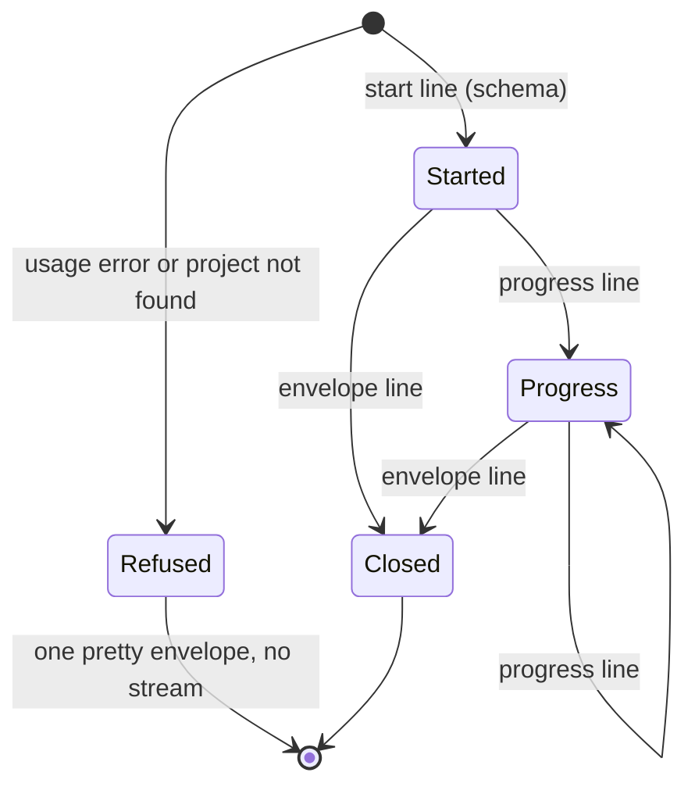

# Lifecycle progress stream

`hack up --json --progress`, `hack down --json --progress` and
`hack restart --json --progress` print a newline-delimited JSON (ndjson) stream on
stdout instead of one pretty-printed envelope. Callers that show progress, such as
the desktop app, read it line by line. Stderr is unchanged and is not part of the
contract.

This is the Compose backend only. The native backend does not support it yet (see
[Refusals](#refusals)).

## The stream

Every line is one JSON object.

1. **Start line**, written once Hack validated the options and resolved the
   project:

   ```json
   {"schema":"hack.lifecycle-progress.v1","type":"start","ts":"2026-11-14T17:00:00.000Z","action":"up","project":"shop"}
   ```

   `action` is `up`, `down` or `restart`. `project` is the Compose project name
   (`<name>` or `<name>--<branch>`). `schema` appears only on this line.

2. **Progress lines**, zero or more:

   ```json
   {"type":"progress","ts":"2026-11-14T17:00:01.000Z","service":null,"phase":"images"}
   {"type":"progress","ts":"2026-11-14T17:00:09.000Z","service":"api","phase":"running"}
   ```

   `service` is `null` for a project-level phase and a Compose service name
   otherwise. `ts` is an ISO 8601 UTC timestamp.

3. **Closing line**: the same envelope the command prints with `--json` alone,
   written as one compact line. Nothing follows it.

   ```json
   {"ok":true,"data":{"action":"up","project":"shop","branch":null,"composeProject":"shop","services":{"started":["api"],"completed":["migrate"],"stopped":[],"failed":[]},"durationMs":9120}}
   ```

   A failure after the start line also ends with exactly one envelope line,
   `{"ok":false,"error":{"code":...,"message":...}}`. Exit codes are the same as
   with `--json` alone.



## Phases

Hack reports only signals the Compose path already observes. It does not parse
Compose's terminal output or poll for extra state. A phase that did not happen is
skipped, so a consumer must not wait for any particular phase.

| Phase | `service` | Source |
|---|---|---|
| `images` | `null` | Compose image preparation (`up --no-start`) is starting. |
| `starting` | `null` | Image preparation succeeded; containers are being started (`up -d`). |
| `stopping` | `null` | `down` is about to stop the containers; `restart` is about to run its stop phase (down hooks and host processes). |
| `stopped` | `null` | That stop finished successfully. |
| `waiting`, `installing`, `verifying`, `ready`, `failed` | service | Dependency cache startup markers, also printed to stderr as `Dependency cache <service>: <phase>`. Only services that use the dependency cache report them. |
| `running`, `completed`, `stopped`, `failed` | service | The final state of each service, taken from the closing envelope and written just before it. |

What each command reports:

- `up`: `images`, then `starting` if image preparation succeeded, any dependency
  cache phases, then the final states. `up --json` always runs detached, so the
  `images` and `starting` signals always fire; a failure during image preparation
  stops after `images`.
- `down`: `stopping`, `stopped` when `docker compose down` succeeded, then one
  `stopped` line per service that was running before.
- `restart`: `stopping` and `stopped` for the stop phase, then the same phases as
  `up`. A restart of named services (`hack restart api`) skips the stop phase.
  When a full restart's start fails and Hack repairs it with a second Compose
  start, that repair reports no `images` or `starting` lines.

Final per-service lines come from the envelope's `data.services` lists on success
(`started` maps to `running`). On an `E_STARTUP_INCOMPLETE` error they come from
`error.detail.running`, `completed` and `failed`. Other errors have no final
per-service lines.

## Interruption

SIGINT or SIGTERM after the start line closes the stream with one compact
`{"ok":false,"error":{"code":"E_CANCELLED",...}}` line. The existing lifecycle
cleanup still runs, and the process still ends by that signal. Nothing is
written to stdout after the closing line. A stream with no closing line was
killed (for example with SIGKILL).

## Refusals

These end with the ordinary pretty `--json` envelope (or usage text without
`--json`) and no stream, because they happen before the start line:

- `--progress` without `--json`: usage error `--progress requires --json.`
- The native backend (`HACK_RUNTIME_BACKEND=native`): usage error
  `Native lifecycle commands do not support --progress yet.` before any work.
- A native-authored project refuses `--progress` as an unsupported option of its
  native Compose path.
- A remote target (project lifecycle routed through dispatch): usage error
  `--progress is not supported for remote targets.` before dispatch.
- Other usage errors, a missing project, Docker missing from `PATH`, and an
  invalid shared helper configuration.

A consumer that needs to tell the two apart can check whether the first line
parses as a complete JSON object with `schema`.
