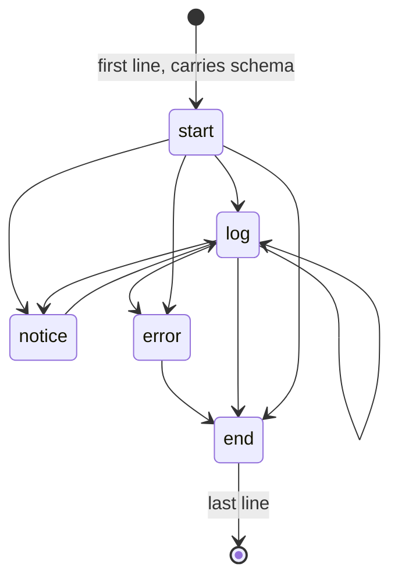

# Logs JSON stream

`hack logs --json` writes newline-delimited JSON (ndjson): one object per line
on stdout. This stream is a stable contract, `hack.logs.v1`, for scripts and for
the desktop app's Logs tab. Fields may be added in v1; none are removed or
renamed.

```sh
hack logs --json --no-follow --tail 200
hack logs --json --services api,worker
hack logs --json --services api --max-line-bytes 65536
```

## Lines



Every line has `type` and `ts` (ISO 8601). Lines also carry `backend`
(`compose`, `loki` or `native`) and, when known, `project` and `branch`.

| `type` | Meaning | Extra fields |
| --- | --- | --- |
| `start` | Always the first line. | `schema: "hack.logs.v1"`, `follow`, and when set `services`, `since`, `until`, `max_line_bytes` |
| `log` | One log entry. | `entry` (below) |
| `notice` | Information for a person; safe to ignore. | `message` |
| `heartbeat` | Reserved for a quiet follow; current backends do not send it. | none |
| `error` | The backend failed; an `end` follows. | `message` |
| `end` | Always the last line of a stream that finished. | `reason`, and sometimes `phase`, `message` |

Only the `start` line has `schema`. A stream that stops without an `end` line
was interrupted, for example because the reader stopped the process.

`end.reason` is `eof` when the backend finished cleanly, `closed` when a Loki
follow closed cleanly, `exit:<n>` when the backend process exited with status
`n`, and `error` after an `error` line. Native follow can also end with
`native_log_service_stopped` (the followed service stopped) and adds `phase`
and `message` to a failed end. Treat `error` and `exit:<n>`
with nonzero `n` as failure; the other reasons are a normal finish.

### `entry`

| Field | Meaning |
| --- | --- |
| `source` | `compose`, `loki` or `native` |
| `message` | The log text, without the service prefix or timestamp |
| `raw` | The line as the backend returned it |
| `service`, `instance`, `project` | Where the line came from, when known |
| `stream` | `stdout` or `stderr`, when known |
| `timestamp`, `timestamp_ns` | Engine time, when known |
| `level`, `fields` | Parsed from structured (JSON) log lines |
| `truncated` | `true` when `message` or `raw` was cut to a byte bound |
| `partial` | `true` when the stream ended before the line's newline |

## Options

Compose logs read the resolved project using its saved Docker connection
settings. Application values from the project's environment overlay are
excluded from the Docker log process.

- `--services a,b`: only these services. A service given as the argument is
  added to the list. On Compose, persistent `hack up` processes in the list are
  read from the lifecycle log, and the other names are passed to
  `docker compose logs`. On Loki they build the selector. `--services` does
  not choose a backend; it works with `--compose` and `--loki`. Native logs do
  not accept it yet: pass one service as the argument.
- `--max-line-bytes <n>`: keep at most `n` UTF-8 bytes of each entry's
  `message` and `raw`, cutting on a character boundary. A cut entry has
  `truncated: true` and no `fields`. `n` is a whole number from 1 to 1,048,576.
  It requires `--json`. Native logs do not accept it yet; native follow
  already cuts lines at 64 KiB and marks them `truncated`.

## Refusals

A refusal before the stream starts, such as an invalid option, is not a
stream. With `--json` it is one standard envelope on stdout and a nonzero exit:

```json
{ "ok": false, "error": { "code": "E_USAGE", "message": "--max-line-bytes requires a whole number from 1 to 1048576." } }
```

On the native backend (`HACK_RUNTIME_BACKEND=native`), a refused follow keeps
stdout for stream lines only: the same envelope, as one line, goes to stderr.

## Native exceptions

Native `hack logs --json --no-follow` still prints one snapshot object, not
this stream. Native-authored projects refuse `--json` logs. Both are planned
follow-ups.
