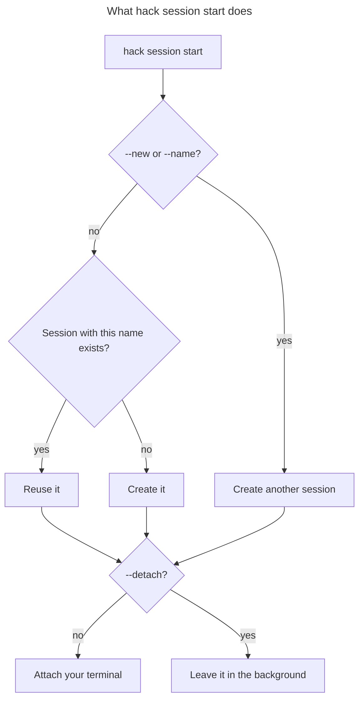
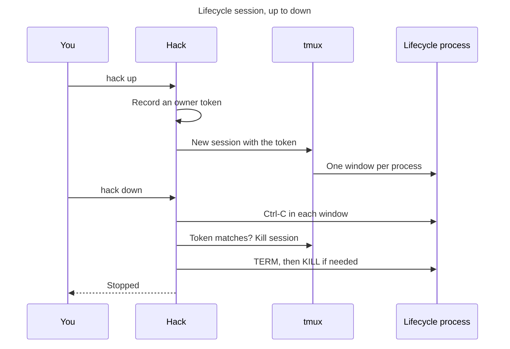

# Sessions

A session is a named tmux session that Hack starts in a project's repository,
with the project's env already loaded. The CLI also calls it a workspace.

Sessions need [tmux](https://github.com/tmux/tmux). Hack creates the tmux
session, names it after the project, and gives you commands to attach to it,
send it a command and read what it printed. Everything else is plain tmux.

## Why sessions exist

- **Your work survives the terminal.** The shell and whatever runs in it live in
  the tmux server, not in your terminal window. Close the window, lose an SSH
  connection or restart your editor, then attach again and continue.
- **One place to come back to.** A project's default session always has the
  project's name. A person, a script or a coding agent can find it by that name,
  send it a command, and read the output later.
- **The right env is already there.** Hack starts the session with the project's
  resolved env. A session for one overlay and one service carries that
  service's values, and its name says which.
- **Hack has somewhere to run host processes.** `hack up` runs a project's
  lifecycle processes and its persistent `up.before` hooks in a tmux session that
  Hack owns, so `hack down` can find them and stop them.

A session is not an instance. An [instance](core.md) is a running copy of the
project's services. A session is a terminal that stays open beside it.

## Start one

```bash
hack session start my-project
```

This attaches your terminal to the session named `my-project`, and creates it
first if it does not exist. Name a registered project, or pass its path;
`hack session start` does not guess the project from the current folder. Run
`hack projects` to see the names.

Detach with the tmux prefix and `d`. The session keeps running. Come back with:

```bash
hack session attach my-project
```

In a terminal, run `hack session` with no arguments for a picker that lists sessions and
projects. `hack setup tmux` installs a tmux popup binding that opens the same
picker from inside tmux.

## How it works

### Names

| You run | Session name |
| --- | --- |
| `hack session start my-project` | `my-project` |
| `hack session start my-project --new` | `my-project--2`, then `--3`, and so on |
| `hack session start my-project --name agent-1` | `my-project--agent-1` |
| `hack session start my-project --env qa` | `my-project.env-qa` (`--env base` gives `.env-base`) |
| `hack session start my-project --service api` | `my-project.svc-api` |
| `hack session start my-project --env qa --service api` | `my-project.env-qa.svc-api` |
| `hack up` in a project with lifecycle processes | `my-project--lifecycle` |
| the same, in a branch instance | `my-project--<branch>--lifecycle` |



- **The default session** has the project's name. `start` reuses it when it
  exists.
- **Another session** for the same project comes from `--new` (the next free
  number) or `--name <suffix>`. Use one for each person or agent that should
  not share a shell.
- **A session for one overlay or service** comes from `--env` and `--service`.
  Its name is stable, so starting it twice gives you the same session.

A new session starts in the repository root, not in `.hack/`.

### Env

`hack session start` resolves the project's env and hands the values to tmux
when it creates the session. Every shell in that session has them. `--env`
chooses the overlay and `--service` chooses the scope, as on other commands;
see [Environment and secrets](env.md).

A session keeps the env it was created with. Changing env files does not update
an existing session; stop it and start it again.

The values then live in the tmux server's memory for that session, including
secrets. Anything that can attach to the session can read them. Hack passes them
to tmux on standard input, not as command arguments.

### Attach

`hack session attach <name>` attaches your terminal and detaches other clients,
so the session takes your terminal's size. From inside tmux it switches the
current client instead of nesting. Use `--detach` on `start` when nothing should
attach, for example from a script.

### Send a command

```bash
hack session exec my-project "bun test"
```

`exec` types the command into the session's active pane and presses Enter. It
returns at once. It does not wait for the command, and its exit code only says
whether the keys were sent. If the pane is busy, the text goes to whatever is
running there.

With `--env` or `--service`, or in a session named for an overlay or service,
Hack loads that env for the one command. It writes the values to a private
temporary file that only you can read. The command's launcher reads the file
and deletes it; a file that is not picked up expires after 10 minutes.

### Read the output

```bash
hack session capture my-project --lines 200
hack session tail my-project --max-ms 5000
hack session panes my-project
```

| Command | What it reads | Defaults |
| --- | --- | --- |
| `capture` | The last lines of a pane | 200 lines, the active pane |
| `tail` | New lines as they appear, for a short time | polls every 500 ms for 5 seconds |
| `panes` | The panes in the session: target, window, command, folder | |

All three print JSON lines by default: a `start` event, one `log` event per
line or pane, an `error` event if a read fails, then an `end` event. `--pretty`
prints plain text on `capture` and `tail`, and one JSON object on `panes`.
`--json` asks for the default and cannot be combined with `--pretty`. `--target`
picks a pane on `capture` and `tail`.

`hack session list` prints a table. It has no `--json`.

### Stop

```bash
hack session stop my-project
```

`stop` kills the tmux session with that exact name. Everything running in it
ends at once; there is no graceful step. Two things to know:

- `hack session list` shows every session on your tmux server, not only the
  ones Hack created. `stop` kills whichever one you name.
- Do not stop a `--lifecycle` session this way. Use `hack down`, which stops
  the session's processes in order. If you kill the session and a process
  outlives it, `hack down` refuses and keeps the lifecycle state until that
  process is gone.

### Lifecycle sessions

When a project declares lifecycle processes or a persistent `up.before` hook,
`hack up` creates a session named `<project>--lifecycle` and gives each process
its own tmux window. See [Lifecycle](lifecycle.md) for how to declare them.



Hack owns this session:

- **Ownership.** Hack writes a random owner token to the project's lifecycle
  state, then creates the tmux session with that token in one step. `hack down`
  kills the session only when its token matches.
- **Teardown.** `hack down` sends Ctrl-C to each window, kills the session, then
  checks the processes it started. Processes that are still alive get TERM, and
  KILL after a wait. `hack down` fails if any are still alive after that.
- **Looking inside.** `hack session attach my-project--lifecycle` shows the
  processes. Detach when you are done.

If tmux is not installed, a `hack up` that needs a lifecycle session fails
before it starts one. A project with no lifecycle processes and no persistent
hooks needs no tmux for `hack up`.

A project can opt in to an experimental built-in supervisor for these processes
instead of tmux, with `lifecycle.runner: "supervisor"`. It needs a matching
supervisor executable. See [Lifecycle supervisor](lifecycle-supervisor.md).

### What is stored where

| What | Where | Survives a reboot |
| --- | --- | --- |
| A session, its shells and its env | The tmux server's memory | No |
| Lifecycle state, with the owner token | `.hack/.internal/lifecycle/state.json` | Yes |
| Lifecycle logs | `.hack/.internal/lifecycle/` | Yes |

Hack keeps no file for an interactive session. If the tmux server stops, the
session is gone; start it again.

## Options

| Option | On | What it does |
| --- | --- | --- |
| `--up` | `start` | Run `hack up -d` first, with `--env`. It uses the `hack` on your `PATH`, and the session starts even if `up` fails |
| `--new` | `start` | Create another numbered session |
| `--name <suffix>` | `start` | Create another session with this suffix |
| `--detach`, `-d` | `start` | Do not attach |
| `--env <name>` | `start`, `exec` | Choose the env overlay |
| `--service <name>` | `start`, `exec` | Choose the env scope |
| `--target <pane>` | `capture`, `tail` | Choose a pane |
| `--lines <n>` | `capture`, `tail` | How many lines to read |
| `--interval-ms`, `--max-ms` | `tail` | How often and how long to poll |
| `--pretty` | `capture`, `tail`, `panes` | Plain text (`panes`: one JSON object) |

The [command reference](reference/cli.md) has every flag.

### Settings

| Setting | Values | Default |
| --- | --- | --- |
| `sessions.mux` in `.hack/hack.config.json` or the global config | `auto`, `tmux`, `none` | `auto` |
| `HACK_SESSIONS_MUX` | the same; it wins over both config files | |

`auto` and `tmux` both mean tmux. `none` turns sessions off: `list` shows
nothing and `start` fails. The project file wins over the global config.

```bash
hack config set --global sessions.mux tmux
```

### From another machine

`hack ssh` prints the SSH command for this machine and lists its sessions, so
you can attach from a phone or another computer. `--tailscale` or
`--direct --host <name>` choose the route, and it shows a QR code for a phone
SSH app. Run `hack ssh --help` for the rest.

## Limits

- **tmux is required.** There is no other multiplexer and no fallback.
- **A session is not a sandbox.** It runs as you, on your tmux server, with your
  files and your network. It separates nothing. Two sessions for one project
  share the same repository folder and the same running services.
- **A session does not survive a reboot.** Nothing restarts it.
- **`exec` does not report results.** To know whether a command worked, read
  the pane with `capture` or `tail`, or run the command with
  [`hack exec --detach` or `hack run --detach`](guides/background-commands.md),
  which keep an exit code.
- **A slow tmux gives an unknown result.** Hack waits at most 15 seconds for a
  tmux command that is not interactive. After that it stops waiting and reports
  that the outcome is unknown, because tmux may still apply the command.
- **Secrets are visible inside the session.** Treat a session that has a
  project's env as you would a shell with those variables set.

## Zellij was removed in v5

v4 could use zellij. v5 uses tmux only. What happens depends on what you have:

| You have | What v5 does | What to do |
| --- | --- | --- |
| `sessions.mux` set to `zellij` in a project or the global config, or `HACK_SESSIONS_MUX=zellij` | `hack session` commands, `hack ssh`, and a `hack up` or `hack restart` that needs a lifecycle session stop with: `sessions.mux=zellij was removed in v5. Install tmux, then unset sessions.mux (and HACK_SESSIONS_MUX) or set it to tmux.` `hack doctor` reports the same text as a `sessions mux` error. `hack global install` stops when the global setting or the variable says `zellij`. | Install tmux. Remove the setting in each place, or set it to `tmux`. |
| A project whose lifecycle processes were started under zellij by v4 and are still recorded | `hack up`, `hack restart` and `hack down` refuse, because v5 cannot inspect or stop a zellij session. Changing the setting does not clear this. | Stop that project with the v4 CLI while zellij is still installed: run v4's `hack down`. If you already upgraded, go back to the v4 CLI for that one stop. Do not delete or edit Hack's state files. |
| Open zellij sessions | Nothing. v5 does not stop them and does not move them to tmux. | Close them yourself. Start new sessions with `hack session start`. |

The [upgrade guide](versions/v5/guides/upgrade-from-v4.md#breaking-change-zellij-workspaces-removed)
has the full stop procedure, including the backup to take before it.
