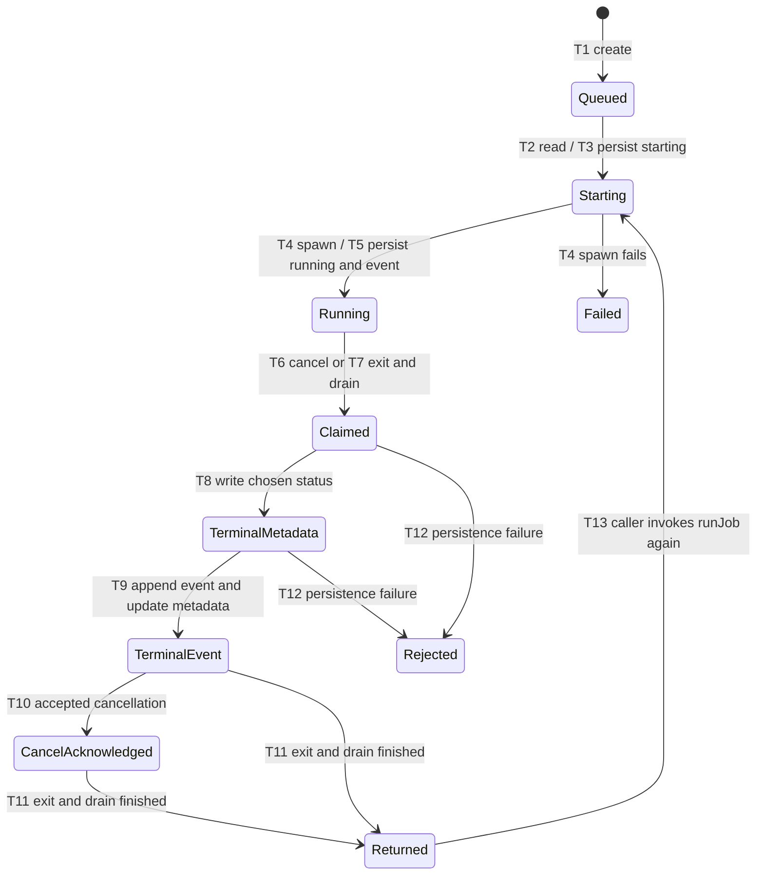
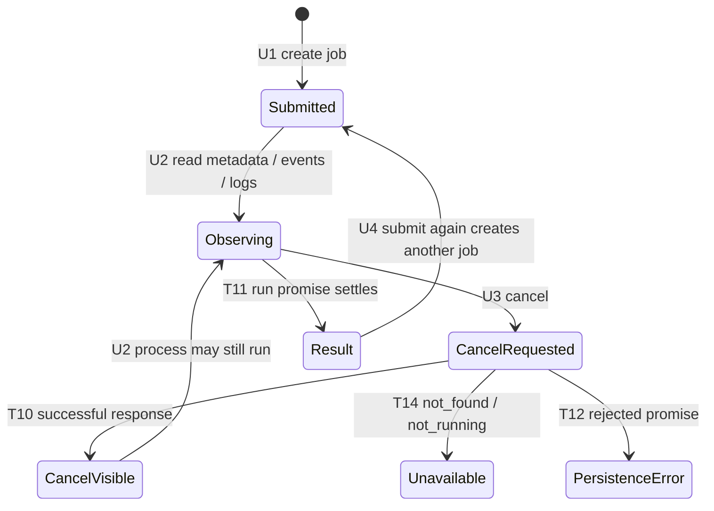

# Supervisor job statechart and property derivation

- Walkthrough: [supervisor-usage.md](supervisor-usage.md).
- Source revision: `08e0412a9fa063c33f4145b569c36afc5810e606`; no uncommitted product changes.
- Saved before modeling: 2026-10-23. The reviewed documentation is committed before any project TLA+ file.
- Boundary: the exported job runner, filesystem job store, service composition, and adjacent shell service. These are unsupported experimental surfaces, explicitly inspected for this verification task.

## Code states

A terminal **outcome claim** is local to one invocation. There is no durable execution
claim, lease, queue consumer, attempt counter, or retry policy. `awaiting_input` is
accepted by the store parser but has no transition in these runner/service paths.
A cancelled job can still have a live process; metadata and process state are distinct.

## User flow

Caller deadlines are external; this service supplies no job timeout or automatic retry.
A shell close response means a signal was sent, not that exit was observed.

## Transition map

Paths below are relative to `src/control-plane/extensions/supervisor/`.

| ID | Trigger / guard / effect | Source :: function | Atomic boundary and observable result | Status |
| --- | --- | --- | --- | --- |
| T1 / U1 | Create UUID; write queued metadata and created event; start runner | `service.ts :: createJob`; `job-store.ts :: createJob` | Several awaited filesystem operations; returned metadata is the initial snapshot | Existing |
| T2 | Read existing metadata; require command, but do not check status or ownership | `runner.ts :: runJob` | Awaited read; another invocation may read the same job | Existing |
| T3 | Persist starting; append starting event | `runner.ts :: runJob`; `job-store.ts :: updateJobStatus, appendEvent` | Separate read/write, event append, and metadata rewrite awaits | Existing |
| T4 | Spawn process, or record failed status/event on spawn exception | `runner.ts :: runJob` | Synchronous spawn; error persistence awaits; no cancellation handle yet | Existing |
| T5 | Persist running and started event, then register cancellation callback | `runner.ts :: runJob`; `service.ts :: onSpawn` | Process is already live before persistence and registration finish | Existing |
| T6 | Cancel if no non-cancelled terminal outcome; signal once; choose cancelled | `runner.ts :: cancel, finish` | Signal and local terminal claim before first persistence await; repeated cancel shares `terminalWrite` | Existing |
| T7 | Observe process exit and drain both streams; choose completed/failed unless already claimed | `runner.ts :: runJob, finish, pipeStreamToFiles` | Exit and drain are independent waits; local outcome arbitration is synchronous | Existing |
| T8 | Persist chosen status | `runner.ts :: finish`; `job-store.ts :: updateJobStatus` | Read metadata, then write replacement; no compare-and-swap | Existing |
| T9 | Append terminal event, then rewrite metadata with sequence | `job-store.ts :: appendEventInternal` | Append and metadata write are separate; failure may occur between them | Existing |
| T10 / U3 | Resolve accepted cancellation only after T8/T9 complete | `runner.ts :: cancel`; `service.ts :: cancelJob` | Does not await process exit or pipe drain; repeated accepted requests reuse result | Existing |
| T11 | Resolve run after exit/drain and terminal persistence; remove service map entry | `runner.ts :: runJob`; `service.ts :: finally` | A process that never exits can keep the run pending after cancellation acknowledgement | Existing |
| T12 | Persistence rejects; preserve already claimed outcome; otherwise service attempts failed fallback | `service.ts :: catch`; `runner.ts :: finish` | No retry after a claimed terminal write fails; fallback can also reject | Existing |
| T13 | Invoke exported runner on same job again, including terminal jobs | `runner.ts :: runJob` | New independent local variables; no stored status guard | Existing low-level caller composition; not an advertised retry endpoint |
| T14 | Cancel missing job or missing local handle, or after another terminal outcome claims | `service.ts :: cancelJob` | Store read precedes local map lookup; return `not_found` or `not_running` | Existing |
| T15 / U4 | Resubmit create request | `service.ts :: createJob` | New UUID each call; no idempotency key | Existing; no transport retry deduplication |
| T16 | Create PTY and shell; publish running metadata; close sends signal; exit updates metadata/listeners; expire after ten minutes | `shell-service.ts :: createShell, closeShell, attachShell, handleShellExit` | In-memory session map; signal acknowledgement distinct from exit callback; no job-store writes | Existing separate lifecycle |
| T17 | Acquire durable execution ownership, bound retries, recover abandoned work | No implementation in these files | No claim/retry/recovery API to invoke | Absent requested guarantees, not a modeled existing transition |
| T18 / U2 | Read metadata/events/logs | `service.ts :: getJob, listJobs`; `job-store.ts :: readJobMeta, readEvents` | Reads can observe intermediate persistence; malformed metadata returns null | Existing |

## Properties derived from transitions

Hypotheses below are recorded before TLC. Names are stable check identifiers.

| Check | Promise and harm | Transitions | Promise source / scope | Kind and model property | Bounds / fairness | Sensitivity and real-code replay |
| --- | --- | --- | --- | --- | --- | --- |
| P1 | At most one live runner per stored job; duplicate side effects otherwise | T2–T5, T13 | Requested job-wide guarantee; service normally creates fresh UUIDs | Safety `SingleRunner` | One job, two invocations; no fairness needed | Remove reference admission guard; two actual runner calls overlap on one stored job |
| P2 | After cancellation acknowledgement no process runs; post-cancel side effects otherwise | T6, T8–T11, T13 | Requested stronger guarantee; current documentation promises persisted outcome only | Safety `CancelQuiescent` | One job; signal may be ignored; separate exit transition | Reorder reference acknowledgement before exit; actual process dependency remains live after successful cancel |
| P3 | Retrying the same logical job does not execute it twice; repeated side effects otherwise | T2–T5, T11, T13, T15 | Requested idempotency; automatic retry and attempt budget are absent | Safety `RetryIdempotent` | One job, two sequential invocations; count executions rather than a set | Remove reference duplicate guard; actual runner executes a terminal job again |
| P4 | Every locally claimed outcome reaches durable terminal status and event | T6–T12 | Requested progress; current implementation exposes persistence errors without recovery | Liveness `ClaimedTerminal` | One invocation; weak fairness for enabled persistence, exit, and drain; one transient write rejection allowed | Disable reference recovery after rejected persistence; actual service rejects and retains running metadata despite subsequent store availability |
| P5 | Within one invocation, accepted cancellation preserves one cancelled terminal outcome/event | T6–T10 | Existing documented promise | Safety `CancelWins` | One invocation; successful persistence, no external store writers | Remove local finish memoization; actual cancellation/exit race attempts a second terminal write |

The reference admission, exit-wait, deduplication, and persistence recovery controls are
hypothetical and must be labeled separately. Their passes are sensitivity controls,
not evidence that those fixes exist. Every property gets its own mutation config and
behavioral replay; no known failure may mask another.

## Observations before TLC

- P1/P3 likely fail at the exported runner boundary: T2 accepts any existing status.
  No current service path is claimed to schedule the same UUID twice.
- P2 likely fails for a process that ignores termination. This is already documented
  behavior, but does not meet the requested stronger guarantee.
- P4 likely fails after a finite terminal persistence error. Fair scheduling cannot
  execute a recovery action that does not exist. Successful-I/O progress must also
  be checked separately; do not call the absence of a queue claim API a hang.
- P5 appears protected by a synchronous local claim and shared promise. A global
  job-level interpretation would be false because T13 creates a new local arbiter.
  This assumes callbacks do not throw or synchronously re-enter `finish`.
- The daemon client can retry a failed POST transmission once after readiness
  recovery (`src/daemon/client.ts :: resolveDaemonJsonResponse`). A lost create
  response can therefore lead to T15 and a new UUID. This is an additional
  idempotency concern, not an automatic job retry or a modeled same-ID submission.
- Job-store operations are not transactions: concurrent read-modify-write operations
  may lose sequence/status updates. The minimal model can restrict stores to serialized
  operations for P1–P4 counterexamples; it must not claim general store linearizability.
- Shell close has the same signal-versus-exit distinction but no job persistence or
  retry machinery. Review it as an adjacent boundary, not as a fictitious job runner.

## Deliberate exclusions

- Transport authorization, gateway delivery, process groups/descendants, daemon crashes,
  corrupt files, shell listener exceptions, and arbitrary concurrent store writers.
- UUID collisions, multiple jobs, unbounded caller submissions, and retry backoff (absent).
- Filesystem failure coverage is a finite rejected terminal status write. Partial event
  appends are documented above and covered by existing service tests, not claimed exhaustive.

## Review gate

- Reviewer: implementation agent (source review; no human approval claimed).
- Reviewed revision: `08e0412a9fa063c33f4145b569c36afc5810e606`; product diff: none.
- Evidence: all four scoped source files, `docs/supervisor.md`, existing runner/service
  tests, supervisor command callers, and daemon service construction inspected.
- Checks: caller responses, missing retry/claim APIs, independent process and persisted
  states, pre-registration window, terminal errors, atomicity, and all five property
  derivations checked against source.
- Findings/resolutions: execution ownership is absent, so label T2 a read rather than
  a claim; P4 uses the actual terminal claim; stronger guarantees remain explicit
  hypotheses; separate actual behavior from hypothetical controls. Keep serialized
  store schedules as a stated coverage limit rather than inventing an atomic store.
- Gate: reviewed; blocking issues: none. Independent review may append corrections
  before modeling. Commit this review and walkthrough first.

Independent source audit confirmed the transition boundaries and missing ownership
and retry mechanisms. It also identified the lost-POST composition above and the
T5 startup failure window; these remain source-derived concerns until replayed.
