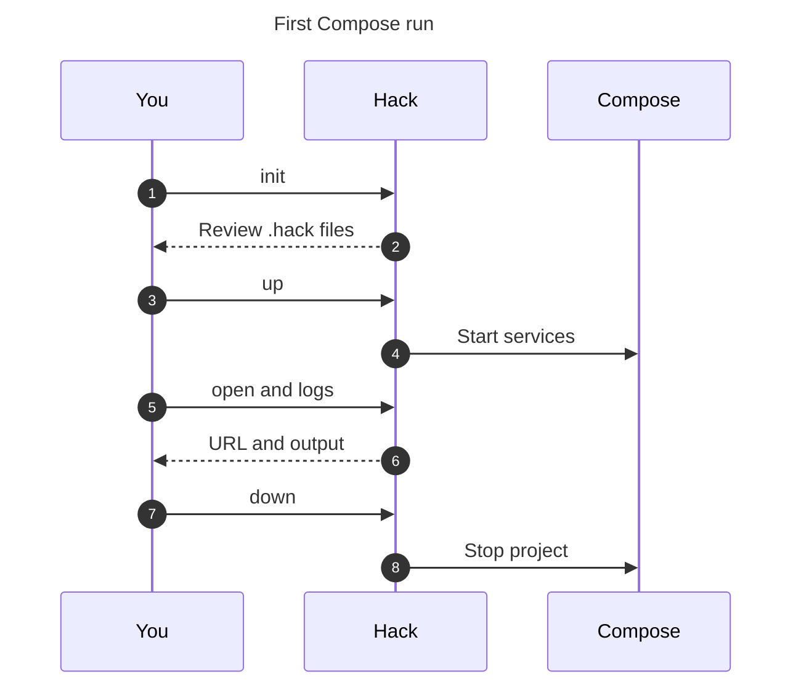

# First project on Compose

Start here: [1. Install](install.md) → **2. First project** →
[3. Upgrade from v4](upgrade.md) or [4. Try native](native/start.md).

Use the terminal from Install: `hack` selects v5 and
`HACK_RUNTIME_BACKEND=compose` is exported. Docker must be running.
An existing v4 project should follow the upgrade page before these steps.

For a read-only inventory, use `hack projects --json --observe`. It lists
registered projects even when hackd is off, preserves the registry, and starts
no services or engine connection. Add `--runtime` only to opt in to Docker
queries: contacting an on-demand engine can start it. Unknown runtime state stays unknown; native projects use their
native `ps` observer. See the [listing contract](../cli.md).



## Set up your repository

From the repository you want to run:

```sh
cd your-project
hack init
```

Follow the service and domain prompts. Discovery suggests services from the app's
packages; review the images and commands it proposes. To adopt an existing Compose
app, use `hack init --manual` for a scaffold, then put the needed service definitions
in `.hack/docker-compose.yml`. Adjust relative build and mount paths for that
file's location; keep the original Compose file until the app checks pass.
This is the Compose setup path; `hack config adopt` is a separate native configuration path.
If `.hack/` already exists, review that setup instead of replacing it.

Check `.hack/docker-compose.yml`: its images, commands, ports and mounts should
match your app. Check the local URL in the service's routing labels. Commit shared
configuration, but never the project key `.hack.secret.key` or local env layers.
[Project setup](guides/init-project.md) explains discovery and custom domains.

For noninteractive setup, `hack init --auto` uses discovery defaults. In builds
containing merged #791, intended for next.17, it warns **“No runnable service was
found”** when discovery wrote a placeholder `app` service (a Bun image running
`bun run dev`). Set that service's image and command to how your app really starts
before `up`. The notice does not appear for a discovered service or when you
explicitly chose `--manual` or `--no-discovery`.

## Start and open

```sh
hack up --detach
hack ps
hack open
```

Expect the declared services in `ps` and the app's local URL from `open`.
If a project has several URLs, choose the app's route. A worker-only project may
have no URL. Sign in or load a page that reads data to check the app itself.

With #791, Compose `open` warns when the host's DNS looks wrong; the URL is still
printed or opened. `open --json` adds `dns: "unresolved"` for a confirmed missing
address, or `dns: "unconfigured"` on a Mac whose Hack DNS suffix is not set up and
whose lookup did not answer in time. A machine upgraded from v4 may resolve only
the older suffix. Follow the hint: use the same Compose-selected v5 CLI to run
`hack global install`, or choose a host under a working suffix with
`hack config set dev_host <name>.<suffix>`. Review host-change prompts.
See [the DNS troubleshooting row](troubleshooting.md).

A failed startup prints a reason. Read it before retrying; use
[troubleshooting](troubleshooting.md) and `hack doctor` for setup problems.

## Read logs and stop

```sh
hack logs --no-follow --tail 50
hack logs --follow
```

The first command prints a snapshot. The second keeps watching. Ctrl-C stops
watching the logs; it does not stop the project. Logs may contain secret values.
Do not paste raw logs into a public issue.

For foreground `hack up`, Ctrl-C stops the project instead. With tmux, Hack also
waits for lifecycle commands and separately grouped workers: they get TERM and
five seconds to finish handling it
before one forced stop. A second Ctrl-C skips the remaining command grace; Hack
still checks ownership, confirms exit and lets the wrapper finish cleanup.
Slow process reads can extend shutdown;
Hack retries transient read failures and reports cleanup it cannot confirm.
Exited processes waiting to be reaped count as stopped, including on macOS.
Canceling startup still allows cleanup to retry a missed process start time.
Ctrl-C does not run `down.before` or `down.after` hooks;
use explicit `hack down` for those hooks. Attached `up.after` runs only after
Compose returns successfully, so it does not run while the project stays attached.

```sh
hack down
```

This stops the project. It does not delete its named volumes or stop shared
routing services. See [Run and inspect](guides/run-project.md) for service selection,
log history and restarts. When this Compose run works, try native only on a
[disposable project](native/start.md).

Lifecycle host processes can opt into `lifecycle.runner: "supervisor"` when the
Rust supervisor executable is installed alongside the CLI. The default stays
`"mux"`. This mode has no terminal: use noninteractive commands and
`hack logs -f <name>` to watch output. See the
[lifecycle runner implementation contract](https://github.com/hack-dance/hack/blob/next/docs/lifecycle-supervisor.md) for prerequisites and
recovery behavior.
