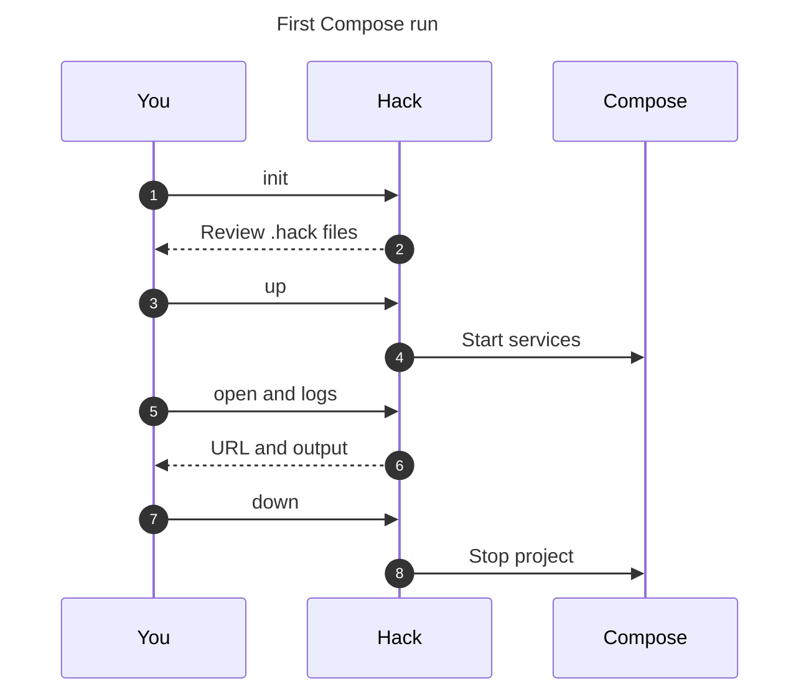
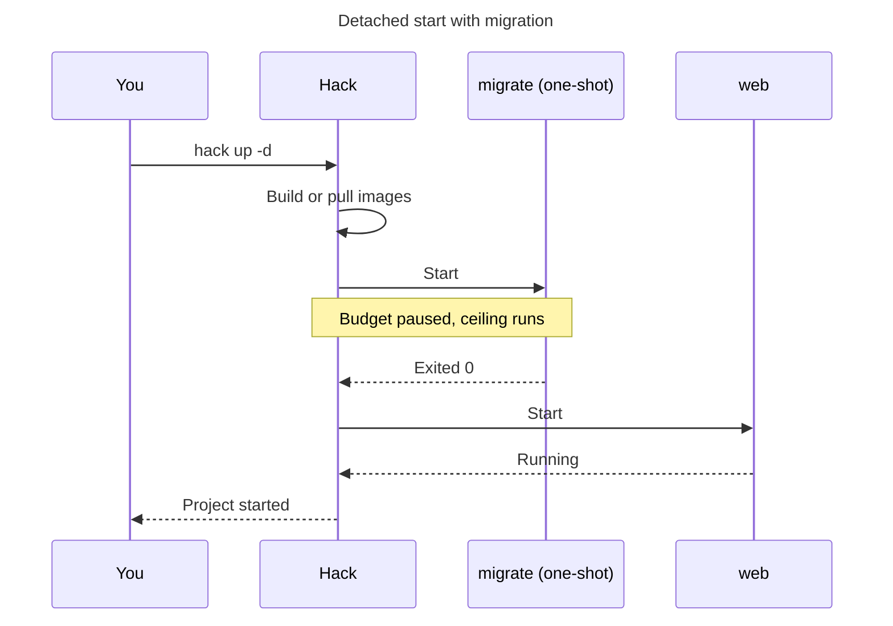

# First project on Compose

Start here: [1. Install](install.md) → **2. First project** →
[3. Upgrade from v4](upgrade.md) or [4. Try native](native/start.md).

Use the terminal from Install: `hack` selects v5 and
`HACK_RUNTIME_BACKEND=compose` is exported. Docker must be running.
An existing v4 project should follow the upgrade page before these steps.

For a read-only inventory, use `hack projects --json --observe`. It lists
registered projects even when hackd is off, preserves the registry, and starts
no services or engine connection. Add `--runtime` only to opt in to Docker
queries: contacting an on-demand engine can start it. Unknown runtime state stays unknown; native projects use their
native `ps` observer. Full listings include routes for registered worktrees
and Hack branches before the copy starts. See the [listing contract](../cli.md).



## Set up your repository

From the repository you want to run:

```sh
cd your-project
hack init
```

Follow the service and domain prompts. Discovery suggests services from the app's
packages; review the images and commands it proposes. To adopt an existing Compose
app, use `hack init --manual` for a scaffold, then put the needed service definitions
in `.hack/docker-compose.yml`. Adjust relative build and mount paths for that
file's location; keep the original Compose file until the app checks pass.
This is the Compose setup path; `hack config adopt` is a separate native configuration path.
If `.hack/` already exists, review that setup instead of replacing it.
New scaffold files and directories created by Hack exclude group and other write
permissions, even with a shell umask of `002`.

Check `.hack/docker-compose.yml`: its images, commands, ports and mounts should
match your app. Check the local URL in the service's routing labels. Commit shared
configuration, but never the project key `.hack.secret.key` or local env layers.
[Project setup](guides/init-project.md) explains discovery and custom domains.

For noninteractive setup, `hack init --auto` uses discovery defaults. Since next.17, it
warns **“No runnable service was
found”** when discovery wrote a placeholder `app` service (a Bun image running
`bun run dev`). Set that service's image and command to how your app really starts
before `up`. The notice does not appear for a discovered service or when you
explicitly chose `--manual` or `--no-discovery`.

The desktop project's **Config** tab shows routes, service dependencies and
which file supplies each setting. Choose **Viewing as** to inspect a checkout
and **Env** to select an overlay. Save edits to the layer shown. Route changes
offer a restart, and env-only changes apply the next time a service starts.
Use `hack config show --json` for the same Compose model from the CLI.
Config omits recognized credentials from service and dependency diagnostics
and hides env keys or scopes that contain recognized credentials.

## Start and open

```sh
hack up --detach
hack ps
hack open
```

Detached Compose `hack up` reports completed hooks by name and lists services
after confirming startup. A successful start ends with the primary address,
startup time, and count of configured routes for running services whose HTTP
readiness has yet to be checked. The command makes no HTTP request to warm the
routes. A detached native start reports its primary served HTTPS address and
startup time once it is ready, or `no address` if native HTTPS is not serving
a route for that project. A successful `hack down` ends with a stopped line
and the elapsed time. Native stops report when they retain data.

If `hack up` stops before the project is ready, look for the `!` line. It
names the blocker and shows the command to run next.

When checking for leftover Compose networks, Hack passes Docker connection
settings and keeps application values out of the network probe's environment.

`hack ps` lists services with their primary address and current state. An
address followed by `+1` has one more configured address. Use `hack ps --wide`
for all addresses, container names, exit codes and port details.
Use `hack ps --copies` to list the project's checkouts and branch instances
together. The count names the backend that was observed. A copy whose runtime
state cannot be confirmed on that backend shows `unknown`. Saved native
instances stay listed when Compose is selected. Native mode lists only native
records and does not query Docker. Authored projects leave the
address cell empty because the copies view cannot resolve their saved routes.
Use `hack ps --copies --json` for the same inventory in structured form.
The result includes `observation: {ok, code}` for inventory, setup, or
deadline failures. The command still returns the known copies in those cases.

To start this project at future logins, use `hack up -d --always` and install
the per-user daemon with `hack daemon install`. `hack down` pauses its marker;
`hack up` resumes it. See [Always-on projects](https://github.com/hack-dance/hack/blob/next/docs/always-on-projects.md) for
the startup bounds, no-prompt behavior and JSON contract. Automatic startup requires
trusted, non-writable-by-others tool and project paths; `hack doctor` reports
permission refusals, including app-bundle and Homebrew paths on macOS.
Formerly writable files require reviewed replacement on fresh private files;
changing modes or ACLs in place cannot revoke an older open writer.
This slice starts only eligible Compose projects with images already available
locally. Hooks, host helpers, command providers and image builds require manual
`hack up`; doctor explains those manual-start requirements.
Retained projects created by `hack config adopt` also require manual starts.
Host-file/source-code bind mounts also require manual starts. Verified default
engine volumes and Hack's authenticated read-only TLS mounts remain supported.
Interrupting `hack autostart run` cancels the pass and waits for startup cleanup.
After upgrades that change global templates, run `hack global install` manually
before relying on login routing.

If a default remote target declares a [sign-in prerequisite](https://github.com/hack-dance/hack/blob/next/docs/env.md#sign-in-prerequisites-for-compose-projects),
Hack checks it before startup hooks. If the check fails, follow the displayed
login command and try again. Use `hack config validate` to verify declarations
without running the checks.

When the project declares remotes, `hack ps` shows the observed target or
`unknown` if it cannot identify one. An environment-backed hostname displays
the variable name. Start the whole project with `hack up`. Use `hack down`
followed by `hack up` to restart it.

To add Redis to a Compose project, run `hack service add redis --dry-run` to
review the diff, then `hack service add redis` to save it and `hack up redis`
to start the service. In the desktop preview, open **Add service**, search for
Redis, choose **Add to project** to preview the diff, then **Save to project**
and **Start redis** on the Compose backend. Native also supports editing
Compose files. It starts the whole project, so use `hack up` without a service
name. If the native project is already running, stop it first to load the
change. For projects authored in `.hack/hack.project.json`, add a workload in
that file and run `hack config validate`.

Review the saved file in **Changes** and commit it when
you're ready. For PostgreSQL, MySQL, and MinIO, set the listed variables in the
Env tab under the matching service scope before starting. Catalog services
with image-declared storage use named Compose volumes.

The desktop preview shows those descriptors on the registered project's
**Services** tab. It shows the environment variable name for an
environment-backed address and marks each target as unchecked.

Expect the declared services in `ps` and the app's local URL from `open`.
If a project has several URLs, choose the app's route. A worker-only project may
have no URL. Sign in or load a page that reads data to check the app itself.

With #791, Compose `open` warns when the host's DNS looks wrong; the URL is still
printed or opened. `open --json` adds `dns: "unresolved"` for a confirmed missing
address, or `dns: "unconfigured"` on a Mac whose Hack DNS suffix is not set up and
whose lookup did not answer in time. A machine upgraded from v4 may resolve only
the older suffix. Follow the hint: use the same Compose-selected v5 CLI to run
`hack global install`, or choose a host under a working suffix with
`hack config set dev_host <name>.<suffix>`. Review host-change prompts.
See [the DNS troubleshooting row](troubleshooting.md).

### How long a first start takes

A first start can take minutes. Later starts are faster, because the images
exist and the database is already migrated. `hack up -d` runs in two phases, and
each phase has its own time limit:

| Phase | What happens | Limit | Raise it with |
| --- | --- | --- | --- |
| Images | Build or pull images, create containers | 30 minutes | `HACK_COMPOSE_IMAGE_TIMEOUT_MS` |
| Start | Start containers, wait on `depends_on` | 90 seconds without progress | `HACK_COMPOSE_STARTUP_TIMEOUT_MS` |
| Start, while a one-shot runs | The same phase, counted as a whole | 30 minutes in all | `HACK_COMPOSE_STARTUP_CEILING_MS` |

A **one-shot** is a service that runs once and exits, such as a migration or a
seed job. Another service waits for it with
`depends_on: <name>: condition: service_completed_successfully`. While a one-shot
runs, the start is making progress, so the 90 seconds do not count down. The
30-minute ceiling limits the whole start phase. A one-shot that keeps restarting
is not progress. A ceiling lower than the start limit is raised to it.



Set a limit for one command with a host variable. You can also set the two
start limits for the project in `.hack/hack.config.json`. The image limit has
only the host variable. A host variable wins over the project setting. Values
are milliseconds: up to 1 hour for the start limit, and up to 4 hours for the
ceiling and the image limit.

```sh
# Migrations that can run longer than 30 minutes
HACK_COMPOSE_STARTUP_CEILING_MS=3600000 hack up -d
# A service that is slow to become healthy
HACK_COMPOSE_STARTUP_TIMEOUT_MS=300000 hack up -d
```

```json
{
  "compose": {
    "startupTimeoutMs": 180000,
    "startupCeilingMs": 3600000,
    "downTimeoutSeconds": 5
  }
}
```

`compose.downTimeoutSeconds` (whole seconds, `0` to `600`) sets the stop grace
period passed to `docker compose down --timeout` in `hack down` (invalid values
refuse with `E_CONFIG_INVALID`), and `hack down --timeout <seconds>` overrides
it for one run. Leaving both unset keeps Docker Compose's default grace period
and the 90-second overall cap (which does not inspect per-service
`stop_grace_period` settings in Compose); setting a timeout scales the cap to
`max(90s, timeout × distinct running services + 30s)`.

If the start stops at the ceiling while a one-shot still runs, the
`E_STARTUP_TIMEOUT` error names that service. The one-shot keeps running, but
nothing starts the services that wait on it. Do this:

1. Run `hack ps`. Waiting services show `created (waiting for <service>)`.
2. Wait until the one-shot shows `exited`. If its exit code is not 0, read
   `hack logs <service>` before you go on.
3. Run `hack up -d` again.

Do not run `hack restart` or `hack down` while a one-shot runs. Both stop it
mid-run, and a half-applied migration is hard to repair. In a terminal, they ask
first and the default answer is no. With `--json` or `--no-interactive` they go
on, and report the service in `data.interrupted` and `data.warnings`.

These limits apply to detached Compose starts. Foreground Compose `hack up`
has no start limit. Native has separate detached and readiness settings.
See [native startup limits](../native/limits.md#native-startup-limits).

A failed startup prints a reason. Read it before retrying; use
[troubleshooting](troubleshooting.md) and `hack doctor` for setup problems.

## Read logs and stop

```sh
hack logs --no-follow --tail 50
hack logs --follow
```

The first command prints a snapshot. The second keeps watching. Ctrl-C stops
watching the logs; it does not stop the project. Logs may contain secret values.
Do not paste raw logs into a public issue.

For foreground `hack up`, Ctrl-C stops the project instead. With tmux, Hack also
waits for lifecycle commands and separately grouped workers: they get TERM and
five seconds to finish handling it
before one forced stop. A second Ctrl-C skips the remaining command grace; Hack
still checks ownership, confirms exit and lets the wrapper finish cleanup.
Slow process reads can extend shutdown;
Hack retries transient read failures and reports cleanup it cannot confirm.
Exited processes waiting to be reaped count as stopped, including on macOS.
Canceling startup still allows cleanup to retry a missed process start time.
Ctrl-C does not run `down.before` or `down.after` hooks;
use explicit `hack down` for those hooks. Attached `up.after` runs only after
Compose returns successfully, so it does not run while the project stays attached.

```sh
hack down
```

This stops the project. It does not delete its named volumes or stop shared
routing services. See [Run and inspect](guides/run-project.md) for service selection,
log history and restarts. When this Compose run works, try native only on a
[disposable project](native/start.md).

Always-on login restores Caddy/CoreDNS routing only. Logging (Grafana, Loki and
Alloy) is opt-in (`hack global up --logging`) and starts through manual
`hack global up`; login leaves existing logging containers running. Change default Grafana credentials before network exposure.

Login requires a non-SSH Docker transport and already-prepared DNS. It skips
macOS dnsmasq startup and passwordless DNS recovery; use manual `hack global up`
when DNS needs starting or recovery.
The daemon service PATH is unchanged; only automatic-start children use the
separately audited Docker user-bin path.
Dotenv template and backup copies do not block always-on admission; active dotenv
overlays still need migration, and Compose `env_file` inputs require manual starts.
TCP Docker contexts require manual starts too; login accepts local Unix socket
transports, without claiming TCP peer authentication.
On Linux/macOS, login also requires a Unix socket under trusted parents; shared
or sticky socket directories are refused before engine access.
Writable sticky Docker plugin directories also refuse login startup, including
empty directories where a plugin could be planted after an audit.
Direnv files such as `.envrc` are not dotenv overlays and do not block admission.
Prepare Caddy/CoreDNS images with manual `hack global up`: login routing never
pulls or builds images and refuses missing local images.
Machine-wide autostart progress is exposed locally, not through the unsupported gateway.

Lifecycle host processes can opt into `lifecycle.runner: "supervisor"` when the
Rust supervisor executable is installed alongside the CLI. The default stays
`"mux"`. This mode has no terminal: use noninteractive commands and
`hack logs -f <name>` to watch output. On stop, commands get five seconds to
respond to TERM. Hack gives the supervisor extra time to confirm they exited on
a busy host. See the
[lifecycle runner implementation contract](https://github.com/hack-dance/hack/blob/next/docs/lifecycle-supervisor.md) for prerequisites and
recovery behavior.

Project JSON rows and hackd project snapshots share `backend`, `state`,
`started_at` and per-service readiness, completion, health and exit fields.
Unavailable evidence stays unknown/null. A zero exit is a completed job only
with a declared completion role. Default `projects --json --observe` still
contacts no runtime; live observations require `--runtime`.
