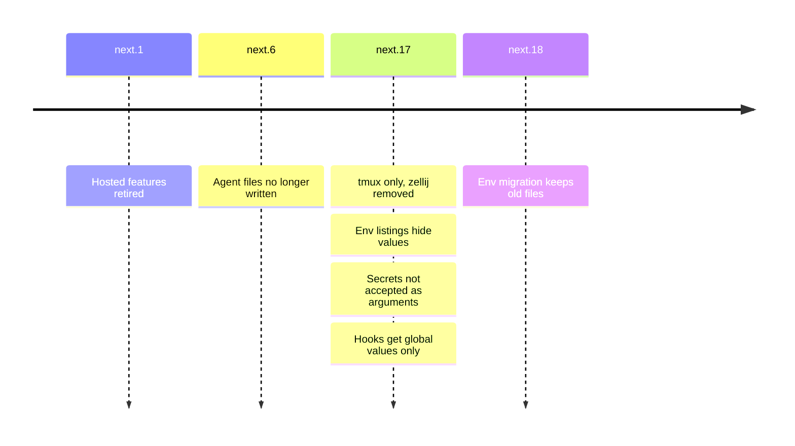

# Breaking changes from v4

These are the changes most likely to break a v4 project or a script written for
v4. Each row gives the reason and what to do. Read it before you follow
[Upgrade from v4](../upgrade.md). The long guide has every detail: see
[what changes for a project](upgrade-from-v4.md#4-what-changes-for-a-project)
and the
[command-line checklist](upgrade-from-v4.md#5-command-line-compatibility-checklist).

v5 is still a prerelease. Stable is v4, and the two install side by side, so you
can try v5 on one project and [go back](#how-to-go-back).

## The list

| # | What changed | Why | What to do |
| --- | --- | --- | --- |
| 1 | **Zellij is gone. `hack session` needs tmux.** `sessions.mux=zellij` and `HACK_SESSIONS_MUX=zellij` are refused. | v5 supports one multiplexer, tmux. It cannot verify or stop zellij sessions, so it refuses them rather than leave processes it cannot clean up. | Install tmux. Remove the setting or set it to `tmux`. Existing zellij sessions are not stopped or migrated. If a project has saved zellij state, stop it with the v4 CLI first: see [the stop procedure](upgrade-from-v4.md#breaking-change-zellij-workspaces-removed). |
| 2 | **`hack env list` hides every value**, in text and in `--json`, including plaintext values moved from old `.env` files. JSON has `has_value` and no `value`. | Listings exposed migrated plaintext, and they end up in logs and transcripts. | Use `has_value` to test that a value is set. Read one value with `hack env get <KEY>`. For plaintext values in bulk, use `hack env list --json --plaintext-values`. |
| 3 | **The text columns of `hack env list` changed.** Rows are now `KEY`, `SCOPE`, `set`, `LAYER`, separated by tabs. | It follows row 2: the value column is gone, and a layer column is added. | Do not parse the text. Parse `hack env list --json`. |
| 4 | **`hack env set --secret` and `hack env add --secret` refuse a secret typed as an argument.** | An argument stays in shell history and is visible to other processes. | Leave the value out and type it at the hidden prompt in a terminal, or pipe it with `--value-stdin`. `--allow-secret-argv` exists for test fixtures only, not for real values. |
| 5 | **Legacy lifecycle hooks and processes receive only `global` values.** They no longer receive values that belong to one service. | They received service values outside their scope. | Review hooks that read a service's value. Move only the values they need into the `global` scope. |
| 6 | **Hack's decryption keys are not passed to child processes.** Hooks and host commands get the application's environment only. | So a hook or a tool that Hack starts cannot read or leak the key. | If a hook read the key from its environment, change it to read the values it needs. |
| 7 | **Env migration keeps the old files.** v4's `hack doctor --migrate-env-config` deleted `.hack/hack.env.json` and old `.env` files. v5 keeps them, and removal is a separate step. | An interrupted migration could not be resumed or undone. Now it can be previewed, resumed and rolled back. | Preview with `hack env migrate --json`, then `--apply`. Start the project and check it. Only then run `hack env migrate --cleanup --apply`. Undo with `hack env migrate --rollback-manifest <path>`. |
| 8 | **The daemon's old env routes refuse YAML projects.** `POST /v1/env/set` and `/v1/env/unset` return HTTP 409 `yaml_env_mutation_unsupported`. `GET /v1/env` returns names only. | Writing through these routes would create a second, legacy copy of the values. | Use the `hack env` commands. |
| 9 | **Hack no longer writes agent files.** It does not write `AGENTS.md` or `CLAUDE.md` sections, Cursor rules, session hooks or global skill copies. `hack setup sync` and `hack agent prime` refuse. | Agent guidance now comes from a plugin that your agent's plugin manager installs and keeps current, instead of files Hack wrote into your repository. | Install the optional plugin: see [Agent integrations](../integrations.md). Your existing files are left alone. Review them with `hack setup migrate`, which previews by default and can be rolled back. |
| 10 | **Hosted features are retired:** account and team sign-in, the web dashboard, Hack Tickets, and the built-in GitHub and Linear integrations. | v5 is a local-first CLI. Nothing is hosted and you need no account. | Use your own tools for tickets and reviews. |

Two smaller command changes can stop a script:

- `hack init --with` takes `claude` or `codex`. `both` is gone.
- `hack secrets delete` without a terminal needs `--yes`.

Three changes are not breaking, but they surprise people:

- **`hack exec` and `hack run` reuse the running overlay.** Without `--env`, they
  use the overlay the project was started with, not the project default. See
  [Choose where a command runs](run-commands.md).
- **`hack up -d` waits for migrations.** A detached start no longer fails after
  90 seconds while a one-shot service runs. See
  [First project on Compose](../getting-started.md).
- **With `--json`, hook output goes to stderr.** In v4, and in v5 up to next.20,
  lines printed by lifecycle hooks could appear on stdout before the JSON. This
  fix is on the `next` branch and not in a release yet. If a script read hook
  output from stdout, read stderr instead. See
  [Command and output contracts](../reference/command-contracts.md).

If you scripted against an early v5 prerelease, one more change applies: from
next.18, `hack version --json`, `hack activity --json`,
`hack projects --json --observe`, `hack global status --json --observe`,
`hack global install --plan --json` and `hack global trust --plan --json` put
their payload under `data`. v4 never had these outputs.

## When each change arrived



Check your installed version with `hack version --json` before you rely on a
row. An older prerelease keeps its older behaviour. Rows 3, 5, 6 and 8 arrived
in next.17 with row 2.

## How to go back

Selecting the v4 binary again is not enough. v5 may have migrated env files, and
your app may have changed its database. Going back means restoring the backup
you took before the upgrade. Rehearse it on data you can lose first.

1. **Stop the v5 project** with the same v5 CLI, backend, project path, overlay
   and branch that started it. For a Compose trial:

   ```sh
   HACK_RUNTIME_BACKEND=compose "$V5" down --path /absolute/project
   ```

   Do not add flags that remove caches or data. A project you ran on native
   needs its own stop first.
2. **Deselect v5**, if you used the prerelease manager. It checks that nothing
   is still running, then switches:

   ```sh
   "$HOME/.hack-next/bin/hack-next" --manager stable
   ```

   This keeps the v5 files on disk. It restores nothing. On Linux, if the trial
   installed a v5 user service, uninstall it with the v5 CLI before you go on.
3. **Restore your backup**, with every Hack process stopped and nothing set to
   restart it. Restore the project files, the ignored env and key files (the
   **original** project key), the project registry and the global config. Keep
   a private copy of the post-trial state first. Do not restore copied daemon
   socket or PID files.
4. **Restore application data** with your own procedure, if the app changed it.
5. **Go back to the v4 program** you kept. Check that `command hack --version`
   prints the v4 version you recorded.
6. **Start with v4.** Run `command hack doctor`. On macOS, if you removed the
   login service, run `command hack daemon install`; otherwise run
   `command hack daemon start`. Then run `command hack up --detach`, and check
   the app and its data. `command` stops a shell alias from choosing v5.

The exact restore commands are in
[Return to v4](upgrade-from-v4.md#7-return-to-v4). That procedure is still being
confirmed in the dogfood run, so treat a restore as untested until you have
rehearsed it.

If you only saved a snapshot with `hack upgrade snapshot`,
`hack upgrade rollback --rollback-manifest <snapshot-manifest>` restores the
files that `hack upgrade apply` changed. It skips files changed since the
snapshot. It does not undo env migration, volumes, application data or the
binary you selected.
