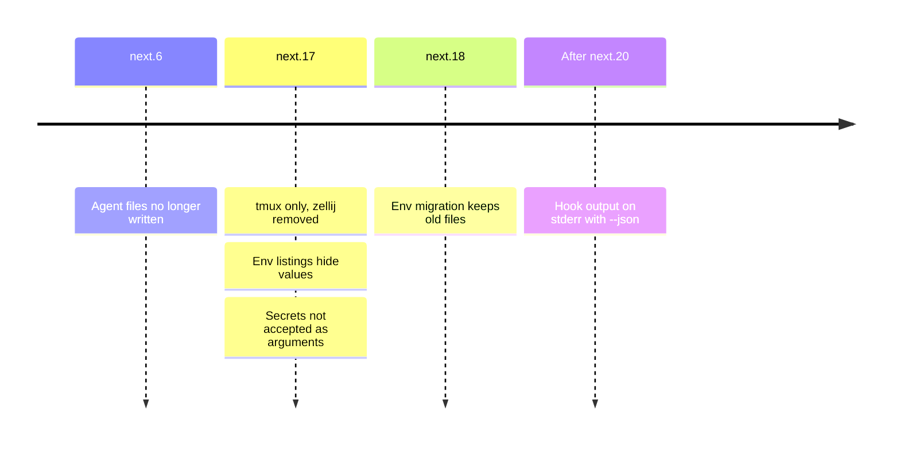

# Breaking changes from v4

This is the full list of things that worked in v4 and work differently, or not
at all, in v5. Each row gives the reason and what to do. Read it before you
follow [Upgrade from v4](../upgrade.md).

v5 is still a prerelease. Stable is v4, and the two install side by side, so you
can try v5 on one project and [go back](#how-to-go-back).

## The list

| # | What changed | Why | What to do |
| --- | --- | --- | --- |
| 1 | **Zellij is gone. `hack session` needs tmux.** `sessions.mux=zellij` and `HACK_SESSIONS_MUX=zellij` are refused. | Hack must be able to check and stop every process a session starts. v5 does that for one terminal multiplexer. | Install tmux. Remove the setting or set it to `tmux`. If a project has saved zellij state, stop it with the v4 CLI first: see [the stop procedure](upgrade-from-v4.md#breaking-change-zellij-workspaces-removed). |
| 2 | **`hack env list` hides every value**, in text and in `--json`, including plaintext values moved from old `.env` files. JSON has `has_value` and no `value`. | Listings ended up in logs, chat and agent transcripts. A listing should be safe to paste. | Use `has_value` to test that a value is set. Read one value with `hack env get <KEY>`. For plaintext values in bulk, use `hack env list --json --plaintext-values`. |
| 3 | **`hack env set --secret` refuses a secret typed as an argument.** | An argument stays in shell history and is visible to other processes. | Leave the value out and type it at the hidden prompt, or pipe it with `--value-stdin`. |
| 4 | **Env migration keeps the old files.** `hack env migrate --apply` no longer deletes `.hack/hack.env.json` or old `.env` files. Removal is a separate `--cleanup` step. | An interrupted migration could not be resumed or undone. Now it can be previewed, resumed and rolled back. | Preview with `hack env migrate --json`, then `--apply`. Start the project and check it. Only then run `hack env migrate --cleanup --apply`. |
| 5 | **With `--json`, hook output is on stderr.** Lifecycle hooks, host commands and the Compose client no longer print to stdout when you pass `--json`. | Stdout must be one JSON value, or a script cannot parse it. | Read hook output from stderr. See [Command and output contracts](../reference/command-contracts.md). |
| 6 | **Hack no longer writes agent files.** It does not write `AGENTS.md` or `CLAUDE.md` sections, Cursor rules, session hooks or global skill copies. `hack setup sync` and `hack agent prime` refuse. | Hack edited files you own, and the copies went stale. | Install the optional plugin through your agent's own plugin manager: see [Agent integrations](../integrations.md). Your existing files are left alone. |
| 7 | **Hosted features are retired:** account and team sign-in, the web dashboard, Hack Tickets, and the built-in GitHub and Linear integrations. | v5 is a local-first CLI. Nothing is hosted and you need no account. | Use your own tools for tickets and reviews. |

Two changes are not breaking, but they surprise people:

- **`hack exec` and `hack run` reuse the running overlay.** Without `--env`, they
  use the overlay the project was started with, not the project default. See
  [Choose where a command runs](run-commands.md).
- **`hack up -d` waits for migrations.** A detached start no longer fails after
  90 seconds while a one-shot service runs. See
  [First project on Compose](../getting-started.md).

If you scripted against an early v5 prerelease, one more change applies: from
next.18, `hack version --json`, `hack activity --json`,
`hack projects --json --observe`, `hack global status --json --observe` and the
`--plan --json` outputs put their payload under `data`. v4 never had these
outputs.

## When each change arrived



Check your installed version with `hack version --json` before you rely on a
row. An older prerelease keeps its older behaviour.

## How to go back

Selecting the v4 binary again is not enough. v5 may have migrated env files, and
your app may have changed its database. Going back means restoring the backup
you took before the upgrade.

1. **Stop the v5 project** with the same v5 CLI, backend and project path that
   started it. Do not add flags that remove caches or data.
2. **Deselect v5**, if you used the prerelease manager:

   ```sh
   "$HOME/.hack-next/bin/hack-next" --manager stable
   ```

   This keeps the v5 files on disk. It restores nothing.
3. **Restore your backup:** the project files, the ignored env and key files
   (the **original** project key), the project registry and the global config.
   Keep a private copy of the post-trial state first.
4. **Restore application data** with your own procedure, if the app changed it.
5. **Start with v4.** In a stable terminal, run `hack daemon install` if you
   removed the login daemon, then `hack up --detach`, and check the app.

The exact commands, and what to do on Linux, are in
[Return to v4](upgrade-from-v4.md#7-return-to-v4). If you only saved a snapshot
with `hack upgrade snapshot`,
`hack upgrade rollback --rollback-manifest <snapshot-manifest>` restores the
files that `hack upgrade apply` changed. It does not cover application data.
