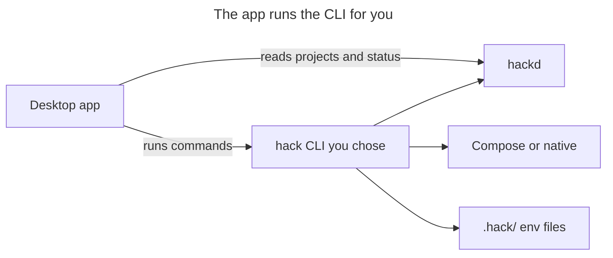

# Desktop app (preview)

The Hack desktop app is a window over the `hack` CLI. It shows every project on
your machine, its state and its services, and it gives you buttons for the
commands you run most.

It is an **unsupported preview**. No release or installer ships it yet, and you
do not need it to use Hack. To try it, build it from the repository; see
[the app's README](https://github.com/hack-dance/hack/blob/next/apps/desktop/README.md).
It needs macOS 15 or newer, or Linux with Wayland or X11 and Vulkan.

## What it is

The app saves its window layout and which CLI you chose. It holds resource
history in memory and holds no credentials. For every action it runs `hack` as you, exactly
as you would in a terminal.

The app reads its data from the CLI and `hackd`. It collects the points shown
in the Stats charts while the app is open.

## What it shows

| Where | What you see | CLI behind it |
| --- | --- | --- |
| Project list | Every registered project and its branch instances, grouped by state. Search with Cmd-K (Ctrl-K on Linux). | `hackd` (`/v1/projects`); `hack ps --json` for native projects |
| Project header | Start, Stop, Restart and Open, with errors and live phases for local Compose lifecycle actions. | `hack up`, `down`, `restart`, `open`; Compose progress uses `--json --progress` |
| Services tab | Each service, its state and its routes. For a running Compose project, also CPU and memory per service, and an **emulated** mark on a service whose image runs under CPU emulation. | `hackd`; `hack ps --json`; `hack usage --json --by-service` |
| Service Stats | Up to 10 minutes of CPU, memory against the configured limit, and network rates for a Compose service. A short Info list shows the service's runtime details. | `hack usage --json --details --no-host`; `hackd` |
| Logs tab | Live logs with pause, search and a filter for one service. | `hack logs --json` |
| Files tab | Browse a running Compose service's directories, preview files, copy container paths and open worktree files in an editor. | `hack files ls --json`, `hack files cat --json` |
| Env tab | Variable names and values per overlay and scope. See below. | `hack env list`, `get`, `add` |
| Terminal panel | Log and shell tabs inside the window. On Linux, only in a build with the `terminal` feature. | `hack logs --pretty`, shells |
| Setup | One card per setup step: the CLI, the runtime, `hackd`, routing and DNS, certificate trust, the login service. | read-only checks |
| Doctor | Machine checks once, and project checks for each registered checkout. | `hack doctor --json` |
| hackd | Whether `hackd` runs and matches the CLI, and a summary of always-on projects. | `hack daemon status --json` |
| Upgrade | The upgrade review pane. See below. | `hack upgrade check`, `review`, `snapshot`, `rollback` |

When the CLI does not report something, the app shows a dash and says why. It
does not invent a value.

The app samples running Compose services every five seconds, including while
you view another pane. For a stopped service, its recent samples age out of
the chart. Network rates need two samples with the same known container
start time. Rounded Docker counters can leave gaps in the chart. The history
starts fresh each time you open the app or switch CLI installations.

## How it finds the CLI

The app looks for two installs:

- stable `hack` on your `PATH`;
- the prerelease `hack-next`, on your `PATH` or at `~/.hack-next/bin/hack-next`.

It offers only an install that no other user on the machine can change. It uses
the one you chose last time; otherwise stable; otherwise the prerelease. The
status bar names the CLI in use, for example
`hack-next 5.0.0-next.19 · prerelease`, and one click switches to the other.

The app then asks that CLI where its `hackd` is (`hack daemon status --json`)
and reads that one. This matters with a prerelease: `hack-next` keeps its own
`hackd` and its own project list, apart from stable. If the app shows no
projects, check which CLI the status bar names.

Your choice is saved in the app's settings file
(`~/Library/Application Support/dance.hack.desktop/settings.json` on macOS,
`$XDG_CONFIG_HOME/hack-desktop/settings.json` elsewhere, by default under
`~/.config`). No environment
variable selects the CLI.

## The Files tab

Choose a Compose service to start in its working directory. Click a directory
to browse it, or enter a relative or absolute path under **Go to file**.
**Show hidden** includes filenames that start with a dot.

Each row shows where the file lives. **Worktree** files come from the checkout
and can open in your host editor. **Container** files and files in a named
**volume** have read-only previews. **Copy path** copies the container path.
The preview shows up to 64 KiB of text. The tab needs a CLI that exposes
`hack.files.v1` and a running container with common shell utilities.

## The Env tab

The Env tab shows one overlay at a time. Tabs across the top choose the
overlay (`base`, then each overlay the project has). Pills on the right choose
the scope. [Overlay and scope](run-commands.md#overlay-and-scope) explains the two words.

- **Plaintext values** load with the list.
- **A secret shows dots** until you press its eye, for that one name. It hides
  again after 60 seconds, and when you change overlay, scope, tab or project, or
  the window is hidden or loses focus.
- **Copy** puts one value on the clipboard and clears it after 60 seconds, or
  when the app quits sooner, if it is still there. On macOS the copied item is marked concealed, so clipboard
  managers that follow that convention do not record it. Linux has no such
  convention.
- **Edit** and **+ Variable** open an editor that shows the exact command Save
  runs, for example
  `hack env add API_TOKEN --secret --value-stdin --env staging --service api`.
  The value goes to the CLI on standard input. It is never a command argument.
- **A missing key** is named on its own line. Without the key, secrets cannot be
  revealed, copied or edited.

Some things still need the CLI: creating an overlay
(`hack env overlay add <name>`) and, when the key is missing, choosing another
key for one run (`--key-file`, `--key-env`). The app shows these as inactive
buttons that name the command. See [Share environment and secrets](share-environment.md).

## Follow-up banners and Doctor

The project pane shows the highest-priority follow-up. Dismiss it until the
check changes or the app relaunches. Open **Doctor** to see machine and project
checks, or **Check again** to refresh the results.

In a build with the terminal panel, **Run** opens that panel. **Fix all** runs
available repairs one at a time and checks each result before continuing. It
stops when a repair fails, a check cannot confirm it, or you choose **Stop**.
Enter a password only at the system prompt in the terminal. Use **Review** for
an available upgrade.

## The upgrade review pane

The **Upgrade** row opens the same review the CLI gives you before a v4 to v5
upgrade.

- **Check** is read-only. It shows the CLI's verdict, each blocker, each check
  that could not run, and the plan, one row per step. You copy a step's command
  and run it yourself.
- **Save snapshot** keeps a private copy of the files an upgrade changes.
- **Review findings** is read-only. It lists what cannot be applied safely, and
  why.
- **Restore** lists the snapshots and asks before it restores one. It never
  overwrites a file that changed since the snapshot.

The app does not apply the upgrade. Run `hack upgrade apply` in a terminal. See
[Upgrade from v4](../upgrade.md).

## What it never does

- It never runs `hack upgrade apply`, and it never installs a new version.
- It never runs a Doctor fix. It shows the finding and the command.
- It never changes always-on projects. Use `hack autostart`.
- Its setup checks only read. The only `hackd` actions it runs itself are
  `hack daemon start`, `hack daemon install`, and `hack daemon restart` for a
  `hackd` older than the CLI, each when you press its button.
- It never asks for an administrator password. A step that needs one, such as
  `hack global install` or `hack global trust`, opens in your own terminal.
- It never puts a secret value in a command argument, a log or an error
  message.
- It never uses a `hack` that another user on the machine could change.
