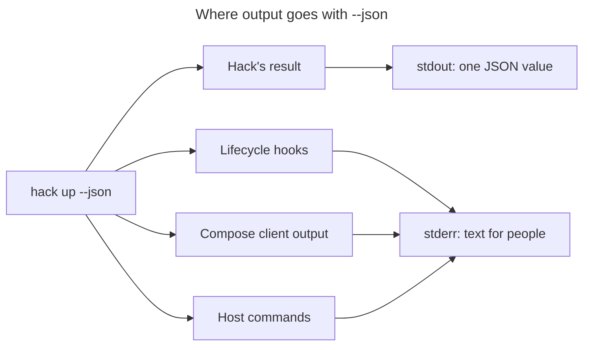

# Scripts and JSON output

Use `--json` when a script, a CI job or an agent reads Hack's output. This page
gives the rules that hold for every command. The
[command and output contracts](../reference/command-contracts.md) list each
command's exact shape.

## The rule: stdout is one JSON value

With Hack's own `--json`, stdout carries only Hack's result. Everything else goes
to stderr.



So this is safe, even when a lifecycle hook prints status lines:

```sh
hack up --json 2>up.log | jq '.data.services.started'
```

Three things to know:

- **Hook output goes to stderr.** With `--json`, both the stdout and the stderr
  of lifecycle hooks (`up`, `restart` and `down` phases) go to Hack's stderr. The
  same holds for host commands and for the Compose client's own output. Read them
  on stderr. Never parse them from stdout.
- **`hack up --json` starts detached.** It returns when the start finishes; it
  does not stay attached to the services.
- **A child's `--json` belongs to the child.** In `hack run web tool --json`, the
  flag after the service is the tool's flag. Hack passes that output through
  unchanged.

One exception: `hack run --detach --json` keeps the Compose client's output for
its own result, so that output appears on neither stream.

## Check the exit code and `ok`

Most commands print an envelope:

```json
{ "ok": true, "data": { "action": "up", "project": "myapp", "branch": null } }
```

```json
{ "ok": false, "error": { "code": "E_STARTUP_TIMEOUT", "message": "..." } }
```

Read `error.code`, not the message text. Messages can change. A failure may add
`error.detail` with fields for that error.

Not every command uses the envelope. `hack ps --json`, `hack open --json` and
`hack projects --json` print a bare object, and some reports exit 0 while they
describe a problem. `hack doctor --json` can print `ok: true` and still exit 1
when a check fails. Always check both the exit code and the fields for your
command. Valid JSON alone does not mean success.

## Progress as a stream

`hack up`, `hack down` and `hack restart` take `--json --progress` on the Compose
backend. Stdout is then one JSON object per line. The first line names the
schema, `hack.lifecycle-progress.v1`. The last line is the same envelope that
`--json` alone prints.

```sh
hack up --json --progress | while read -r line; do
  echo "$line" | jq -c 'select(.type == "progress") | {service, phase}'
done
```

Logs are also a stream: see `hack logs --json` in
[Run and inspect a project](run-project.md).

## `hack ps --json` fields

On Compose, `hack ps --json` prints one bare object:

```json
{
  "project": "myapp",
  "branch": null,
  "composeProject": "myapp",
  "items": [
    { "Service": "migrate", "State": "running" },
    { "Service": "web", "State": "created" },
    { "Service": "worker", "State": "running", "emulated": true }
  ],
  "waiting": { "web": ["migrate"] }
}
```

| Field | Meaning |
| --- | --- |
| `project` | The project name. |
| `branch` | The branch instance name, or `null` for the main instance. |
| `composeProject` | The Compose project name: `<name>` or `<name>--<branch>`. |
| `items[]` | One Docker Compose `ps` record per container. Docker owns these keys (`Service`, `Name`, `State`, `ExitCode`, `Status`, `Ports` and more). Ignore keys you do not know. |
| `items[].emulated` | `true` when the image was built for another CPU architecture than the Docker engine, so the container runs under emulation and is slow. The key is absent when the architectures match, or when Docker could not report them in time. Absent does not prove "not emulated". |
| `waiting` | A map from a service to the one-shot services it waits for. A service is listed while its container is `created` and that one-shot (for example a migration) still runs. The map is empty when nothing waits. |

`waiting` matters after a start that stopped at its time limit: see
[First project on Compose](../getting-started.md).
For an emulated service, run `hack doctor`; see
[Troubleshooting](../troubleshooting.md).

The native backend prints a different `ps` shape. Use the
[contracts page](../reference/command-contracts.md) for it.
