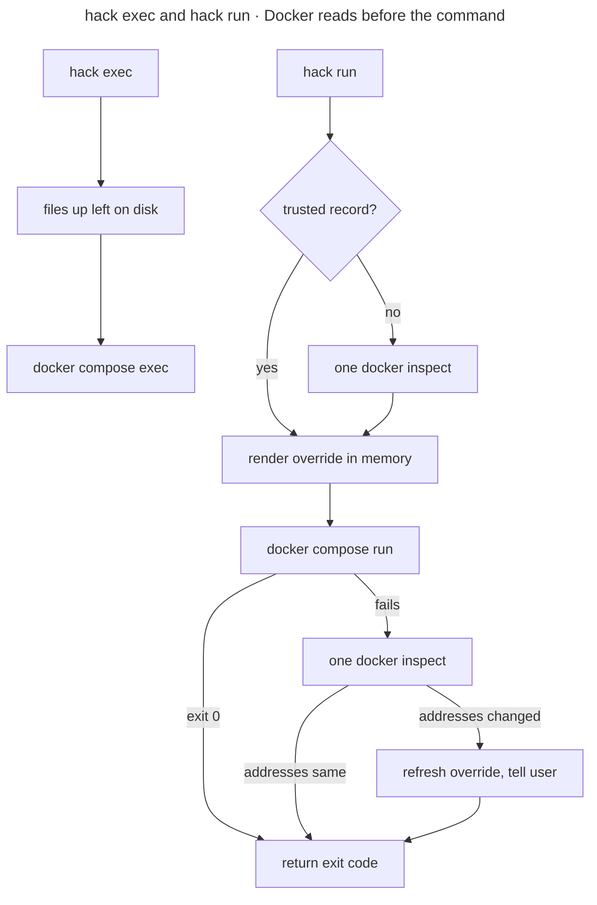
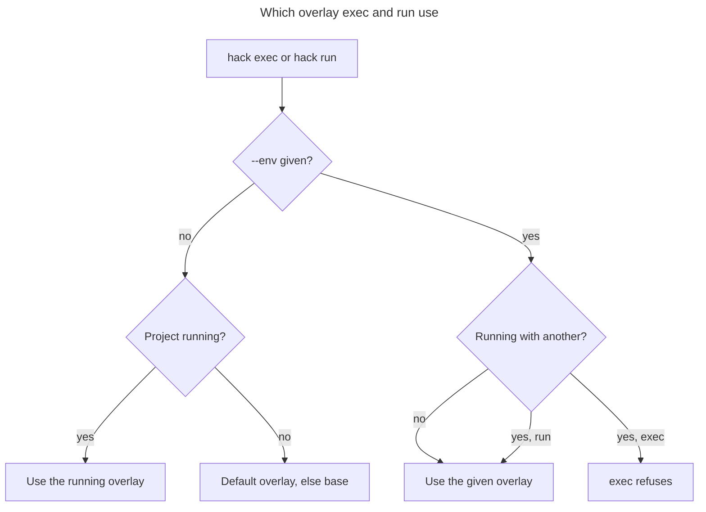

# Choose where a command runs

Hack can run a command in three places.

| Command | Runs in | Use it when |
| --- | --- | --- |
| `hack exec <service> -- <command>` | A service container that is already running | You need that container's files or processes. |
| `hack run <service> <command>` | A new, one-off container for that service | You run a task such as a migration or a test. |
| `hack host exec -- <command>` | Your host shell, with the project's environment | The tool is installed on the host, not in a container. |

```sh
hack exec web -- node --version
hack run web node --version
hack host exec --scope web -- node --version
```

Replace `web` and the command with your project's actual service and tool. The
three examples report the installed Node version in three execution contexts; they
install nothing. The host path needs Node on the host.

Hack options go before the command tail. After the service name or `--`, everything
is passed through unchanged, so a child's `--json` or `--help` is never read as a
Hack flag.

On the Compose backend, `hack exec` starts `docker compose exec` with no other
Docker call first. If the service is not running, Compose refuses, and Hack then
adds a hint to start the stack with `hack up -d` or use `hack run`.

`hack run` gives its new container the proxy and DNS addresses that `hack up` or
`hack global up` recorded, with no Docker call for them. If the command fails,
Hack checks those addresses with one `docker inspect`. If they changed (the proxy
or DNS container was recreated outside Hack), Hack updates the setting and says
so on stderr. It does not run your command again, because the command may have
done some of its work before it failed. Run it again yourself if the failure
was a name or connection error.



## Browse a service's files

```sh
hack files ls --json api .
hack files cat --json --branch feature-search api /app/search.config.ts
```

`files` reads the lowest-numbered running Compose replica owned by the
selected checkout. Relative paths start in the container's working
directory. A linked worktree selects its branch instance the same way as
`hack exec`. To choose another checkout, pass `--path <checkout>`.

Both commands return a `hack.files.v1` success envelope. The `entry` describes
the resolved target. For directory listings, `entries` includes direct
children, including dotfiles. Each entry has a `source` of `worktree`,
`volume` or `container`. The deepest actual mount determines the source.
Worktree entries also carry `hostPath` for the corresponding checkout path.
Files read through an SSH or TCP Docker endpoint stay in the container or
its named volumes.
`cat` returns the first 64 KiB with an `encoding` of `utf8` or `base64` and sets
`truncated` if there are more bytes. These commands use `sh`, `readlink`,
`stat`, `timeout` and `head` in the container.

## Overlay and scope

These two words answer two different questions.

- An **overlay** answers "which environment?" It is a named set of values, such
  as `qa` or `staging`, stored in `.hack/hack.env.<name>.yaml`. You choose it
  with `--env <name>`. A value in an overlay wins over the same key in the base
  file, `.hack/hack.env.default.yaml`.
- A **scope** answers "who receives this value?" Inside every env file, values
  sit under `global` (every service and the host), under a service name (only
  that service), or under `host` (only commands that run on the host).

One env file shows both. This is the `qa` overlay, with three scopes:

```yaml
# .hack/hack.env.qa.yaml
values:
  global:
    API_BASE_URL: "https://api.example.com"
  api:
    PORT: "4000"
  host:
    PORT: "4100"
```

| Command | Overlay | Scope it reads | `PORT` |
| --- | --- | --- | --- |
| `hack up --env qa` | `qa` | `global`, then each service's own | `4000` in `api`; not set by this file elsewhere |
| `hack run --env qa api env` | `qa` | `global`, then `api` | `4000` |
| `hack host exec --env qa -- env` | `qa` | `global`, then `host` | `4100` |
| `hack host exec --env qa --scope api -- env` | `qa` | `global`, then `api`, then `host` | `4100` |
| `hack up` (no default overlay set) | base only | from `.hack/hack.env.default.yaml` | not from this file |

Only host commands (`hack host exec`, `hack host shell`) take an env scope with
`--scope`. It only chooses which values Hack injects. The command still runs on the host.

Within each file, Hack applies `global`, then the service, then `host`. A later
file wins over an earlier one whatever the scope, and machine-local
`.local.yaml` files come last.

To choose the overlay:

- `--env <name>` selects that overlay.
- `--env base` (also `default` or `none`) selects the base file only.
- With no `--env`, Hack uses the project's default overlay, if
  `.hack/hack.config.json` sets `env.defaultOverlay`. Otherwise it uses the base
  file only.

See [Share environment and secrets](share-environment.md) for how to list
overlays and set values.

## A running project keeps its overlay

`hack exec` and `hack run` act on a project that is already running. Without
`--env`, they use the overlay the project was started with. `hack down` and
`hack restart` do the same.



So after `hack up --env qa`, plain `hack exec api -- env` shows the `qa` values.
You do not repeat `--env qa`.

If you pass an `--env` that differs from the running overlay, `exec` refuses and
names both:

```text
The running stack uses env qa, but this exec request asks for env base.
Omit --env to exec with the running env qa, or restart the stack with
`hack restart --env base` first.
```

`hack run` does not refuse. It uses the overlay you give. Its one-off container
then does not reuse the running services, and Compose starts the dependencies
it needs.

`hack logs`, `hack ps` and `hack open` do not read an overlay at all.

One exception: for a project with an authored `.hack/hack.project.json` (an
experimental file that covers a bounded subset of configuration) on the
Compose backend, `hack run` without `--env` uses the default overlay, not the
running one. Pass the running overlay with `--env`.

## Agents

An agent uses the same model. Ask it to read project instructions, select the
intended host and instance, and inspect state before running data-changing
commands such as migrations, which need their own project-specific checks.

## Native backend (beta)

On the native backend, `hack exec <service> -- /bin/sh` opens an interactive
session when stdin and stdout are terminals. Otherwise, or with
`HACK_NO_INTERACTIVE=1`, it runs the command once with closed stdin. Name the
shell yourself; Hack never adds one. Native `exec` refuses
`--env`. Native `run` accepts only the overlay the project started with and
refuses any other. Both use that overlay. A one-off `run` has
closed stdin and no terminal, and it refuses a service with source or data
mounts. See
[Native authored commands](../../reference/native-authored-commands.md).
