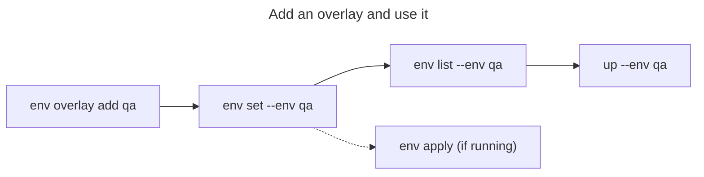

# Share environment and secrets

This page shows how to keep a project's settings and secrets in the repository
so teammates, worktrees and other machines get the same values: list them, add
an overlay such as `qa`, set a value and use it.

[Environment and secrets](../../env.md) has the full model; read it before
choosing a backend. Commit shareable configuration; keep decryption keys and
local overrides separate.

```sh
hack env list
```

Inspect masked values and provenance rather than printing credentials. Scope
values to the intended service/overlay. A linked worktree can inherit the primary
checkout's key; a separate host needs its own approved runtime delivery mechanism.

New to the words? An **overlay** is a named environment such as `qa`. A
**scope** says who receives a value. See
[Overlay and scope](run-commands.md#overlay-and-scope).

## Everyday commands



### List the overlays

```sh
hack env overlay list
```

This prints every overlay the project has: names and file paths only, never
values. It includes overlays that exist only in your machine-local file, and the
project's default overlay even before that overlay has a file.

### Create an overlay

```sh
hack env overlay add qa
```

This creates an empty `.hack/hack.env.qa.yaml`, which you commit. It refuses a
name that already exists. It also makes sure git ignores the machine-local file
`.hack/hack.env.qa.local.yaml`.

### Set and read values

```sh
hack env set API_BASE_URL https://api.example.com --env qa
hack env set PORT 4000 --env qa --service api
hack env set SERVICE_TOKEN --env qa --service api --secret
hack env list --env qa
hack env get PORT --env qa --service api
```

- Without `--service`, the value goes to the `global` scope.
- `--secret` stores the value encrypted. Leave the value out and, in a terminal,
  Hack asks for it with a hidden prompt. Or pipe it with `--value-stdin`. Do not type a secret as
  an argument; it would stay in your shell history.
- `hack env list` shows names, scopes and source files. It hides every value,
  unless you pass `--show-values` in a terminal.
- `hack env get <key>` prints one value. Treat its output as plaintext.

A running service keeps its old values. `hack env apply --service api`
recreates `api` with the overlay the project runs with. To use values you just
set in `qa`, name it: `hack env apply --service api --env qa`. That records `qa`
as the project's overlay, so run `hack restart --env qa` to move every service.

### Read plaintext values in one call

```sh
hack env list --json --plaintext-values --env qa
```

With `--json`, `--plaintext-values` adds `value` to each entry stored as
plaintext. Entries stored as secrets never get a `value`, and no key is needed.
Use this instead of one `hack env get` per name.

### See which key is in use

`hack env list --json` reports two fields about the project key, and never the
key itself:

| Field | Values |
| --- | --- |
| `key_state` | `ok`, `missing`, `unreadable`, or `not_checked` (legacy projects that do not use this key). |
| `key_source` | Where the key came from: a key file (this checkout, shared by worktrees, the primary checkout, or `--key-file`), an environment variable by name, or none. It is `null` when a key file was refused. |

If `key_state` is `missing`, copy the original key from a checkout that has it.
A new key cannot decrypt existing values.

### Use another key for one run

```sh
hack env list --key-file /path/to/project.key
# PROJECT_KEY is a variable your secret manager already set
hack env get SERVICE_TOKEN --env qa --service api --key-env PROJECT_KEY
```

`--key-file <path>` and `--key-env <NAME>` work on `env list`, `env get`,
`env set` and `env add`. Pass a path or a variable **name**, never the key. For
that run Hack uses only that key: it does not fall back to other key locations
and does not create a key file. Hack refuses to encrypt with a key that differs
from the one this checkout would otherwise find, so a project never has secrets
under two keys.

See [Environment and secrets](../../env.md) for the full reference.

For encrypted-file storage, possession of the project key grants decryption of
values encrypted with it. Keep an approved backup separate from the repository.
Git access and secret access are different grants. Removing someone's repository
access does not erase keys or values already copied to their machine. Follow the
implemented backend's rotation/revocation procedure; do not assume a universal
`hack` revocation or secret-manager synchronization command exists.

## External secret managers

Use the provider's approved authentication flow and the backend contract in the
matching reference. An illustrative integration reads a single required value
through the provider CLI and sends it directly into a supported hidden/standard-
input path; do not put it in shell arguments, chat, logs or cached files. Exact
write commands and provider support differ by version, so no generic sync command
is implied here. Verify masked metadata, then the app's actual service access.
