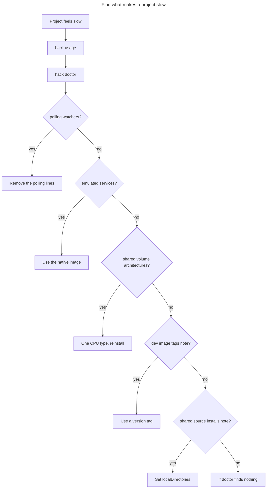

# My Mac is slow

Start here when a project makes your Mac hot, loud or slow. Five common causes
are project settings that `hack doctor` can find. Other causes, such as many
running projects or a heavy build, need `hack usage`. These checks run on the
Compose backend. The same checks run on Linux.

## Start from the symptom

| What you see | Likely cause | Doctor check |
| --- | --- | --- |
| Fans run and CPU stays high while you change nothing | A file watcher polls every file | `polling watchers` |
| Everything in one service is several times slower than expected | The image was built for another CPU type, so it runs emulated | `emulated services` |
| A service crashes on a native module after an install | Two CPU types share one dependency volume | `shared volume architectures` |
| The container's Node or Bun may be older than the repository asks for | A `:latest` or untagged `node` or `bun` image that Docker cached long ago | `dev image tags` (a note) |
| Installs and rebuilds are slow, and the checkout fills with `node_modules` or build output | A service installs or builds into the source you bind-mount | `shared source installs` (a note) |



## 1. See which project uses the CPU

```sh
hack usage
```

This shows CPU and memory for each running project and for host processes. Add
`--details` to see each container. If a host process is the busy one, the cause
is outside your containers. Otherwise note the busy project, and run the next
step in that project's folder.

## 2. Run doctor in the project

```sh
hack doctor
```

Look for the "Dev performance" group. Each finding names the service, and the
file and line when a setting causes it. Doctor only reports facts: an image's
CPU type, a setting, a variable. It does not warn about a CPU number.

## 3. Fix what doctor names

### `polling watchers`

A service sets `CHOKIDAR_USEPOLLING` or `WATCHPACK_POLLING` to a true value
(`true`, `yes`, `on`). The watcher
then reads every file again and again instead of waiting for change events.
Older versions of `hack init` wrote these lines.

```sh
hack doctor --fix --only 'polling watchers'        # show the change, write nothing
hack doctor --fix --only 'polling watchers' --yes  # apply it, then check it
hack restart
```

The repair removes only lines written exactly as `CHOKIDAR_USEPOLLING: "true"`
and `WATCHPACK_POLLING: "true"`. Edit any other form by hand. Plain
`hack doctor --fix` never runs this repair.

### `emulated services`

The image is for a CPU type other than your machine's. On an Apple silicon Mac
this usually means an `amd64` image, which runs through slow emulation. Doctor
reports a running container on the wrong CPU type, and also a `platform:` line
in the Compose file that differs from the host.

1. Remove the `platform:` line doctor names, if there is one.
2. Get the image for your CPU type. Removing the line is not enough, because
   Docker keeps using the copy it already has:

   ```sh
   docker pull --platform linux/arm64 <image>
   ```

   On an x86 Linux machine, use `linux/amd64` instead.

3. Recreate the services with `hack restart`.
4. Run `hack doctor` again. No service should be reported as emulated.

Doctor never edits the `platform:` line or the image for you. Some images exist
for one CPU type only; such a service stays emulated until its image changes.

### `shared volume architectures`

Containers of one instance run on different CPU types and mount the same named
volume, for example `node_modules`. A branch instance counts on its own. This
check needs Docker to be running. An install that ran under emulation leaves
native modules that the other services cannot load.

1. Move every service of the instance to one CPU type (see above).
2. Run `hack down`.
3. Find the volume with `docker volume ls`, then remove it with
   `docker volume rm <name>`.
4. Run `hack up` so the install step runs again.

### `dev image tags`

This is a note, not a warning. A service mounts your source code and uses a
`:latest` or untagged image, while the repository declares a Node or Bun
version. It covers only images whose name contains `node` or `bun`. Docker does
not refresh a `:latest` image it already has, so it can be old. Use a version tag that matches the repository, or pull the image again.

### `shared source installs`

This is a note, not a warning. A service bind-mounts your checkout and sees a
directory that installs or builds usually write, such as `node_modules`,
`.venv`, `.next` or a Rust `target` beside `Cargo.toml`, and nothing else is
mounted there. Every write then crosses from the Linux VM to macOS, which is
much slower than the VM's own disk.

List those directories in `.hack/hack.config.json`. You do not edit the Compose
file:

```json
{ "localDirectories": ["node_modules", "apps/web/.next"] }
```

The next `hack up` mounts a named volume at each listed directory for every
service that bind-mounts it. Run the install once more after that start,
because the volume starts empty (or with what the image has at that path).
Your checkout's copies stay where they are. On the native backend the
volumes are on the VM disk, so installs there avoid the host share entirely
(adopted, authored and imported native projects do not apply the setting).
See
[Dependency directories](../recipes/dependency-directories.md#keep-a-directory-local-without-editing-compose).

## If doctor finds nothing

- Check that you ran doctor with the same `hack` and in the same project as the
  slow services.
- These checks do not run for a project you adopted with
  `hack config adopt`, or on the native backend. Native has its own
  `amd64 emulation` check.
- A script can read the same fact from `hack ps --json`: an emulated container
  has `emulated: true`.
- Stop projects you do not use with `hack down`. Every running project uses
  memory.

See [Troubleshooting](../troubleshooting.md) for other findings.
