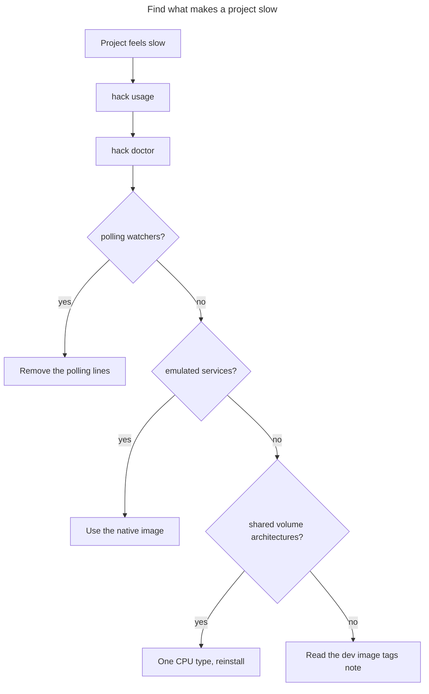

# My Mac is slow

Start here when a project makes your Mac hot, loud or slow. Most cases have one
of four causes, and `hack doctor` finds each of them. These checks run on the
Compose backend. The steps are the same on Linux.

## Start from the symptom

| What you see | Likely cause | Doctor check |
| --- | --- | --- |
| Fans run and CPU stays high while you change nothing | A file watcher polls every file | `polling watchers` |
| Everything in one service is several times slower than expected | The image was built for another CPU type, so it runs emulated | `emulated services` |
| A service crashes on a native module after an install | Two CPU types share one dependency volume | `shared volume architectures` |
| The container has an older Node or Bun than the repository asks for | A `:latest` image that Docker cached long ago | `dev image tags` |



## 1. See which service uses the CPU

```sh
hack usage
```

This shows CPU and memory for each running project. Note the project that is
busy, then run the next step in that project's folder.

## 2. Run doctor in the project

```sh
hack doctor
```

Look for the "Dev performance" group. Each finding names the service, and the
file and line when a setting causes it. Doctor only reports facts: an image's
CPU type, a setting, a variable. It does not warn about a CPU number.

## 3. Fix what doctor names

### `polling watchers`

A service sets `CHOKIDAR_USEPOLLING` or `WATCHPACK_POLLING` to true. The watcher
then reads every file again and again instead of waiting for change events.
Older versions of `hack init` wrote these lines.

```sh
hack doctor --fix --only 'polling watchers'        # show the change, write nothing
hack doctor --fix --only 'polling watchers' --yes  # apply it, then check it
hack restart
```

The repair removes only lines written exactly as `CHOKIDAR_USEPOLLING: "true"`
and `WATCHPACK_POLLING: "true"`. Edit any other form by hand. Plain
`hack doctor --fix` never runs this repair.

### `emulated services`

The image is for a CPU type other than your machine's. On an Apple silicon Mac
this usually means an `amd64` image, which runs through slow emulation. Doctor
reports a running container on the wrong CPU type, and also a `platform:` line
in the Compose file that differs from the host.

1. Remove the `platform:` line doctor names, if there is one.
2. Get the image for your CPU type. Removing the line is not enough, because
   Docker keeps using the copy it already has:

   ```sh
   docker pull --platform linux/arm64 <image>
   ```

3. Recreate the services with `hack restart`.
4. Run `hack doctor` again. No service should be reported as emulated.

Doctor never edits the `platform:` line or the image for you. Some images exist
for one CPU type only; such a service stays emulated until its image changes.

### `shared volume architectures`

Containers of one project run on different CPU types and mount the same named
volume, for example `node_modules`. An install that ran under emulation leaves
native modules that the other services cannot load.

1. Move every service of the project to one CPU type (see above).
2. Run `hack down`.
3. Remove the dependency volume, then start again so the install step runs.

### `dev image tags`

This is a note, not a warning. A service mounts your source code and uses a
`:latest` or untagged image, while the repository declares a Node or Bun
version. Docker does not refresh a `:latest` image it already has, so it can be
old. Use a version tag that matches the repository, or pull the image again.

## If doctor finds nothing

- Check that you ran doctor with the same `hack` and in the same project as the
  slow services.
- These four checks do not run for a project you adopted with
  `hack config adopt`, or on the native backend.
- A script can read the same fact from `hack ps --json`: an emulated container
  has `emulated: true`.
- Stop projects you do not use with `hack down`. Every running project uses
  memory.

See [Troubleshooting](../troubleshooting.md) for other findings.
