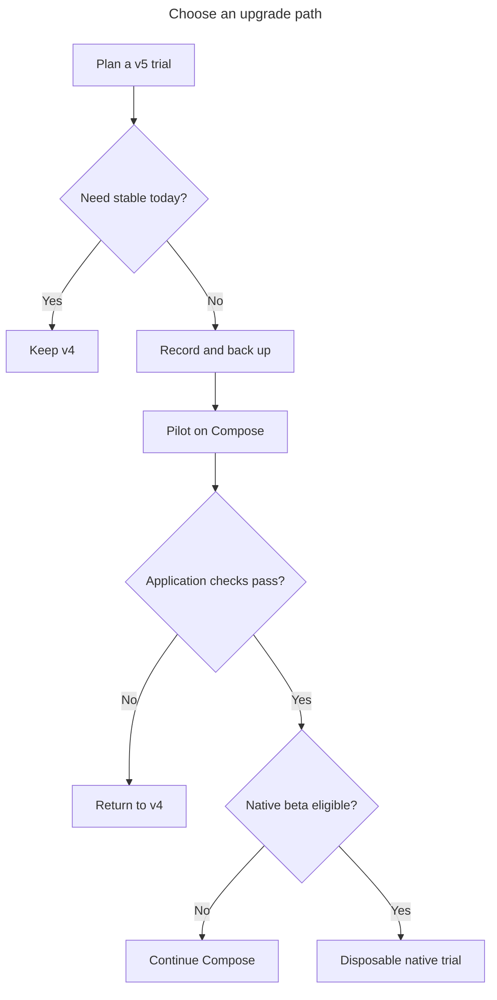

# Upgrade a v4 machine to v5

This is a working upgrade checklist with a limited real-project trial record. It was
audited against `next` at `26a142921c` and the v4.3.0 reference on `main` at
`b36275575c`, with the merged Linux daemon service update at `5e017fddd3`.
The site targets **next.16**. The first reported trials used three existing
Compose projects on macOS, previously running v4.3.0. Start, restart, stop and
lifecycle hooks worked without changes to their `.hack/` configuration, after
one project's own cloud credentials were refreshed and with the reruns noted
under [Known problems](#known-problems-and-the-dogfood-record). This does not qualify every
project, the v4.2.1 path, env migration, data recovery or rollback. Those remaining
steps are **to be confirmed in the dogfood run**. Native setup and log following
remain **under verification**.



Keep v4 when stability is required; otherwise back up, try one project on
Compose, check the application, and only then consider an eligible native trial.

**next.16 and earlier migration warning (HACK-2172): do not run
`hack doctor --migrate-env-config` without a private, readable copy of
`.hack.secret.key`.** If a legacy encrypted store's `keyPath` names that file,
explicit Doctor cleanup can remove the key that the migrated values still need.
Implicit migration also writes files, so back up before it too; the key-removal
defect described here is in the explicit Doctor cleanup. See
[Config and env migration](#config-and-env-migration) before any env-consuming
command. The live-key preservation fix is merged for a later prerelease;
next.16 and earlier bundles still need this warning. A new build cannot recover
a key already removed by an older cleanup.

## 1. Who should upgrade now

Try v5 on a project whose application data you can restore and whose important
workflows you can exercise. Wait if you need a stable-only release, depend on a
retired integration, or cannot qualify recovery. Compose remains the ordinary
CLI's default backend. Native is an opt-in beta for Apple Silicon macOS through
`hack-next`, with a bounded command and configuration surface.

There is an important launcher exception: **`hack-next` defaults to native**.
Use `HACK_RUNTIME_BACKEND=compose` explicitly for the first Compose trial. Keep
stable `hack` installed. See [Install](../install.md) and
[native limits](../native/limits.md).

Sources: [candidate channel contract](https://github.com/hack-dance/hack/blob/26a142921c9b9aeb8821b7e0a19c2cfb3be0189f/docs/guides/candidate-install.md),
[application qualification](https://github.com/hack-dance/hack/blob/26a142921c9b9aeb8821b7e0a19c2cfb3be0189f/docs/guides/v5-dogfooding.md).

## 2. Before you start

Keep the records and backups private: registry and doctor output can identify
local projects, and ignored env files can contain plaintext secrets. Do not paste
them into an issue. Use a new backup directory and record its location yourself:

```sh
BACKUP="$HOME/hack-upgrade-$(date +%Y%m%dT%H%M%S)"
(
  set -eu
  mkdir -m 700 "$BACKUP"
  hack --version > "$BACKUP/version.txt"
  command -v hack > "$BACKUP/executable-path.txt"
  doctor_exit=0; hack doctor > "$BACKUP/doctor-before.txt" 2>&1 || doctor_exit=$?
  daemon_exit=0; hack daemon status --json > "$BACKUP/daemon-before.json" || daemon_exit=$?
  projects_exit=0; hack projects --json > "$BACKUP/projects-before.json" || projects_exit=$?
  printf 'doctor=%s\ndaemon=%s\nprojects=%s\n' \
    "$doctor_exit" "$daemon_exit" "$projects_exit" > "$BACKUP/exit-statuses.txt"
)
```

Stop if the subshell fails. Review the saved exit statuses; a stopped or
incompatible daemon can return nonzero. Record the installation method, host OS/architecture, project
roots, branches, profiles, selected envs and whether a daemon service was enabled.

Then stop stable daemon activity before the filesystem copy and candidate use:

```sh
hack daemon stop
```

On macOS with the stable launchd service installed, uninstall it **after** that
stop, before running the candidate:

```sh
hack daemon uninstall
```

Then confirm that stable daemon activity has stopped:

```sh
pgrep -fl "hack daemon start"
```

The process check must print nothing. The Mac trials required both stopping the
stable daemon and uninstalling its launchd service; stopping alone allowed it to
return. Record the service before removing it, and restore it with stable
`hack daemon install` when returning to v4. Do not stop an unrelated process.
Candidate installation leaves stable installed, but candidate Compose commands
share the stable Hack home by default. Do not invoke more stable commands against
that shared home during the candidate run. In next.16, candidate Doctor can
suggest `hack daemon start`: that spelling runs stable Hack. Do not follow that
hint during the candidate trial. Merged [#776](https://github.com/hack-dance/hack/pull/776)
treats the daemon as optional in a newer candidate Compose trial; it does not
change next.16's hint. The complete
[stable-daemon stop procedure](https://github.com/hack-dance/hack/blob/26a142921c9b9aeb8821b7e0a19c2cfb3be0189f/docs/guides/candidate-install.md#stop-stable-hackd-before-a-compose-run)
also explains which stable commands can start it again.

Copy, and verify that you can read back:

| Record or copy | Why it matters |
| --- | --- |
| Exact v4 executable, release archive and installer; preserve executable permissions | Re-select the version you actually used, including 4.2.1. |
| The effective Hack home, normally `~/.hack/` | Includes global config, registry, installed assets and daemon records; copy only after quiescing writers. |
| `hack.config.json` and `projects.json` in that home | Preserve global settings and registered checkout identities. |
| Each project's working tree, including ignored `.hack/` files and overlays | Git alone does not back up local env values, keys or uncommitted changes. |
| Project-root `.hack.secret.key` and `.gitignore`, including whether either was absent | Migration can create the key and edit the root ignore file. |
| Configured external secret-store/key files and the means to unlock them | A copy of encrypted bytes is not proof that keychain or external-key access will work. |
| Application-aware database/volume backups | Reinstalling an executable does not undo application data or schema changes. |

`HACK_HOME` changes the global home; `HACK_GLOBAL_CONFIG_PATH` changes the config
path and places the registry beside that file. Record both overrides if set and
back up those actual locations. Check symlinks: a backup pointing back to the live
directory is not an independent copy. Leave `.hack/.internal/` untracked.
Backup/restore on a real 4.2.1 machine, custom homes and external secret stores:
**to be confirmed in the dogfood run**.

For an existing project with regular directories at the default locations, this
gives the copies used by the rollback example below. Set `PROJECT` first. Stop
if the subshell fails; do not use a partial backup. A wrapper, symlink, unreadable
file or nonstandard layout needs its own verified copy procedure.

```sh
PROJECT=/absolute/project
(
  set -eu
  cp -pL "$(command -v hack)" "$BACKUP/hack-v4"
  cp -Rp "$HOME/.hack" "$BACKUP/hack-home"
  cp -Rp "$PROJECT/.hack" "$BACKUP/project-hack"
  git -C "$PROJECT" status --short --ignored > "$BACKUP/git-before.txt"
  for FILE in .gitignore .hack.secret.key; do
    if [ -L "$PROJECT/$FILE" ] || { [ -e "$PROJECT/$FILE" ] && [ ! -f "$PROJECT/$FILE" ]; }; then
      printf 'Stop: non-regular project file: %s\n' "$FILE" >&2
      exit 1
    fi
    if [ -f "$PROJECT/$FILE" ]; then
      cp -p "$PROJECT/$FILE" "$BACKUP/project-$FILE"
    else
      : > "$BACKUP/project-$FILE.absent"
    fi
  done
)
```

Review private `git status --short --ignored` records before and after the trial.
The template copies only the listed project files; preserve the rest of the
working tree and any separate Git ignore rules as recorded above. A copy failure
on daemon sockets or service-owned data is a stop, not permission to skip files.

Sources: [global path resolution](https://github.com/hack-dance/hack/blob/26a142921c9b9aeb8821b7e0a19c2cfb3be0189f/src/lib/config-paths.ts),
[registry paths](https://github.com/hack-dance/hack/blob/26a142921c9b9aeb8821b7e0a19c2cfb3be0189f/src/lib/projects-registry.ts),
[secret-store ownership](https://github.com/hack-dance/hack/blob/26a142921c9b9aeb8821b7e0a19c2cfb3be0189f/src/lib/secret-store.ts),
[key location and ignore rules](https://github.com/hack-dance/hack/blob/26a142921c9b9aeb8821b7e0a19c2cfb3be0189f/docs/env.md),
[data recovery prerequisites](https://github.com/hack-dance/hack/blob/26a142921c9b9aeb8821b7e0a19c2cfb3be0189f/docs/guides/v5-dogfooding.md).

## 3. Choose the version and installation path

`V5` below means the absolute path to the reviewed v5 executable. On Apple
Silicon this can be `$HOME/.hack-next/bin/hack-next`; a current-source Linux
trial needs a separately prepared executable. Do not replace stable `hack` just
to try the prerelease.

| Starting point | Today | What the dogfood run must establish |
| --- | --- | --- |
| 4.3.0 on Apple Silicon macOS | Keep v4; install the separate candidate, stop stable writers, then use the Compose pilot below. Three existing Compose projects passed start, restart and stop on next.16 with their `.hack/` unchanged, with the reruns noted under Known problems. | Full application/data checks and rollback: **to be confirmed in the dogfood run**. |
| Older 4.x, including 4.2.1 | Use the same backup and isolated-candidate sequence; inspect legacy env before any env-consuming command. Do not assume every project needs the same migration. | Direct 4.2.1 upgrade, or any need for an intermediate version: **to be confirmed in the dogfood run**. |
| Homebrew install | Keep the installed v4 formula during the trial. `brew upgrade hack-dance/tap/hack` is the stable-release path, not the native-candidate installer. | Stable v5 formula availability and replacement/rollback: **to be confirmed in the dogfood run**. |
| Script install | Use the separate reviewed candidate bootstrap on supported Macs. For stable software, the release downloader accepts `HACK_INSTALL_TAG` or `HACK_INSTALL_VERSION`. | Replacing an installed v4 with a stable v5 archive: **to be confirmed in the dogfood run**. |
| Linux 4.x or a fresh Linux host | next.16 publishes no Linux candidate bundle. Keep stable Compose, or agree on a separately built current-source CLI before testing newer Linux setup. | Published v5 Linux install and full host migration: **to be confirmed in the dogfood run**. |
| Intel macOS or a fresh host | Native is unavailable. A fresh stable installation uses the normal Homebrew/release installer and Compose; use the candidate only on its supported host. | First stable v5 install and project initialization: **to be confirmed in the dogfood run**. |

After backups and stable-daemon quiescence, read the migration section below
**before** the Compose pilot. Make and verify the project-key backup before
either explicit or implicit migration. Explicit next.16 Doctor cleanup has the
key-removal gap described above; implicit cleanup removes migrated dotenv files,
but still writes. Only then consider the explicit Doctor migration and review
its diff. On eligible legacy projects, interactive `up` otherwise
asks whether to migrate and **Enter means Yes**. Answer No if you have not
reviewed and accepted that write. `env exec` and session env resolution can
migrate without that prompt; do not use them as read-only probes.

After that review, the Compose pilot is:

```sh
HACK_RUNTIME_BACKEND=compose "$V5" --version
HACK_RUNTIME_BACKEND=compose "$V5" doctor --path /absolute/project
# Only after reviewing/completing the migration procedure in section 4:
HACK_RUNTIME_BACKEND=compose "$V5" up --path /absolute/project
```

Check the actual application: sign-in, assets, data-backed pages, selected env,
branch/worktree behavior, and a marker written before a retaining stop and read
after restart. Record what failed, not just a green health endpoint.

For a **current-source** Linux CLI, DNS and CA trust setup are implemented. Follow
the [Linux DNS setup source](https://github.com/hack-dance/hack/blob/26a142921c9b9aeb8821b7e0a19c2cfb3be0189f/docs/guides/linux-setup.md)
and [Linux trust guide](https://github.com/hack-dance/hack/blob/26a142921c9b9aeb8821b7e0a19c2cfb3be0189f/docs/guides/linux-certificate-trust.md).
These sources are included in next.16; its published candidate bundle is still
Apple Silicon only. DNS host integration is bounded to a rootful Linux Docker
bridge/systemd-resolved setup; trust has separate host and browser handling.
Review the printed privileged steps and confirm them yourself.

Linux login-service support has also merged, at `5e017fddd3`. After choosing a
durable v5 installation, `hack daemon install` enables and starts the systemd
user unit `hackd.service`; `hack daemon uninstall` stops, disables and removes
it. Keep this outside the side-by-side trial: do not retarget the stable service
to an experimental executable. `daemon start` by itself detaches from the
terminal but does not survive logout or reboot. The user service needs a working
`systemctl --user` session; without one, install writes no unit, starts directly
and exits 1. Linger is reported, never enabled automatically. Without linger,
the user service stops after the last logout and does not start at boot.
Real-machine service setup and upgrade are **to be confirmed in the dogfood run**.

Sources: [stable installation](https://github.com/hack-dance/hack/blob/26a142921c9b9aeb8821b7e0a19c2cfb3be0189f/README.md#install),
[release asset generation](https://github.com/hack-dance/hack/blob/26a142921c9b9aeb8821b7e0a19c2cfb3be0189f/scripts/build-release.ts),
[next.16 artifact contract](https://github.com/hack-dance/hack/blob/b21c3b189841c1a3cbb8af2b76414fa347dc7057/docs/guides/candidate-install.md),
[Linux service and detached-start contract](https://github.com/hack-dance/hack/blob/5e017fddd30bae212883053c62c1105e56835ebc/docs/architecture.md#keeping-hackd-running),
[service regression tests](https://github.com/hack-dance/hack/blob/5e017fddd30bae212883053c62c1105e56835ebc/tests/daemon-systemd-cli.test.ts).
Migration entry points: [up prompt](https://github.com/hack-dance/hack/blob/26a142921c9b9aeb8821b7e0a19c2cfb3be0189f/src/commands/project.ts),
[env resolution](https://github.com/hack-dance/hack/blob/26a142921c9b9aeb8821b7e0a19c2cfb3be0189f/src/commands/env.ts),
[session env resolution](https://github.com/hack-dance/hack/blob/26a142921c9b9aeb8821b7e0a19c2cfb3be0189f/src/commands/session.ts).

## 4. What changes for a project

### Env command changes: what to change

These source changes are merged for next.17 in HACK-2163/HACK-2166, after the
next.16 snapshot used above. Check the chosen binary's release notes and help
before changing scripts; this is not a claim that next.17 is published.
HACK-2172's live-key preservation fix is also merged for next.17; it cannot
recover keys removed by earlier cleanup. Keep the next.16 key-backup warning
until using a published build containing that fix.

- Replace `env list --json --show-secrets` in noninteractive scripts with
  explicit `hack env get KEY` reads for the keys needed, using the same `--env`
  and `--service`. Those reads return plaintext; do not log it. Use ordinary
  `env list --json` and `has_value` for availability checks; `value` is absent
  by default even for migrated plaintext entries.
- Pipe secret writes through `hack env add KEY --secret --value-stdin` or
  `hack env set KEY --secret --value-stdin`, or use the hidden terminal prompt.
  Positional secret values are refused. The unsafe argv compatibility flag is
  for controlled fixtures, not real values.
- Legacy lifecycle hooks and processes now receive only global contract values.
  Review hooks that previously depended on another service's values; put only
  the values they need into global scope. Service values remain service-scoped.
- Update text parsers: modern rows are `KEY`, `SCOPE`, `set`, `LAYER` separated
  by tabs (a fifth value column appears only with explicit reveal). Legacy rows
  replace the seventh value column with set state by default and add layer as
  column eight. Prefer JSON metadata or explicit single-key reads.
- Run `hack env protect` for a names-only inventory of plaintext entries, then
  `hack env protect KEY...` for chosen entries. Values, scopes and overlays stay
  in place; omitted `--env` covers all overlays. Protecting YAML does not erase
  legacy copies. Back up existing keys and values first; never replace a missing
  recovery key with a newly generated key. A legacy store without its key must
  stay intact until its original key is recovered.
- YAML projects now return HTTP 409 `yaml_env_mutation_unsupported` from the
  legacy daemon `POST /v1/env/set` and `/unset` routes. Use canonical CLI env
  commands instead of writing a second legacy store through those endpoints.

The terminal reveal gate reduces accidental logging and transcript exposure;
it is not access control against a local process that can open a pseudo-terminal
or use `env get`. Updating an existing encrypted key without `--secret` can still
downgrade it to plaintext; HACK-2173 tracks that follow-up. Continue using
`--secret --value-stdin` for secret updates.

### Config and env migration

The project still uses `.hack/`, but this does **not** mean legacy env files are
left untouched.

**Stop before migration on next.16 or earlier prereleases unless the project key is backed up.**
HACK-2172 affects a legacy encrypted store configured with a `keyPath` pointing
at `.hack.secret.key`: migration cleanup can delete that same file after using
it for the new encrypted YAML values. The values then cannot be decrypted.
Keep the key copy private and outside the working tree, verify it is readable,
and preserve the pre-migration env files too. A successful migration exit does
not prove the key survived. Implicit migration cleanup removes only migrated
dotenv files, not the store's `keyPath`, but it still writes project state: keep
the backup before env-consuming commands that can migrate automatically too.
The section 2 template already saves the key privately as
`$BACKUP/project-.hack.secret.key`, outside the working tree. A published fix
for explicit Doctor cleanup is merged in
[#769](https://github.com/hack-dance/hack/pull/769), intended for next.17.
In a build containing that fix, project/shared env keys and current config/YAML
inputs, including filesystem aliases, are not cleanup targets, even when an old backend configuration names
one; cleanup refuses instead. Eligible obsolete contract/dotenv files, stores
and separate backend keys still need the documented delivery and consent
checks before removal. This does not repair an installed next.16 bundle
or recover a key removed earlier. Keep the backup until recovery is verified.

After those prerequisites, the explicit migration command is:

```sh
HACK_RUNTIME_BACKEND=compose "$V5" doctor --path /absolute/project --migrate-env-config
```

This is a mutation, not a dry run. Review the tracked-file consent list and the
diff afterward. `--json` cannot be combined with this repair. Without a prompt,
tracked edits/deletions require explicit `--accept-tracked-env-changes`; do not
add that flag just to get past an unfamiliar refusal.

- The new model uses `hack.env.default.yaml`, named overlay YAML, and private
  `hack.env.local.yaml` / `hack.env.<overlay>.local.yaml` layers. With a legacy
  contract, tracked secret values become ciphertext, not legacy plaintext.
- Without `hack.env.json`, legacy `.hack/.env` and overlay values go to private
  local layers; tracked layers are empty. Teammates must migrate their own local
  values after the shared change is committed.
- Doctor can remove old contract/dotenv files and Compose `env_file` references
  with the documented consent and delivery checks. Undelivered values and files
  still needed for interpolation are retained. It can also rewrite legacy config
  keys. Do not delete all `.env*` files by hand.
- Env-consuming commands can migrate implicitly. The implicit path keeps the
  contract and tracked files and does not edit Compose, but can rewrite legacy
  config keys and remove migrated untracked dotenv files. It is still a write.
- Migration has refusal paths for collisions, symlinks, unreadable files and
  changed delivery semantics. Earlier layer or ignore-rule changes can remain
  after a refusal; inspect before retrying. Secret-backend/keychain discovery has
  limits. Follow the full audit rather than assuming every overlay was found.
- Managed values containing `$` now reach containers literally. A previously
  expanded `$VAR` or escaped `$$` can change the application value and cause
  container recreation on the next start.

Sources: [migration and refusal audit](https://github.com/hack-dance/hack/blob/26a142921c9b9aeb8821b7e0a19c2cfb3be0189f/docs/env.md#legacy-repos-and-migration),
[tracked-consent regression tests](https://github.com/hack-dance/hack/blob/26a142921c9b9aeb8821b7e0a19c2cfb3be0189f/tests/env-migration-tracked-consent.test.ts),
[migration safety tests](https://github.com/hack-dance/hack/blob/26a142921c9b9aeb8821b7e0a19c2cfb3be0189f/tests/env-migration-safety.test.ts),
[managed-dollar behavior](https://github.com/hack-dance/hack/blob/26a142921c9b9aeb8821b7e0a19c2cfb3be0189f/docs/env.md#upgrading-managed-values-that-contain-),
[Doctor mode validation](https://github.com/hack-dance/hack/blob/26a142921c9b9aeb8821b7e0a19c2cfb3be0189f/src/commands/doctor.ts).

The key-removal warning follows the cleanup-candidate collection and deletion
paths in [project-env-config.ts at the trial-guide audit revision](https://github.com/hack-dance/hack/blob/cce4b5954a4b1889b095bda796bea561142d6b52/src/lib/project-env-config.ts)
(`collectLegacyEncryptedBackendCleanupCandidates`, `removeLegacyProjectEnvArtifacts`).

### Secrets after upgrading

Run Doctor with the selected v5 executable after upgrading:

```sh
HACK_RUNTIME_BACKEND=compose "$V5" doctor --path /absolute/project
```

An existing project key can retain group or other access from an older version.
next.16 Doctor already reports `env-key-weak-permissions` and suggests
`chmod 600` for the key. Review that finding and keep the backup private too.
The broader secrets-hygiene report and fixes are tracked in
[#764](https://github.com/hack-dance/hack/pull/764); those are not a next.16
guarantee. Once using a release
that contains them, review Doctor's findings before applying its fixes. The
hygiene repair is separate from `--migrate-env-config` and does not remove the
key-backup requirement above.

In the next.16 trials, most real env entries were stored as plain values.
`env list --json` still prints those values: JSON is formatting, not redaction.
Avoid bulk listing when only names or provenance are needed. Plain values
migrated from v4 are not encrypted merely by upgrading.

Merged [#767](https://github.com/hack-dance/hack/pull/767), intended for next.17,
changes env listings to hide values by default and adds protection in place. This is
a breaking output change: scripts should use `has_value` to test availability;
an explicit `env get KEY` is a deliberate plaintext read. Follow that PR's
migration notes when installing a release that contains it. Do not use the new
output contract or assume the protection command exists in next.16.

Sources for next.16 behavior: [env list and get](https://github.com/hack-dance/hack/blob/b21c3b189841c1a3cbb8af2b76414fa347dc7057/src/commands/env.ts),
[project key checks](https://github.com/hack-dance/hack/blob/b21c3b189841c1a3cbb8af2b76414fa347dc7057/src/lib/doctor-env-key.ts).

### Doctor and cleanup in next.17

Run the selected candidate's Doctor before restarting the project. The merged
[#766](https://github.com/hack-dance/hack/pull/766) `secret integrity` check fails
for an unreadable or invalid env layer, or encrypted entries the available key
cannot open, matching the runtime refusal. Fix the reported file or recover its
original key; do not treat a successful names-only env listing as a decryption
test.

Cleanup receipts in merged [#768](https://github.com/hack-dance/hack/pull/768)
bind removal to the inventoried content and file identity, with fresh delivery
checks under the writer locks. A refusal can leave completed migration writes
and confirmed removals in place. Preserve remaining files and keys, reconcile
through stdin while keeping scope/overlay, `--local` for machine-local entries
and `--secret` for secrets, then check delivery before removing obsolete copies.
Implicit cleanup warns and continues the original command; explicit Doctor
cleanup fails and reports confirmed removals. Editors that ignore the locks can
still race filesystem operations.

With [#783](https://github.com/hack-dance/hack/pull/783), a confirmed store
removal drops its legacy config pointer even if a later cleanup step fails.
If the store remains, the pointer stays. A config-write failure is reported too,
so follow the remaining reconciliation guidance rather than assuming rollback.
An old global store with a missing key should stay intact until its key is
recovered or the separate retirement path in
[#779](https://github.com/hack-dance/hack/pull/779) is available. Do not discard
the store or replace its only key to silence Doctor.

Source: [current env migration and cleanup guidance](https://github.com/hack-dance/hack/blob/af91049f30d7ec272c461d009253faf6800507bc/docs/env.md#legacy-repos-and-migration).

### Daemon, old lock and missing checkouts

Installing another CLI does not replace an already running daemon. For an
unmanaged daemon, `daemon start` replaces a reachable incompatible daemon;
`daemon restart` is the explicit replacement path. With the newer Linux systemd
service, a unit pointing at a different existing executable needs explicit
`daemon install`: restarting that unit would run its old executable again.
Keep this separate from a side-by-side candidate
trial: the launcher disables daemon autostart, and stable `hackd` stays stopped
while the candidate shares its home. The macOS trials confirmed that the stable
launchd service must be stopped and uninstalled first. The full service restore
and old-daemon replacement transcript remain **to be confirmed in the dogfood run**.

The registry writer protocol changed. v4 writers do not honor the v5 lock, so
never run both against the same home concurrently. A lock's age is not permission
to remove it: current recovery requires a demonstrably dead owner. Empty,
uncertain and interrupted-recovery receipts can refuse and need offline
inspection. The old-lock recovery sequence on the upgraded machine is
**to be confirmed in the dogfood run**; do not guess by deleting lock files.

For folders that are gone, preview first:

```sh
HACK_RUNTIME_BACKEND=compose "$V5" projects prune --dry-run --json
```

`projects prune` also considers orphaned containers; `--json` **without**
`--dry-run` applies the prune noninteractively. Review ownership and candidates
before choosing an apply. Missing Docker skips only the container half, not
registry pruning. Keep the registry backup for rollback.

Sources: [daemon compatibility](https://github.com/hack-dance/hack/blob/26a142921c9b9aeb8821b7e0a19c2cfb3be0189f/src/commands/daemon.ts),
[Linux service replacement](https://github.com/hack-dance/hack/blob/5e017fddd30bae212883053c62c1105e56835ebc/docs/architecture.md#keeping-hackd-running),
[registry lock contract](https://github.com/hack-dance/hack/blob/26a142921c9b9aeb8821b7e0a19c2cfb3be0189f/src/lib/projects-registry-lock.ts),
[lock regressions](https://github.com/hack-dance/hack/blob/26a142921c9b9aeb8821b7e0a19c2cfb3be0189f/tests/projects-registry-lock.test.ts),
[prune command](https://github.com/hack-dance/hack/blob/26a142921c9b9aeb8821b7e0a19c2cfb3be0189f/src/commands/projects.ts).

### Agent integration files

Software upgrades do not opt you into agent integrations. `hack setup` is
explicit. Existing agent files need their own review; do not regenerate or delete
them as part of an upgrade. `hack setup migrate` defaults to a read-only preview;
its explicit apply backs up selected legacy files and has a manifest-based
rollback. Client loading on the upgraded machine is **to be confirmed in the
dogfood run**.

Sources: [explicit setup](https://github.com/hack-dance/hack/blob/26a142921c9b9aeb8821b7e0a19c2cfb3be0189f/src/commands/setup.ts),
[agent migration](https://github.com/hack-dance/hack/blob/26a142921c9b9aeb8821b7e0a19c2cfb3be0189f/src/commands/setup-migrate.ts),
[channel installation](https://github.com/hack-dance/hack/blob/26a142921c9b9aeb8821b7e0a19c2cfb3be0189f/scripts/installer/channel.ts).

## 5. Command-line compatibility checklist

This compares the generated [v4.3.0 reference on main](https://github.com/hack-dance/hack/blob/b36275575c6bf75f35090ea7b762a45d77924470/docs/reference/cli.md)
with the [current next reference](https://github.com/hack-dance/hack/blob/26a142921c9b9aeb8821b7e0a19c2cfb3be0189f/docs/reference/cli.md).
The [Linux service reference update](https://github.com/hack-dance/hack/blob/5e017fddd30bae212883053c62c1105e56835ebc/docs/reference/cli.md)
adds Linux install/uninstall and marks the launchd flags as macOS-only.
No command heading disappears in that comparison. A retained name can still
refuse, be hidden from ordinary help, or change option behavior. The site's
curated reference deliberately omits unsupported surfaces.

| Surface | What to check in scripts |
| --- | --- |
| `exec`, `run`, `host exec`, `env exec`, `session exec`, `x` | Put Hack options before the child command or extension tail. Child `--help`, `--version` and `--json` are passed through. |
| Env selection | `--env` documents `base` and `default` for base layers only; omission selects the configured default overlay. |
| Init | `--with` lists `claude` or `codex`, not `both`; new-host guidance uses `hack.local`/global `default_domain`. |
| Config | New `validate`, `plan`, `import --dry-run` and `adopt --dry-run` forms have bounded native admission/preview contracts. They are not a general v4 conversion switch. |
| Discovery and env | New `project target`, `project task`, `env get`, `env hydrate`, `--value-stdin` and `setup migrate` surfaces are explicit; check the exact reference before adopting them. |
| Doctor | New domain-migration, native-preflight, native-cleanup and native-run-mapping modes have separate inspection/repair contracts. `--accept-tracked-env-changes` is explicit consent for migration, not an ordinary diagnostic flag. |
| Global setup | New `global dns preview/activate/deactivate` handles scoped native DNS. `global trust` adds Linux host/NSS trust; `global logs-reset` also resets Alloy read positions. |
| Linux daemon | `install`/`uninstall` now manage a systemd user unit. Status JSON adds `managed_by` and `service`; Doctor adds a `daemon service` check. An incompatible service using another existing executable needs `daemon install`, not repeated restarts. |
| Secret deletion | `secrets delete --yes` supplies deletion consent without a TTY or with `HACK_NO_INTERACTIVE`; review scripts that previously expected an implicit confirmation. |
| Native commands | Native `down`/`restart` recovery flags, data deletion and followed-log selection are backend-specific; do not copy them into a Compose rollback. |
| Agent setup | Candidate MCP setup adds explicit `--bundle`, `--cli` and `--runtime-directory` selection. `setup sync`, automatic client hooks/instruction injection and `agent prime` refuse; use explicit setup/onboarding. |
| Retired product scope | Hosted accounts/dashboard, Hack Tickets and built-in GitHub/Linear integrations are retired. Remote/gateway/node/dispatch remain unsupported and hidden from normal help; retained names are not support guarantees. |
| Exit codes and JSON | Do not infer a universal schema from `--json`. Usage-error `E_USAGE`/exit 1 already exists on main; v5 human handler errors now use a short usage hint. Doctor repairs reject `--json`; prune JSON can mutate; native preflight can emit `ok: true` with blockers and exit 1. |

Sources for behavior beyond the generated tables: [parser/error handling](https://github.com/hack-dance/hack/blob/26a142921c9b9aeb8821b7e0a19c2cfb3be0189f/src/cli/run.ts),
[v4 error handling](https://github.com/hack-dance/hack/blob/b36275575c6bf75f35090ea7b762a45d77924470/src/cli/run.ts),
[help visibility](https://github.com/hack-dance/hack/blob/26a142921c9b9aeb8821b7e0a19c2cfb3be0189f/src/cli/help.ts),
[release-scope summary](https://github.com/hack-dance/hack/blob/26a142921c9b9aeb8821b7e0a19c2cfb3be0189f/docs/guides/v5-release-notes.md),
[preflight result contract](https://github.com/hack-dance/hack/blob/26a142921c9b9aeb8821b7e0a19c2cfb3be0189f/src/commands/doctor-native-preflight.ts).
The Linux daemon additions are specified in the
[merged service contract](https://github.com/hack-dance/hack/blob/5e017fddd30bae212883053c62c1105e56835ebc/docs/architecture.md#keeping-hackd-running).
The complete 4.2.1 automation/exit/JSON transcript is **to be confirmed in the dogfood run**.

### Native followed-log format in next.17

The merged [#747](https://github.com/hack-dance/hack/pull/747) changes native
plain `logs SERVICE --follow` output for the next prerelease. Application-text
lines no longer get the old `SERVICE | ` prefix; the shape matches a finite
snapshot. Both service stdout and stderr reach the reader's stdout, while Hack
notices use stderr. This applies to native followed logs.

Update a script that parsed the plain prefix to use `--json` and the log event's
`entry.service`, `entry.stream` and `entry.message`. Add `--timestamps` only when
Engine timestamps are wanted; in JSON they populate `entry.timestamp`. JSON
follow remains a stream of session events, including a named `end` on failure;
check both that event and the command exit status. Do not expect a second global
error envelope after the session. Log output can contain application secrets in
either format; do not paste raw output into reports.

Source: [merged native log output contract](https://github.com/hack-dance/hack/blob/e7a70393e1bae3d3e453ac82bf20fad6273277b3/docs/reference/native-authored-commands.md#followed-service-logs).

### Native startup readiness in next.17

Merged [#770](https://github.com/hack-dance/hack/pull/770) can infer a reviewed
`GET /` readiness probe from complete standard Caddy route labels when the
service has no authored `healthcheck`. The inferred probe uses the route port
and 240 seconds of initial grace. Explicit healthchecks are not replaced;
command-only or disabled checks on routed services still need review. A complete
HTTP response from 200 through 499 can establish inferred endpoint readiness,
including an application's 404; 5xx, incomplete responses and timeouts cannot.
This does not establish application correctness.
Inferred readiness also does not satisfy `depends_on: condition: service_healthy`;
that dependency still requires an explicit enabled healthcheck.

The usual 300-second deadline belongs to the entire graph. Dependencies consume
it too; a 240-second probe grace does not reset or extend it. For slow startup,
inspect the selected service and its dependencies in logs, check the route port,
or review an explicit `healthcheck.x-hack-http` path and timing. A longer probe
grace alone does not extend the graph deadline.

Merged [#778](https://github.com/hack-dance/hack/pull/778) also waits for bridge
sockets after provider readiness when starting immediately after a pool stop.
Use normal `up`; a successful bridge connection is still required within the
startup deadline. Do not add a fixed sleep as a substitute for that check.

Source: [reviewed route probe and whole-graph budget](https://github.com/hack-dance/hack/blob/31339c7b64a0fde1ce7615a14ce8bfd21189cf89/docs/guides/native-candidate.md#native-http-readiness-probe).
The bridge wait is implemented in [the merged bridge startup code](https://github.com/hack-dance/hack/blob/ceb3e233221bdc4e57de3c80787aca60b0483e4a/packages/runtime-core/src/provider/bridge.rs).

## 6. Try native, then return to Compose

Only after the Compose pilot passes, use a disposable project and read
[the limits](../native/limits.md). next.16 provides one explicit preparation
command, [under verification](../native/setup.md):

```sh
/absolute/bundle/hack-native --candidate-root /absolute/private/native-home runtime setup
```

Setup previews the pinned downloads and asks for consent; ordinary `up` does not
fetch provider artifacts. Check `hack-next --manager status` for the selected
version; older installed prereleases can lack this command. Use the
[setup instructions and offline alternative](../native/setup.md).
Setup success does not prove a project works. Native project admission, mounts,
images and command support still have their own limits.

Before switching back, stop native project runs with the same selected candidate
and follow its runtime-stop/quiescence procedure. Select Compose explicitly:

```sh
HACK_RUNTIME_BACKEND=compose "$V5" up --path /absolute/project
```

Do not just unset the selector on `hack-next`: that returns to its native default.
Native and Compose data are not automatically transferred. Native setup, retained
data and the switch-back on the real machine are **to be confirmed in the dogfood run**.

Sources: [setup implementation](https://github.com/hack-dance/hack/blob/26a142921c9b9aeb8821b7e0a19c2cfb3be0189f/packages/runtime-core/src/provider/setup.rs),
[backend switching and manager quiescence](https://github.com/hack-dance/hack/blob/26a142921c9b9aeb8821b7e0a19c2cfb3be0189f/docs/guides/candidate-install.md).

## 7. Return to v4

The recovery path deliberately keeps the original software and data backup.
Rehearse it on disposable data first. Filesystem restoration below must happen
with all Hack writers and service respawn stopped. After any env migration,
restore the saved project state before returning to v4: selecting the v4 binary
alone does not restore its env inputs.

1. Stop the v5 project with the same executable, backend, path, env, branch and
   profile used to start it. For the Compose pilot:
   `HACK_RUNTIME_BACKEND=compose "$V5" down --path /absolute/project`.
   Do not add cache-prune or data-removal flags. Native runs need their separate
   owned stop before changing channel selection.
2. If using the candidate manager, run
   `"$HOME/.hack-next/bin/hack-next" --manager stable` after its quiescence checks
   pass. This deselects the candidate and retains its bundles/homes; it does not
   restore shared Compose files or application data.
   If a current-source Linux trial installed a v5 user service, uninstall it
   with that v5 CLI before restoring v4. v4 has no Linux service-install command;
   keep any pre-existing custom unit's separately recorded restore procedure.
3. Preserve the post-trial working tree and global state in a separate private
   copy. Restore the saved project files, ignored env/key files, registry and
   global configuration to their recorded locations. Never overwrite unrelated
   work; do not revive copied daemon socket/PID files. If application data changed,
   use its separately verified restore procedure.

   For the default-location copies above, with the original config and registry
   files present and all writers stopped, restore the project, its root files
   and those two global files. This preserves the post-trial files instead of
   discarding them. Stop if the subshell fails:

   ```sh
   (
     set -eu
     STAMP=$(date +%Y%m%dT%H%M%S)
     test -d "$PROJECT/.hack"
     test ! -L "$PROJECT/.hack"
     test -d "$BACKUP/project-hack"
     test ! -L "$BACKUP/project-hack"
     test -x "$BACKUP/hack-v4"
     test ! -L "$BACKUP/hack-v4"
     for FILE in projects.json hack.config.json; do
       test -f "$BACKUP/hack-home/$FILE"
       test ! -L "$BACKUP/hack-home/$FILE"
     done
     for FILE in .gitignore .hack.secret.key; do
       test ! -L "$BACKUP/project-$FILE"
       test ! -L "$BACKUP/project-$FILE.absent"
       if [ -f "$BACKUP/project-$FILE" ]; then
         test ! -e "$BACKUP/project-$FILE.absent"
       else
         test -f "$BACKUP/project-$FILE.absent"
       fi
       test ! -e "$BACKUP/post-trial-$FILE-$STAMP"
     done
     test ! -e "$BACKUP/post-trial-project-hack-$STAMP"
     test ! -e "$BACKUP/post-trial-home-$STAMP"
     git -C "$PROJECT" status --short --ignored > "$BACKUP/git-after-$STAMP.txt"
     cp -Rp "$HOME/.hack" "$BACKUP/post-trial-home-$STAMP"
     mv "$PROJECT/.hack" "$BACKUP/post-trial-project-hack-$STAMP"
     cp -Rp "$BACKUP/project-hack" "$PROJECT/.hack"
     for FILE in .gitignore .hack.secret.key; do
       if [ -e "$PROJECT/$FILE" ] || [ -L "$PROJECT/$FILE" ]; then
         mv "$PROJECT/$FILE" "$BACKUP/post-trial-$FILE-$STAMP"
       fi
       if [ -f "$BACKUP/project-$FILE" ]; then
         cp -p "$BACKUP/project-$FILE" "$PROJECT/$FILE"
       fi
     done
     cp -p "$BACKUP/hack-home/projects.json" "$HOME/.hack/projects.json"
     cp -p "$BACKUP/hack-home/hack.config.json" "$HOME/.hack/hack.config.json"
     "$BACKUP/hack-v4" --version
   )
   ```

   The root-file markers restore original absence without deleting post-trial
   keys. Do not run this template for custom paths or missing original global
   files. Restore any other changed global files from their verified copies;
   the template intentionally does not restore daemon socket/PID records.
4. Return to the retained stable v4 executable and confirm `--version` matches
   `version.txt`. If it was replaced, use the saved installation or a reviewed,
   explicitly version-selected release installer. The 4.2.1 release archives
   support macOS ARM64/x86_64 and Linux x86_64, **not Linux ARM64**. For example,
   on a supported host, download its legacy installer for review:

   ```sh
   curl --fail --location --proto '=https' --proto-redir '=https' --tlsv1.2 \
     https://github.com/hack-dance/hack/releases/download/v4.2.1/hack-4.2.1-install.sh \
     --output hack-v4-install.sh
   less hack-v4-install.sh
   ```

   The versioned script filename alone is not a selection guarantee: the downloader
   otherwise resolves the latest stable release. This legacy downloader has no
   archive checksum verification and runs the downloaded archive's `install.sh`.
   Reviewing the downloader alone does not review that second script. Prefer the
   retained v4 executable; if you accept the legacy install path after reviewing
   those artifacts, select the target explicitly:

   ```sh
   HACK_INSTALL_TAG=v4.2.1 bash hack-v4-install.sh
   ```

   Review installation/PATH prompts.
   For a Homebrew trial, the preferred rollback is the v4 installation you kept;
   a version-specific Homebrew replacement recipe is **to be confirmed in the dogfood run**.
5. Verify v4's version, run its `doctor`, and inspect the restored registry.
   Start its daemon with `hack daemon start` only after the candidate has stopped.
   If you removed its macOS service, restore it with stable `hack daemon install`.
   Start the same Compose project and check its application data again.

Sources: [candidate stable/rollback semantics](https://github.com/hack-dance/hack/blob/26a142921c9b9aeb8821b7e0a19c2cfb3be0189f/docs/guides/candidate-install.md#upgrade-roll-back-and-return-to-stable),
[v4.2.1 downloader and installer](https://github.com/hack-dance/hack/blob/v4.2.1/scripts/build-release.ts),
[data-restore qualification](https://github.com/hack-dance/hack/blob/26a142921c9b9aeb8821b7e0a19c2cfb3be0189f/docs/guides/v5-dogfooding.md).
The complete restore, including retained data and daemon/service recovery, is
**to be confirmed in the dogfood run**; software selection alone is not a tested rollback.

## Known problems and the dogfood record

The first macOS trials reported the following next.16 behavior. Fixes below are
intended for the next prerelease; they do not change an installed
next.16 bundle.

| Symptom | What to check or do |
| --- | --- |
| `up` stops with `E_LIFECYCLE_FAILED` and a pre-up hook's message | In one trial, the hook needed its project's cloud credentials refreshed. Check that hook's own dependency and credentials privately, then retry. A failing `up.before` hook blocks startup; do not suppress it to continue. |
| `up -d` or `restart` exits 1 with `E_STARTUP_INCOMPLETE` although services are up | next.16 can misclassify a one-shot service that finishes in under a second. Check the reported service states and actual exit codes first. In the observed case, rerunning `up -d` succeeded. Merged [#758](https://github.com/hack-dance/hack/pull/758), intended for next.17, addresses short one-shot observation; it does not change next.16, and not every incomplete start is this bug. |
| HTTP on port 80 works but routed HTTPS on 443 times out | On one Mac, another program listened on 443 on all addresses, including loopback; affected project hostnames resolved to `127.0.0.1`. Check listener ownership and hostname resolution. Hostnames resolving to the proxy container's address were not affected in that trial. next.16 Doctor did not detect this case. Merged [#773](https://github.com/hack-dance/hack/pull/773) adds a `proxy ports` warning for failed published loopback paths; inspect competing listeners, VPN serve/runtime HTTPS settings and DNS/bind configuration. There is no automatic repair. |
| next.16 candidate Doctor suggests `hack daemon start` | That command names the stable CLI. Keep the stable daemon and its launchd service stopped during the shared-home candidate run. Merged [#776](https://github.com/hack-dance/hack/pull/776) treats the daemon as optional for newer candidate Compose trials. |
| `env list --json` reveals plain values | This is next.16 behavior. Review the breaking listing changes in [#767](https://github.com/hack-dance/hack/pull/767) before updating scripts for the next prerelease. |
| next.16 or earlier explicit Doctor migration cleanup can remove `.hack.secret.key` | Keep a private readable key backup before any migration, including `doctor --migrate-env-config`. The merged [#769](https://github.com/hack-dance/hack/pull/769) live-input protection is intended for next.17; an older bundle retains the bug, and upgrading does not recover an already removed key. |
| An old project key has group or other access | next.16 Doctor reports `env-key-weak-permissions` with a `chmod 600` remedy. The broader secrets-hygiene report and fixes are tracked in [#764](https://github.com/hack-dance/hack/pull/764); check the chosen release's availability. |

Sources for startup failures: [next.16 lifecycle and startup handling](https://github.com/hack-dance/hack/blob/b21c3b189841c1a3cbb8af2b76414fa347dc7057/src/commands/project.ts).
The three-project result, credential refresh, daemon-service behavior and HTTPS
listener case above are reported real-project observations from November 13,
not results inferred from unit tests. No native, Linux, full data-recovery or
rollback acceptance is claimed by this record.

Stop on a lock/ownership refusal, an env-delivery mismatch, unreadable state, or
application data that fails its restart check. Keep the pre-upgrade backup and
the refused state; do not reset receipts, delete locks or prune volumes to force
success. See [Doctor and architecture](../../architecture.md) and
[the current qualification checklist](https://github.com/hack-dance/hack/blob/26a142921c9b9aeb8821b7e0a19c2cfb3be0189f/docs/guides/v5-dogfooding.md).

For help, report versions, OS/architecture, backend, command form, exit code and a
value-free error code in [a repository issue](https://github.com/hack-dance/hack/issues).
Do not attach env values, keys, raw registry contents or private project paths.

The remaining record must fill these gaps, each **to be confirmed in the dogfood run**:

- The 4.2.1 installation/upgrade path, exact version selections and complete daemon/service restore.
- Which migration prompts/files change, and whether every required overlay still reaches its target.
- Missing-folder registry preview and the old-lock recovery outcome.
- Full application/data checks beyond the three-project start/restart/stop trials, and restored v4 data.
- Linux DNS, host/browser trust and daemon service availability at the tested revision.
- Explicit agent-client loading, native setup eligibility, and the actual rollback transcript.
