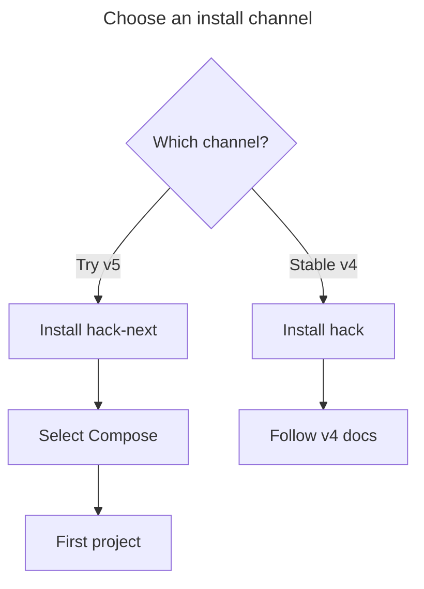

# Install v5

Start here: **1. Install** → [2. First project](getting-started.md).
Already using v4? Read [3. Upgrade from v4](upgrade.md) before running v5 in a project.

## Prerequisites

v5 is in prerelease. Stable is still v4. A stable install does **not** install v5.
The v5 prerelease supports Apple Silicon macOS (native and Compose backends)
and Linux on x86_64 and arm64 with glibc (Compose backend only). Linux archives
are published since `5.0.0-next.23`, so the release named below has them. Intel
Macs stay on stable v4; see
[platform support](../guides/prereleases.md).
The [Linux host setup](../guides/linux-setup.md) and
[Linux certificate trust](../guides/linux-certificate-trust.md) guides cover Linux
host configuration.



## Install beside stable

Download the installer from an exact release. Review it before running it:

```sh
curl --fail --location --proto '=https' --proto-redir '=https' --tlsv1.2 \
  https://github.com/hack-dance/hack/releases/download/v5.0.0-next.24/hack-next-install.sh \
  --output hack-next-install.sh
less hack-next-install.sh
sh hack-next-install.sh
"$HOME/.hack-next/bin/hack-next" --version
"$HOME/.hack-next/bin/hack-next" --manager status
```

Expect the version you chose and a selected bundle in the manager's report.
Newer releases are on [GitHub](https://github.com/hack-dance/hack/releases).
Check a release's notes before replacing the tag above.

**On Linux**, use the same commands above. That release publishes a Compose
archive for Linux x86_64 and one for Linux arm64, with their checksums in
`SHA256SUMS-linux`. The installer needs `curl` and `sha256sum`, installs under
`~/.hack-next` without `sudo`, and ends with "Installed the Compose backend. The
native backend is Apple Silicon macOS only." The
[prerelease install guide on `next`](https://github.com/hack-dance/hack/blob/next/docs/guides/candidate-install.md#linux-the-compose-only-candidate)
has the details.

| Channel | What it installs | Project state |
| --- | --- | --- |
| Stable `hack` | Homebrew's executable, or `~/.hack/bin/hack` with the release installer | Uses `~/.hack` |
| Prerelease `hack-next` | Launcher and versioned bundles under `~/.hack-next` | Native uses private homes per version; Compose shares `~/.hack` with stable |

The installer pins only its manager's SHA-256; the manager then accepts the
archive digest listed in the release's checksum file, fetched over HTTPS from the
same GitHub release, so an archive is only as trustworthy as that release's assets
(the same on macOS and Linux).

The prerelease installer leaves stable alone. It does not edit PATH, start a VM,
or set up DNS or certificate trust. [Install details](../guides/candidate-install.md)
cover custom roots, checksums and version changes.

For stable v4 on macOS, use `brew install hack-dance/tap/hack`; the
[stable install instructions](https://github.com/hack-dance/hack/blob/main/README.md#install)
cover the release installer too. Check it with `command hack --version`.

## Select v5 on Compose

Before machine-wide Compose setup, inspect administrator operations without
running them with `hack global install --plan --json`. For certificate trust
alone, use `hack global trust --plan --json`. Both distinguish root and user
steps and include exact root argv and shell forms. Exit 3 means a phase depends
on state bootstrap has not created yet; review the reported prerequisite rather
than treating it as a complete plan.

Have a running Docker-compatible engine and Docker Compose. Check with
`docker info` and `docker compose version`.

| Entry point | Apple Silicon macOS | Supported Linux |
| --- | --- | --- |
| Stable v4 `hack` executable | Compose | Compose |
| Current `hack-next` or manual `hack-v5` | Native by default. Set `HACK_RUNTIME_BACKEND=compose` for Compose project commands. | Compose only. Explicit native selection is refused. |

Native is the planned default for stable v5. Set up the
prerelease Compose path in this terminal. On Linux, the export is optional.

```sh
export HACK_RUNTIME_BACKEND=compose
hack() { "$HOME/.hack-next/bin/hack-next" "$@"; }
hack --version
```

The function makes `hack` mean the v5 prerelease in this terminal only. It does not
replace the stable executable. Keep this terminal for the next page. A new
terminal needs these two setup lines again.

**Existing v4 users:** stop here and follow [the upgrade steps](upgrade.md).
Stable and the prerelease must not run against the shared home at the same time.

For a new machine, set up Compose routing once:

```sh
hack global install
```

On macOS, a non-interactive `hack global install` skips missing optional
`chafa` and `mkcert` and prints how to install each. If host DNS needs
`dnsmasq`, the command exits before bootstrap with `E_INTERACTIVE_REQUIRED`
and prints `brew install dnsmasq`. Pass `--install-brew-deps` to authorize the
Homebrew installs.

Read the prompts for DNS and certificate trust. Host changes can require your
approval. This starts the proxy and DNS only. The logging stack (Loki, Alloy and
Grafana, for log history and queries) is opt-in: add it any time with
`hack global up --logging`. Then continue to
[First project on Compose](getting-started.md).

## Stop using or remove an install

Stop its projects with `hack down` first. For a login daemon, use that install's
`hack daemon stop` and `hack daemon uninstall` before removing its executable.

- Homebrew: `brew uninstall hack-dance/tap/hack`.
- Release installer: remove only the executable `~/.hack/bin/hack`. Keep the rest
  of `~/.hack` if you need its configuration or keys.
- Prerelease: stop every retained version's workloads, then run
  `"$HOME/.hack-next/bin/hack-next" --manager stable` to deselect it. This keeps
  the bundles and data. To remove the whole channel, save wanted data elsewhere
  before removing `~/.hack-next`; that removes all its version-private homes too.

Removing an executable does not undo host DNS/trust, project files or volumes.
To see whether a newer release exists without changing
anything (since next.18), run `hack update --check --json --observe` through the same launcher;
it prints the upgrade command for this install.
For a prerelease rollback or return to stable, use
[the full procedure](../guides/candidate-install.md#upgrade-roll-back-and-return-to-stable).

### Lifecycle supervisor packaging

New release archives include `hack-lifecycle-supervisor` beside the CLI. The
standard and slim installers install it with executable mode 0755; Homebrew keeps
it beside `libexec/hack`. Source installs prepare it with
`bun run build:lifecycle-supervisor` (Rust 1.97.1, locked dependencies).
The slim runtime image includes the same sibling executable.

Stable archives (v4.3.1) build it for macOS arm64/x86_64 and Linux x86_64; the
v5 prerelease adds Linux arm64 from `5.0.0-next.23`. The macOS
prerelease bundle's supervisor is ad-hoc signed and covered by the bundle
checksums. The Compose-only Linux prerelease bundles carry it unsigned, covered by
the bundle checksums. Retained managers accept older bundles without this helper. Packaging does not change the lifecycle runner default.
A prerelease channel installed by `5.0.0-next.17` or earlier refuses a bundle that
contains it ("Foreign, duplicate or traversing archive entry."), and its `upgrade`
changes nothing. For a channel a compiled manager installed (`next.6` to `next.17`),
replace its manager first with the standalone manager of `5.0.0-next.19` or later
(`upgrade-manager`), then upgrade. Older or unrecognized channels need a fresh
`--root`. See
[the full procedure](../guides/candidate-install.md#upgrade-roll-back-and-return-to-stable).

Self-upgrades stage the helper before publishing the CLI, retain its previous
bytes and SHA-256 in the backup, and restore it if publication fails.
Before publishing anything, a self-upgrade asks the staged CLI which helper
handshake it requires and refuses the release, leaving the installation
unchanged, if the staged helper is missing or answers differently. Releases
whose CLI predates the helper are still accepted. Keep the
helper with its matching CLI when moving an installation.
