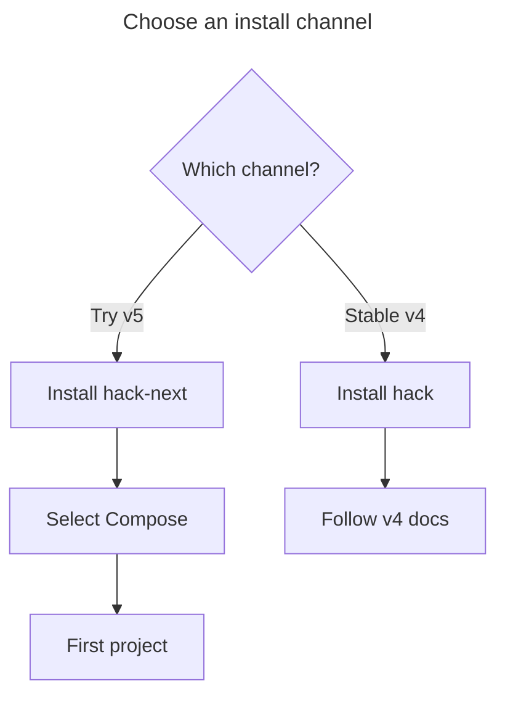

# Install v5

Start here: **1. Install** → [2. First project](getting-started.md).
Already using v4? Read [3. Upgrade from v4](upgrade.md) before running v5 in a project.

## Prerequisites

v5 is in prerelease. Stable is still v4. A stable install does **not** install v5.
The v5 prerelease bundle supports Apple Silicon macOS. Linux and Intel Macs stay
on stable v4; see [platform support](../guides/prereleases.md).
The [Linux host setup](../guides/linux-setup.md) and
[Linux certificate trust](../guides/linux-certificate-trust.md) guides cover host
configuration, not a Linux v5 candidate bundle.



## Install beside stable

Download the installer from an exact release. Review it before running it:

```sh
curl --fail --location --proto '=https' --proto-redir '=https' --tlsv1.2 \
  https://github.com/hack-dance/hack/releases/download/v5.0.0-next.16/hack-next-install.sh \
  --output hack-next-install.sh
less hack-next-install.sh
sh hack-next-install.sh
"$HOME/.hack-next/bin/hack-next" --version
"$HOME/.hack-next/bin/hack-next" --manager status
```

Expect the version you chose and a selected bundle in the manager's report.
Newer releases are on [GitHub](https://github.com/hack-dance/hack/releases).
Check a release's notes before replacing the tag above.

| Channel | What it installs | Project state |
| --- | --- | --- |
| Stable `hack` | Homebrew's executable, or `~/.hack/bin/hack` with the release installer | Uses `~/.hack` |
| Prerelease `hack-next` | Launcher and versioned bundles under `~/.hack-next` | Native uses private homes per version; Compose shares `~/.hack` with stable |

The prerelease installer leaves stable alone. It does not edit PATH, start a VM,
or set up DNS or certificate trust. [Install details](../guides/candidate-install.md)
cover custom roots, checksums and version changes.

For stable v4 on macOS, use `brew install hack-dance/tap/hack`; the
[stable install instructions](https://github.com/hack-dance/hack/blob/main/README.md#install)
cover the release installer too. Check it with `command hack --version`.

## Select v5 on Compose

Have a running Docker-compatible engine and Docker Compose. Check with
`docker info` and `docker compose version`.

`hack-next` selects **native** unless you select Compose. In this terminal:

```sh
export HACK_RUNTIME_BACKEND=compose
hack() { "$HOME/.hack-next/bin/hack-next" "$@"; }
hack --version
```

The function makes `hack` mean the v5 candidate in this terminal only. It does not
replace the stable executable. Keep this terminal for the next page. A new
terminal needs these two setup lines again.

**Existing v4 users:** stop here and follow [the upgrade steps](upgrade.md).
Stable and the candidate must not run against the shared home at the same time.

For a new machine, set up Compose routing once:

```sh
hack global install
```

Read the prompts for DNS and certificate trust. Host changes can require your
approval. Then continue to [First project on Compose](getting-started.md).

## Stop using or remove an install

Stop its projects with `hack down` first. For a login daemon, use that install's
`hack daemon stop` and `hack daemon uninstall` before removing its executable.

- Homebrew: `brew uninstall hack-dance/tap/hack`.
- Release installer: remove only the executable `~/.hack/bin/hack`. Keep the rest
  of `~/.hack` if you need its configuration or keys.
- Prerelease: stop every retained version's workloads, then run
  `"$HOME/.hack-next/bin/hack-next" --manager stable` to deselect it. This keeps
  the bundles and data. To remove the whole channel, save wanted data elsewhere
  before removing `~/.hack-next`; that removes all its version-private homes too.

Removing an executable does not undo host DNS/trust, project files or volumes.
For a candidate rollback or return to stable, use
[the full procedure](../guides/candidate-install.md#upgrade-roll-back-and-return-to-stable).

### Lifecycle supervisor packaging

New release archives include `hack-lifecycle-supervisor` beside the CLI. The
standard and slim installers install it with executable mode 0755; Homebrew keeps
it beside `libexec/hack`. Source installs prepare it with
`bun run build:lifecycle-supervisor` (Rust 1.97.1, locked dependencies).
The slim runtime image includes the same sibling executable.

Stable archives build it for macOS arm64/x86_64 and Linux arm64/x86_64. Existing
prerelease bundles remain macOS arm64 only: their supervisor is ad-hoc signed and
covered by the bundle checksums. Retained managers accept older bundles without
this helper. Packaging does not change the lifecycle runner default.

Self-upgrades stage the helper before publishing the CLI, retain its previous
bytes and SHA-256 in the backup, and restore it if publication fails. Keep the
helper with its matching CLI when moving an installation.
