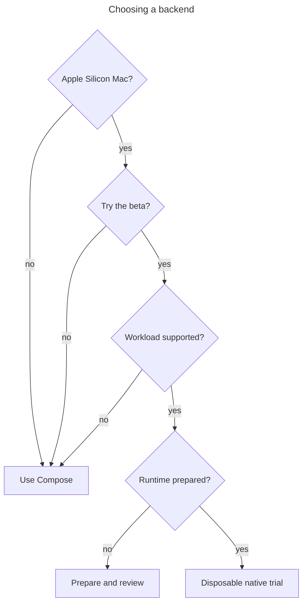

# Native backend (beta)

The native backend is a second way for Hack to run your project. It is a beta for
Apple Silicon Macs. Stable `hack` uses Compose. The current `hack-next`
prerelease selects native on Apple Silicon macOS and Compose on Linux.

Native setup and live log following are **under verification**. Real-VM
acceptance remains pending; start with disposable projects and synthetic data.
See [Prepare the runtime](setup.md) and [Follow service logs](log-follow.md).

Interactive exec, guarded Compose env-file reads and retirement fixes arrived in
next.17. An older installed bundle does not have them; see
[what changed and what to do](https://github.com/hack-dance/hack/blob/5002cf87bb50686b17ceae8a4c835f524ee1b3a5/docs/guides/v5-release-notes.md#next17-what-changed-and-what-to-do).

## What it is

Hack needs something to run your services in. Today that is Docker Compose, which
needs a Docker app running on your machine.

With the native backend, Hack runs admitted project workloads as containers in a
lightweight Linux VM that Hack manages. You do not need Docker Desktop or OrbStack
on the Mac. The VM runs its own pinned Docker Engine; it does not use your host's
Docker app. Preparing that VM runtime is still a separate step.

It is not a different container format. Your images and your Compose file are the
same. Projects on native share the VM's resources.

Your project stays the same. The `.hack/` folder, the commands (`hack up`,
`hack down`, `hack logs`) and your env and secrets are the same on both backends.

## What it is not

- **Backend selection.** Set `HACK_RUNTIME_BACKEND=compose` to run project
  commands through the macOS prerelease on Compose. Native is the planned default
  for stable v5.
- **Not in stable Hack.** It ships only through the separate `hack-next` channel.
  The stable release archives and the Homebrew formula do not contain it.
- **Not for every platform.** It runs on Apple Silicon macOS only. Intel Macs,
  Linux and Windows use Compose.
- **Not a full replacement for Compose yet.** It supports a limited set of commands
  and Compose features. See [what works and known limits](limits.md).
- **Not a migration.** Trying native does not convert your project or move your
  data. Your stable setup is left alone.
- **Not proven faster or lighter.** We make no speed, memory or battery claim
  for native. Choose it to run without a Docker app, not for performance.
- **Not a sandbox.** It is a way to run a Compose file without a Docker app. It
  refuses some risky container settings (see below), but it is not a security
  boundary: do not rely on it to contain a project or a coding agent.
- **Shared resources.** Projects the pool was started with share its VM resources.
  A running pool's folders are fixed. When nothing uses the pool, `hack up` in
  another project restarts it once to add that folder. When another
  project is running, it refuses and names it: run `hack down` there first.

## Control and traffic

For the Compose-file native frontend, the compiler prepares the workload plan and
the VM's container runtime runs the containers; published TCP traffic takes a
separate loopback path into the VM.

The compiler does not carry application traffic. This picture covers published
TCP ports, not every routing mode or the authored frontend's separate capability
limits; see the [reference](reference.md) before selecting a workload.

The VM provider is a pinned third-party release today. Setup lists it, with its
hash and source, before it downloads anything; see
[prepare the native runtime](setup.md). Hack's own VM launcher is planned to
replace it.

A native home can also run one small control process, the runtime service
(`hack-native service serve|status|stop`). It only answers who it is and whether
it is running: no `hack` command uses it yet, it never starts by itself, and
stopping it does not stop your services or the VM. The native backend reference
describes its commands under "The runtime service".

## Why try it

What you get today:

- **No Docker Desktop install or licence.** Hack brings what it needs.
- **Ports stay on your machine.** A Compose port bound to every network interface
  (`0.0.0.0`) is narrowed to your own machine, so a dev service is not open to the
  network you are on.
- **You can limit where containers connect.** An optional list names the hosts your
  containers may reach.
- **Risky container settings are refused.** For example, `privileged: true` does not
  run.
- **Images are checked when pulled.** Hack verifies each image against its digest, a
  fingerprint of its exact contents.
- **Crashes are handled in the open.** Hack detects a crashed run and cleans it up
  with an explicit command. `hack down` keeps your data.
- **Safe to try.** `hack-next` installs beside stable Hack with its own files. It
  does not edit your PATH, your stable `hack`, or `~/.hack`.

What you give up today:

- Following logs live as a verified native capability. `hack logs --follow` is
  available for testing; real-VM acceptance for authored and adopted projects
  is still pending.
- Interactive shells before next.17. Since next.17, native supports foreground terminal
  `hack exec SERVICE -- /bin/sh`; redirects and `HACK_NO_INTERACTIVE=1` keep
  finite exec. Use the matching runtime and follow its retained-session
  recovery instructions after an uncertain outcome.
- UDP ports.
- Automatic restart for services that publish a port.

Use Compose if you need any of these.

## Who should try it

Try it if you use an Apple Silicon Mac, you are comfortable testing beta software,
and you have a project you can afford to break. Start with a disposable project
and synthetic data.

Stay on Compose if you need every Compose feature, you work on Linux or an Intel
Mac, or the project holds data you cannot lose.

A native trial requires a supported Mac, supported workload features and a
separately prepared runtime.

Eligibility is permission to try a disposable workload, not a claim of feature
parity, production readiness or better performance.

## Where to go next

1. [Try it](try-it.md): install, run one project on native, and switch back.
2. [What works and known limits](limits.md).
3. [Reference](reference.md): the detailed pages, by topic.
