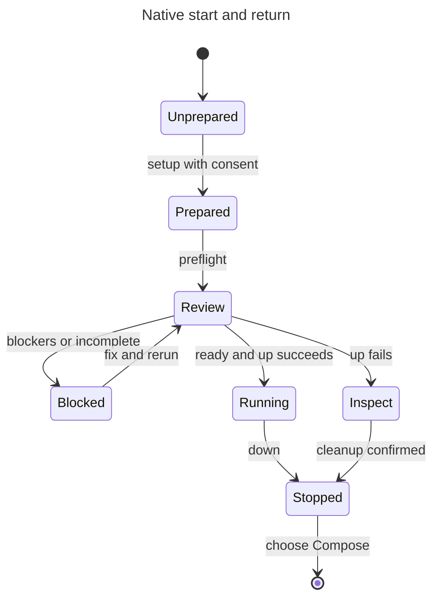

# Try native on Apple Silicon

Start here: [1. Install](../install.md) · [2. First project](../getting-started.md) ·
[3. Upgrade](../upgrade.md) · **4. Try native**.

Use an Apple Silicon Mac and a disposable project with synthetic data. Native
runs services in Hack's Linux VM. It is beta; it does not move Compose volumes
or prove that every Compose feature works. Read [the limits](limits.md) first.



## Prepare the runtime

Keep the `hack-next` install from [Install](../install.md). Its launcher selects
the installed version and that version's private native home:

```sh
CANDIDATE="$HOME/.hack-next/bin/hack-next"
unset HACK_RUNTIME_BACKEND HACK_NATIVE_HOME
```

Do not use the Compose shell function from page 1 for native commands. The full
launcher path below selects native and that version's private homes.

Prepare the runtime with the same frontend, without another binary or a home argument.

These frontend setup steps need next.17 or later; an installed next.16 keeps
its [older setup procedure](setup.md#older-setup-only-homes).

```sh
"$CANDIDATE" native setup
# Noninteractive downloads need explicit consent:
"$CANDIDATE" native setup --accept-downloads --json
```

Setup shows file sizes, download hosts, hashes and locations, then asks once for
consent. Read the list. It includes the image builder that `build:` services
need; a home that an earlier build set up gains it with
`native setup --accept-downloads` ([the image builder](setup.md#the-image-builder)).
A matching install is checked and reused. Noninteractive
`up` refuses until setup is complete; interactive `up` can offer setup with the
same consent and continue after success. For offline inputs or an interrupted
download, use [setup and recovery details](setup.md).

Manual bundle users run the adjacent `hack-v5 native setup`. Their default home is
`$HACK_HOME/native-runtime` or `~/.hack/native-runtime`; an absolute
`HACK_NATIVE_HOME` selects another home. Managed `hack-next` keeps its version's
receipt-owned home and refuses a differing override. See
[home selection and moving homes](setup.md#manual-homes).

## Check before starting

`hack upgrade check` checks native configuration only. It does not inspect runtime
setup or runtime admission, so a finding with no configuration blockers is not
permission to start. Run setup above and the full preflight below.

```sh
"$CANDIDATE" doctor --native-preflight --path /absolute/project
```

Native `hack up` selects Compose profiles as Compose does: `--profile`, else
`COMPOSE_PROFILES` in the managed env (for example `.hack/hack.env.default.yaml`),
else in the shell (a `COMPOSE_PROFILES` stored as a secret selects nothing).
Preflight selects them the same way, so without `--profile` it reviews the services
a fresh `up` starts. A run that already exists keeps the profiles it started
with; when the env now selects others, `up` says so, and changing them means
`hack down --remove-data` (this deletes the data volumes) and `hack up`.
Preflight reads the Compose project and lists blockers with fixes. It starts no VM or service. Continue only
when there are no blockers **and** the report says `Runtime review: completed`.
The runtime setup item must also say ready. In JSON, this means `ready: true`
and `runtime_review.status: "completed"`.
An exit of 0 alone is not enough: runtime review can be skipped or unavailable.

If blocked, fix the named field and rerun. For a project that already runs on
Compose, [Run an existing Compose project on native](existing-compose-project.md)
collects the usual fixes. Do not remove a check or delete state
to force a start. Keep the project on Compose if it needs unsupported behavior.
See [Troubleshooting](../troubleshooting.md) and [the preflight reference](preflight.md).

Env-file support (since next.17) changes input checks and shell-default
selection. Before upgrading, read the [environment-file rules](https://github.com/hack-dance/hack/blob/9cd2053affe4f3307703e97d5bb4cd7fc3049830/docs/native/environment-files.md)
and [migration notes](https://github.com/hack-dance/hack/blob/9cd2053affe4f3307703e97d5bb4cd7fc3049830/docs/guides/v5-release-notes.md#next17-what-changed-and-what-to-do).
They explain which files are read, which declarations refuse and how to fix them.

## Start, check and stop

```sh
"$CANDIDATE" up --detach --path /absolute/project
"$CANDIDATE" ps --path /absolute/project
"$CANDIDATE" logs api --no-follow --tail 50 --path /absolute/project
```

Replace `api` with a service in your project. Start still checks images, source
sharing, credentials, ownership and readiness. Preflight does not prove these.
If writable source sharing asks for consent, review the exact source roots and
[sharing limits](full-reference.md#explicit-writable-development-source) before
opting in. Check the app and saved data yourself; a running VM is not acceptance.

**Build base registry refusal (`registry_image`).** Foreground and detached
starts can report `Image unavailable: could not resolve build base` when the
registry cannot resolve a Dockerfile base. Check the reported reason, restore
registry access, then retry `hack up`. `Already present` lists images Hack
confirmed in the running guest. It does not confirm that the named build base
can be resolved offline.

Since next.17, use
`"$CANDIDATE" exec api -- /bin/sh` from a foreground terminal for a live shell.
Terminal stdin and stdout are required; redirects or `HACK_NO_INTERACTIVE=1`
select finite exec, which waits up to 30 seconds; with fresh per-command values, a command that
finished on a busy host still returns its output and exit code. Use the matching runtime, and restart old managed-env
launchers if requested. After an uncertain outcome, inspect
`"$CANDIDATE" exec-sessions` and follow the
[recovery instructions](https://github.com/hack-dance/hack/blob/5002cf87bb50686b17ceae8a4c835f524ee1b3a5/docs/guides/native-candidate.md#normal-native-exec).

Native `up`, `up --detach` and `up --json` return once every container has started;
the closing line counts the routes still warming, and `--json` says
`readiness: "warming"`. `up --wait` returns once every service is ready, as before.
`up.after` hooks run at started: a hook that calls a project URL needs `--wait`.
`hack exec` and `hack run` wait for ready on their own; `hack open` does not.
A loopback port can accept connections as soon as its own service is ready.
During startup, `hack ps` shows verified loopback publications, and
`hack open <service>` can open a service with one verified loopback address.
Other services can still be starting. If the start fails or is cancelled,
the owner retires the ports it has already published. HTTPS addresses still
depend on the HTTPS frontend being ready.
Text output reports each build as it finishes, including its service names,
outcome and elapsed time. Build output stays with foreground `hack up`.
See [native command forms and startup limits](https://github.com/hack-dance/hack/blob/next/docs/native/limits.md) for the
separate detached and graph readiness limits. If detached startup times out,
run `down` next. It waits up to two minutes for a pending owner and stops what
the owner published, or reports `E_DOWN_INCOMPLETE` if it cannot prove the stop.
Retry after the stop is confirmed.

Stop with the **same version and native home**:

```sh
"$CANDIDATE" down --path /absolute/project
```

If the foreground owner exited during startup, run `"$CANDIDATE" down --recover
--path /absolute/project` while the original pool is still running. Recovery
retains project data and requires matching records for this run. If those
records cannot prove ownership, keep the old home and use a separate checkout
with a [fresh manual native home](setup.md#manual-homes). This starts a separate
run without transferring the old run’s data.

If stop reports retained or unknown cleanup, follow its inspection instructions
before switching. Keep the home and receipts; use the
[cleanup reference](full-reference.md#manual-candidate-upgrade-and-rollback).

If startup was interrupted just after creating a container, cleanup records
the container it verified before removing it. Once cleanup finishes with data
retained, `hack up` can restore the run with its existing named volumes.
This applies when cleanup records the ID. Runs already stopped with a missing
container ID still refuse restore. Earlier builds cannot read receipts that
contain the new cleanup observation field. Native homes are per version.

After installing a newer version, its native home is new, but the project still
records its last run in the old one. If you did not stop the project with the old
version first, `hack up`, `hack ps` and `hack down` from the new version refuse with
`E_NATIVE_RUN_MAPPING_FOREIGN_HOME`. When the old home proves a clean stop, the
message names the exact command that releases the old mapping
(`hack doctor --native-run-mapping release --expect-selection <sha> [--branch <name>]`);
run it, then `hack up` again. The project's data stays in the old home. If the old
run is still live or its stop cannot be proven, stop it with the old version first.

If the old home is no longer at its path (deleted, or on a disk that is not
mounted), its records cannot be read there. The same refusal then names the same
release command: it releases the mapping once no process of this user still names
the old home's path or works inside it, and keeps the mapping in an audit file
beside it. If the home is on a disk that is not mounted (the message names a missing
directory under `/Volumes`, `/mnt` or `/media` when it can tell), mount it and stop
the run there instead; its data is still on that disk. A home that was moved rather
than deleted, and started again from its new path, has processes that name only the
new path, so this check cannot see it; in that case release again from the moved
home afterwards.

## Back to Compose

Once the native stop is confirmed, use the same prerelease on Compose:

```sh
HACK_RUNTIME_BACKEND=compose "$CANDIDATE" up --detach --path /absolute/project
```

This uses the shared stable Hack home. First follow the
[stable-daemon stop procedure](../../guides/candidate-install.md#stop-stable-hackd-before-a-compose-run)
if stable is installed. Native data stays in the native home; Compose data stays
in Compose volumes. This switch does not copy either database.

[The command contract](authored-commands.md) and
[full reference](full-reference.md) cover advanced configuration and recovery.

### Read the startup timeline

Run `hack up --detach --timings` to see the native startup timeline on stderr.
It shows when every container started and when all services met their readiness
conditions. A service with a health check must pass it. A completed one-shot
service must exit successfully. A milestone appears only when this invocation
observed it. A project that is still warming may have a start time without a
readiness time.

Native `hack up --json` includes the same `hack.timings/1` records
in `data.timings`. Add `--timings-file <file>` to save those records as JSONL
in a new file. Times overlap when steps run together, so use `command.total`
for elapsed startup time.
