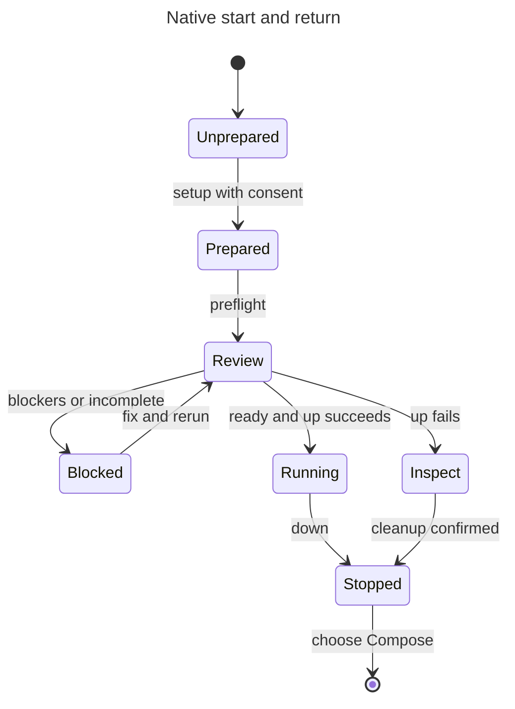

# Try native on Apple Silicon

Start here: [1. Install](../install.md) · [2. First project](../getting-started.md) ·
[3. Upgrade](../upgrade.md) · **4. Try native**.

Use an Apple Silicon Mac and a disposable project with synthetic data. Native
runs services in Hack's Linux VM. It is beta; it does not move Compose volumes
or prove that every Compose feature works. Read [the limits](limits.md) first.



## Prepare the runtime

Keep the `hack-next` install from [Install](../install.md). Use the exact version
shown by `"$HOME/.hack-next/bin/hack-next" --manager status`:

```sh
V=5.0.0-next.16
NATIVE="$HOME/.hack-next/versions/$V/bundle/hack-native"
NATIVE_HOME="$HOME/.hack-next/versions/$V/native-home"
CANDIDATE="$HOME/.hack-next/bin/hack-next"
unset HACK_RUNTIME_BACKEND
```

Do not use the Compose shell function from page 1 for native commands. The full
launcher path below selects native and that version's private homes.

Today's setup command is:

```sh
"$NATIVE" --candidate-root "$NATIVE_HOME" runtime setup
```

A `hack` command for this step is coming (HACK-2193); only this setup line needs
to change when it lands. Setup shows file sizes, download hosts, hashes and
locations, then asks for consent. Read the list. `up` never downloads the runtime
for you. A matching install is checked and reused. For offline inputs or an
interrupted download, use [setup and recovery details](setup.md).

## Check before starting

```sh
"$CANDIDATE" doctor --native-preflight --path /absolute/project
```

Add the project's `--profile` selection if needed. Preflight reads the Compose
project and lists blockers with fixes. It starts no VM or service. Continue only
when there are no blockers **and** the report says `Runtime review: completed`.
In JSON, this means `ready: true` and `runtime_review.status: "completed"`.
An exit of 0 alone is not enough: runtime review can be skipped or unavailable.

If blocked, fix the named field and rerun. Do not remove a check or delete state
to force a start. Keep the project on Compose if it needs unsupported behavior.
See [Troubleshooting](../troubleshooting.md) and [the preflight reference](preflight.md).

Env-file support intended for next.17 changes input checks and shell-default
selection. Before upgrading, read the [environment-file rules](https://github.com/hack-dance/hack/blob/9cd2053affe4f3307703e97d5bb4cd7fc3049830/docs/native/environment-files.md)
and [migration notes](https://github.com/hack-dance/hack/blob/9cd2053affe4f3307703e97d5bb4cd7fc3049830/docs/guides/v5-release-notes.md#next17-what-changed-and-what-to-do).
They explain which files are read, which declarations refuse and how to fix them.

## Start, check and stop

```sh
"$CANDIDATE" up --detach --path /absolute/project
"$CANDIDATE" ps --path /absolute/project
"$CANDIDATE" logs api --no-follow --tail 50 --path /absolute/project
```

Replace `api` with a service in your project. Start still checks images, source
sharing, credentials, ownership and readiness. Preflight does not prove these.
If writable source sharing asks for consent, review the exact source roots and
[sharing limits](full-reference.md#explicit-writable-development-source) before
opting in. Check the app and saved data yourself; a running VM is not acceptance.

In a build containing next.17's interactive exec, use
`"$CANDIDATE" exec api -- /bin/sh` from a foreground terminal for a live shell.
Terminal stdin and stdout are required; redirects or `HACK_NO_INTERACTIVE=1`
select finite exec. Use the matching runtime, and restart old managed-env
launchers if requested. After an uncertain outcome, inspect
`"$CANDIDATE" exec-sessions` and follow the
[recovery instructions](full-reference.md#normal-native-exec).

Stop with the **same version and native home**:

```sh
"$CANDIDATE" down --path /absolute/project
```

If stop reports retained or unknown cleanup, follow its inspection instructions
before switching. Keep the home and receipts; use the
[cleanup reference](full-reference.md#manual-candidate-upgrade-and-rollback).

## Back to Compose

Once the native stop is confirmed, use the same candidate on Compose:

```sh
HACK_RUNTIME_BACKEND=compose "$CANDIDATE" up --detach --path /absolute/project
```

This uses the shared stable Hack home. First follow the
[stable-daemon stop procedure](../../guides/candidate-install.md#stop-stable-hackd-before-a-compose-run)
if stable is installed. Native data stays in the native home; Compose data stays
in Compose volumes. This switch does not copy either database.

[The command contract](authored-commands.md) and
[full reference](full-reference.md) cover advanced configuration and recovery.
