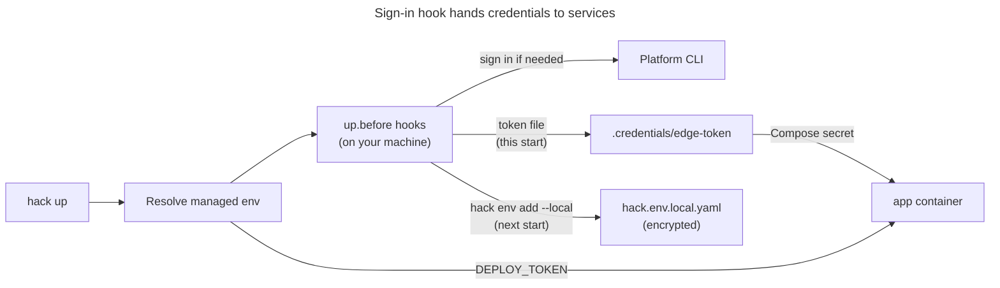

# Sign in to another CLI at startup

The commands and configuration on this page were audited against `v5.0.0-next.13`.
The execution notes below come from the newer recipe source revision; the examples
were not rerun with the pinned binary.

Use this when your services need a token from another tool's CLI, such as a
deploy platform or an edge platform. A lifecycle hook signs in on your machine
before the containers start, then hands the token to the services.

This is a pattern built from lifecycle hooks and managed env. It is not a
built-in credential adapter. Hack has built-in adapters only for AWS and gcloud,
and only on the [native backend (beta)](../../guides/native-candidate.md). There is
no plugin API for adding another adapter.

The complete project is in
[`examples/recipes/cli-login`](https://github.com/hack-dance/hack/blob/943503b56081f9934fa98c4b80b7eea2a1a41822/examples/recipes/cli-login). It uses two
stand-in CLIs, `deployctl` and `edgectl`, in `stand-ins/`. They are shell
scripts that behave like a real CLI's sign-in, status and token commands.

## How it works



Hack resolves the managed env **before** the `up.before` hooks run. That
decides how a hook can pass a token on:

| Hand-off | Reaches containers | Stored as |
| --- | --- | --- |
| Write a file that Compose mounts as a secret | On this start | A plain file, mode 0600, ignored by git |
| `hack env add --secret --local` | On the next start | An encrypted value in `.hack/hack.env.local.yaml` |

## Steps

1. Put the sign-in hooks in `.hack/hack.config.json`. The down hook removes the
   token file when you stop the project.

   <!-- include: examples/recipes/cli-login/.hack/hack.config.json -->
   ```json
   {
     "$schema": "https://schemas.hack.local/hack.config.schema.json",
     "name": "cli-login",
     "dev_host": "cli-login.hack.local",
     "lifecycle": {
       "up": {
         "before": [
           { "name": "deploy platform sign-in", "command": "sh scripts/deploy-login.sh" },
           { "name": "edge platform sign-in", "command": "sh scripts/edge-login.sh" }
         ]
       },
       "down": {
         "after": [{ "name": "remove edge token file", "command": "rm -f .credentials/edge-token" }]
       }
     }
   }
   ```

2. Keep a token in managed env (the deploy platform). The hook signs in only
   when needed, reads the token, and compares it with the stored value. When
   the token changed, it stores the new one and stops this start, because the
   containers would otherwise get the old value.

   <!-- include: examples/recipes/cli-login/scripts/deploy-login.sh -->
   ```sh
   #!/bin/sh
   # Sign in to the deploy platform CLI and keep its token in Hack's managed env.
   # Replace the three deployctl commands with your CLI's sign-in, status and
   # token commands.
   set -eu

   if ! deployctl whoami >/dev/null 2>&1; then
     deployctl login
   fi
   token=$(deployctl token)

   # Hack resolves service env before this hook runs, so a value written now only
   # reaches containers on the next start. Stop this start when the token changed,
   # so no service runs with the old one.
   stored=$(hack env get DEPLOY_TOKEN --service app 2>/dev/null || true)
   if [ "$token" != "$stored" ]; then
     printf '%s' "$token" | hack env add DEPLOY_TOKEN --service app --secret --local --value-stdin
     echo "deploy-login: stored a new DEPLOY_TOKEN. Run hack up again." >&2
     exit 1
   fi
   ```

3. Hand a token over as a file (the edge platform). The hook writes the token
   to a private file. Compose mounts it into the container at
   `/run/secrets/edge_token`, on this same start.

   <!-- include: examples/recipes/cli-login/scripts/edge-login.sh -->
   ```sh
   #!/bin/sh
   # Sign in to the edge platform CLI and write its token to a private file that
   # Compose mounts as a secret. Replace the edgectl commands with your CLI's.
   set -eu

   if ! edgectl whoami >/dev/null 2>&1; then
     edgectl login
   fi

   umask 077
   mkdir -p .credentials
   edgectl token > .credentials/edge-token.tmp
   mv .credentials/edge-token.tmp .credentials/edge-token
   ```

   Add `.credentials/` to `.gitignore`.

4. Give the service the token. `DEPLOY_TOKEN` arrives as an environment
   variable. The edge token arrives as a file, and the service reads its path
   from `EDGE_API_TOKEN_FILE`.

   <!-- include: examples/recipes/cli-login/.hack/docker-compose.yml -->
   ```yaml
   name: cli-login
   services:
     app:
       image: alpine:3.22
       command: ["sh", "/app/scripts/show-credentials.sh"]
       environment:
         EDGE_API_TOKEN_FILE: /run/secrets/edge_token
       volumes:
         - ..:/app:ro
       secrets:
         - edge_token

   secrets:
     edge_token:
       file: ../.credentials/edge-token
   ```

5. Start the project. The first start signs in, stores the deploy token and
   stops. Start it again.

   ```sh
   hack up -d     # stops with: stored a new DEPLOY_TOKEN. Run hack up again.
   hack up -d
   hack logs app --no-follow
   ```

   The stand-in app prints `deploy token: present` and
   `edge token file: present`. It never prints the values.

To try the example with the stand-ins, put them on `PATH` first:
`export PATH="$PWD/stand-ins:$PATH"`.

## Use a real CLI

Replace the stand-in commands with your CLI's commands:

| Stand-in | What it does | Example: Wrangler (edge platform) | Example: flyctl (deploy platform) |
| --- | --- | --- | --- |
| `edgectl login`, `deployctl login` | Interactive sign-in | `wrangler login` | `fly auth login` |
| `edgectl whoami`, `deployctl whoami` | Exit 0 when signed in | `wrangler whoami` | `fly auth whoami` |
| `edgectl token`, `deployctl token` | Print a token on stdout | `wrangler auth token` | `fly tokens create deploy` (check its output first) |

We checked these commands against the official Wrangler and flyctl command
references in November 2026. We did not run them against a live account.
Check your CLI's documentation for how it prints a token, which variable it
reads (for example `CLOUDFLARE_API_TOKEN` for Wrangler), and how long a token
lasts.

Hooks run with your terminal's input, so a browser or device-code sign-in
works. With `HACK_NO_INTERACTIVE=1`, Hack still runs the hook; a sign-in that
waits for input still waits.

## Notes

- Use a token file when the token changes often, or when it must reach the
  containers on the same start. Use managed env when the token is long-lived
  and you want it encrypted at rest.
- A container that runs as a non-root user may not be able to read a 0600 file
  owned by your user. Run the hook's `umask` and the container's user so they
  match, or copy the file in an entrypoint.
- The `stored` comparison reads the default overlay. If you start with
  `--env <name>`, pass the same `--env` to `hack env get` and `hack env add`.
- AWS SSO and gcloud: on the Compose backend, use the same hook pattern
  (`aws sso login`, `gcloud auth login`). The native backend's built-in
  adapters are described in the [native backend guide](../../guides/native-candidate.md).

Related: [Lifecycle](../../lifecycle.md), [Env and secrets](../../env.md),
[Common pitfalls](common-pitfalls.md).
