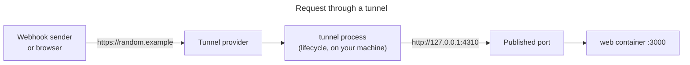

# Expose a local service through a tunnel

The commands and configuration on this page were audited against `v5.0.0-next.13`.
The execution notes below come from the newer recipe source revision; the examples
were not rerun with the pinned binary.

Use this when something outside your machine must reach a local service: a
webhook sender, a phone, or a teammate. The tunnel runs as a Hack lifecycle
process, so `hack up` starts it and `hack down` stops it.

The complete project is in
[`examples/recipes/tunnel`](https://github.com/hack-dance/hack/blob/943503b56081f9934fa98c4b80b7eea2a1a41822/examples/recipes/tunnel). It uses
`cloudflared` quick tunnels, which need no account. Any tunnel CLI that runs in
the foreground works the same way.

## How it works



## Steps

1. Publish the service on the loopback address only, so the tunnel on your
   machine can reach it and nothing else on your network can.

   <!-- include: examples/recipes/tunnel/.hack/docker-compose.yml -->
   ```yaml
   name: tunnel
   services:
     web:
       image: oven/bun:1.4.4-slim
       working_dir: /app
       command: ["bun", "src/server.ts"]
       volumes:
         - ..:/app:ro
       # The tunnel runs on the host, so the app is published on loopback only.
       ports:
         - "127.0.0.1:4310:3000"
   ```

2. Add the tunnel as a lifecycle process. It must stay in the foreground; Hack
   runs it in its own tmux session and stops it on `hack down`.

   <!-- include: examples/recipes/tunnel/.hack/hack.config.json -->
   ```json
   {
     "$schema": "https://schemas.hack.local/hack.config.schema.json",
     "name": "tunnel",
     "dev_host": "tunnel.hack.local",
     "lifecycle": {
       "processes": [
         {
           "name": "tunnel",
           "command": "cloudflared tunnel --no-autoupdate --url http://127.0.0.1:4310"
         }
       ]
     }
   }
   ```

3. Start the project and read the public URL from the tunnel's log:

   ```sh
   hack up -d
   hack logs tunnel --no-follow | grep -o 'https://[a-z0-9-]*\.trycloudflare\.com'
   ```

4. Send a test request through the tunnel:

   ```sh
   curl -X POST -d '{"event":"test"}' https://<your-tunnel>.trycloudflare.com/webhooks
   hack logs web --no-follow --tail 1   # webhook received: {"event":"test"}
   ```

5. Stop the project. `hack down` stops the containers and the tunnel process.
   The public URL stops working.

   ```sh
   hack down
   ```

Lifecycle processes need tmux (or zellij). See [Lifecycle](../../lifecycle.md).

## OAuth callbacks and stable URLs

A quick tunnel gets a new random hostname on every start. That is fine for
webhooks you register by hand while testing. OAuth providers need a callback URL
that you register in advance, so they need a hostname that stays the same:

- **A named tunnel.** Create it once in your tunnel provider's account and run
  it with a token instead of `--url`. Store the token with
  `<secret-source> | hack env add TUNNEL_TOKEN --service host --secret --local --value-stdin`.
  The `host` scope delivers it to lifecycle processes without adding it to
  application containers. Use this scope rather than `global`, which delivers
  values to every service. For `cloudflared`, the process command is then just
  `cloudflared tunnel run`: it reads `TUNNEL_TOKEN` from its environment
  (`cloudflared tunnel run --help` lists it). Do not write
  `--token "$TUNNEL_TOKEN"`; that puts the token in the process's arguments,
  where other tools on your machine can read it. We did not run a named
  tunnel, because it needs an account.
- **A local OAuth alias.** When the provider only needs a callback that your
  browser can reach (not a public one), Hack's `.hack.gy` alias may be enough.
  See `--oauth` and `--oauth-tld` under `hack init` in the
  [Command reference](../../reference/cli.md#hack-init).

Point your app's public URL setting (for example `PUBLIC_URL`) at the stable
hostname, in the overlay you use for tunnel work. See
[Environments](environments.md).

## Notes

- Tunnel to the published port, not to the Hack route
  (`https://tunnel.hack.local`). A tunnel to the route needs the global proxy,
  its local CA and the right `Host` header. We did not test that path.
- Anyone with the URL reaches your service. Do not tunnel a service that has
  no sign-in, or that holds data you would not publish.
- If you start the same tunnel by hand, Hack starts a second copy. For fixed
  local ports, see `singleton` in [Lifecycle](../../lifecycle.md).

Related: [Lifecycle](../../lifecycle.md), [Common pitfalls](common-pitfalls.md).
