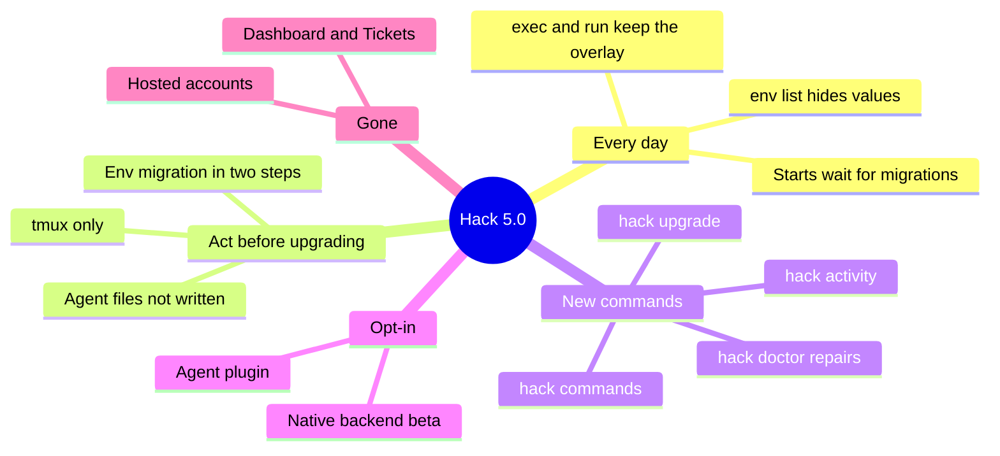

# What's new in Hack 5.0

> **Draft for the 5.0.0 release.** Until 5.0.0 is published, v5 ships as
> `5.0.0-next.N` prereleases through the separate `hack-next` channel. Stable is
> still v4. See [Install v5](install.md).

Hack 5 keeps the v4 project model. Your `.hack/` folder, your encrypted env
values, branch instances and lifecycle processes carry over. Docker Compose is
still the default way to run services. This page lists what changed for a user,
starting with what you will notice most.

## 1. What you will notice every day

**A first start no longer times out during migrations.** `hack up -d` keeps
waiting while a one-shot service such as a migration runs, up to 30 minutes.
Before, a slow first start could fail after 90 seconds. See
[How long a first start takes](getting-started.md).

**`hack exec` and `hack run` keep the running overlay.** After
`hack up --env qa`, plain `hack exec api -- env` uses `qa`. You no longer repeat
`--env`. See [Choose where a command runs](guides/run-commands.md).

**`hack env list` hides every value.** It shows names, scopes and source files.
Read one value with `hack env get <KEY>`. See
[Share environment and secrets](guides/share-environment.md).

**Hack options go before your command.** In `hack exec`, `hack run`,
`hack host exec` and `hack env exec`, everything from the command's first word
on belongs to that command, including `--json` and `--help`.

**Ctrl-C on a foreground `hack up` stops cleanly.** Hack waits for the
project's lifecycle processes to end. A second Ctrl-C skips the remaining wait.

## 2. What you must do before you upgrade

| Change | What to do |
| --- | --- |
| `hack session` needs **tmux**. Zellij is removed. | Install tmux. Stop any project that has saved zellij state with the v4 CLI first. |
| **Secrets are refused as command arguments.** | Type the value at the hidden prompt, or pipe it with `--value-stdin`. |
| **Env migration keeps your old files.** Cleanup is a separate step. | Preview, apply, check the project, then clean up. You can resume and roll back. |
| **Managed values that contain `$` are delivered as stored.** v4 let Compose expand `$VAR` inside a managed value. | Check values that relied on that, or that escaped `$` as `$$`. |
| **Hack no longer writes agent files.** `hack setup sync` and `hack agent prime` refuse. | Install the optional plugin if you want agent guidance. |

Follow [Upgrade from v4](upgrade.md). It is a backup-first procedure, and it
says how to go back.

## 3. New commands

| Command | What it is for |
| --- | --- |
| `hack upgrade check`, `review`, `apply`, `snapshot`, `rollback` | Check a v4 machine before the upgrade, apply selected file repairs with a snapshot, and restore those files. It does not install a release or back up application data. |
| `hack doctor --fix --only '<check>'` | Run one named repair and verify it. Doctor also reports settings that make a project slow: emulated images, polling file watchers, mixed CPU types on one volume, and old `:latest` images. |
| `hack activity` | Read the history of `up`, `down` and `restart` for a project. |
| `hack exec --detach`, `hack run --detach`, `hack commands` | Run a long command in the background, then read its output, inspect it or cancel it. |
| `hack env overlay list`, `hack env overlay add <name>` | List and create env overlays. |
| `hack env migrate` | Preview, apply, resume, roll back and clean up the env file migration. |
| `hack autostart` | Start chosen Compose projects once per boot. |
| `hack usage --json --by-service` | CPU and memory for each service of one project. |
| `hack dev` | Run a repository's own side-by-side development build. It first shipped in 4.3.0. |

The [command reference](reference/cli.md) has every flag.

## 4. For scripts and agents

- **With `--json`, stdout is one JSON value.** Output from lifecycle hooks and
  from Compose goes to stderr. *(On the `next` branch; not in a prerelease yet.)*
- **`hack up`, `down` and `restart` take `--json --progress`** for a line-by-line
  progress stream on Compose.
- **`hack logs --json`** is a stable stream, one event per line, with
  `--services` and `--max-line-bytes`.
- **`hack ps --json`** adds `emulated` for a container that runs under CPU
  emulation, and `waiting` for services held behind a one-shot.
- **New read-only reports** for apps and monitors: `hack version --json`,
  `hack projects --json --observe`, `hack global status --json --observe` and
  `hack update --check --json --observe`.

See [Command and output contracts](reference/command-contracts.md).

## 5. What you can choose to add

**The agent plugin.** v4 wrote instructions into `AGENTS.md` and `CLAUDE.md`
and installed hooks. v5 does none of that. You can install the `hack` plugin
through your agent's own plugin manager. An agent with a shell needs nothing:
every command has `--json` and `--no-interactive`. See
[Agent integrations](integrations.md).

**The native backend (beta).** On an Apple Silicon Mac, prepared projects can
run in a small Linux virtual machine without a Docker app. It ships only through
`hack-next`. Nothing selects it for you, and it does not claim to match Compose
for every project. See [Try native](native/start.md) and
[What works and known limits](native/limits.md).

## 6. What is gone

| Retired | Use instead |
| --- | --- |
| Hosted accounts, organizations and teams | Nothing. Hack is local-only. |
| The web dashboard | `hack status`, `hack ps`, `hack tui` |
| Hack Tickets | The tracker your project already uses |
| Built-in GitHub and Linear integrations | `git`, `gh` and the tracker's own CLI |
| Zellij workspaces | tmux |
| Automatic agent instruction files | The optional `hack` plugin |

Remote, gateway, node and dispatch commands remain in the repository. They are
unsupported.

## Platforms

The v5 prerelease installs on Apple Silicon macOS. Stable v4 remains the
release for Intel Macs and Linux until 5.0.0 is published. See
[Install v5](install.md).

## More detail

The [per-prerelease notes](https://github.com/hack-dance/hack/blob/next/docs/guides/v5-release-notes.md)
say what changed in each `5.0.0-next.N`, with the exact steps for each change.
The [CHANGELOG](https://github.com/hack-dance/hack/blob/next/CHANGELOG.md) lists
every commit.
