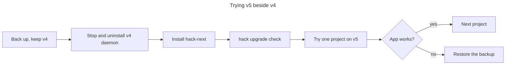

# What's new in Hack 5.0

> **Draft for the 5.0.0 release.** Until 5.0.0 is published, v5 ships as
> `5.0.0-next.N` prereleases through `hack-next`, a separate channel that
> installs beside stable. Stable is still v4. See [Install v5](install.md).
>
> Everything on this page is in `5.0.0-next.24`. The migration wait, overlay
> reuse, the slow-project checks, `hack env overlay` and the `--json` stdout rule
> arrived in next.21; an installed next.20 or earlier does not have them.

Hack 5 keeps the v4 project model. Your `.hack/` folder, your encrypted env
values, branch instances and lifecycle processes carry over. Stable v4 uses
Compose. Native is the planned default for stable v5.

In short:

- **When you upgrade:** deal with the old daemon, install tmux, and check your
  scripts for the changes in section 1.
- **Every day:** `hack env list` hides values; starts wait for migrations;
  `exec` and `run` keep the overlay.
- **New:** an upgrade assistant, single repairs in `hack doctor`, a history of
  starts and stops, and background commands.
- **Optional:** the agent plugin. Native backend selection depends on the launcher and platform.
- **Gone:** hosted accounts, the dashboard, Hack Tickets and zellij.

## 1. What you meet first when you upgrade

| Change | What to do |
| --- | --- |
| **An old `hackd` keeps running after you upgrade the CLI in place.** `hack daemon status` reports it as incompatible. | Run `hack daemon restart`. For a prerelease trial beside v4, stop and uninstall the v4 daemon first instead: see [Upgrade from v4](upgrade.md). |
| **`hack session` needs tmux.** Zellij is removed. | Install tmux. Stop any project that has saved zellij state with the v4 CLI first. |
| **Hack options go before your command.** In `hack exec`, `hack run`, `hack host exec` and `hack env exec`, everything from the command's first word on belongs to that command, including `--json` and `--help`. v4 read Hack flags anywhere, so a tool's own flag after the command could be refused. v5 passes everything after the command to it. | Move Hack options in front of the command in your scripts. |
| **Native `hack up` and `hack restart` return once every container has started, not once every service is ready.** Health checks and routes keep warming after it returns, and `up.after` hooks run at that point, as with Compose `up -d`. `hack exec` and `hack run` wait for ready on their own. | A script or hook that calls a project URL right after `up` should run `hack up --wait` (the old behaviour). `--json` results say `readiness: "warming"` or `"ready"`. |
| **Secrets are refused as command arguments.** | Type the value at the hidden prompt, or pipe it with `--value-stdin`. |
| **Env migration keeps your old files.** v4's `hack doctor --migrate-env-config` deleted them. | Run `hack env migrate --json` to preview, then `hack env migrate --apply`. Start the project and check it. Then run `hack env migrate --cleanup --apply`. Undo with `hack env migrate --rollback-manifest <path>`. |
| **Managed values that contain `$` are delivered as stored.** v4 let Compose expand `$VAR` inside a managed value. | Check values that relied on that, or that escaped `$` as `$$`. The next `hack up` recreates those services. |
| **In a project that still uses `.hack/hack.env.json`, lifecycle hooks receive only `global` values.** | Move the values a hook needs into the `global` scope. |
| **The text columns of `hack env list` changed.** | Parse `hack env list --json`, not the text. |
| **Hack no longer writes agent files.** `hack setup sync`, `hack setup cursor`, `hack setup claude` and `hack setup agents` refuse. `hack agent prime` only prints a retirement notice. | Install the optional plugin if you want agent guidance. |

Follow [Upgrade from v4](upgrade.md). It is a backup-first procedure, and it
says how to go back.

### Native build receipts and downgrades

New native build receipts record verified base image IDs for reclamation. After
a downgrade to a runtime that rejects the new receipt field, build-image
reclamation skips cleanup when it encounters those receipts. Upgrade to the
newer runtime to reclaim the images.

### Native run receipts and downgrades

After this version, older prereleases cannot read run receipts. Run `hack down`
before downgrading.

### Native build contexts

Native builds exclude machine-local `.hack/` state, including generated Compose
env overrides, and the checkout's `.hack.secret.key`. Changes to that state no
longer trigger rebuilds.

## 2. What you will notice every day

**`hack env list` hides every value.** It shows names, scopes and source files.
Read one value with `hack env get <KEY>`. See
[Share environment and secrets](guides/share-environment.md).

**A first start no longer times out during migrations.** `hack up -d` keeps
waiting while a one-shot service such as a migration runs, up to 30 minutes.
Image builds and pulls have their own 30-minute limit. In v4, one 90-second
limit covered all of it. See [First project on Compose](getting-started.md).

**`hack exec` and `hack run` keep the running overlay.** After
`hack up --env qa`, plain `hack exec api -- env` uses `qa`. You no longer repeat
`--env`. See [Choose where a command runs](guides/run-commands.md).

**Ctrl-C on a foreground `hack up` stops cleanly.** Hack asks the project's
processes to stop and waits for them. A second Ctrl-C forces the stop.

## 3. New commands

| Command | What it is for |
| --- | --- |
| `hack upgrade check`, `review`, `apply`, `snapshot`, `rollback` | Check a v4 machine before the upgrade, apply selected file repairs with a snapshot, and restore those files. It does not install a release or back up application data. |
| `hack doctor --fix --only '<check>'` | Run one named repair and verify it: `hack gitignore`, or `polling watchers`. Doctor also reports settings that make a project slow: emulated images, polling file watchers, mixed CPU types on one volume, and `:latest` images that may be old. |
| `hack activity` | Read the history of `up`, `down` and `restart` for a project. |
| `hack exec --detach`, `hack run --detach`, `hack commands` | Run a long command in the background, then read its output, inspect it or cancel it. |
| `hack env migrate` | Preview, apply, resume, roll back and clean up the env file migration. |
| `hack env hydrate` | Import many values at once into your machine-local env file, from standard input or a file, never from arguments. |
| `hack env overlay list`, `hack env overlay add <name>` | List and create env overlays. |
| `hack autostart` | Start chosen Compose projects at login. |
| `hack usage --json --by-service` | CPU and memory for each service of one project. |

`hack dev`, which runs a repository's own side-by-side development build,
shipped in 4.3.0 and is part of v5. The [command reference](reference/cli.md)
has every flag.

## 4. For scripts and agents

- **With `--json`, stdout is one JSON value.** Output from lifecycle hooks and
  from Compose goes to stderr.
- **`hack up`, `down` and `restart` take `--json --progress`** for a line-by-line
  progress stream on Compose.
- **`hack logs --json` adds `--services` and `--max-line-bytes`.**
- **`hack ps --json` adds `emulated`** for a container that runs under CPU
  emulation, **and `waiting`** for services held behind a one-shot.
- **New read-only reports** for apps and monitors: `hack version --json`,
  `hack projects --json --observe`, `hack global status --json --observe` and
  `hack update --check --json --observe`.

See [Scripts and JSON output](guides/machine-output.md) and
[Command and output contracts](reference/command-contracts.md).

## 5. What you can choose to add

**The agent plugin.** v4 wrote instructions into `AGENTS.md` and `CLAUDE.md`
and installed hooks. v5 does none of that. You can install the `hack` plugin
through your agent's own plugin manager. An agent with a shell needs nothing:
most commands have `--json`, and every command takes `--no-interactive`. See
[Agent integrations](integrations.md).

**The native backend (beta).** On an Apple Silicon Mac, prepared projects can
run in a Linux virtual machine without a Docker app. The current `hack-next`
and manual `hack-v5` launchers select native by default on Apple Silicon macOS.
Use `HACK_RUNTIME_BACKEND=compose` for Compose. Supported Linux candidates
are Compose-only. See [Try native](native/start.md) and
[What works and known limits](https://github.com/hack-dance/hack/blob/next/docs/native/limits.md).

## 6. What is gone

| Retired | Use instead |
| --- | --- |
| Hosted accounts, organizations and teams | Nothing. Hack is local-only. |
| The web dashboard | `hack status`, `hack ps`, `hack tui` |
| Hack Tickets | The tracker your project already uses |
| Built-in GitHub and Linear integrations | `git`, `gh` and the tracker's own CLI |
| Zellij workspaces | tmux |
| Automatic agent instruction files | The optional `hack` plugin |

Remote, gateway, node and dispatch commands and the macOS app remain in the
repository. They are unsupported.

## Platforms

The v5 prerelease installs on Apple Silicon macOS and, with the Compose
backend only, on Linux x86_64 and arm64 (`5.0.0-next.24` publishes both Linux
archives). Stable v4 remains the release for Intel Macs. See
[Install v5](install.md).

## More detail

The [per-prerelease notes](https://github.com/hack-dance/hack/blob/next/docs/guides/v5-release-notes.md)
say what changed in each `5.0.0-next.N`, with the exact steps for each change.
The [CHANGELOG](https://github.com/hack-dance/hack/blob/next/CHANGELOG.md) lists
every commit.
