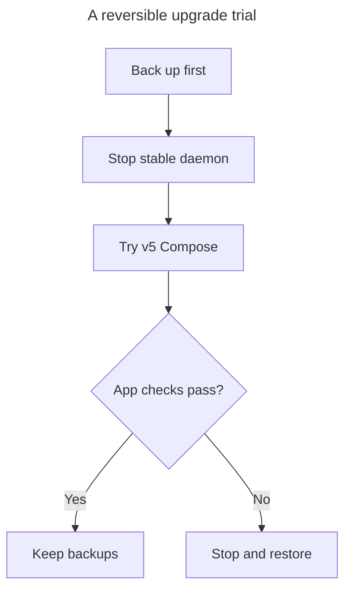

# Upgrade from v4

Start here: [1. Install](install.md) · [2. First project](getting-started.md) ·
**3. Upgrade** · [4. Try native](native/start.md).

This is today's manual path. **To be replaced by the upgrade assistant**
(HACK-2189 and HACK-2191). Next.17 source already checks and repairs selected
files; env migration and the runtime trial remain manual. Keep stable v4
installed and try one Compose project at a time. Native is a separate trial.
The published v5 candidate bundle requires an Apple Silicon Mac.



## Upgrade one project

On current source builds, start with `hack upgrade check`, then
`hack upgrade apply --dry-run`. Apply can snapshot and repair ignore rules,
verified stale agent files and permission-only key findings. Use
`hack upgrade review` to walk the remaining env and tracked-file decisions in
one command. See the [assistant and recovery details](guides/upgrade-from-v4.md).
These file repairs do not replace the runtime trial below.
JSON findings and plan steps label their supplied action `safe`, `admin` or
`manual`; severity stays separate. Only explicitly safe commands should be
offered as Run. Host changes and decisions still need review.

1. **Back up before running v5 on the project.** Keep a private copy outside the
   checkout of `.hack/`, the root `.gitignore` and `.hack.secret.key`, and the
   global Hack configuration and project registry. Record files that were absent.
   Back up application data with the database's own tools; copying `.hack/` does
   not back up volumes. Use the [complete backup steps](guides/upgrade-from-v4.md#2-before-you-start)
   and confirm you can read the original key. If stable routing needs starting,
   run stable `command hack global up` before the backup procedure stops its daemon
   and copies the files.
2. **Stop saved zellij lifecycle sessions before switching to v5.** Keep zellij
   installed and use retained v4 `command hack down` for each affected project.
   Confirm the lifecycle processes stopped, then take a **fresh backup** with the
   step 1 procedure. Keep the earlier copy too; use the stopped-state backup for
   rollback so it does not restore live zellij state. Next.17 requires tmux; remove
   `sessions.mux=zellij` and `HACK_SESSIONS_MUX=zellij`, or select `tmux`.
   Changing the setting alone does not clear saved state. See the
   [stop procedure](guides/upgrade-from-v4.md#breaking-change-zellij-workspaces-removed).
3. **Confirm stable's daemon stays stopped.** In a terminal where
   `hack` is the stable executable, run:

   ```sh
   command hack daemon stop
   command hack daemon uninstall
   pgrep -fl "hack daemon start"
   ```

   The last command must print nothing before you continue. On macOS uninstall
   removes the launchd service so it cannot restart the daemon during the trial.
   Run no stable commands while the candidate uses the shared home.
4. **Install v5 beside stable**, following [Install](install.md). Use a fresh
   terminal for the trial, select Compose, and check the chosen version:

   ```sh
   export HACK_RUNTIME_BACKEND=compose
   hack() { "$HOME/.hack-next/bin/hack-next" "$@"; }
   hack --version
   cd your-project
   hack doctor
   ```

5. **Review env migration before accepting it.** `up` can offer migration;
   sessions and some env commands can migrate without a prompt. Keep backups
   before any of them. If explicit migration is needed, use
   `hack doctor --migrate-env-config` only after reading the
   [migration and consent details](guides/upgrade-from-v4.md#4-what-changes-for-a-project).
   On next.16 or earlier, cleanup can remove a project key a legacy store names:
   never run that repair without the private readable key copy. The merged fix
   intended for next.17 cannot recover an already deleted key.
6. **Run the project and check it**, using `hack up --detach`, `hack open`,
   `hack logs --no-follow --tail 50` and `hack down`. Check sign-in, saved data,
   hooks and a restart. Keep the backup until rollback and data recovery have
   been checked. See [known problems](guides/upgrade-from-v4.md#known-problems-and-the-dogfood-record).

v5 keeps Compose as the default for the ordinary CLI. Retired features include the hosted
account/team flows, dashboard and Hack Tickets; the
[release summary](../guides/v5-release-notes.md) covers retired features and
breaking command changes. Newer source changes are marked as intended for
next.17; an installed next.16 bundle keeps its original behavior.

## Roll back

Stop the candidate with `hack down` in its Compose terminal. Restore the project
and machine files, including the **original** project key, from the backup;
follow the [full restore procedure](guides/upgrade-from-v4.md#7-return-to-v4).
Restore project state after any migration. Selecting an older binary alone does
not undo migrated files, volumes or database schema changes.

In a stable terminal, reinstall its login daemon with `command hack daemon install`
if you removed it. Then use stable `command hack up --detach` and check the app
and data again. A native trial's data never moves into Compose volumes by itself.

If Doctor blocks the trial, use [Troubleshooting](troubleshooting.md).
If an env layer is refused, check and `upgrade review --only env-format` name
its file with code `env-layer-refused`. Replace the link with a real readable
file inside this checkout or remove the layer, then rerun the check.
The detailed [machine upgrade checklist](guides/upgrade-from-v4.md) keeps the
backup scripts, source evidence and checks still awaiting real-machine trials.

## The daemon after an upgrade

Installing a CLI does not replace a running daemon. After choosing a durable v5
install, use `hack daemon restart` for an unmanaged incompatible daemon. If a
login service still points at the old executable, use the chosen install's
`hack daemon install`. Keep this outside the shared-home candidate trial;
[daemon and service details](guides/upgrade-from-v4.md#daemon-old-lock-and-missing-checkouts)
explain the difference.
