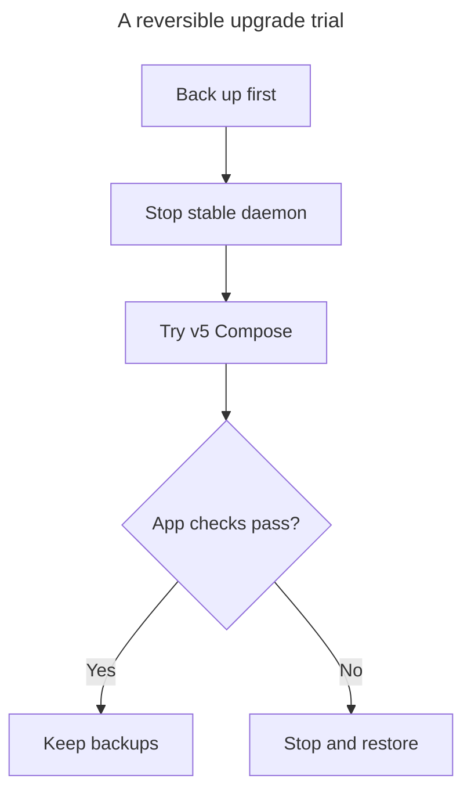
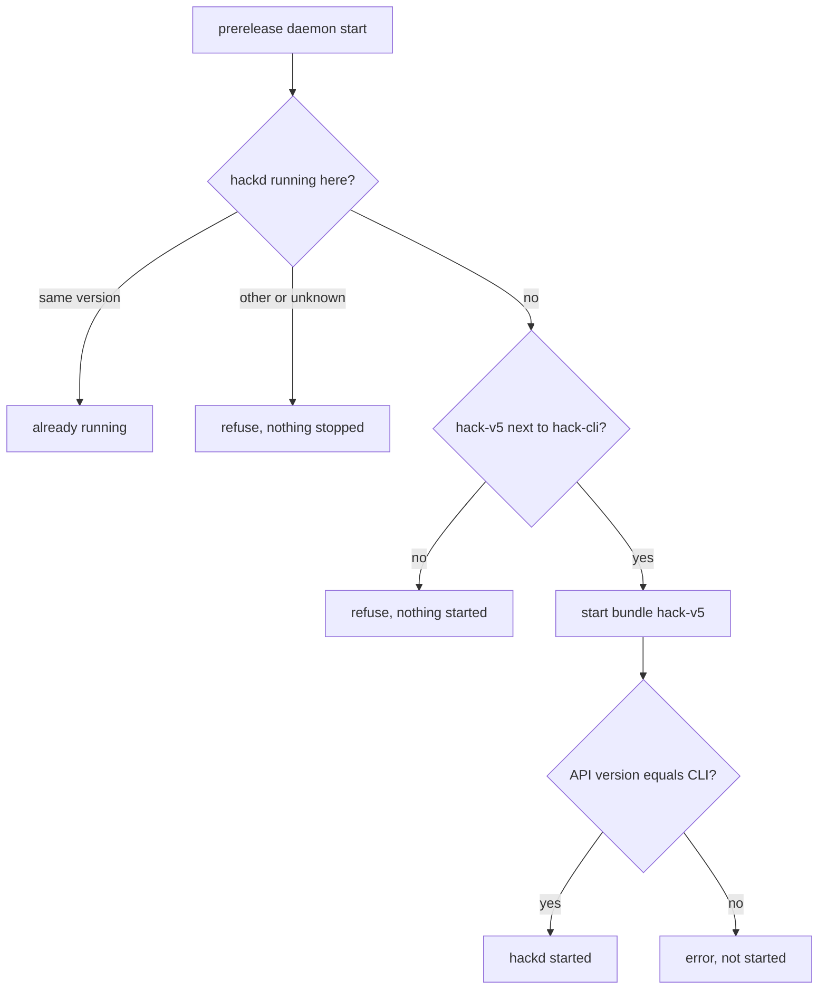

# Upgrade from v4

Start here: [1. Install](install.md) · [2. First project](getting-started.md) ·
**3. Upgrade** · [4. Try native](native/start.md).

This is a backup-first, manual path. The upgrade assistant (`hack upgrade check`,
`review`, `apply`, `snapshot`, `rollback`; since next.17) checks the machine and
repairs selected files. Env migration and the runtime trial remain manual. Keep stable v4
installed and try one Compose project at a time. Native is a separate trial.
The published v5 prerelease runs on Apple Silicon macOS and, on the Compose
backend only, on Linux x86_64 and arm64; see [Install](install.md#prerequisites).

In builds with `hack upgrade check`, its native finding covers configuration
only; runtime setup and admission are not checked. For a native trial, follow
[runtime setup and full preflight](native/start.md#prepare-the-runtime).



## Upgrade one project

On current source builds, start with `hack upgrade check`, then
`hack upgrade apply --dry-run`. Apply can snapshot and repair ignore rules,
verified stale agent files and permission-only key findings. Use
`hack upgrade review` to walk the remaining env and tracked-file decisions in
one command. See the [assistant and recovery details](guides/upgrade-from-v4.md).
These file repairs do not replace the runtime trial below.
JSON findings and plan steps label their supplied action `safe`, `admin` or
`manual`; severity stays separate. Only explicitly safe commands should be
offered as Run. Host changes and decisions still need review.

If a direct daemon replacement refuses its PATH, the existing daemon stays
running. Review the flagged directory, then retry the replacement.

1. **Back up before running v5 on the project.** Keep a private copy outside the
   checkout of `.hack/`, the root `.gitignore` and `.hack.secret.key`, and the
   global Hack configuration and project registry. Record files that were absent.
   Back up application data with the database's own tools; copying `.hack/` does
   not back up volumes. Use the [complete backup steps](guides/upgrade-from-v4.md#2-before-you-start)
   and confirm you can read the original key. If stable routing needs starting,
   run stable `command hack global up` before the backup procedure stops its daemon
   and copies the files.
2. **Stop saved zellij lifecycle sessions before switching to v5.** Keep zellij
   installed and use retained v4 `command hack down` for each affected project.
   Confirm the lifecycle processes stopped, then take a **fresh backup** with the
   step 1 procedure. Keep the earlier copy too; use the stopped-state backup for
   rollback so it does not restore live zellij state. v5 requires tmux (since next.17); remove
   `sessions.mux=zellij` and `HACK_SESSIONS_MUX=zellij`, or select `tmux`.
   Changing the setting alone does not clear saved state. See the
   [stop procedure](guides/upgrade-from-v4.md#breaking-change-zellij-workspaces-removed).
3. **Confirm stable's daemon stays stopped.** In a terminal where
   `hack` is the stable executable, run:

   ```sh
   command hack daemon stop
   command hack daemon uninstall
   pgrep -fl "hack daemon start"
   ```

   The last command must print nothing before you continue. On macOS uninstall
   removes the launchd service so it cannot restart the daemon during the trial.
   Run no stable commands while the prerelease uses the shared home.
4. **Install v5 beside stable**, following [Install](install.md). Use a fresh
   terminal for the trial, select Compose, and check the chosen version:

   ```sh
   export HACK_RUNTIME_BACKEND=compose
   hack() { "$HOME/.hack-next/bin/hack-next" "$@"; }
   hack --version
   cd your-project
   hack doctor
   ```

5. **Review env migration before accepting it.** `up` can offer migration;
   sessions and some env commands can migrate without a prompt. Keep backups
   before any of them. If explicit migration is needed, use
   `hack env migrate --json` to preview, then `hack env migrate --apply` after reading the
   [migration and consent details](guides/upgrade-from-v4.md#4-what-changes-for-a-project).
   On next.16 or earlier, cleanup can remove a project key a legacy store names:
   never run that repair there without the private readable key copy. The fix in
   next.17 cannot recover an already deleted key.
6. **Run the project and check it**, using `hack up --detach`, `hack open`,
   `hack logs --no-follow --tail 50` and `hack down`. Check sign-in, saved data,
   hooks and a restart. Keep the backup until rollback and data recovery have
   been checked. See [known problems](guides/upgrade-from-v4.md#known-problems-and-the-dogfood-record).

Stable `hack` uses Compose. Native is the planned default for stable v5. The current
`hack-next` defaults to native on Apple Silicon macOS and uses Compose on supported
Linux. Retired features include the hosted
account/team flows, dashboard and Hack Tickets; [Breaking changes from v4](guides/breaking-changes.md) lists every breaking
change in one table, with the reason for each. The
[release summary](../guides/v5-release-notes.md) has the detail. An older installed prerelease keeps its original behavior;
the detail pages say which prerelease each change needs.

## Roll back

Stop the prerelease with `hack down` in its Compose terminal. Restore the project
and machine files, including the **original** project key, from the backup;
follow the [full restore procedure](guides/upgrade-from-v4.md#7-return-to-v4).
Restore project state after any migration. Selecting an older binary alone does
not undo migrated files, volumes or database schema changes.

In a stable terminal, reinstall its login daemon with `command hack daemon install`
if you removed it. Then use stable `command hack up --detach` and check the app
and data again. A native trial's data never moves into Compose volumes by itself.

### In the desktop app (unsupported preview)

The desktop app's **Upgrade** pane (sidebar, Machine) shows `hack upgrade
check` (the verdict, blockers and plan), saves a snapshot, explains review
findings and restores a snapshot the CLI lists. It never runs `hack upgrade
apply` or installs a version: copy those commands to a terminal. A restore
never overwrites: a file changed since the snapshot (or since the apply step
that recorded it) stays as it is, and whatever a restore replaces is kept in
the snapshot. Restoring is how you undo `hack upgrade apply`; it does not
undo migrated files, volumes or a different binary.

If Doctor blocks the trial, use [Troubleshooting](troubleshooting.md).
If an env layer is refused, check and `upgrade review --only env-format` name
its file with code `env-layer-refused`. Replace the link with a real readable
file inside this checkout or remove the layer, then rerun the check.
The detailed [machine upgrade checklist](guides/upgrade-from-v4.md) keeps the
backup scripts, source evidence and checks still awaiting real-machine trials.

## The daemon after an upgrade

Installing a CLI does not replace a running daemon. After choosing a durable v5
install, run its `hack daemon start` (or `hack daemon restart`). When the login
service runs that same executable, start restarts hackd on the new version and
rewrites a stale unit that Hack wrote (it carries Hack's managed header) or a
stale launchd plist with Hack's label, including one an earlier Hack wrote.
`hack update` does this by itself when a service is installed and
hackd is running. A hand-written unit, a unit that sets its own Hack home, or a
service that points at another existing executable is reported instead: use the
chosen install's `hack daemon install`. Add `--json` for one machine-readable result. Keep this
outside the shared-home prerelease trial;
[daemon and service details](guides/upgrade-from-v4.md#daemon-old-lock-and-missing-checkouts)
explain the difference.

## A candidate's own daemon

A prerelease run (`hack-next` or the bundle's `hack-v5`) starts and stops only its
own hackd. `daemon start` and `daemon restart` start the running bundle through its
own `hack-v5` launcher, never a `hack` found on PATH, and never through the login
service, which runs stable `hack`. `daemon start`, `restart` and `stop` change
nothing and print one sentence when hackd for this Hack home is not positively
this prerelease's: it reports another version, its API does not answer, or a hackd
process holds the home without its pid file. `start` and `restart` also refuse
before anything is stopped when they cannot prove which hackd they would start,
for example a source run with the candidate marker set by hand. `daemon install`
and `daemon uninstall` refuse in a prerelease run.



Any direct start, prerelease or stable, reports "hackd started" only when the new
hackd's API answers with this CLI's version. The CLI and hackd read the version from
one place, so a prerelease's hackd reports the release version (for example
`5.0.0-next.18`), the same string as `hack version --json`. `daemon status --json`
prints both as `version` (hackd's API) and `cli_version`.
