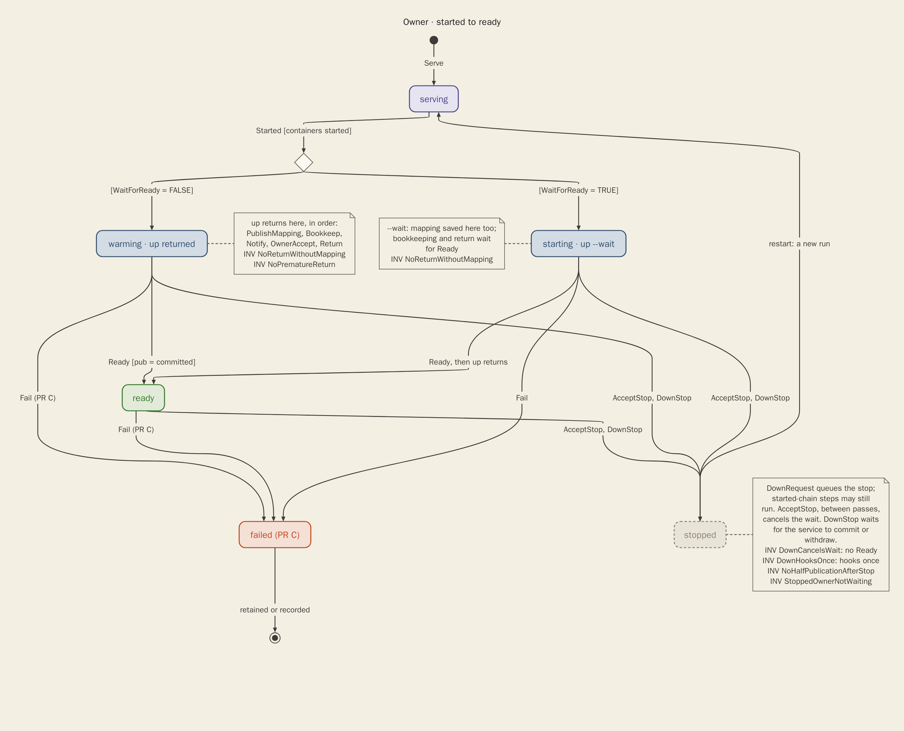

# Native startup owner coverage

`Owner.tla` models one native `hack up` (foreground or detached) from the graph
owner's first frame to its return, a failure, or a `down`. The graph reaches
`started` (every container started, by Compose's rule) before `ready` (every
service goal met). The CLI passes `--report-started` in both modes, so the run
mapping is saved at `started` with or without `--wait`. Without `--wait`, `up`
returns at `started`. The run then shows as `warming`, and the owner keeps
waiting for `ready` in the background. With `--wait` (`WaitForReady = TRUE`), the
bookkeeping and the return happen at `ready`, as they did before this change. A
`--wait` start killed between started and ready therefore has a mapping: finding
B is closed for both modes.

The model also covers a `down` in the window between started and ready, and one
service's publication under the lease as a two-step commit (stage, then one
atomic commit or withdraw). A `down` only queues a stop (`DownRequest`); the
owner accepts it at its next cancellation check (`AcceptStop`), which cancels its
wait, and the frontend's started-chain steps (`PublishMapping`, `Bookkeep`,
`Notify`) may run between the two. The stop takes effect (`DownStop`) only after
the owner accepted it, and only once the publication has committed or been
withdrawn. The model keeps the failed-startup ownership rules
from HACK-1917 and the detached handshake from HACK-1940.

## State chart

[SVG](state.svg) · [Mermaid source](state.mmd). The chart is rendered with Pele
1.9.0 and the house theme. `warming` and `starting` are the same model phase
(`phase = "started"`): `warming` is the default path, after `up` has returned, and
`starting` is the `--wait` path, before `up` returns. `down` reaches both,
because the mapping exists in both. The publication sub-steps are not drawn as
states: `Ready` needs `pub = committed`, and the note on `stopped` gives the
stop's publication guard. `failed` after started
belongs to PR C. A restart is a `down` (`DownRequest`, `AcceptStop`, `DownStop`; the
chart's edges omit the queuing step) followed by a
new run; the model ends at `stopped`.

## Bounds and result

The model has one launcher, one owner, at most one `down` request and one
service publication. Each phase is a single abstract value, not one per service. TLC 1.7.4 runs with two workers,
and deadlock checking is off, because terminal phases are intended to stop.

| Configuration | Constants changed from `positive` | Expected result |
| --- | --- | --- |
| `positive` | none (`WaitForReady = FALSE`) | no error, **852 distinct states** |
| `wait` | `WaitForReady = TRUE` | no error, **410 distinct states** |
| `negative` | `RecordFailedOwner = FALSE` | `NoUnownedResources` at `ExitUnconfirmed`: an authenticated failed start exits with resources present and no mapping |
| `refused-inspection` | none; also checks `NoUnrecordedRefusal` | `NoUnrecordedRefusal` at `ExitUnconfirmed`: `receipt = "refused"`, resources present, no mapping (a known gap, kept explicit) |
| `detached-before-bookkeeping` | `EnforceBookkeeping = FALSE` | `NoPrematureReturn` at `Return`: returned at started with the mapping saved and `bookkept = FALSE` |
| `detached-before-started` | `EnforceDetachedStarted`, `EnforceBookkeeping`, `MappingBeforeNotify` all `FALSE` | `NoPrematureReturn` at `Return`: returned with `startedSeen = FALSE` |
| `detached-before-ready-wait` | as above, with `WaitForReady = TRUE` | `NoPrematureReturn` at `Return`: under `--wait`, returned with `readied = FALSE` |
| `mapping-after-line` | `MappingBeforeNotify = FALSE` | `NoReturnWithoutMapping` at `Notify`: the launcher is notified at started with `bookkept = TRUE` and `mapping = "none"` (finding B) |
| `mapping-after-line-wait` | `MappingBeforeNotify = FALSE`, `WaitForReady = TRUE` | `NoReturnWithoutMapping` at `Notify`: under `--wait`, notified at ready (`readied = TRUE`) with `mapping = "none"` |
| `stop-mid-publication` | `StopWaitsForPublication = FALSE` | `NoHalfPublicationAfterStop` at `DownStop`: `phase = "stopped"`, `pub = "publishing"`, `route = "bound"`, `recorded = FALSE` (a staged route the stop never withdraws) |
| `down-leaves-owner-waiting` | `CancelWaitOnDown = FALSE` | `DownCancelsWait` at `AcceptStop`: `down = "accepted"`, `acceptAt = "started"` and `wait = "waiting"` |
| `stop-without-accept` | `StopNeedsAccept = FALSE` | `StoppedOwnerNotWaiting` at `DownStop`: `phase = "stopped"`, `down = "done"`, `acceptAt = "none"`, `wait = "waiting"` (a queued stop took effect without the owner's check, so the owner was never told) |

`detached-before-started` turns off three guards at once on purpose. The return
gate is layered: the mapping and bookkeeping guards each imply `started`, because
`PublishMapping` and `Bookkeep` are enabled only from `started`. Turning off only
`EnforceDetachedStarted` therefore violates nothing. Removing every release gate
shows that the remaining invariant still catches a return before `started`. Each
of the other controls turns off exactly one guard.

`scripts/lib/tla-runtime-models.ts` pins these counts, the violated invariants,
the final action and the fields of the violating state. The original controls
were run five times; after the publication change and again after the stop split,
every control was run at least twice more, with two workers. The pinned fields matched every time.

## Invariants

- `NoPrematureReturn`: `up` returns only after `started` (`ready` under `--wait`), with the run mapping saved, the down-hook debt committed and the owner's acceptance.
- `NoReturnWithoutMapping`: the launcher is never released (`notified` or later) before the run mapping is saved. A start killed after its closing line can still be found by `down` and `down --recover`.
- `NoLostHandoff`: a launcher lost before acceptance is never handed off later.
- `DownCancelsWait`: once the owner accepted a stop in the started window (`AcceptStop`), it is not waiting, and `Ready` never happens. A `Ready` between `DownRequest` and `AcceptStop` is allowed: the owner has not seen the stop yet. This is a safety invariant, not a liveness property. The repository runner checks invariants only, with no fairness. Acceptance and the cancel are one step (the owner's check aborts its controller), so the property can fail only there. That the owner eventually reaches its check is the stop delay below, not a model property.
- `StoppedOwnerNotWaiting`: a stopped run has no owner still waiting for ready. Every stop goes through the owner's acceptance.
- `DownHooksOnce`: `down.before` runs exactly once for committed debt, and never without it. Under `--wait` the debt is committed at ready, so a `down` in the window runs no `down.before`.
- `NoHalfPublicationAfterStop`: after a stop, no service is published but unrecorded, and none is recorded but unpublished (`route = "bound"` exactly when `recorded`).
- `NoUnownedResources`: resources that outlive the frontend under an authenticated receipt have a published mapping.
- `NoUnprovenOwner`: only the started inspection or an authenticated receipt publishes a mapping.
- `NoFalseCleanup`: a confirmed cleanup never leaves resources behind.
- `NoUnrecordedRefusal`: a coverage-gap control only. It is expected to fail.

## Source mapping

Part of this mapping is being implemented in PR B. The function names follow the
PR B plan.

| Model action | Source boundary |
| --- | --- |
| `Serve`, `StartResources` | `serveNativeProjectGraph` in `src/backends/native-project-start.ts`; admission and graph creation |
| `Started` | the first `graph_foreground_started` frame (`graph serve --report-started`), then `onStarted` step 1: `authoritative(inspect)` checks run, namespace, plan and owner. The owner's wait for `graph_foreground_ready` begins here |
| `PublishMapping` | `onStarted` step 2: `deps.save` of the run mapping, before the HTTPS lease, in both modes |
| (not separate actions) | `onStarted` steps 3 to 7: the HTTPS lease, finalization and `admission.retire`, `onEnvironmentReady`, `up.after`, `watchServiceExits` |
| `Bookkeep` | `onStarted` step 8: `stop.owe`, with its cancellation fence |
| `Notify`, `Accept`, `OwnerAccept`, `Return` | `onStarted` step 9: the detached release in `src/lib/native-detached-up.ts` (a `started` message to the launcher, then acceptance), and step 10, the closing line. Foreground `up` returns its prompt at the same point |
| `LauncherLoss` | the launcher's channel closing before acceptance (`native-detached-up.ts`) |
| `BeginPublish`, `CommitPublish`, `WithdrawPublish` | per-service publication under the lease (#1090): the service's port and HTTPS route are staged, then committed with the owner's record in one step, or withdrawn |
| `Ready` | `onReady`: only `verifyHttpsRoutes` and the foreground per-service ready lines. Under `--wait`, bookkeeping and the release run here instead |
| `Fail` | a failure after started (PR C) or before it; `recordFailedStartupOwner` |
| `OwnerCleanup`, `Inspect`, `Confirm`, `ExitConfirmed`, `ExitUnconfirmed` | the failed-startup path in `native-project-start.ts` (HACK-1917) |
| `DownRequest` | `nativeProjectDown` in `src/backends/native-project-down.ts` finds the run through its mapping, and `requestOwnedStop` sends the stop through the owner. The stop is queued on the owner's socket; the frontend's started chain may still be running |
| `AcceptStop` | the owner's start loop (`packages/runtime-core/src/project/execution.rs`) and the foreground owner (`packages/runtime-core/src/provider/graph/foreground.rs`) accept the stop at the next cancellation check, between passes, which ends the wait for ready (`DownCancelsWait`). This table names the files only |
| `DownStop` | the owner's stop, after acceptance and never inside a publication commit; it withdraws every recorded publication, and `down.before` runs from the committed `stop.owe` debt. `stop.owe`'s cancellation fence refuses new debt once the owner's controller is aborted, so `Bookkeep` is not enabled after `AcceptStop` |

**Stop delay.** The model separates the queued request from the owner's
acceptance but does not measure the gap. In code, the owner answers a stop or
status request wherever its start loop checks cancellation: between engine
operations, between final verification's listener-exit polls (25 ms), and between
deferred-publication settlement rounds (100 ms). A request waits for at most one
in-flight step: one engine request (the engine transport's 40 s timeout, after a
3 s connect), or one service's publication (inside its `ServiceReady` record, or
one settlement round), each bounded by the start's own deadline. A stop never
interrupts a publication: it takes effect after that publication commits or is
withdrawn, and the run then stops with data retained.

**Publication boundary at the code level.** The Rust unit tests do not cover the
real publication boundary: `execution.rs` sets "published" itself in its test,
and `foreground/tests.rs` supplies its own cleanup reply. Only the VM scenario
exercises a stop against a real publication.

Regressions: `tests/native-project-start.test.ts` (journal delay, failure and
cancellation before the release; failed-owner recording) and
`tests/native-detached-up.test.ts` (post-launcher control, pre-acceptance loss,
timeout, child failure). PR B adds the started-point regressions next to them.

## Not covered

- Crashes inside `onStarted` between its steps, and crashes between finalization registration and mapping publication.
- A `down` before the mapping exists. That goes through `awaitPendingStartup` (HACK-2351), outside this model; `DownRequest` requires a published mapping.
- More than one `down`, a restart as its own action, concurrent starts, and the later dead-owner recovery.
- Liveness of the owner's wait: no fairness is assumed.
- More than one service, per-service warming and route states, and the lease's own phases (#1090's `per-service-publication` model). Only one publication is modeled, and it is not republished after a withdraw.
- The time between a queued stop and the owner's acceptance (bounded only in code; see the stop delay above).
- A failure while a stop is queued: `Fail` requires no `down`.
- IPC delivery, OS scheduling, real hooks, the VM, and filesystem durability.
