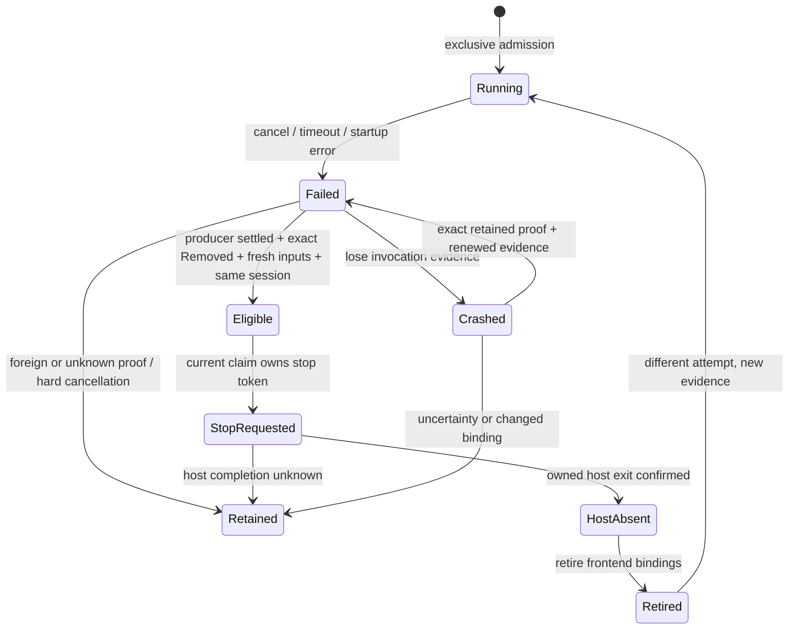

# Pre-Ready host retirement

This model specifies the required recovery boundary after a graph fails before
Ready. It is a contract model, not an implementation-refinement proof. Protected
`next` f73fbd56 does not contain the unpublished PR499 local follow-up 5c4ae64c;
positive model results must not be represented as qualification of that branch.

## Bounds and atomic boundaries

Two logical attempts may each acquire once. The exclusive claim is an abstract
atomic admission operation; real filesystem/process exclusion is covered separately
by graph-admission, registry-writer and frontend-recovery models and runtime tests.
Source identity has original/replacement generations. Receipt outcomes are live,
removed or foreign. Reader completion is pending, EOF or canceled. A canceled
reader is never producer exit: MarkProducerSettled also requires a known exited
producer and absent original group. Session identity may become foreign.

Acquisition, startup refusal, process exit, reader completion, absence observation,
settlement, receipt publication/inspection, input refresh, stop request, host exit
confirmation and binding retirement are separate actions. Source/session/receipt
replacement and hard cancellation may interleave. One crash loses observed proof
and refresh authority; recovery requires exact durable removal, original-group
absence and matching source/session, then reacquires invocation-local evidence.
This abstract Recover does not establish filesystem lease recovery or boot identity. RequestHostStop atomically joins
its permission checks with issuing the request, and Retire atomically retires the
modeled bindings. The model does not explore TOCTOU inside the implementation's
awaited checks/stop operations or crashes between individual binding removals.
Those windows require finer models and executable interruption tests; they remain
release-coverage gaps rather than properties closed by this model.

The positive instance exhausts 10,965 states. Six independent guard-removal controls
must violate Safe at RequestHostStop or Retire with the named unsafe flag in that
same state. The registry rejects parse failures, unrelated counterexamples, wrong
state counts and incomplete positive exploration.

## Source and executable regression mapping

| Model boundary | Implementation / executable evidence |
| --- | --- |
| Acquire / stale claimant refusal | Native authored admission and hook-owner claim; existing graph-admission/registry-writer tests and stale-claim control. A scalar exclusive claim is an assumption here, not a proof of the lock implementation. |
| MarkProducerSettled | `native-project-process.ts` finalizer, onSettled, original group absence; `native-authored-project-start.ts` pre-Ready processSettled guard in local5c4ae64c. One-shot EPERM control retains despite a later real ESRCH. Removing the settlement guard changes expected retained to removed. |
| Inspect / RefreshHardInputs | Exact expected-review Removed receipt and all-resource/null-observation checks; unchanged host selection reacquired under hard signal. Foreign/live/hard-canceled cases retain. Removing refresh changes expected removed to retained. |
| RequestHostStop | Existing exact host-session token/identity checks; all applicable preconditions remain necessary. Source changes or an unknown/foreign session never grant new authority. |
| ConfirmHostExit / Retire | Await host stop/close before retiring hook/start/source bindings. Unknown host completion cannot establish removal. The unconfirmed-host-exit model control checks this gap; an equivalent injected executable host-close control remains a required coverage follow-up. |
| Crash / Recover | Retain uncertain intent, never reconstruct authority from a missing path/PID. Full durable recovery is delegated to native-frontend-recovery and real crash/ownership tests; this model omits filesystems, PIDs, boot epochs and resource observations. |

Executable regression cases are in `tests/native-authored-project-start.test.ts` on
local 5c4ae64c/537f0c26, currently unpublished. Link those exact revisions and their
receipts during integration; do not imply the tests are already on protected next.

## Conditional liveness

The liveness instance exhausts 395 states. It disables crashes/interference and
assumes weak fairness for producer exit, reader completion, group observation,
trusted runtime removal, inspection, refresh, stop, host-exit confirmation and
retirement. Under those assumptions a failed invocation eventually retires.
Neither eventual external cleanup nor scheduler fairness is established by the
implementation. With foreign state, hard cancellation or crash, retention is a
permitted safe terminal outcome. No unconditional recovery claim is made.

## Statechart review aid

The diagram compresses orthogonal producer, receipt, host and invocation states.
Those regions are independent variables in the executable TLA+ model; the Eligible
join is guarded by all of them. A UI history state cannot recreate a capability.
Upgrade/rollback binary selection and project-data compatibility are outside this
model and remain explicit release gates in the global coverage map.
